<!-- _class: lead -->
<!-- _paginate: false -->

<style scoped>
section {
  background-image: url('assets/logo.png');
  background-repeat: no-repeat;
  background-position: bottom 40px center;
  background-size: 380px;
}
</style>

# La ressource, MongoDB et le CRUD

**R5.Real.10 · Nouveaux paradigmes de base de données**

Séance 1 · BUT Informatique 3e année · 2026-2027

<!--
(30 s)

Point cours de 30 minutes, en trois temps :
- ouverture, 23 min, avant le TP : la ressource (8 min), puis MongoDB jusqu'à « À vous » (15 min) ;
- reprise avant la partie 3, 5 min : modifier et upsert ;
- reprise avant la partie 4, 2 min : supprimer.

Avant de commencer : demander qui n'a pas reçu ou pas accepté l'invitation à l'organisation IUTInfoAix-R510-2026. Sans elle, impossible d'accepter le TP1.
-->

---

## Le but de la ressource

> Choisir le modèle de données adapté aux requêtes, puis l'intégrer dans une application.

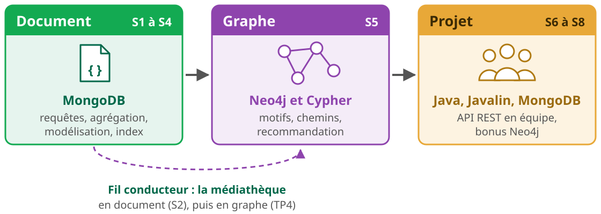

<!--
(1 min)

L'objectif du programme national : appréhender les paradigmes non relationnels. En pratique, on en étudie deux en profondeur, le document et le graphe. Les autres familles (clé-valeur, colonnes, vectoriel, multi-modèle) sont présentées aujourd'hui, pas pratiquées.

La question qui revient tout le module : quelles requêtes l'application va-t-elle faire, et quel modèle y répond le mieux ?

Prérequis : SQL (R1.05, R2.06, R3.07, R4.03), Java, Git.
-->

---

## Huit séances de 4 h, en quatre semaines


<p class="note" style="margin-top: 0.6rem;">Chaque séance commence par un point cours. Jours et horaires : consultez ADE, ils changent d'une semaine et d'un groupe à l'autre. Dernière séance au plus tard le jeudi 17/12.</p>

<!--
(1 min)

32 h à l'emploi du temps : 5 séances de TP, 3 de projet. Les deux groupes (GA1, GA2) suivent exactement les mêmes TP et le même projet.

Les dates limites de rendu sont dans l'énoncé de chaque TP. Pour le TP1 : dimanche 6 décembre à 23 h 59.
-->

---

## Contrôle continu : les TP comptent pour 40 %

<div class="g2" style="margin-top: 0.6rem; align-items: center;">
<div>

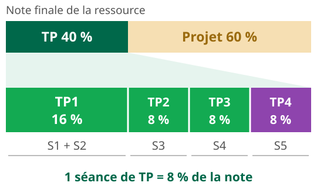

</div>
<div class="carte vert" style="font-size: 0.82em;">

- À chaque rendu, le **correcteur automatique** exécute vos requêtes sur une base de test.
- Le score s'affiche dans la Release du rendu et dans Classroom 50 : vous voyez quels exercices passent.
- La note retenue vient du dernier rendu dans les délais.
- Une partie des rendus est vérifiée à la main.

</div>
</div>

<div class="alerte" style="margin-top: 1rem; font-size: 0.78em;">
<b>Fraude</b> : modifier le correcteur automatique ou les fichiers <code>.github/</code>, supprimer une Release, recopier les résultats attendus au lieu de les calculer. Sanction possible, jusqu'à l'exclusion, conformément aux M3C.
</div>

<!--
(1 min 30)

Pour le TP1, la note définitive est recalculée après la clôture sur un second jeu de données, secret, aux valeurs différentes. On garde le plus petit des deux scores. Une requête qui calcule son résultat obtient les mêmes points sur les deux jeux ; une réponse recopiée ou qui vise des identifiants perd ses points.

La vérification à la main porte sur les réponses écrites en dur et la recopie.
-->

---

## Le projet compte pour 60 %

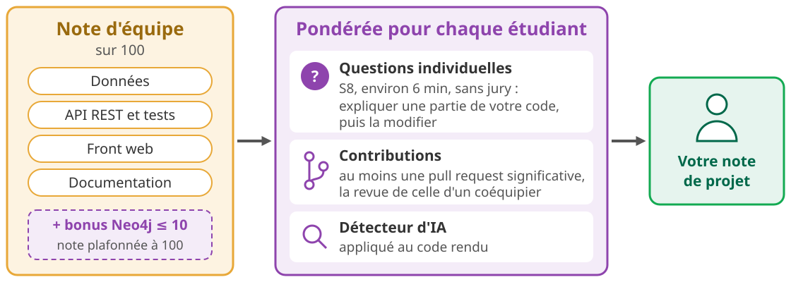

<p class="note" style="margin-top: 0.6rem;">Barème détaillé au lancement du projet, en S6.</p>


<!--
(1 min)

Barème indicatif du syllabus, à ne pas détailler aujourd'hui : données 50, API et tests 25, front 10, documentation 15, bonus graphe jusqu'à +10.

Pile imposée : Java 25, Javalin, pilote Java MongoDB, front web léger. Un squelette fonctionnel est fourni : on le fait évoluer. Équipes constituées à l'intérieur de chaque groupe, avant S6.

Le détecteur d'IA : si une équipe ne montre pas qu'elle comprend son code pendant les questions individuelles, sa note est coefficientée par le taux de contribution que le détecteur lui attribue. L'historique Git est lu de manière qualitative : on ne compte pas les commits.
-->

---

## Environnement et rendu

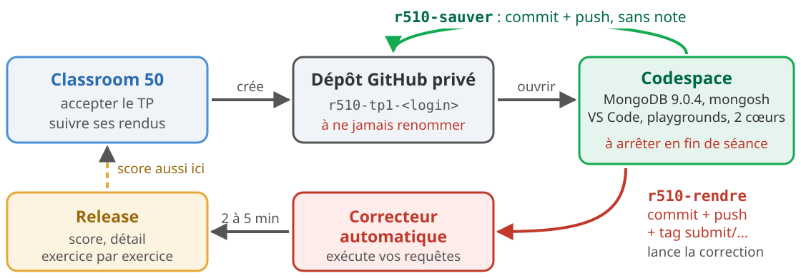

<p style="font-size: 0.72em; text-align: center; margin: 0.3rem 0 0;"><b>TP1</b> : trois rendus au plus, en fin de S1, en fin de S2, puis le rendu final, au plus tard le <b>dimanche 6/12, 23 h 59</b>.</p>

<div class="bandeau" style="margin-top: 0.5rem; padding: 0.5rem 1.2rem;">
Énoncé du TP1 : <a href="https://iutinfoaix-r510.github.io/tp1/">iutinfoaix-r510.github.io/tp1</a>
</div>

<p class="note" style="margin-top: 0.4rem;">Contacts, absences, aménagements : voir le syllabus. Questions sur le module : issues du dépôt <code>syllabus</code>.</p>

<!--
(1 min 30)

Pas d'Atlas, pas de Compass, pas de compte MongoDB à créer. Les présentations officielles de MongoDB, en anglais, supposent Atlas : on n'en a pas besoin.

L'énoncé en ligne donne le lien d'acceptation et les commandes de rendu, à copier telles quelles. Le TP s'ouvre le lundi 23 novembre à 8 h ; avant, la page affiche « This assignment is locked ».

Ne jamais renommer son dépôt : Classroom 50 ne le retrouverait plus. Reprendre le même codespace d'une séance à l'autre (Code, Codespaces, le codespace existant), ne pas en recréer un.

En une phrase pour le syllabus : justificatif d'absence sous 48 h, défaillance au-delà de 20 % d'absence, aménagements à demander au responsable en début de module. Une question d'ordre privé passe par un courriel à l'enseignant du groupe (Sébastien Nedjar pour GA1, Leïla Sakli Miled pour GA2).
-->

---

## L'IA comme tuteur

<div class="g2" style="margin-top: 0.4rem; font-size: 0.82em;">
<div>

- Autorisée pour **comprendre** : une notion, un message d'erreur, deux approches à comparer.
- Elle n'écrit pas la requête d'un exercice à votre place.
- À utiliser **dans le codespace** : Copilot Chat, ou Claude Code et Codex avec votre abonnement.
- Là, l'assistant voit l'énoncé, votre playground et les données. Sur le site web, il n'a rien de tout cela.

</div>
<div class="carte vert">
<b class="t">En fin de partie, un quiz</b>

« Fais-moi un quiz sur les opérateurs de mise à jour et l'upsert. »

<p class="note">Une question à la fois, sur d'autres données que celles du TP, avec la correction expliquée.</p>
</div>
</div>

<div class="alerte" style="margin-top: 0.9rem; font-size: 0.78em;">
En S8, les questions individuelles se font sans assistant. Dans le projet, l'usage de l'IA est documenté dans le dépôt de l'équipe.
</div>

<!--
(1 min 30)

Les assistants du codespace sont configurés en tuteurs : ils lisent l'énoncé et vos fichiers, mais ne peuvent ni les modifier, ni lancer de commande qui écrit, ni rendre. À la première ouverture, Claude Code ou Codex demande de faire confiance au dossier : accepter, c'est ce qui leur fait lire cette configuration.

Ils savent aussi approfondir une notion pour elle-même : « J'aimerais en savoir plus sur les expressions régulières. »

Conseil : en S1, demander de l'aide sur la syntaxe et le playground ne pose aucun problème. En S2, surtout pour les pipelines, aller le plus loin possible seul avant de demander.
-->

---

<!-- _class: lead -->

# MongoDB et le NoSQL

Pourquoi d'autres modèles, et lesquels

<!--
(10 s)

Fin de la partie sur la ressource. Jusqu'à « À vous » : 15 minutes.
-->

---

## Les limites du relationnel

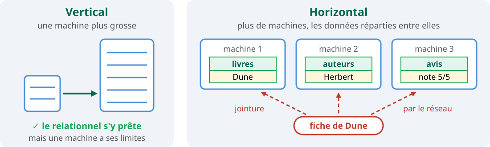

<p style="margin: 0.5rem 0 0; font-size: 0.8em;"><b>Schéma fixe</b> : <code>CREATE TABLE</code> avant la première ligne, <code>ALTER TABLE</code> à chaque évolution.</p>

<p style="margin: 0.4rem 0 0; font-size: 0.75em;"><b>1970</b> : modèle relationnel (Codd) <span style="color: #00684a;">→</span> <b>années 1990</b> : le Web <span style="color: #00684a;">→</span> <b>années 2000</b> : Bigtable, Dynamo, puis MongoDB (2009)</p>

<p style="margin-top: 0.6rem; font-size: 0.8em;">« NoSQL » se lit aujourd'hui <i>Not only SQL</i> : schéma flexible, structures variables, répartition sur plusieurs machines.</p>

<!--
(1 min)

Vous connaissez le relationnel depuis R1.05. Il reste le bon choix dans beaucoup de cas : transactions sur plusieurs tables, données très liées, requêtes imprévues. Ce que la ressource demande : choisir le modèle selon les requêtes.

Passage à l'échelle : vertical, c'est une machine plus grosse ; horizontal, c'est plus de machines. Le relationnel se prête bien au premier, moins au second.

Le schéma de droite montre aussi l'objet éclaté : la fiche d'un livre de la médiathèque (séance 2), avec ses auteurs, ses exemplaires et ses avis, demande quatre ou cinq jointures en SQL ; si les tables sont réparties sur plusieurs machines, chaque jointure passe par le réseau.

La frise, en détail : 1970, le modèle relationnel de Codd, puis SQL ; années 1990, le Web fait exploser les volumes ; années 2000, Bigtable (Google) et Dynamo (Amazon), puis MongoDB en 2009.

En 2009, NoSQL était le mot-clé d'une rencontre de développeurs ; la lecture « Not only SQL » est venue après.
-->

---

## Le théorème CAP : un choix forcé

<p style="margin: 0 0 0.3rem 0; font-size: 0.82em;">Deux copies de la même base, à Paris et à Marseille. Le livre <i>Dune</i> a <b>1</b> exemplaire disponible. Le réseau entre les deux se coupe.</p>

<svg viewBox="0 0 900 230" style="width: 100%; height: 230px;" xmlns="http://www.w3.org/2000/svg" font-family="sans-serif">
  <rect x="40" y="60" width="230" height="110" rx="14" fill="#e6f4ee" stroke="#13aa52" stroke-width="3"/>
  <text x="155" y="95" text-anchor="middle" font-size="24" font-weight="bold" fill="#00684a">Paris</text>
  <text x="155" y="130" text-anchor="middle" font-size="21">Dune : <tspan font-weight="bold" fill="#c0392b">0</tspan> disponible</text>
  <text x="155" y="158" text-anchor="middle" font-size="16" fill="#555">(Alice vient de l'emprunter)</text>
  <rect x="630" y="60" width="230" height="110" rx="14" fill="#e6f4ee" stroke="#13aa52" stroke-width="3"/>
  <text x="745" y="95" text-anchor="middle" font-size="24" font-weight="bold" fill="#00684a">Marseille</text>
  <text x="745" y="130" text-anchor="middle" font-size="21">Dune : <tspan font-weight="bold">1</tspan> disponible</text>
  <text x="745" y="158" text-anchor="middle" font-size="16" fill="#555">(n'a pas reçu l'emprunt)</text>
  <line x1="275" y1="115" x2="625" y2="115" stroke="#999" stroke-width="4" stroke-dasharray="14 10"/>
  <text x="450" y="103" text-anchor="middle" font-size="38" fill="#c0392b">✂</text>
  <text x="450" y="150" text-anchor="middle" font-size="18" fill="#c0392b">coupure réseau (partition)</text>
  <text x="155" y="35" text-anchor="middle" font-size="19">Alice : « j'emprunte Dune »</text>
  <text x="745" y="35" text-anchor="middle" font-size="19">Bob : « Dune est-il disponible ? »</text>
  <text x="155" y="215" text-anchor="middle" font-size="17" fill="#555">écriture acceptée</text>
  <text x="745" y="215" text-anchor="middle" font-size="17" fill="#555">que doit répondre Marseille ?</text>
</svg>

<div class="g2" style="margin-top: 0.3rem; font-size: 0.76em;">
<div class="carte"><b class="t">Refuser : « réessayez plus tard »</b>Pas de réponse fausse : <b>cohérent (C)</b>. Mais Bob n'obtient rien : <b>pas disponible (A)</b>.</div>
<div class="carte orange"><b class="t">Répondre : « oui, 1 exemplaire »</b>Bob a une réponse : <b>disponible (A)</b>. Mais elle est périmée, le livre sera prêté deux fois : <b>pas cohérent (C)</b>.</div>
</div>

<!--
(2 min)

Raconter la scène dans l'ordre : deux copies de la même base, le réseau entre elles se coupe, Alice emprunte à Paris, Bob interroge Marseille.

Marseille n'a que deux possibilités, et aucune ne donne à la fois une réponse et une réponse à jour : il ne peut pas connaître une écriture qu'il n'a pas reçue. C'est tout le théorème : pendant une partition (P), un système réparti choisit entre la cohérence (C : toute lecture voit la dernière écriture) et la disponibilité (A : toute requête reçue par un nœud en marche obtient une réponse).

Demander à la salle ce qu'elle choisirait pour une banque (refuser), pour un fil d'actualité ou un panier d'achat (répondre).
-->

---

## CAP en pratique

<div class="g2" style="grid-template-columns: 1.2fr 1fr; align-items: center; margin-top: 0.2rem;">
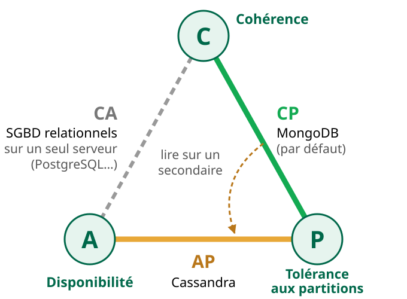
<div style="font-size: 0.8em;">
<div class="carte"><b class="t">Le choix ne se pose que pendant une coupure</b>Sans partition, un système peut être cohérent et disponible. Mais une coupure finit toujours par arriver : il faut décider à l'avance.</div>
<div class="carte violet" style="margin-top: 0.7rem;"><b class="t">Le C de CAP n'est pas le C d'ACID</b>ACID : les contraintes d'intégrité sont respectées. CAP : chaque lecture voit la dernière écriture, quelle que soit la copie.</div>
<p class="note" style="margin-top: 0.6rem;">MongoDB : pendant une coupure, seul le côté majoritaire garde un primaire et accepte les écritures.</p>
</div>
</div>

<p class="note" style="margin-top: 0.3rem;">Conjecture d'Eric Brewer (2000), démontrée par Seth Gilbert et Nancy Lynch (2002).</p>

<!--
(1 min 30)

Insister sur le premier point : CAP n'interdit pas d'être cohérent et disponible au quotidien, il dit ce qu'on sacrifie le jour où le réseau se coupe.

Pour les étudiants qui viennent du SQL : le C d'ACID (une transaction laisse la base dans un état qui respecte les contraintes) n'a rien à voir avec le C de CAP (toutes les copies donnent la même réponse, la dernière).

MongoDB : avec les réglages par défaut (lectures et écritures sur le primaire), il se comporte en CP. On peut le rapprocher de AP en lisant sur les secondaires (readPreference), au prix de lectures périmées : c'est la flèche du schéma.

Cassandra, côté AP : chaque nœud accepte lectures et écritures, les copies se mettent d'accord après coup ; le niveau de cohérence se règle requête par requête.

Côté CA : un SGBD relationnel classique, sur un seul serveur, n'a pas de partition à gérer : il est cohérent et disponible tant que ce serveur tourne (et s'il tombe, tout tombe). Dès qu'on le réplique, il doit choisir lui aussi. Notre TP est dans ce cas : un seul serveur MongoDB, donc pas de choix à faire.

Ce point n'est dans aucune des présentations MongoDB for Academia ; le syllabus l'annonce. Il servira à justifier un choix de base dans le projet ou en entreprise.
-->

---

## Six familles NoSQL


<!--
(1 min)

Les quatre premières sont les familles historiques ; les présentations MongoDB n'en citent que quatre. Le vectoriel et le multi-modèle sont dans le syllabus.

Attention à la famille « colonnes » : les bases wide-column (Cassandra, HBase) ne sont pas les bases en colonnes analytiques (ClickHouse, par exemple), qui rangent chaque colonne à part pour accélérer l'analyse.
-->

---

## Un document représente un objet

<style scoped>
pre { font-size: 0.95em !important; }
</style>

<div class="g2" style="grid-template-columns: 1.25fr 1fr; align-items: start;">
<div>

```js
{
  _id: "F01",
  titre: "Le Voyage de Chihiro",
  annee: 2001,
  duree: 125,
  sortie: ISODate("2001-07-20"),
  realisation: { nom: "Miyazaki", pays: "Japon" },
  genres: ["animation", "fantastique"]
}
```

</div>
<div style="font-size: 0.8em;">

- Il s'écrit avec la **notation des objets JavaScript** : des paires `champ: valeur` entre accolades.
- Les noms de champs se passent de guillemets, les chaînes non.
- `realisation` est un **document imbriqué** : un objet dans l'objet.
- `genres` est un **tableau**, entre crochets.

</div>
</div>

<p class="note">Proche d'un objet JavaScript, d'une <code>Map</code> Java ou d'un dictionnaire Python.</p>

<!--
(1 min)

Un document, c'est un film, un employé, un livre : un objet du domaine, entier.

Dans le playground et mongosh, on écrit { _id: "E01", nom: "Martin" }, sans guillemets autour des noms de champs, comme dans tout le TP1. Le JSON strict les exige, pas MongoDB. Et MongoDB ne stocke pas du JSON, mais du BSON : voir la diapo sur les types.
-->

---

## Du relationnel au document

<p style="font-size: 0.8em; margin-bottom: 0.3rem;">Le film de la diapositive précédente. En SQL, il est réparti en trois tables, recollées par deux jointures. En MongoDB, il tient dans un seul document.</p>

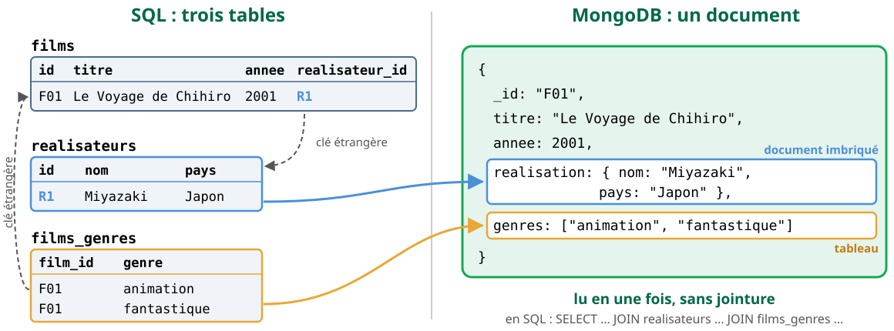

<!--
(1 min)

Lecture : à gauche, la modélisation relationnelle du film : une table pour les films, une pour les réalisateurs (relation plusieurs-à-un, clé étrangère realisateur_id), une table d'association pour les genres (relation un-à-plusieurs). Pour afficher le film complet, il faut deux jointures.

À droite, le même film en document : le réalisateur est un document imbriqué, les genres un tableau. Le film se lit en une fois.

Le prix à payer, à garder pour la séance 2 : si Miyazaki change de pays, il faut modifier chacun de ses films, puisque l'information est recopiée dans chaque document. Embarquer ou référencer, c'est le sujet de la séance 2 (« Modéliser la médiathèque ») et du TP3.
-->

---

## Le vocabulaire, de SQL à MongoDB

<style scoped>
table { font-size: 0.7em; }
td { white-space: nowrap; }
</style>

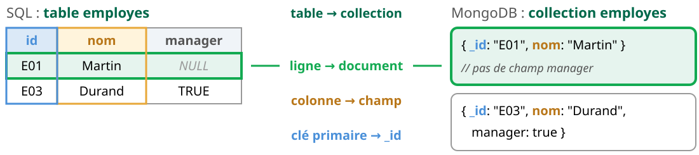

<div class="g2" style="grid-template-columns: 1.3fr 1fr; align-items: start; margin-top: 0.4rem;">
<div>

| SQL | MongoDB |
|---|---|
| Base de données | Base (`use('tp1')`) |
| `INSERT` | `insertOne`, `insertMany` |
| `SELECT … WHERE` | `find(filtre, projection)` |
| `UPDATE` | `updateOne`, `updateMany` |
| `DELETE` | `deleteOne`, `deleteMany` |
| Jointure | Document imbriqué (S2) ou `$lookup` (TP2) |

</div>
<div class="carte vert" style="font-size: 0.78em;">
<b class="t">Schéma flexible</b>

Pas de `CREATE TABLE` : une collection naît à la première insertion.

</div>
</div>

<!--
(1 min)

Le schéma le montre avec E01 : un champ absent n'est pas un champ à null.

Schéma flexible ne veut pas dire absence de schéma : c'est l'application qui le porte. MongoDB sait aussi valider un schéma ($jsonSchema, à la création de la collection) ; ce n'est pas au programme des TP.

Faire évoluer un schéma reste du travail, même sans ALTER TABLE : le TP3 le montre avec le pattern Versioning.

_id est unique dans sa collection : deux documents d'une même collection ne peuvent pas avoir le même.

Attention, dans un filtre, { champ: null } trouve aussi les documents où le champ manque (vérifié sur 9.0.4) ; pour l'absence seule, c'est $exists: false.
-->

---

<!-- _class: lead -->

# Parties 1 et 2 - Créer et lire des documents

`insertOne`, `insertMany`, `find`, opérateurs de requête, tri

<!--
(10 s)

Le CRUD de MongoDB, dans l'ordre des parties 1 et 2 du TP1. Modifier et supprimer viendront en reprise, au début des parties 3 et 4.
-->

---

## Insérer : insertOne, insertMany

```js
db.films.insertOne({ _id: "F01", titre: "Le Voyage de Chihiro", annee: 2001, /* … */ })
```

<div class="res">
<div class="res-titre">Résultat</div>

```js
{ acknowledged: true, insertedId: 'F01' }
```

</div>

```js
db.films.insertMany([
  { _id: "F02", titre: "Mon voisin Totoro", annee: 1988, duree: 86 },
  { _id: "F03", titre: "La Haine", annee: 1995, duree: 98 },
  { _id: "F04", titre: "Parasite", annee: 2019, duree: 132 },
  { _id: "F05", titre: "Le Fabuleux Destin d'Amélie Poulain", annee: 2001, duree: 122 }
])
```

<div class="res">
<div class="res-titre">Résultat</div>

```js
{ acknowledged: true, insertedIds: { '0': 'F02', '1': 'F03', '2': 'F04', '3': 'F05' } }
```

</div>

<!--
(1 min)

Le premier insertOne insère le document de la diapo « Un document représente un objet », abrégé ici.

insertMany prend un tableau de documents, en une seule instruction. Le résultat est un objet insertedIds, indexé par la position, pas un tableau comme dans les anciennes présentations.

Les résultats affichés ici sont ceux de mongosh sur MongoDB 9.0.4. Le playground affiche les mêmes valeurs, présentées en JSON.

writeConcern règle surtout l'attente des répliques : sur notre serveur unique, on le laisse par défaut. ordered: false fait continuer insertMany après une erreur, un doublon par exemple ; le TP n'en a pas besoin.
-->

---

## Types BSON et identifiant _id

<style scoped>
table { font-size: 0.95em; }
td code { white-space: nowrap; }
th { white-space: nowrap; }
</style>

<div class="g2" style="grid-template-columns: 1.05fr 1.1fr; align-items: start;">
<div>

| Valeur écrite | Type BSON |
|---|---|
| `"F01"` | string |
| `2001` | int |
| `21.5` | double |
| `ISODate("2001-07-20")` | date |
| `{ nom: … }` | object |
| `["animation", …]` | array |
| _id omis | objectId |

<p class="note">Types relevés avec <code>$type</code> sur MongoDB 9.0.4.</p>

</div>
<div style="font-size: 0.95em;">

```js
db.films.insertOne({ titre: "Le Dîner de cons", annee: 1998 })
```

<div class="res">
<div class="res-titre">Résultat : sans _id, MongoDB génère un ObjectId</div>

```js
{ acknowledged: true,
  insertedId: ObjectId('6af2d8afcf3231a85a9f4fe7') }
```

</div>

```js
db.films.insertOne({ _id: "F03", titre: "Ma 6-T va crack-er" })
```

<div class="res">
<div class="res-titre">Résultat : _id est unique dans la collection</div>

```text
MongoServerError: E11000 duplicate key error collection:
cinema.films index: _id_ dup key: { _id: "F03" }
```

</div>
</div>
</div>

<!--
(1 min)

MongoDB stocke les documents en BSON, un format binaire qui a plus de types que JSON : entiers, décimaux, dates, ObjectId.

Le film « Le Dîner de cons » n'a pas de durée : le schéma flexible l'accepte.

Dans le TP, les _id sont des chaînes choisies ("E01") : les résultats sont les mêmes d'une base à l'autre. Exécuter deux fois une insertion avec le même _id donne cette erreur E11000. Dans le TP, npm run seed -- --avant N répare la base.
-->

---

## Lire : find(filtre, projection)

<style scoped>
pre { font-size: 0.85em; }
</style>

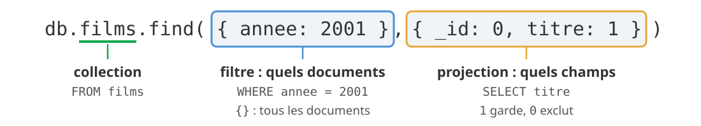

<div class="res">
<div class="res-titre">Résultat</div>

```js
[ { titre: 'Le Voyage de Chihiro' }, { titre: "Le Fabuleux Destin d'Amélie Poulain" } ]
```

</div>

<div class="carte" style="margin-top: 0.8rem; font-size: 0.78em;"><code>_id</code> revient toujours, sauf <code>_id: 0</code>. On ne mélange pas 1 et 0 dans une projection, sauf pour <code>_id</code>.</div>

<!--
(1 min)

findOne renvoie un seul document, ou null ; find renvoie tous ceux qui correspondent.

Pièges du correcteur automatique : un champ en trop dans la projection rend la réponse fausse, sauf _id quand la consigne ne le demande pas (on peut le garder ou l'exclure). Et sans tri, l'ordre des documents n'est pas garanti.
-->

---

## Opérateurs de requête

<style scoped>
pre { font-size: 0.74em; }
</style>

<div class="g2" style="grid-template-columns: 1fr 1fr; align-items: start;">
<div>
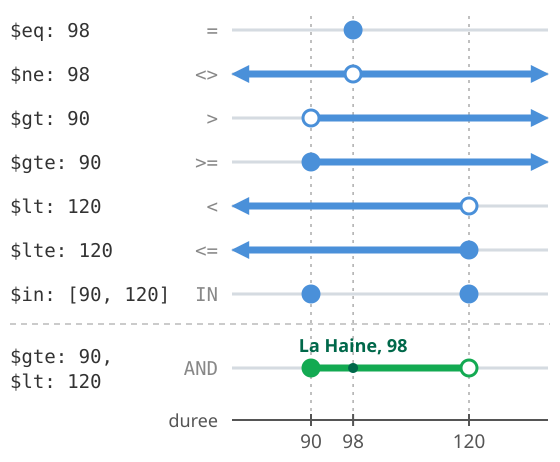
</div>
<div>

```js
db.films.find(
  { duree: { $gte: 90, $lt: 120 } },
  { _id: 0, titre: 1, duree: 1 }
)
```

<div class="res">
<div class="res-titre">Résultat</div>

```js
[ { titre: 'La Haine', duree: 98 } ]
```

</div>

```js
db.films.find({ genres: "animation" },
  { _id: 0, titre: 1 })
```

<div class="res">
<div class="res-titre">Résultat : un élément du tableau suffit</div>

```js
[ { titre: 'Le Voyage de Chihiro' } ]
```

</div>
</div>
</div>

<p style="font-size: 0.75em; margin-top: 0.4rem;">Un opérateur commence par <code>$</code> et s'écrit dans un objet, à la place de la valeur. Plusieurs conditions se combinent par un ET. Aussi : <code>$nin</code> (NOT IN), <code>$exists</code> (le champ existe ou manque), <code>$regex</code> (LIKE, en plus riche).</p>

<!--
(1 min 30)

Premier exemple : deux conditions sur le même champ, une durée entre 90 (compris) et 120 (exclu) minutes.

Second exemple : genres vaut ["animation", "fantastique"] pour Chihiro. Le filtre { genres: "animation" } le trouve sans qu'on parcoure le tableau.

$exists n'a pas d'équivalent en SQL : une colonne existe toujours. En MongoDB, un champ peut manquer, comme la durée du « Dîner de cons ».

Les expressions régulières ont un tableau de motifs dans l'énoncé, partie 2.
-->

---

## Trier, limiter, compter

```js
db.films.find({ annee: { $gte: 2000 } }, { _id: 0, titre: 1, duree: 1 })
        .sort({ duree: 1 })
        .limit(1)
```

<div class="res">
<div class="res-titre">Résultat</div>

```js
[ { titre: "Le Fabuleux Destin d'Amélie Poulain", duree: 122 } ]
```

</div>

```js
db.films.countDocuments({ annee: { $lt: 2000 } })
```

<div class="res">
<div class="res-titre">Résultat : un nombre, pas des documents</div>

```js
3
```

</div>

<p style="font-size: 0.75em;"><code>1</code> trie par ordre croissant, <code>-1</code> par ordre décroissant ; une seconde clé départage les égalités. Le serveur trie toujours avant de limiter. <code>distinct("champ")</code> renvoie le tableau des valeurs différentes.</p>

<!--
(1 min)

Le film le plus court depuis 2000. Sans sort, limit garde un document quelconque.

Les 3 films d'avant 2000 : Totoro, La Haine, Le Dîner de cons.

count() et find().count(), qu'on trouve dans de vieux exemples, sont dépréciés. On écrit countDocuments().
-->

---

## Le playground, au quotidien

<style scoped>
pre { font-size: 0.95em !important; }
</style>

<div class="g2" style="grid-template-columns: 1.1fr 1fr; align-items: start;">
<div>

```js
// ────────────── Exercice N ──────────────
// consigne
// Votre réponse :
use('tp1');
db.employes.find(…)    // dernière instruction :
                       // celle qui est notée
```

<p class="note">Ne modifiez ni les marqueurs ni les consignes : le correcteur automatique s'en sert pour retrouver vos réponses.</p>
<p class="note">Chaque réponse est autonome et écrit la collection en entier (<code>db.employes.find…</code>) : une variable venue d'un autre exercice, ou une collection rangée dans une variable, vaut 0.</p>
<p class="note">Pour s'entraîner : <code>essais.mongodb.js</code> et la collection <code>brouillon</code>, que le correcteur automatique ne lit pas.</p>

</div>
<div>
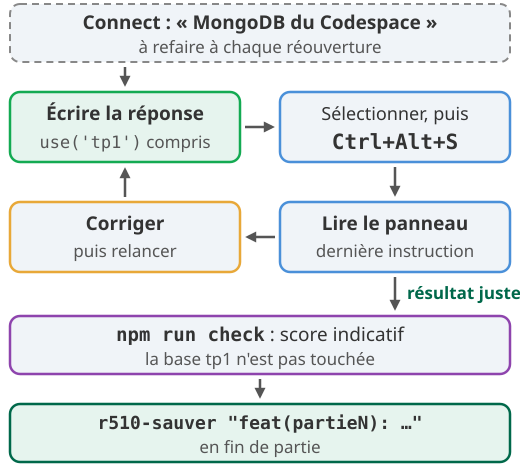
</div>
</div>

<!--
(1 min 30, démonstration comprise)

Démonstration conseillée : ouvrir le playground, se connecter, exécuter l'exemple A avec Ctrl+Alt+S.

Sans connexion, le playground affiche « Please connect to a database before running a playground » : cliquer sur Connect now et choisir MongoDB du Codespace.

Le correcteur automatique note la dernière instruction de chaque zone de réponse pour un exercice de lecture, et l'état de la collection pour un exercice de modification.

mongosh 2.14.1 est aussi disponible dans le terminal : mongosh tp1.

npm run seed -- --avant N remet la base dans l'état attendu juste avant l'exercice N.
-->

---

## Les pièges de la séance

<style scoped>
code { white-space: nowrap; }
</style>

<div class="g2" style="font-size: 0.74em; gap: 0.8rem;">
<div class="carte rouge"><b class="t">Résultat vide, requête juste</b>La sélection s'est exécutée sur une autre base : commencez par <code>use('tp1')</code>.</div>
<div class="carte rouge"><b class="t">Ctrl+Alt+R rejoue tout le fichier</b>Doublons <code>E11000</code>, mises à jour appliquées deux fois. Préférez Ctrl+Alt+S.</div>
<div class="carte orange"><b class="t">Un essai sous « Votre réponse »</b>Il devient la dernière instruction, donc la réponse notée.</div>
<div class="carte orange"><b class="t">Projection et ordre</b>Un champ en trop rend la réponse fausse, sauf <code>_id</code> quand la consigne ne le demande pas. Sans <code>sort</code>, l'ordre n'est pas garanti.</div>
<div class="carte"><b class="t">Guillemets</b>Noms de champs sans, chaînes avec : <code>{ _id: "E01" }</code>. Dans le TP, les noms de champs n'ont pas d'accent (<code>prenom</code>), les valeurs en gardent (« Noé »).</div>
<div class="carte"><b class="t">Les diapos officielles, en anglais</b>Atlas, Compass, invite <code>&gt;&gt;&gt;</code>, <code>count()</code>, <code>update()</code>, <code>remove()</code> : ici <code>countDocuments</code>, <code>updateOne</code>/<code>updateMany</code>, <code>deleteOne</code>/<code>deleteMany</code>.</div>
</div>

<!--
(1 min)

Les deux premiers pièges coûtent le plus de temps en séance. Base abîmée : npm run seed -- --avant N.

Les présentations MongoDB for Academia, en anglais, sont listées dans le dépôt cours. Elles sont utiles en complément, mais elles supposent Atlas et l'ancien shell, et utilisent des méthodes dépréciées.

Pour l'enseignant, les erreurs relevées dans ces présentations, si un étudiant les cite :
- MongoDB 101, diapo 14 : confond les bases wide-column (Cassandra, HBase) et les bases en colonnes analytiques ;
- MongoDB 101, diapos 18 et 33 : « pas de migration » ; faire évoluer un schéma reste du travail (pattern Versioning, TP3) ;
- MongoDB 101, diapo 22 : « MongoDB uses JSON » ; il stocke du BSON ;
- MongoDB 101, diapo 24 : clés entre guillemets obligatoires ; faux dans mongosh et le playground ;
- MongoDB 101, diapo 28 : deux documents de la même collection avec le même _id ; impossible ;
- MQL, diapo 29 : updateMany décrit comme « Update an array of documents » ; il modifie tous les documents qui correspondent au filtre, et seul insertMany prend un tableau ;
- MQL, diapo 71 : définition de $addToSet copiée d'un autre opérateur ; il ajoute la valeur au tableau seulement si elle n'y est pas déjà ;
- MQL, diapo 73 : upsert avec update(), déprécié ; on écrit updateOne(…, { upsert: true }) ;
- Inserting and Updating, diapo 23 : « delete : Always! » idempotent ; faux pour deleteOne avec un filtre qui désigne plusieurs documents, puisque chaque exécution en supprime un de plus ;
- Deleting Data, diapo 11 : affiche le code de la diapo 7 au lieu de drop().
-->

---

## À vous

<div class="bandeau" style="font-size: 1.1em;">
<a href="https://iutinfoaix-r510.github.io/tp1/">iutinfoaix-r510.github.io/tp1</a>
</div>

<div class="g2" style="margin-top: 1rem; font-size: 0.82em;">
<div>

**Aujourd'hui**

1. Mise en place : accepter le TP1, ouvrir le codespace, les quatre vérifications.
2. Parties 1 à 4 : 25 exercices, 100 points.
3. En fin de séance : premier rendu, avec `r510-rendre`.

</div>
<div class="carte vert">
<b class="t">En fin de chaque partie</b>

Demandez un quiz à l'assistant du codespace :
« Fais-moi un quiz sur deleteOne, deleteMany et les filtres de suppression. »
</div>
</div>

<p style="margin-top: 1rem; font-size: 0.82em;">En avance ? Lisez « Modéliser la médiathèque » : la séance 2 commence à la partie 5.</p>

<!--
(30 s)

Les quatre vérifications de l'énoncé : r510-mongo status, npm run seed, mongosh tp1 --quiet --eval 'db.employes.countDocuments()' qui doit afficher 12, puis npm run check qui finit sur 0/208.

Partie 1 très guidée (exemples A à C), partie 2 : la boucle écrire, exécuter, lire, corriger.

Modifier et supprimer viennent dans deux courtes reprises, quand le groupe arrive aux parties 3 et 4.
-->

---

<!-- _class: lead -->

# Partie 3 - Modifier des documents

`updateOne`, `updateMany`, opérateurs de mise à jour, upsert

<!--
(10 s)

À projeter quand la plupart des étudiants abordent la partie 3. Durée de la reprise : 5 minutes.
-->

---

## Modifier : updateOne, updateMany

<style scoped>
.g2 pre { font-size: 0.7em; }
</style>

```js
db.films.updateOne({ titre: "La Haine" }, { $set: { pays: "France" } })
```

<div class="res">
<div class="res-titre">Résultat</div>

```js
{ acknowledged: true, insertedId: null, matchedCount: 1, modifiedCount: 1, upsertedCount: 0 }
```

</div>

<div class="g2" style="margin-top: 0.4rem;">
<div>

```js
db.films.updateOne({ titre: "La haine" },
  { $set: { pays: "France" } })
```

<div class="res">
<div class="res-titre">Résultat : la casse compte, rien n'est trouvé</div>

```js
{ acknowledged: true, insertedId: null,
  matchedCount: 0, modifiedCount: 0,
  upsertedCount: 0 }
```

</div>
</div>
<div>

```js
db.films.updateMany({ annee: { $lt: 2000 } },
  { $set: { classique: true } })
```

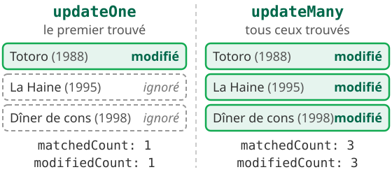

</div>
</div>

<!--
(1 min 30)

matchedCount : documents trouvés par le filtre. modifiedCount : documents réellement changés. Un matchedCount à 0, c'est un filtre qui ne trouve rien, sans aucun message d'erreur.

update() est déprécié : on écrit updateOne ou updateMany. updateMany ne prend pas de tableau : un filtre, puis un objet d'opérateurs. Seul insertMany prend un tableau.
-->

---

## Opérateurs de mise à jour

<style scoped>
pre { font-size: 0.68em; }
</style>


<div class="g2" style="margin-top: 0.4rem;">
<div>

```js
db.films.updateOne({ _id: "F01" }, {
  $set: { pays: "Japon" },
  $inc: { diffusions: 1 } })
db.films.findOne({ _id: "F01" },
  { _id: 0, pays: 1, diffusions: 1 })
```

<div class="res">
<div class="res-titre">Résultat : deux opérateurs, une seule mise à jour</div>

```js
{ diffusions: 1, pays: 'Japon' }
```

</div>
</div>
<div>

```js
db.films.updateOne({ _id: "F03" },
  { pays: "France" })     // sans opérateur
```

<div class="res">
<div class="res-titre">Résultat</div>

```text
MongoInvalidArgumentError:
Update document requires atomic operators
```

</div>
</div>
</div>

<!--
(1 min 30)

Exemples du schéma exécutés sur la collection films : Totoro reçoit diffusions: 1, Parasite reçoit prix: [ "Palme d'or" ], Chihiro garde genres: [ 'animation' ], La Haine perd son champ pays. L'exemple de gauche vient ensuite : Chihiro reçoit pays et diffusions en une seule instruction. Le playground affiche le résultat de la dernière instruction, ici le findOne. Un même objet de mise à jour peut contenir plusieurs opérateurs, chacun sur des champs différents.

$unset retire le champ ; le mettre à false ou à null ne suffit pas.

Une mise à jour sans opérateur est refusée par updateOne. Remplacer un document entier, c'est replaceOne.

$addToSet, non demandé dans le TP1 : il ajoute un élément au tableau seulement s'il n'y est pas déjà.
-->

---

## Upsert : créer ou mettre à jour

```js
db.capteurs.updateOne(
  { _id: "C42" },
  { $set: { temperature: 21.5 } },
  { upsert: true }
)
```


<p style="font-size: 0.75em;">État final dans les deux cas : <code>[ { _id: 'C42', temperature: 21.5 } ]</code>. Rejouée, la requête laisse le même état : elle est <b>idempotente</b>.</p>

<!--
(1 min 30)

Un capteur envoie sa dernière mesure : s'il est inconnu, on le crée ; sinon, on met à jour.

Le correcteur automatique exécute l'exercice 20 deux fois de suite, et aussi sur une base où le document existe déjà avec d'autres valeurs : seul le champ visé par la consigne doit changer.

L'upsert s'écrit avec updateOne et l'option { upsert: true }. update(), qu'on voit dans de vieux exemples, est déprécié.
-->

---

<!-- _class: lead -->

# Partie 4 - Supprimer des documents

`deleteOne`, `deleteMany`

<!--
(10 s)

À projeter quand la plupart des étudiants abordent la partie 4. Durée de la reprise : 2 minutes.
-->

---

## Supprimer : deleteOne, deleteMany

<div class="g2">
<div>

```js
// d'abord, voir ce qui partira
db.films.find({ annee: { $lt: 1990 } },
  { titre: 1 })
```

<div class="res">
<div class="res-titre">Résultat</div>

```js
[ { _id: 'F02', titre: 'Mon voisin Totoro' } ]
```

</div>
</div>
<div>

```js
db.films.deleteMany(
  { annee: { $lt: 1990 } })
```

<div class="res">
<div class="res-titre">Résultat</div>

```js
{ acknowledged: true, deletedCount: 1 }
```

</div>
</div>
</div>

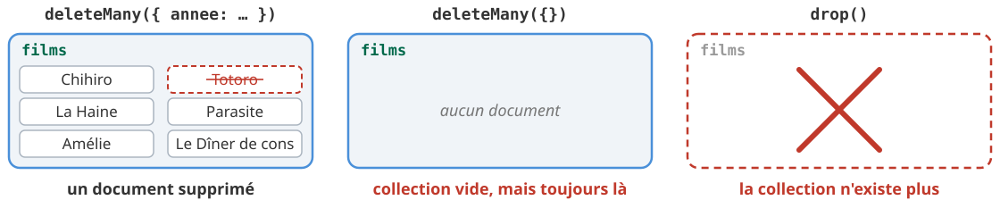

<div class="alerte" style="font-size: 0.75em;">
Aucune confirmation demandée. Dans le codespace, <code>npm run seed -- --avant N</code> répare.
</div>

<!--
(1 min 30)

Même filtre que find, mêmes opérateurs, même ET implicite. deleteOne supprime le premier document trouvé, deleteMany tous.

En production, sans npm run seed, seule une sauvegarde permettrait de récupérer des documents supprimés.

deleteOne avec un filtre qui désigne plusieurs documents n'est pas idempotent : chaque exécution en supprime un de plus.

remove() est déprécié : on écrit deleteOne ou deleteMany.

Pour essayer drop(), le faire sur la collection brouillon, jamais sur employes.
-->

---

<!-- _class: lead -->

# Des questions ?

**Sébastien Nedjar** (GA1) · **Leïla Sakli Miled** (GA2)
IUT d'Aix-Marseille, département Informatique

<div style="margin-top: 1.2rem; font-size: 0.85em;">

[iutinfoaix-r510.github.io/tp1](https://iutinfoaix-r510.github.io/tp1/)
sebastien.nedjar@univ-amu.fr · leila.SAKLI@univ-amu.fr

</div>

<div style="margin-top: 1.6rem; background: #00684a; color: white; padding: 0.8rem 1.6rem; border-radius: 12px; font-size: 0.95em;">

**Dès maintenant** : la partie 4, puis le premier rendu avec <code style="white-space: nowrap;">r510-rendre</code>.

</div>

<div style="margin-top: 1rem; background: #fff4e0; border-left: 5px solid #e8a838; padding: 0.7rem 1rem; border-radius: 6px; font-size: 0.8em;">

**Avant la séance 2** : terminez les parties 1 à 4, puis lisez « Modéliser la médiathèque » dans l'énoncé. La séance commencera par ces questions.

</div>

<!--
(10 s)

Les adresses sont celles du syllabus. Questions sur le cours : en séance, ou par courriel à l'enseignant de son groupe.
-->

---

## Crédits

<div style="font-size: 0.72em;">

- **Supports d'origine**, dont ce support s'inspire : présentations du programme MongoDB for Academia, en anglais, sous licence [CC BY-NC-SA 3.0](https://creativecommons.org/licenses/by-nc-sa/3.0/) : *MongoDB 101: Non-Relational for Beginners*, *Querying in Relational and Non-Relational Databases*, *The MongoDB Query Language (MQL)*, *Inserting and Updating Data in MongoDB*, *Deleting Data in MongoDB*. Liens dans le README du dépôt `cours`.
- **Documentation** : [MongoDB Manual](https://www.mongodb.com/docs/manual/), [correspondance SQL et MongoDB](https://www.mongodb.com/docs/manual/reference/sql-comparison/).
- **Exemples** : exécutés sur MongoDB 9.0.4 avec mongosh ; les résultats affichés sont ceux obtenus.
- **Énoncé et syllabus** : TP1 et syllabus de R5.Real.10, IUT d'Aix-Marseille.

</div>

<div class="carte vert" style="margin-top: 0.8rem; font-size: 0.72em;">
Ce support, R5.Real.10 (IUT d'Aix-Marseille, github.com/IUTInfoAix-R510/cours), est diffusé sous licence <a href="https://creativecommons.org/licenses/by-nc-sa/4.0/deed.fr">CC BY-NC-SA 4.0</a>. Le logo d'Aix-Marseille Université n'est couvert par aucune de ces licences.
</div>

<!--
(Hors minutage : diapo de référence, laissée en fin de support.)

Les licences du dépôt et le détail des reprises sont dans ATTRIBUTION.md.
-->
