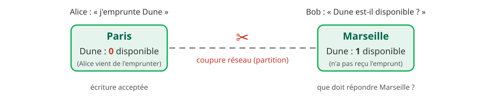

<!-- _class: lead -->
<!-- _paginate: false -->

<style scoped>
section {
  background-image: url('assets/logo.png');
  background-repeat: no-repeat;
  background-position: bottom 40px center;
  background-size: 340px;
}
h1 { font-size: 1.9em; }
p.question { font-size: 0.85em; color: #5c6c75; font-style: italic; margin-top: 0.8em; }
</style>

# La ressource, MongoDB et le CRUD

**R5.Real.10 - Nouveaux paradigmes de base de données**

Séance 1 · TP1, parties 1 à 4 · semaine du 23 novembre 2026

<p class="question">Un film que le relationnel éclate en trois tables : comment le ranger entier, puis le manipuler ?</p>

<!--
(20 s)

Point cours d'environ 28 minutes, en un seul temps, en début de séance (somme des durées notées en tête de chaque diapo) :
- la ressource, diapos 2 à 4 : 3 min ;
- objectifs, puis « Du relationnel au document » (diapos 5 à 10) : 4 min 40 ;
- le playground (diapo 11) : 1 min 45 ;
- parties 1 à 4 (diapos 12 à 33) : 16 min 15 (partie 1 : 2 min 55 ; partie 2 : 6 min 10 ; partie 3 : 5 min 55 ; partie 4 : 1 min 15), dont une prédiction par partie (diapos 14, 19, 27 et 32) ;
- « À retenir » (34), les deux diapos « À vous » (35 et 36), puis « Des questions ? » (37) : 2 min 10.

Total : 28 min 10, titre compris (37 diapos projetées).

La question directrice est posée ici, reprise en sous-titre de chaque intercalaire et conclue dans « À retenir ».

Les exemples portent sur une collection films (la même qu'en S2 et S3, qui s'enrichit d'une séance à l'autre) et sur un capteur (ceux de S2), jamais sur les données du TP. Ils tournent dans une base à part, demo, que le correcteur automatique ne lit pas. Tout a été exécuté sur MongoDB 9.0.4 et les résultats affichés sont ceux obtenus. Le script qui recharge les données et rejoue toutes les diapos, dans l'ordre, est dans les notes de la diapo « Insérer les films » (diapo 13).

Avant de commencer : demander qui n'a pas reçu ou pas accepté l'invitation à l'organisation IUTInfoAix-R510-2026. Sans elle, impossible d'accepter le TP1.
-->

---

<!-- header: Séance 1 · la ressource -->
## Le but et le calendrier

> Choisir le modèle de données adapté aux requêtes, puis l'intégrer dans une application.


<p class="note" style="margin-top: 0.5rem;">Chaque séance commence par un point cours. Jours et horaires : consultez ADE, ils changent d'une semaine et d'un groupe à l'autre. Dernière séance au plus tard le jeudi 17/12.</p>

<!--
(1 min)

L'objectif du programme national : appréhender les paradigmes non relationnels. En pratique, on en étudie deux en profondeur : le document avec MongoDB (S1 à S4), puis le graphe avec Neo4j et Cypher (S5). Les autres familles (clé-valeur, colonnes, vectoriel, multi-modèle) sont situées tout à l'heure, sur une seule diapo, pas pratiquées.

La question qui revient tout le module : quelles requêtes l'application va-t-elle faire, et quel modèle y répond le mieux ?

32 h à l'emploi du temps : 5 séances de TP, 3 de projet. Les deux groupes (GA1, GA2) suivent exactement les mêmes TP et le même projet. Fil conducteur : la médiathèque de la séance 2 revient en graphe au TP4.

Prérequis : SQL (R1.05, R2.06, R3.07, R4.03), Java, Git.
-->

---

## L'évaluation : TP 40 %, projet 60 %

<div class="g2" style="grid-template-columns: 0.9fr 1fr; align-items: center; margin-top: 0.4rem;">
<div>


</div>
<div style="font-size: 0.78em; display: grid; gap: 0.7rem;">
<div class="carte vert"><b class="t">TP : le correcteur automatique</b>À chaque rendu, il exécute vos requêtes et affiche le score dans la Release. La note retenue vient du dernier rendu dans les délais.</div>
<div class="carte"><b class="t">Projet, en équipe, S6 à S8</b>Une note d'équipe, pondérée pour chacun par les questions individuelles de S8, les contributions et un détecteur d'IA. Le détail en S6.</div>
</div>
</div>

<div class="alerte" style="margin-top: 0.9rem; font-size: 0.76em;">
<b>Fraude</b> : modifier le correcteur automatique ou les fichiers <code>.github/</code>, supprimer une Release, recopier les résultats attendus au lieu de les calculer. Sanction possible, jusqu'à l'exclusion, conformément aux M3C.
</div>

<!--
(1 min)

Le score s'affiche dans la Release du rendu et dans Classroom 50 : on voit quels exercices passent. Une partie des rendus est vérifiée à la main (réponses écrites en dur, recopie).

Pour le TP1, la note définitive est recalculée après la clôture sur un second jeu de données, secret, aux valeurs différentes. On garde le plus petit des deux scores. Une requête qui calcule son résultat obtient les mêmes points sur les deux jeux ; une réponse recopiée, ou qui vise des identifiants, perd ses points.

Projet, à ne pas détailler aujourd'hui : pile imposée (Java 25, Javalin, pilote Java MongoDB, front web léger), squelette fourni, équipes constituées à l'intérieur de chaque groupe avant S6. Barème indicatif du syllabus : données 50, API et tests 25, front 10, documentation 15, bonus graphe jusqu'à +10, note plafonnée à 100. Questions individuelles : environ 6 minutes en S8, sans jury ni assistant : expliquer une partie de son code, puis la modifier. Contributions : au moins une pull request significative et la revue de celle d'un coéquipier. Le détecteur d'IA : si une équipe ne montre pas qu'elle comprend son code pendant les questions individuelles, sa note est coefficientée par le taux de contribution que le détecteur lui attribue.
-->

---

## Environnement, rendu et IA


<div class="g2" style="margin-top: 0.4rem; font-size: 0.76em; align-items: stretch;">
<div class="carte orange"><b class="t">📅 TP1 : trois rendus au plus</b>En fin de S1, en fin de S2, puis le rendu final, au plus tard le <b>dimanche 6/12, 23 h 59</b>.</div>
<div class="carte vert"><b class="t">🤖 L'IA, un tuteur</b>Dans le codespace, elle explique une notion ou une erreur ; elle n'écrit pas la requête d'un exercice. Les questions individuelles se font sans assistant.</div>
</div>

<!--
(1 min)

Pas d'Atlas, pas de Compass, pas de compte MongoDB à créer. Les présentations officielles de MongoDB, en anglais, supposent Atlas : on n'en a pas besoin.

L'énoncé en ligne donne le lien d'acceptation et les commandes de rendu, à copier telles quelles. Le TP s'ouvre le lundi 23 novembre à 8 h ; avant, la page affiche « This assignment is locked ». Ne jamais renommer son dépôt : Classroom 50 ne le retrouverait plus. Reprendre le même codespace d'une séance à l'autre (Code, Codespaces, le codespace existant), ne pas en recréer un.

L'IA : Copilot Chat, ou Claude Code et Codex avec son propre abonnement, dans le codespace : là, l'assistant voit l'énoncé, le playground et les données, et il est configuré en tuteur (il ne peut ni modifier les fichiers, ni rendre). À la première ouverture, Claude Code ou Codex demande de faire confiance au dossier : accepter, c'est ce qui lui fait lire cette configuration. Sur le site web, il n'a rien de tout cela. En S1, demander de l'aide sur la syntaxe et le playground ne pose aucun problème ; en S2, surtout pour les pipelines, aller le plus loin possible seul avant de demander. Dans le projet, l'usage de l'IA est documenté dans le dépôt de l'équipe.

En une phrase pour le syllabus : justificatif d'absence sous 48 h, défaillance au-delà de 20 % d'absence, aménagements à demander au responsable en début de module. Une question d'ordre privé passe par un courriel à l'enseignant du groupe (Sébastien Nedjar pour GA1, Leïla Sakli Miled pour GA2) ; une question sur le module, par une issue du dépôt syllabus.
-->

---

<!-- header: Séance 1 · objectifs -->
## Ce que vous saurez faire en fin de séance

<div class="bandeau" style="font-size: 0.85em; text-align: left;">
❓ Un film que le relationnel éclate en trois tables : comment le ranger entier, puis le manipuler ?
</div>

<div class="g2" style="margin-top: 0.9rem; font-size: 0.8em; align-items: stretch;">
<div class="carte vert">
<b class="t">🎯 Objectifs : TP1, parties 1 à 4</b>

- **Expliquer** ce que sont un document, une collection et l'identifiant `_id`
- **Insérer** des documents qui contiennent un document imbriqué et un tableau
- **Lire** : filtrer, projeter, trier, compter
- **Modifier** et **supprimer**, upsert compris

</div>
<div class="carte">
<b class="t">🧠 Déjà vu</b>

- **SQL** (R1.05, R2.06) : `INSERT`, `SELECT … WHERE`, `IN`, `LIKE`, `ORDER BY`, `COUNT`, `DISTINCT`, `UPDATE`, `DELETE`, jointures
- **JSON** : objets et tableaux
- **Git** (R2.03) : commit, push

</div>
</div>

<p class="note" style="margin-top: 0.7rem;">🧪 Exemples : une collection <code>films</code>, dans la base <code>demo</code>. Le TP porte sur d'autres données : <code>employes</code>, dans la base <code>tp1</code>.</p>

<!--
(45 s)

Les quatre objectifs reprennent les niveaux « Comprendre » et « Appliquer » de l'énoncé du TP1 (exemples A à C, exercices 1 à 25).

Le pont avec SQL revient à chaque partie : ce qui se transpose, et l'endroit où l'analogie casse (un champ peut manquer, un tableau se teste sans jointure, une mise à jour se rejoue ou non).

Les films reviennent en S2, enrichis (réalisation imbriquée, séances), puis en S3, où la réalisation devient une référence. Ce sont aussi les films d'entraînement du tuteur du TP1.
-->

---

<!-- header: Séance 1 · du relationnel au document -->

<!-- _class: lead -->
<!-- _header: "" -->

# 🍃 Du relationnel au document

Un film en trois tables : comment le ranger entier ?

<!--
(10 s)

Le besoin d'abord (un film éclaté), puis le document qui y répond, le vocabulaire, et la place du document parmi les autres familles NoSQL.
-->

---

## Un film, trois tables, deux jointures

<style scoped>
pre { font-size: 0.8em; }
table { font-size: 0.9em; margin-top: 0.8em; }
</style>

<div class="g2" style="grid-template-columns: 1.2fr 1fr; align-items: start; margin-top: 0.8rem;">
<div>

```sql
SELECT f.titre, r.nom, g.genre
FROM films f
JOIN realisateurs r ON r.id = f.realisateur_id
JOIN films_genres g ON g.film_id = f.id
WHERE f.id = 'F01';
```

| titre | nom | genre |
|---|---|---|
| Le Voyage de Chihiro | Miyazaki | animation |
| Le Voyage de Chihiro | Miyazaki | fantastique |

</div>
<div style="font-size: 0.8em;">
<div class="carte orange"><b class="t">Le constat</b>Afficher un film demande trois tables et deux jointures. Le titre et le réalisateur reviennent sur chaque ligne : un film, deux lignes. L'application doit recoller l'objet.</div>
<div class="box" style="margin-top: 1rem; font-size: 1.1em;">❓ Et si le film était rangé <b>entier</b>, en un seul morceau ?</div>
</div>
</div>

<!--
(1 min)

C'est la modélisation relationnelle que les étudiants connaissent depuis R1.05 : une table films, une table realisateurs (relation plusieurs-à-un, clé étrangère realisateur_id), une table films_genres pour les genres de chaque film (relation un-à-plusieurs ; le genre n'est qu'une valeur, sans table genres).

Requête et résultat obtenus sur PostgreSQL 17, avec ces trois tables et le seul film F01 :

CREATE TABLE realisateurs (id text PRIMARY KEY, nom text, pays text);
CREATE TABLE films (id text PRIMARY KEY, titre text, annee int, duree int, realisateur_id text REFERENCES realisateurs);
CREATE TABLE films_genres (film_id text REFERENCES films, genre text, PRIMARY KEY (film_id, genre));
INSERT INTO realisateurs VALUES ('R1', 'Miyazaki', 'Japon');
INSERT INTO films VALUES ('F01', 'Le Voyage de Chihiro', 2001, 125, 'R1');
INSERT INTO films_genres VALUES ('F01', 'animation'), ('F01', 'fantastique');

Demander à la salle : combien de lignes pour un film qui a trois genres ? (trois)
-->

---

## Rangé entier : un document


<p style="font-size: 0.76em; margin-top: 0.3rem;">Notation des objets JavaScript : champs sans guillemets (et, dans le TP, sans accent : <code>prenom</code>), chaînes avec ; <code>{ }</code> imbrique un document, <code>[ ]</code> range un tableau. Stocké en BSON.</p>
<p class="note" style="margin-top: 0.2rem;">🧪 Aujourd'hui, nos films gardent la partie plate et les genres ; la réalisation imbriquée revient en S2.</p>

<!--
(1 min)

Lire le schéma de gauche à droite : la table realisateurs devient le document imbriqué realisation, la table films_genres devient le tableau genres. Le film se lit en une fois, sans jointure.

Un document, c'est un objet du domaine, entier : un film, un employé, un livre. Proche d'un objet JavaScript, d'une Map Java ou d'un dictionnaire Python.

Dans le playground et mongosh, on écrit { titre: "La Haine" }, sans guillemets autour des noms de champs, comme dans tout le TP1. Les noms de champs du TP n'ont pas d'accent (prenom), les valeurs en gardent (« Noé »). Le JSON strict les exige, pas MongoDB. Et MongoDB ne stocke pas du JSON, mais du BSON, qui a plus de types (partie 1).

Aujourd'hui, on manipule la partie « plate » du film et son tableau genres (la ligne du bas le dit à l'écran) ; la réalisation imbriquée s'interroge en S2. Écrire un document imbriqué, en revanche, sert dès l'exercice 1 du TP : c'est la même notation, { } dans { }. Le prix à payer, gardé pour la S2 : si Miyazaki change de pays, il faut modifier chacun de ses films, puisque l'information est recopiée dans chaque document. Embarquer ou référencer, c'est le sujet de la séance 2 (« Modéliser la médiathèque »), puis du TP3.
-->

---

## De SQL à MongoDB : le vocabulaire

<style scoped>
table { font-size: 0.74em; }
td { white-space: nowrap; }
</style>


<div class="g2" style="grid-template-columns: 1.25fr 1fr; align-items: start; margin-top: 0.5rem;">
<div>

| SQL | MongoDB | |
|---|---|---|
| `INSERT` | `insertOne`, `insertMany` | partie 1 |
| `SELECT … WHERE` | `find(filtre, projection)` | partie 2 |
| `UPDATE` | `updateOne`, `updateMany` | partie 3 |
| `DELETE` | `deleteOne`, `deleteMany` | partie 4 |

</div>
<div class="carte orange" style="font-size: 0.76em;"><b class="t">Absent n'est pas null</b>En SQL, la colonne existe toujours : une durée inconnue vaut <code>NULL</code>. En MongoDB, le champ peut <b>manquer</b>. Retirer un champ, le chercher : des opérations à part.</div>
</div>

<p class="note" style="margin-top: 0.4rem;">Pas de <code>CREATE TABLE</code> : une collection naît à la première insertion, et chaque document porte ses propres champs.</p>

<!--
(1 min)

Lire le schéma : à gauche la table, à droite la collection ; la ligne surlignée devient un document. Le Dîner de cons n'a pas de durée connue : en SQL, NULL dans la colonne ; en MongoDB, pas de champ du tout. On le retrouvera en partie 2 (le chercher) et en partie 3 (retirer un champ, ce qui n'est pas le mettre à null).

Schéma flexible ne veut pas dire absence de schéma : c'est l'application qui le porte. MongoDB sait aussi valider un schéma ($jsonSchema) : le TP3 le montre. Faire évoluer un schéma reste du travail, même sans ALTER TABLE : le TP3 le montre aussi, avec le pattern Schema Versioning (en bonus).

La jointure n'a pas de ligne dans le tableau : le document imbriqué la remplace (S2), et $lookup existe quand on a référencé (S3).

_id est unique dans sa collection : deux documents d'une même collection ne peuvent pas avoir le même.
-->

---

## Le document, une famille NoSQL parmi six


<p style="font-size: 0.76em; margin: 0.5rem 0 0;">Ce module en pratique deux : le <b>document</b> (S1 à S4, projet), puis le <b>graphe</b> (S5), où l'on reviendra sur cette carte. Plusieurs familles sont nées pour répartir les données sur plusieurs machines : un objet rangé entier s'y lit sans jointure par le réseau.</p>

<!--
(45 s)

Une carte, pas un cours : elle situe ce qu'on pratique. Les quatre premières familles sont historiques ; le vectoriel et le multi-modèle sont dans le syllabus. Attention à la famille « colonnes » : les bases wide-column (Cassandra, HBase) ne sont pas les bases en colonnes analytiques (ClickHouse, par exemple), qui rangent chaque colonne à part pour accélérer l'analyse.

Le passage à l'échelle en une phrase : une machine plus grosse (vertical) a ses limites ; plus de machines (horizontal) oblige à répartir les données, et une jointure entre machines passe par le réseau. Le détail, et le théorème CAP qui dit ce qu'on sacrifie quand le réseau se coupe, sont en annexe : ils ne servent pas au TP1, qui tourne sur un seul serveur.

La carte revient en clôture de S5 : on y choisira entre deux modèles qu'on aura pratiqués.
-->

---

<!-- header: Séance 1 · le playground -->
## Le playground : écrire, exécuter, lire, corriger

<style scoped>
pre { font-size: 0.9em !important; }
</style>

<div class="g2" style="grid-template-columns: 1.1fr 1fr; align-items: start;">
<div>

```js
// ────────────── Exercice N ──────────────
// consigne
// Votre réponse :
use('tp1');
db.employes.find(…)    // dernière instruction :
                       // celle qui est notée
```

<p class="note">Ne modifiez ni les marqueurs ni les consignes : le correcteur automatique s'en sert pour retrouver vos réponses.</p>
<div class="warn" style="font-size: 0.76em;"><b>Résultat vide, requête juste ?</b> Il manque <code>use('tp1')</code> : elle a tourné sur une autre base. Chaque réponse est autonome.</div>
<div class="warn" style="font-size: 0.76em;"><b>Un essai sous « Votre réponse »</b> devient la dernière instruction, donc la réponse notée. Essayez dans <code>essais.mongodb.js</code>, sur la collection <code>brouillon</code>.</div>

</div>
<div>

</div>
</div>

<!--
(1 min 45)

Placé avant la partie 1 : c'est l'outil de toutes les parties. Les deux encadrés orange sont les deux pièges qui coûtent le plus de temps en séance.

Chaque réponse est autonome et écrit la collection en entier (db.employes.find…) : une variable venue d'un autre exercice, ou une collection rangée dans une variable, vaut 0. Le correcteur automatique ne lit ni essais.mongodb.js, ni la collection brouillon.

Démonstration conseillée, comprise dans la durée : ouvrir le playground, se connecter, exécuter l'exemple A avec Ctrl+Alt+S. Les exemples des diapos qui suivent s'exécutent de la même façon, dans essais.mongodb.js, avec use('demo').

Sans connexion, le playground affiche « Please connect to a database before running a playground » : cliquer sur Connect now et choisir MongoDB du Codespace.

Le correcteur automatique note la dernière instruction de chaque zone de réponse pour un exercice de lecture, et l'état de la collection pour un exercice de modification.

mongosh 2.14.1 est aussi disponible dans le terminal : mongosh tp1. npm run seed -- --avant N remet la base dans l'état attendu juste avant l'exercice N.
-->

---

<!-- header: Partie 1 · créer -->

<!-- _class: lead -->
<!-- _header: "" -->

# Partie 1 - 📝 Premiers documents

Comment ranger les films dans une collection ?

<!--
(10 s)

Même titre que la partie 1 de l'énoncé du TP1 (exemples A à C, exercices 1 et 2).
-->

---

## Insérer les films : insertOne, insertMany

<div class="dense">

```js
use('demo');
db.films.insertOne({ _id: "F01", titre: "Le Voyage de Chihiro", annee: 2001, duree: 125,
  genres: ["animation", "fantastique"] })
// { acknowledged: true, insertedId: 'F01' }
db.films.insertMany([
  { _id: "F02", titre: "Mon voisin Totoro", annee: 1988, duree: 86, genres: ["animation"] },
  { _id: "F03", titre: "La Haine", annee: 1995, duree: 98, genres: ["drame"] },
  { _id: "F04", titre: "Les Glaneurs et la Glaneuse", annee: 2000, duree: 82, genres: ["documentaire"] },
  { _id: "F05", titre: "Amélie Poulain", annee: 2001, duree: 122, genres: ["comédie", "romance"] }
])
// { acknowledged: true, insertedIds: { '0': 'F02', '1': 'F03', '2': 'F04', '3': 'F05' } }
db.films.insertOne({ titre: "Le Dîner de cons", annee: 1998 })
// { acknowledged: true, insertedId: ObjectId('6af5861b9139590d67b9472c') }
```

</div>

<div class="box" style="font-size: 0.76em; margin-top: 0.6rem;"><code>insertMany</code> prend un <b>tableau</b>. Sans <code>_id</code>, MongoDB génère un <code>ObjectId</code>.</div>

<!--
(1 min)

Ce sont les données de toute la séance : six films, dont un sans _id (généré) et sans durée : le schéma flexible l'accepte. Équivalent SQL : INSERT INTO films VALUES (…), une ligne ou plusieurs.

Le résultat de insertMany est un objet insertedIds, indexé par la position, pas un tableau comme dans les anciennes présentations. Les résultats sont ceux de mongosh sur MongoDB 9.0.4 (l'ObjectId change à chaque exécution) ; le playground affiche les mêmes valeurs, présentées en JSON.

writeConcern règle surtout l'attente des répliques : sur notre serveur unique, on le laisse par défaut. ordered: false fait continuer insertMany après une erreur, un doublon par exemple ; le TP n'en a pas besoin.

Script de rechargement, vérifié sur MongoDB 9.0.4, à coller dans essais.mongodb.js. Il remet les films et les capteurs dans l'état du début de séance, et se relance sans erreur. Pour rejouer les diapos en direct, exécuter ce bloc, puis les requêtes des diapos dans l'ordre : chaque résultat affiché suppose les requêtes des diapos précédentes (la diapo de l'upsert suppose qu'on retire le capteur du garage entre ses deux essais, voir ses notes).

use('demo');
db.films.deleteMany({});
db.capteurs.deleteMany({});
db.films.insertOne({ _id: "F01", titre: "Le Voyage de Chihiro", annee: 2001, duree: 125,
  genres: ["animation", "fantastique"] });
db.films.insertMany([
  { _id: "F02", titre: "Mon voisin Totoro", annee: 1988, duree: 86, genres: ["animation"] },
  { _id: "F03", titre: "La Haine", annee: 1995, duree: 98, genres: ["drame"] },
  { _id: "F04", titre: "Les Glaneurs et la Glaneuse", annee: 2000, duree: 82, genres: ["documentaire"] },
  { _id: "F05", titre: "Amélie Poulain", annee: 2001, duree: 122, genres: ["comédie", "romance"] }
]);
db.films.insertOne({ titre: "Le Dîner de cons", annee: 1998 });
db.capteurs.insertOne({ _id: "C1", piece: "Salon", type: "temperature", derniere: 22.5 });
-->

---

## ❓ Prédiction : que répond MongoDB ?

<style scoped>
pre { font-size: 0.82em; }
</style>

<div class="g2" style="margin-top: 0.8rem; align-items: stretch;">
<div class="carte">
<b class="t">A. Combien de films ?</b>

```js
db.films.countDocuments({ annee: 2001 })
db.films.countDocuments({ annee: "2001" })
```

</div>
<div class="carte">
<b class="t">B. Un film de plus ?</b>

```js
db.films.insertOne(
  { _id: "F03", titre: "Ma 6-T va crack-er" })
```

</div>
</div>

<div class="box" style="margin-top: 1rem; font-size: 0.85em;">Notez vos deux réponses avant la diapo suivante : deux nombres pour A, ce qui se passe pour B.</div>

<!--
(30 s)

Laisser 20 secondes. Faire lever la main : « même nombre pour les deux requêtes de A ? ». Beaucoup répondent 2 et 2, parce qu'en SQL, annee = '2001' sur une colonne entière se convertit souvent tout seul.

Pour B : F03 existe déjà (La Haine).
-->

---

## 2001 n'est pas "2001", et `_id` est unique

<style scoped>
table { font-size: 0.74em; }
td code { white-space: nowrap; }
</style>

<div class="g2" style="grid-template-columns: 1fr 1.1fr; gap: 1.4rem; align-items: start;">
<div>

```js
db.films.countDocuments({ annee: 2001 })
// 2
db.films.countDocuments({ annee: "2001" })
// 0
```

| Valeur écrite | Type BSON |
|---|---|
| `"F01"` | string |
| `2001` | int |
| `21.5` | double |
| `ISODate("2001-07-20")` | date |
| `["animation"]`, `{ nom: … }` | array, object |
| `_id` omis | objectId |

</div>
<div>

<p class="petit" style="margin: 0 0 0.3rem;">B : l'insertion est refusée.</p>

<div class="err">

```text
MongoServerError: E11000 duplicate key error
collection: demo.films index: _id_
dup key: { _id: "F03" }
```

</div>

<div class="carte orange" style="font-size: 0.76em; margin-top: 0.8rem;"><b class="t">Les types comptent</b>Un nombre n'est pas une chaîne : le filtre ne convertit rien. Le correcteur automatique compare aussi les types : <code>3700</code> n'est pas <code>"3700"</code>.</div>
</div>
</div>

<!--
(1 min 15)

Résultats obtenus sur MongoDB 9.0.4. Types relevés avec $type sur MongoDB 9.0.4 (un nombre entier écrit dans mongosh ou le playground est stocké en int, un nombre à virgule en double).

MongoDB stocke les documents en BSON, un format binaire qui a plus de types que JSON : entiers, décimaux, dates, ObjectId. Un filtre compare la valeur et le type : la chaîne "2001" ne trouve aucun des films, dont l'année est un entier.

_id est la clé primaire : unique dans la collection, et MongoDB le crée s'il manque. Dans le TP, les _id sont des chaînes choisies ("E01") : les résultats sont les mêmes d'une base à l'autre. Exécuter deux fois une insertion avec le même _id donne cette erreur E11000. Dans le TP, npm run seed -- --avant N répare la base.

Renvoi : exercices 1 et 2 (les tips de l'énoncé redisent ces deux pièges).
-->

---

<!-- header: Partie 2 · lire -->

<!-- _class: lead -->
<!-- _header: "" -->

# Partie 2 - 🔎 Lire des documents

Quel film projeter au ciné-club ? La question s'affine, un opérateur à la fois.

<!--
(10 s)

Même titre que la partie 2 de l'énoncé du TP1 (exercices 3 à 14). Une seule question, celle du ciné-club, reprise dans chaque titre : chaque contrainte de plus fait naître un opérateur, après un essai avec ce qu'on sait déjà.

Les contraintes ne s'additionnent pas toutes dans un même filtre, volontairement : une égalité sur un champ et une borne sur un autre, c'est la forme d'un exercice du TP (le 5). On ne la montre pas.
-->

---

## Le ciné-club fête les films de 2001 : find(filtre, projection)


```js
// [ { titre: 'Le Voyage de Chihiro' }, { titre: 'Amélie Poulain' } ]
```

<div class="box" style="margin-top: 0.8rem; font-size: 0.78em;"><code>_id</code> revient toujours, sauf <code>_id: 0</code>. On ne mélange pas 1 et 0, sauf pour <code>_id</code>. Un champ en trop rend la réponse fausse. <code>findOne</code> renvoie un seul document, ou <code>null</code>.</div>

<!--
(45 s)

Résultat de la requête du schéma, obtenu sur MongoDB 9.0.4 avec les films de la diapo « Insérer les films ». Le ciné-club fête les 25 ans des films de 2001 : il en trouve deux.

Le pont SQL est dans le schéma : la collection est le FROM, le filtre le WHERE, la projection la liste du SELECT. Un filtre vide, {}, garde tous les documents.

Pièges du correcteur automatique : un champ en trop dans la projection rend la réponse fausse, sauf _id quand la consigne ne le demande pas (on peut le garder ou l'exclure). Et sans tri, l'ordre des documents n'est pas garanti (on le verra avec limit).
-->

---

## Le créneau du ciné-club : entre 1 h 30 et 2 h

<style scoped>
pre { font-size: 0.74em; }
</style>

<div class="g2" style="grid-template-columns: 1fr 1fr; align-items: start;">
<div>

</div>
<div>

<p style="font-size: 0.78em; margin: 0 0 0.3rem;">Les deux films de 2001 dépassent 2 h. Lesquels tiennent dans le créneau ?</p>

```js
db.films.find(
  { duree: { $gte: 90, $lt: 120 } },
  { _id: 0, titre: 1, duree: 1 }
)
// [ { titre: 'La Haine', duree: 98 } ]
```

<div class="box" style="font-size: 0.9em; margin-top: 0.8rem;">Un opérateur commence par <code>&#36;</code> et prend la place de la valeur : <code>{ duree: { &#36;lt: 120 } }</code>.</div>

<div class="box" style="font-size: 0.9em;">Plusieurs conditions dans un même filtre se combinent par un <b>ET</b>.</div>

</div>
</div>

<!--
(45 s)

Résultat obtenu sur MongoDB 9.0.4.

Le besoin : l'égalité ne sait dire que « vaut exactement ». Pour un créneau, il faut des bornes.

Lire la droite de haut en bas : chaque opérateur garde une portion de la droite, borne comprise (point plein) ou exclue (point vide) ; $gte et $lt combinés par un ET gardent l'intervalle de 90 compris à 120 exclu. SQL : WHERE duree >= 90 AND duree < 120.

Les deux conditions portent ici sur le même champ ; sur deux champs différents, le ET est le même : l'énoncé le montre avec ville et age.

$eq existe aussi ({ duree: { $eq: 98 } } s'écrit plus simplement { duree: 98 }). $ne arrive avec la question suivante, $in juste après.
-->

---

## ❓ Prédiction : et le film sans durée ?

<style scoped>
pre { font-size: 0.8em; }
</style>

<p style="font-size: 0.85em;">Le ciné-club ne connaît pas la durée du Dîner de cons : son document n'a pas de champ <code>duree</code>. Combien de films renvoie chaque requête ? Le Dîner de cons en fait-il partie ?</p>

```js
db.films.countDocuments({ duree: { $lt: 120 } })
db.films.countDocuments({ duree: { $ne: 98 } })
```

<div class="box" style="margin-top: 1rem; font-size: 0.85em;">Rappel : six films, de durées 125, 86, 98, 82, 122 et… aucune. <code>&#36;ne</code> veut dire « différent de ».</div>

<!--
(30 s)

Laisser chercher. En SQL, NULL < 120 et NULL <> 98 sont tous deux « inconnus » : la ligne n'est jamais gardée. En MongoDB, la réponse diffère selon l'opérateur.
-->

---

## Le film sans durée : ignoré par `$lt`, gardé par `$ne`

<style scoped>
table { font-size: 0.74em; }
th, td:first-child { white-space: nowrap; }
td:nth-child(n+3), th:nth-child(n+3) { text-align: center; }
</style>

<div class="g2" style="grid-template-columns: 1fr 1.05fr; gap: 1rem; align-items: start;">
<div>

```js
db.films.countDocuments({ duree: { $lt: 120 } })
// 3
db.films.countDocuments({ duree: { $ne: 98 } })
// 5
db.films.countDocuments({ duree: { $exists: false } })
// 1
```

<div class="box" style="font-size: 0.74em;"><code>&#36;exists</code> teste la <b>présence</b> du champ, pas sa valeur. Pas d'équivalent SQL : une colonne existe toujours.</div>

</div>
<div>

| Film | `duree` | `$lt` | `$ne` | `$exists` |
|---|---|---|---|---|
| Chihiro | 125 | | ✓ | |
| Totoro | 86 | ✓ | ✓ | |
| La Haine | 98 | ✓ | | |
| Glaneurs | 82 | ✓ | ✓ | |
| Amélie | 122 | | ✓ | |
| Dîner de cons | *absent* | | ✓ | ✓ |

</div>
</div>

<!--
(1 min)

Résultats obtenus sur MongoDB 9.0.4 ; le tableau donne le détail document par document, dans l'ordre des trois requêtes ($lt: 120, $ne: 98, $exists: false ; l'en-tête ne garde que l'opérateur), relevé avec find et la projection { _id: 0, titre: 1 }.

Un opérateur de comparaison ($lt, $gt…) ignore un document sans le champ. $ne, lui, garde tout ce qui n'est pas égal à 98, y compris l'absence : c'est la différence avec SQL, où NULL <> 98 n'est pas vrai. $nin fait de même : il garde aussi les documents sans le champ (diapo suivante).

Piège à signaler, vérifié sur MongoDB 9.0.4 : le filtre { duree: null } trouve aussi le Dîner de cons, parce qu'il trouve à la fois les champs à null et les champs absents. Pour l'absence seule, c'est $exists: false.

Renvoi : exercice 11 (on teste la présence d'un champ, pas sa valeur), et exercice 25 en partie 4.
-->

---

## Le ciné-club veut de l'animation ou du documentaire

<style scoped>
pre { font-size: 0.7em; }
</style>

```js
db.films.find({ genres: "animation" }, { _id: 0, titre: 1 })
// [ { titre: 'Le Voyage de Chihiro' }, { titre: 'Mon voisin Totoro' } ]
db.films.countDocuments({ genres: ["animation", "documentaire"] })
// 0
db.films.find({ genres: { $in: ["animation", "documentaire"] } }, { _id: 0, titre: 1 })
// [ { titre: 'Le Voyage de Chihiro' }, { titre: 'Mon voisin Totoro' },
//   { titre: 'Les Glaneurs et la Glaneuse' } ]
```

<div class="g2" style="font-size: 0.76em; margin-top: 0.6rem; align-items: stretch;">
<div class="carte vert"><b class="t">Sur un tableau</b>L'égalité est vraie dès qu'<b>un</b> élément vaut la valeur : pas de table <code>films_genres</code>, pas de jointure. Mais un tableau écrit en valeur demande le tableau <b>exact</b> : 0 film.</div>
<div class="carte"><b class="t"><code>&#36;in</code>, <code>&#36;nin</code></b>Une valeur parmi une liste, comme <code>IN</code> en SQL. <code>&#36;nin</code> pour <code>NOT IN</code> ; mais, comme <code>&#36;ne</code>, il garde aussi les films sans le champ.</div>
</div>

<!--
(1 min)

Résultats obtenus sur MongoDB 9.0.4 (mongosh affiche le dernier résultat sur plusieurs lignes ; seules les coupures de ligne diffèrent).

Le genres de Chihiro vaut ["animation", "fantastique"] : le filtre { genres: "animation" } le trouve sans qu'on parcoure le tableau. En SQL, il aurait fallu joindre films_genres : c'est le gain du document, visible dès la première requête.

Le réflexe, pour deux genres : écrire les deux dans un tableau. Raté : un tableau en valeur demande l'égalité du tableau entier (mêmes éléments, même ordre), et aucun film n'a exactement ["animation", "documentaire"]. D'où $in, qui prend un tableau de valeurs acceptées. Sur un tableau, il suffit qu'un élément soit dans la liste : les Glaneurs entrent par « documentaire ».

$nin, vérifié sur MongoDB 9.0.4 : { genres: { $nin: ["animation"] } } renvoie La Haine, les Glaneurs, Amélie et le Dîner de cons, qui n'a pas de genres. En SQL, NULL NOT IN (…) n'est jamais vrai.

Renvois : exercices 12 et 13.
-->

---

## Un spectateur tape « Le » : chercher par motif

<style scoped>
pre { font-size: 0.72em; }
table { font-size: 0.74em; }
td:first-child, td:first-child code { white-space: nowrap; }
</style>

<p style="font-size: 0.78em; margin: 0 0 0.3rem;">Sur le site du ciné-club, la recherche reçoit le début d'un titre.</p>

```js
db.films.countDocuments({ titre: "Le" })
// 0
db.films.find({ titre: /^Le/ }, { _id: 0, titre: 1 })
// [ { titre: 'Le Voyage de Chihiro' }, { titre: 'Les Glaneurs et la Glaneuse' },
//   { titre: 'Le Dîner de cons' } ]
db.films.find({ titre: /^Le / }, { _id: 0, titre: 1 })
// [ { titre: 'Le Voyage de Chihiro' }, { titre: 'Le Dîner de cons' } ]
```

<div class="g2" style="grid-template-columns: 1.15fr 1fr; align-items: start; margin-top: 0.4rem;">
<div>

| Motif | Sens | Trouve |
|---|---|---|
| `/cons$/` | finit par « cons » | Dîner |
| `/^le /` | commence par « le » | rien : la casse compte |
| `/^le /i` | idem, sans la casse | Chihiro, Dîner |

</div>
<div class="box" style="font-size: 0.74em;">C'est le <code>LIKE 'Le %'</code> de SQL, en plus riche : <code>^</code> ancre au début, <code>&#36;</code> à la fin. Autre écriture, avec <code>&#36;regex</code> et <code>&#36;options</code> : voir l'énoncé.</div>
</div>

<!--
(1 min)

Résultats obtenus sur MongoDB 9.0.4, y compris ceux du tableau.

Le premier essai, avec ce qu'on sait : l'égalité porte sur le titre entier, « Le » ne trouve rien. Le second : /^Le/ trouve aussi « Les Glaneurs ». Un motif ne s'arrête pas au mot : il faut dire ce qui suit (ici, l'espace).

^ ancre au début, $ à la fin ; sans ancre, le motif peut être n'importe où dans la chaîne. L'autre écriture, vérifiée sur MongoDB 9.0.4 : { titre: { $regex: "^le ", $options: "i" } } trouve les mêmes deux films que /^le /i. L'énoncé (exercice 14) donne un tableau de motifs ; le tuteur sait approfondir les expressions régulières (« J'aimerais en savoir plus sur les expressions régulières »).
-->

---

## Le plus court des films récents, et quels genres proposer ?

<style scoped>
pre { font-size: 0.7em; }
</style>

```js
db.films.find({ annee: { $gte: 2000 } }, { _id: 0, titre: 1, duree: 1 }).limit(1)
// [ { titre: 'Le Voyage de Chihiro', duree: 125 } ]
db.films.find({ annee: { $gte: 2000 } }, { _id: 0, titre: 1, duree: 1 })
        .sort({ duree: 1 }).limit(1)
// [ { titre: 'Les Glaneurs et la Glaneuse', duree: 82 } ]
db.films.countDocuments({ annee: { $gte: 2000 } })
// 3
db.films.distinct("genres")
// [ 'animation', 'comédie', 'documentaire', 'drame', 'fantastique', 'romance' ]
```

<div class="g3" style="font-size: 0.76em; margin-top: 0.5rem; align-items: stretch;">
<div class="carte orange"><b class="t"><code>limit</code> seul</b>Garde le premier venu : sans tri, l'ordre n'est pas garanti.</div>
<div class="carte"><b class="t"><code>ORDER BY … LIMIT</code></b><code>1</code> croissant, <code>-1</code> décroissant. Le serveur trie avant de limiter.</div>
<div class="carte"><b class="t"><code>COUNT</code>, <code>DISTINCT</code></b>Un nombre, puis un tableau ; dans un tableau, chaque élément compte.</div>
</div>

<!--
(1 min)

Résultats obtenus sur MongoDB 9.0.4 (mongosh affiche le tableau de distinct sur plusieurs lignes).

La question du ciné-club : un soir où la salle ferme tôt, quel est le plus court des films sortis depuis 2000 ? Le premier essai, limit(1) sans tri, renvoie Chihiro : le premier document trouvé, ici le premier inséré, et justement le plus long. Avec le tri, ce sont les Glaneurs. Avec find, le serveur trie toujours avant de limiter, quel que soit l'ordre dans lequel on écrit sort et limit (vérifié : .limit(1).sort({ duree: 1 }) donne aussi les Glaneurs). En S2, dans un pipeline, l'ordre des étapes comptera : on y reviendra. Une seconde clé de tri départage les égalités (l'énoncé le rappelle).

Piège, vérifié sur MongoDB 9.0.4 : sans le filtre sur l'année, .sort({ duree: 1 }) met le Dîner de cons en tête. Un champ absent se trie avant tous les nombres.

Les 3 films depuis 2000 : Chihiro, les Glaneurs, Amélie. distinct("genres") déplie les tableaux : chaque genre n'apparaît qu'une fois, même s'il est dans plusieurs films.

count() et find().count(), qu'on trouve dans de vieux exemples, sont dépréciés. On écrit countDocuments().

Renvois : exercices 7 à 10.
-->

---

<!-- header: Partie 3 · modifier -->

<!-- _class: lead -->
<!-- _header: "" -->

# Partie 3 - 🔧 Modifier des documents

Comment changer un film sans le réécrire, et sans rien casser si on rejoue ?

<!--
(10 s)

Même titre que la partie 3 de l'énoncé du TP1 (exercices 15 à 22).
-->

---

## Modifier La Haine : un filtre, puis un opérateur

<style scoped>
pre { font-size: 0.66em; }
</style>

<div class="g2" style="grid-template-columns: 1fr 1fr; align-items: start;">
<div>

```js
db.films.updateOne({ titre: "La Haine" },
  { langue: "français" })    // le réflexe
```

<div class="err">

```text
MongoInvalidArgumentError:
Update document requires atomic operators
```

</div>

```js
db.films.updateOne({ titre: "La Haine" },
  { $set: { langue: "français" } })
// { acknowledged: true, insertedId: null, matchedCount: 1,
//   modifiedCount: 1, upsertedCount: 0 }
```

<div class="box" style="font-size: 0.74em; margin-top: 0.5rem;">La casse compte : avec <code>"La haine"</code>, <code>matchedCount: 0</code>, et aucune erreur.</div>

</div>
<div>

```js
db.films.updateMany({ annee: { $lt: 2000 } },
  { $set: { classique: true } })
```


</div>
</div>

<!--
(1 min)

Résultats obtenus sur MongoDB 9.0.4, dans l'ordre : l'erreur, puis le $set (mongosh affiche le résultat sur plusieurs lignes ; seules les coupures diffèrent).

Le réflexe de qui vient de find : donner le document voulu. updateOne le refuse : il faut dire comment changer, avec un opérateur. C'est UPDATE films SET langue = 'français' WHERE titre = 'La Haine' : un filtre, comme dans find, puis ce qu'on change. $set crée le champ s'il n'existe pas. Remplacer un document entier, c'est replaceOne.

matchedCount : documents trouvés par le filtre. modifiedCount : documents réellement changés. Le filtre { titre: "La haine" } (vérifié sur MongoDB 9.0.4) renvoie matchedCount: 0, modifiedCount: 0, sans aucun message d'erreur. Filtrer sur _id est le moyen le plus sûr de viser un seul document.

Lire le schéma colonne par colonne : le même filtre trouve trois films ; updateOne ne modifie que le premier trouvé, updateMany les modifie tous (résultat obtenu : matchedCount 3, modifiedCount 3).

update() est déprécié : on écrit updateOne ou updateMany. updateMany ne prend pas de tableau : un filtre, puis un objet d'opérateurs. Seul insertMany prend un tableau.
-->

---

## Un opérateur par effet

<style scoped>
pre { font-size: 0.68em; }
</style>


<div class="g2" style="margin-top: 0.4rem; align-items: center;">
<div>

```js
db.films.updateOne({ _id: "F01" }, {
  $set: { langue: "japonais" },
  $inc: { diffusions: 1 } })
db.films.findOne({ _id: "F01" },
  { _id: 0, langue: 1, diffusions: 1 })
// deux opérateurs, une seule mise à jour :
// { diffusions: 1, langue: 'japonais' }
```
</div>
<div class="warn" style="font-size: 0.76em;"><b>Absent n'est pas null.</b> Mettre <code>langue</code> à <code>null</code> ne la retire pas : le champ existe toujours. Seul <code>&#36;unset</code> le retire.</div>
</div>

<!--
(1 min)

Exemples du schéma exécutés sur MongoDB 9.0.4, dans l'ordre des lignes : les Glaneurs reçoivent langue: 'français', Totoro reçoit diffusions: 1, Amélie reçoit prix: [ 'César' ], Chihiro garde genres: [ 'animation' ], La Haine perd le champ langue qu'elle avait reçu à la diapo précédente. L'exemple de gauche vient ensuite : Chihiro reçoit langue et diffusions en une seule instruction. Le playground affiche le résultat de la dernière instruction, ici le findOne.

Pont SQL : $set et $inc sont le SET col = valeur et le SET col = col + 1. $push et $pull n'ont pas d'équivalent simple : il faudrait une table de plus (films_genres) et un INSERT ou un DELETE.

L'encadré reprend le fil des diapos « De SQL à MongoDB » et « Le film sans durée ». Vérifié sur MongoDB 9.0.4 : après $set: { langue: null }, le document garde langue: null, et { langue: { $exists: true } } le trouve toujours. $unset retire le champ ; le mettre à false ou à null ne suffit pas.

$addToSet, non demandé dans le TP1 : il ajoute un élément au tableau seulement s'il n'y est pas déjà.

Renvois : exercices 15 à 19, 21 et 22.
-->

---

## ❓ Prédiction : exécutées deux fois ?

<style scoped>
pre { font-size: 0.8em; }
</style>

<p style="font-size: 0.85em;">La Haine n'a ni <code>langue</code>, ni <code>diffusions</code>, ni <code>prix</code>. On exécute ces trois lignes, puis on les exécute <b>une seconde fois</b> (un Ctrl+Alt+R de trop, par exemple).</p>

```js
db.films.updateOne({ _id: "F03" }, { $set: { langue: "français" } })
db.films.updateOne({ _id: "F03" }, { $inc: { diffusions: 1 } })
db.films.updateOne({ _id: "F03" }, { $push: { prix: "César" } })
```

<div class="box" style="margin-top: 1rem; font-size: 0.85em;">Que valent ensuite <code>langue</code>, <code>diffusions</code> et <code>prix</code> ?</div>

<!--
(30 s)

La Haine a perdu son champ langue avec le $unset de la diapo précédente : le point de départ est bien celui annoncé.
-->

---

## `$set` se rejoue sans dégât, `$inc` et `$push` non

```js
db.films.findOne({ _id: "F03" }, { _id: 0, langue: 1, diffusions: 1, prix: 1 })
// { langue: 'français', diffusions: 2, prix: [ 'César', 'César' ] }
```

<div class="g3" style="font-size: 0.74em; margin-top: 0.6rem;">
<div class="carte vert"><b class="t"><code>&#36;set</code> : idempotent</b>La seconde fois, la valeur y est déjà : <code>modifiedCount: 0</code>, même état.</div>
<div class="carte orange"><b class="t"><code>&#36;inc</code> : non</b>Chaque exécution ajoute 1 : <code>diffusions</code> vaut 2.</div>
<div class="carte orange"><b class="t"><code>&#36;push</code> : non</b>Chaque exécution ajoute un élément : le César est en double.</div>
</div>

<div class="bandeau" style="margin-top: 1rem; font-size: 0.85em;">Une requête est <b>idempotente</b> si l'exécuter deux fois donne le même état que l'exécuter une fois : on peut la relancer sans risque.</div>

<div class="warn" style="font-size: 0.76em; margin-top: 0.8rem;"><b>Dans le playground</b>, Ctrl+Alt+R rejoue tout le fichier : chaque <code>&#36;inc</code> et chaque <code>&#36;push</code> passe une fois de plus. Préférez Ctrl+Alt+S, sur la sélection.</div>

<!--
(45 s)

Résultat obtenu sur MongoDB 9.0.4, après les six exécutions (les trois lignes, deux fois). La seconde exécution du $set a renvoyé matchedCount: 1, modifiedCount: 0.

D'où le conseil de l'énoncé : éviter Ctrl+Alt+R dès qu'on a écrit des mises à jour, et réparer avec npm run seed -- --avant N si un $inc est passé deux fois. Le même Ctrl+Alt+R rejoue aussi les insertions : erreur E11000 sur les _id déjà présents.

C'est aussi ce que vérifie le correcteur automatique sur l'exercice 20 : il l'exécute deux fois de suite. Transition : comment créer un document s'il manque, et rester idempotent ?
-->

---

## Un capteur inconnu : créer ou mettre à jour ?

<style scoped>
pre { font-size: 0.66em; }
</style>

<p style="font-size: 0.8em; margin: 0 0 0.3rem;">Chaque capteur envoie sa pièce, son type et sa dernière mesure. Celui du garage vient d'être installé.</p>

```js
// capteurs : { _id: 'C1', piece: 'Salon', type: 'temperature', derniere: 22.5 }
db.capteurs.updateOne({ piece: "Garage", type: "temperature" }, { $set: { derniere: 19.5 } })
// { acknowledged: true, insertedId: null, matchedCount: 0, modifiedCount: 0, upsertedCount: 0 }
db.capteurs.updateOne({ piece: "Garage", type: "temperature" }, { $set: { derniere: 19.5 } },
                      { upsert: true })
// { acknowledged: true, insertedId: ObjectId('6af5909700c020186ad2b36e'), matchedCount: 0, … upsertedCount: 1 }
db.capteurs.findOne({ piece: "Garage" }, { _id: 0 })
// { piece: 'Garage', type: 'temperature', derniere: 19.5 }
```

<div class="g2" style="font-size: 0.76em; margin-top: 0.5rem;">
<div class="carte"><b class="t">Option <code>upsert: true</code></b>Si rien ne correspond, le document est créé à partir des égalités du filtre et du <code>&#36;set</code>. Sinon, c'est une mise à jour.</div>
<div class="carte orange"><b class="t">Et la date d'installation ?</b>La mettre dans le <code>&#36;set</code> ? À chaque mesure, elle serait réécrite avec la date du jour.</div>
</div>

<!--
(1 min)

Les capteurs sont ceux qu'on retrouvera en S2, réduits ici à leur dernière mesure ; un capteur est repéré par sa pièce et son type. Résultats obtenus sur MongoDB 9.0.4 (mongosh affiche chaque résultat sur plusieurs lignes ; seules les coupures diffèrent ; l'ObjectId change à chaque exécution).

Première requête : aucun capteur ne correspond, aucune erreur, rien de créé (matchedCount: 0). Deuxième : avec upsert: true, le document est créé avec les champs du filtre (piece, type), le champ du $set et un _id choisi par MongoDB.

Le besoin : certains champs ne doivent être écrits qu'à la création (la date d'installation), d'autres à chaque fois (la mesure).

La ligne de commentaire en tête du code rappelle l'état de la collection : C1, inséré par le script de rechargement.

Pour rejouer la diapo suivante : retirer d'abord ce capteur, db.capteurs.deleteOne({ piece: "Garage" }) (résultat : { acknowledged: true, deletedCount: 1 }).
-->

---

## `$setOnInsert` : écrit seulement à la création

<div class="dense">

```js
db.capteurs.updateOne(
  { piece: "Garage", type: "temperature" },
  { $set: { derniere: 19.5 }, $setOnInsert: { installe: ISODate("2026-11-23") } },
  { upsert: true })
// 1re exécution : { acknowledged: true, insertedId: ObjectId('6af5909700c020186ad2b36f'), …, upsertedCount: 1 }
// 2e exécution :  { acknowledged: true, insertedId: null, matchedCount: 1, modifiedCount: 0, upsertedCount: 0 }
db.capteurs.findOne({ piece: "Garage" }, { _id: 0 })
// { type: 'temperature', piece: 'Garage', derniere: 19.5, installe: ISODate('2026-11-23T00:00:00.000Z') }
```

</div>


<p style="font-size: 0.74em; margin: 0.3rem 0 0;">Rejouée, la requête laisse le même état : elle est <b>idempotente</b>.</p>

<!--
(1 min 30)

Exécutée deux fois de suite sur MongoDB 9.0.4, après avoir retiré le capteur du garage de la diapo précédente (mongosh affiche chaque résultat sur plusieurs lignes). Lire l'organigramme de gauche à droite : la question posée au filtre, puis la branche « non » (1re exécution, en haut) ou « oui » (2e exécution, en bas), et le résultat de chacune à droite.

Sur un capteur déjà installé, la même forme ne touche pas à ce qui n'est écrit qu'à la création : vérifié sur le salon avec $set: { derniere: 21 } et le même $setOnInsert, le résultat est matchedCount: 1, modifiedCount: 1, et C1 reste { _id: 'C1', piece: 'Salon', type: 'temperature', derniere: 21 }, sans date d'installation.

L'ordre des champs du document créé (type avant piece) vient du filtre : MongoDB l'a construit ainsi, on le recopie tel quel.

Le correcteur automatique exécute l'exercice 20 deux fois de suite, et aussi sur une base où le document existe déjà avec d'autres valeurs : seul le champ visé par la consigne doit changer. L'idée reviendra en S4 (bucket alimenté par upsert) et en S5 (MERGE de Cypher).

L'upsert s'écrit avec updateOne et l'option { upsert: true }. update(), qu'on voit dans de vieux exemples, est déprécié.
-->

---

<!-- header: Partie 4 · supprimer -->

<!-- _class: lead -->
<!-- _header: "" -->

# Partie 4 - 🗑️ Supprimer des documents

Comment retirer des films, et seulement ceux-là ?

<!--
(10 s)

Même titre que la partie 4 de l'énoncé du TP1 (exercices 23 à 25).
-->

---

## ❓ Prédiction : combien de films restent ?

<style scoped>
pre { font-size: 0.8em; }
</style>

<p style="font-size: 0.85em;">La collection compte six films, dont trois sortis avant 2000 (Totoro, La Haine, Le Dîner de cons). On exécute <b>deux fois</b> :</p>

```js
db.films.deleteOne({ annee: { $lt: 2000 } })
```

<div class="box" style="margin-top: 1rem; font-size: 0.85em;">Combien de films restent ensuite : 6, 5, 4 ou 3 ?</div>

<!--
(20 s)

Le piège est double : deleteOne contre deleteMany, et la seconde exécution, qui rappelle l'idempotence de la partie 3.
-->

---

## `deleteOne` : le premier trouvé ; `deleteMany` : tous

<div class="g2" style="grid-template-columns: 1fr 1.05fr; align-items: start;">
<div>

```js
db.films.deleteOne({ annee: { $lt: 2000 } })
// { acknowledged: true, deletedCount: 1 }
db.films.deleteOne({ annee: { $lt: 2000 } })
// { acknowledged: true, deletedCount: 1 }
db.films.countDocuments()
// 4
```

</div>
<div style="font-size: 0.76em;">
<div class="carte orange"><b class="t">Pas idempotent ici</b>Chaque exécution supprime un film de plus. <code>deleteMany</code> aurait supprimé les trois d'un coup.</div>
<div class="box" style="margin-top: 0.6rem; font-size: 1em;">D'abord un <code>find</code>, même filtre : on voit ce qui partira.</div>
</div>
</div>


<div class="alerte" style="font-size: 0.74em;">Aucune confirmation demandée. Dans le codespace, <code>npm run seed -- --avant N</code> répare.</div>

<!--
(45 s)

Résultats obtenus sur MongoDB 9.0.4 : la première exécution a supprimé Totoro, la seconde La Haine ; le Dîner de cons reste. Un troisième deleteOne supprimerait le Dîner de cons, un quatrième ne trouverait plus rien (deletedCount: 0).

C'est DELETE FROM films WHERE … : même filtre que find, mêmes opérateurs, même ET implicite. deleteOne supprime le premier document trouvé, deleteMany tous. Pour viser un seul document, filtrer sur _id.

Lire le schéma de gauche à droite : trois suppressions de portée croissante. Un filtre supprime les documents qui y correspondent, deleteMany({}) vide la collection, drop() supprime la collection elle-même.

En production, sans npm run seed, seule une sauvegarde permettrait de récupérer des documents supprimés. remove() est déprécié : on écrit deleteOne ou deleteMany. Pour essayer drop(), le faire sur la collection brouillon, jamais sur employes.

Renvois : exercices 23 à 25.
-->

---

<!-- header: "" -->

## À retenir

<div class="g2" style="font-size: 0.74em; gap: 0.8rem; align-items: stretch;">
<div class="carte vert">
<b class="t">Ranger</b>

Un film entier dans un document, lu sans jointure. `_id` unique ; les types comptent ; un champ peut manquer : absent n'est pas `null`.

</div>
<div class="carte">
<b class="t">Lire</b>

`find(filtre, projection)` ; un opérateur `$…` à la place de la valeur ; sur un tableau, un élément suffit ; `sort`, `limit`, `countDocuments`, `distinct`.

</div>
<div class="carte">
<b class="t">Modifier</b>

Toujours un opérateur. `$set` se rejoue, `$inc` et `$push` non. `upsert` crée ce qui manque ; `$setOnInsert` n'écrit qu'à la création.

</div>
<div class="carte orange">
<b class="t">Supprimer</b>

Un `find` d'abord. `deleteOne` : le premier trouvé ; `deleteMany` : tous. Aucune confirmation.

</div>
</div>

<div class="bandeau" style="margin-top: 0.9rem; font-size: 0.82em; text-align: left;">
❓ Le film éclaté en trois tables tient dans un document ; un filtre et des opérateurs suffisent à le manipuler. Mais que faire de la réalisation, et de ce qui se répète d'un film à l'autre ? Séance 2.
</div>

<!--
(45 s)

Faire lire chaque carte par la salle plutôt que la lire soi-même : chacune répond à une partie du TP.

Le bandeau conclut la question directrice et ouvre la S2 : documents imbriqués, tableaux de documents, et « embarquer ou référencer » avec la médiathèque.
-->

---

## À vous : la séance 1

<style scoped>
.g2 > div { display: flex; flex-direction: column; gap: 0.6rem; }
.g2 > div > .orange { margin-top: auto; }
</style>

<div class="bandeau" style="font-size: 1em; padding: 0.45rem 1.2rem;">
<a href="https://iutinfoaix-r510.github.io/tp1/">iutinfoaix-r510.github.io/tp1</a> : accepter le TP1, puis <code>npm run seed</code>
</div>

<div class="g2" style="margin-top: 0.9rem; font-size: 0.8em; grid-template-columns: 1.1fr 1fr; align-items: stretch;">
<div>

1. Mise en place (TP1, codespace, vérifications) : **20 min**
2. Partie 1, premiers documents : **25 min**
3. Partie 2, lire : **1 h 10**
4. Partie 3, modifier : **55 min**
5. Partie 4, supprimer : **20 min**
6. **Premier rendu** : `r510-rendre`, **10 min**

<p style="font-size: 0.85em; margin: 0;">Minutage indicatif, sur une séance de 4 h.</p>

<div class="carte orange">
<b class="t">📅 Rendu final du TP1</b>
dimanche 6 décembre 2026, 23&nbsp;h&nbsp;59
</div>

</div>
<div>

<div class="carte vert">
<b class="t">Les points</b>
Parties 1 à 4 : 25 exercices, 100 des 208 points du TP1, qui compte pour 16 % de la note.
</div>

<div class="carte vert">
<b class="t">Le rendu</b>
<code>r510-rendre</code> lance <code>npm run check</code>, puis rend. Trois rendus au plus pour tout le TP1.
</div>

<div class="carte orange">
<b class="t">Base abîmée ?</b>
<code>npm run seed -- --avant N</code> la répare.
</div>

</div>
</div>

<!--
(45 s)

Durée du point cours : 28 min 10 s au total (somme des durées notées en tête de chaque diapo, de la diapo de titre à « Des questions ? »), en un seul temps, avant le travail.

Rappeler les trois rendus du TP1 : fin de séance 1, fin de séance 2, rendu final au plus tard le dimanche 6 décembre 2026 à 23 h 59.

Les quatre vérifications de l'énoncé : r510-mongo status, npm run seed, mongosh tp1 --quiet --eval 'db.employes.countDocuments()' qui doit afficher 12, puis npm run check qui finit sur 0/208.

Partie 1 très guidée (exemples A à C), partie 2 : la boucle écrire, exécuter, lire, corriger.

Minutage : point cours, 28 min ; mise en place, 20 min ; partie 1 (2 exercices et 3 exemples guidés), 25 min ; partie 2 (12 exercices), 1 h 10 ; partie 3 (8 exercices), 55 min ; partie 4 (3 exercices), 20 min ; rendu, 10 min. Le total fait 28 + 20 + 25 + 70 + 55 + 20 + 10 = 3 h 48 : il reste un peu plus de dix minutes de marge. Si le groupe a besoin d'un rappel au début de la partie 3 ou 4, revenir sur la prédiction de la partie concernée (diapos 27 et 32) plutôt que de reprojeter toute la partie.
-->

---

## Nouveau dans ce TP : un tuteur qui explique et entraîne

<div class="g2" style="margin-top: 0.5rem; font-size: 0.8em; align-items: stretch;">
<div class="carte vert">
<b class="t">🧠 approfondir-une-notion</b>

Une notion expliquée pour elle-même, à partir de ce que vous savez, sur des données inventées.

« J'aimerais en savoir plus sur les expressions régulières. »

</div>
<div class="carte">
<b class="t">❓ quiz-thematique</b>

Une question à la fois, de plus en plus difficile, corrigée et expliquée, puis un score.

« Fais-moi un quiz sur les opérateurs de mise à jour et l'upsert. »

</div>
</div>

<div class="box" style="margin-top: 0.9rem; font-size: 0.78em;">🧪 Vos essais vont dans <code>essais.mongodb.js</code>, à la racine du dépôt, sur la collection <code>brouillon</code> : le correcteur automatique ne lit ni l'un ni l'autre. <b>Jamais sous un <code style="white-space: nowrap;">// Votre réponse :</code>.</b></div>

<p class="note" style="margin-top: 0.6rem;">Dans Copilot Chat, Claude Code ou Codex, dans le codespace. Aucune des deux skills ne résout un exercice du TP.</p>

<!--
(30 s)

Les deux skills du tuteur du TP1, dans .agents/skills/ du dépôt. Elles se déclenchent sur une demande en langage naturel ; inutile de connaître leur nom. Leurs exemples portent sur les films de ce point cours (Chihiro, les Glaneurs, La Haine, Amélie), chargés dans brouillon.

Les quatre invites de quiz de l'énoncé, à la fin de chaque partie :
- partie 1 : « Fais-moi un quiz sur les documents, l'identifiant _id, insertOne et insertMany. »
- partie 2 : « Fais-moi un quiz sur les filtres, les opérateurs de comparaison, les expressions régulières, la projection et le tri. »
- partie 3 : « Fais-moi un quiz sur les opérateurs de mise à jour et l'upsert. »
- partie 4 : « Fais-moi un quiz sur deleteOne, deleteMany et les filtres de suppression. »

Les assistants du codespace sont configurés en tuteurs : ils posent une question à la fois, sur d'autres données que celles du TP, et corrigent chaque réponse en expliquant. Ils n'écrivent pas la réponse d'un exercice.
-->

---

<!-- _class: lead -->

# Des questions ?

**Sébastien Nedjar** (GA1) · **Leïla Sakli Miled** (GA2)
IUT d'Aix-Marseille, département Informatique

<div style="margin-top: 1.2rem; font-size: 0.85em;">

[iutinfoaix-r510.github.io/tp1](https://iutinfoaix-r510.github.io/tp1/)
sebastien.nedjar@univ-amu.fr · leila.SAKLI@univ-amu.fr

</div>

<div class="bandeau" style="margin-top: 1.6rem; text-align: left; font-size: 0.95em;">

🎯 **Dès maintenant**, en sortant : le premier rendu avec <code style="white-space: nowrap;">r510-rendre</code>, si ce n'est pas fait.

</div>

<div class="warn" style="margin-top: 1rem;">

**Avant la séance 2** : terminez les parties 1 à 4, puis lisez « Modéliser la médiathèque » dans l'énoncé et préparez les questions de modélisation. La séance commencera par elles.

</div>

<!--
(10 s)

Les adresses sont celles du syllabus. Questions sur le cours : en séance, ou par courriel à l'enseignant de son groupe ; entre les séances, une issue sur le dépôt syllabus.
-->

---

## Crédits

<div class="petit">

**Ce support** : R5.Real.10, IUT d'Aix-Marseille, sous licence [CC BY-NC-SA 4.0](https://creativecommons.org/licenses/by-nc-sa/4.0/deed.fr). Exemples (films, capteurs) écrits pour ce cours ; tous exécutés sur MongoDB 9.0.4 avec mongosh (la requête SQL sur PostgreSQL 17), et les résultats affichés sont ceux obtenus. Le logo d'Aix-Marseille Université n'est pas couvert par cette licence.

**Pour aller plus loin** : [MongoDB Manual](https://www.mongodb.com/docs/manual/) · [correspondance SQL et MongoDB](https://www.mongodb.com/docs/manual/reference/sql-comparison/) · [opérations CRUD](https://www.mongodb.com/docs/manual/crud/) · [types BSON](https://www.mongodb.com/docs/manual/reference/bson-types/) · [opérateurs de requête](https://www.mongodb.com/docs/manual/reference/operator/query/) · [opérateurs de mise à jour](https://www.mongodb.com/docs/manual/reference/operator/update/)

</div>

<!--
(Hors minutage : diapo de référence.)

Ce support s'inspire des présentations du programme MongoDB for Academia sans en reprendre de contenu. Pour les étudiants qui consultent ces présentations officielles (en anglais, pensées pour Atlas et l'ancien shell) : « MongoDB 101: Non-Relational for Beginners », « Querying in Relational and Non-Relational Databases », « The MongoDB Query Language (MQL) », « Inserting and Updating Data in MongoDB » et « Deleting Data in MongoDB » traitent les notions de cette séance, sous licence CC BY-NC-SA 3.0. Liens dans le README du dépôt cours ; leurs erreurs sont relevées en annexe.

Les licences du dépôt et le détail des reprises sont dans ATTRIBUTION.md.
-->

---

<!-- header: Séance 1 · annexe -->

<!-- _class: lead -->
<!-- _header: "" -->

# Annexe

Pourquoi d'autres modèles que le relationnel, et ce qu'ils sacrifient

<!--
(Hors minutage : l'annexe n'est pas projetée. Elle reste dans le PDF, pour les curieux et pour justifier un choix de base dans le projet.)
-->

---

## Les limites du relationnel


<p style="margin: 0.5rem 0 0; font-size: 0.8em;"><b>Schéma fixe</b> : <code>CREATE TABLE</code> avant la première ligne, <code>ALTER TABLE</code> à chaque évolution.</p>

<p style="margin: 0.4rem 0 0; font-size: 0.75em;"><b>1970</b> : modèle relationnel (Codd) <span style="color: #00684a;">→</span> <b>années 1990</b> : le Web <span style="color: #00684a;">→</span> <b>années 2000</b> : Bigtable, Dynamo, puis MongoDB (2009)</p>

<p style="margin-top: 0.6rem; font-size: 0.8em;">« NoSQL » se lit aujourd'hui <i>Not only SQL</i> : schéma flexible, structures variables, répartition sur plusieurs machines.</p>

<!--
Le relationnel reste le bon choix dans beaucoup de cas : transactions sur plusieurs tables, données très liées, requêtes imprévues. Ce que la ressource demande : choisir le modèle selon les requêtes.

Passage à l'échelle : vertical, c'est une machine plus grosse ; horizontal, c'est plus de machines. Le relationnel se prête bien au premier, moins au second. Le schéma reprend le film de la séance : ses trois tables réparties sur trois machines, la fiche de Chihiro joint des lignes des trois, par le réseau. Rangé entier dans un document, le film est sur une seule machine.

La frise, en détail : 1970, le modèle relationnel de Codd, puis SQL ; années 1990, le Web fait exploser les volumes ; années 2000, Bigtable (Google) et Dynamo (Amazon), puis MongoDB en 2009. En 2009, NoSQL était le mot-clé d'une rencontre de développeurs ; la lecture « Not only SQL » est venue après.
-->

---

## Le théorème CAP : un choix forcé

<p style="margin: 0 0 0.3rem 0; font-size: 0.82em;">Deux copies de la même base, à Paris et à Marseille. Le livre <i>Dune</i> a <b>1</b> exemplaire disponible. Le réseau entre les deux se coupe.</p>



<div class="g2" style="margin-top: 0.3rem; font-size: 0.76em;">
<div class="carte"><b class="t">Refuser : « réessayez plus tard »</b>Pas de réponse fausse : <b>cohérent (C)</b>. Mais Bob n'obtient rien : <b>pas disponible (A)</b>.</div>
<div class="carte orange"><b class="t">Répondre : « oui, 1 exemplaire »</b>Bob a une réponse : <b>disponible (A)</b>. Mais elle est périmée, le livre sera prêté deux fois : <b>pas cohérent (C)</b>.</div>
</div>

<!--
Raconter la scène dans l'ordre : deux copies de la même base, le réseau entre elles se coupe, Alice emprunte à Paris, Bob interroge Marseille.

Marseille n'a que deux possibilités, et aucune ne donne à la fois une réponse et une réponse à jour : il ne peut pas connaître une écriture qu'il n'a pas reçue. C'est tout le théorème : pendant une partition (P), un système réparti choisit entre la cohérence (C : toute lecture voit la dernière écriture) et la disponibilité (A : toute requête reçue par un nœud en marche obtient une réponse).

Pour une banque, on refuserait ; pour un fil d'actualité ou un panier d'achat, on répondrait.
-->

---

## CAP en pratique

<div class="g2" style="grid-template-columns: 1.1fr 1fr; align-items: center; margin-top: 0.2rem;">

<div style="font-size: 0.76em;">
<div class="carte"><b class="t">Le choix ne se pose que pendant une coupure</b>Sans partition, un système peut être cohérent et disponible. Mais une coupure finit toujours par arriver : il faut décider à l'avance.</div>
<div class="carte orange" style="margin-top: 0.6rem;"><b class="t">Deux simplifications du triangle</b>« CA » veut seulement dire « pas réparti » : un seul serveur n'a pas de partition à tolérer. Et MongoDB n'est « CP » qu'avec ses réglages par défaut : on les change requête par requête.</div>
<div class="carte violet" style="margin-top: 0.6rem;"><b class="t">Le C de CAP n'est pas le C d'ACID</b>ACID : les contraintes d'intégrité sont respectées. CAP : chaque lecture voit la dernière écriture.</div>
</div>
</div>

<p class="note" style="margin-top: 0.3rem;">Conjecture d'Eric Brewer (2000), démontrée par Seth Gilbert et Nancy Lynch (2002).</p>

<!--
CAP n'interdit pas d'être cohérent et disponible au quotidien : il dit ce qu'on sacrifie le jour où le réseau se coupe.

Pour les étudiants qui viennent du SQL : le C d'ACID (une transaction laisse la base dans un état qui respecte les contraintes) n'a rien à voir avec le C de CAP (toutes les copies donnent la même réponse, la dernière).

Les deux simplifications. « CA » : un SGBD relationnel classique, sur un seul serveur, n'a pas de partition à gérer ; il est cohérent et disponible tant que ce serveur tourne (et s'il tombe, tout tombe). Dès qu'on le réplique, il doit choisir lui aussi. Le TP est dans ce cas : un seul serveur MongoDB, donc pas de choix à faire. « CP par défaut » : MongoDB lit et écrit sur le primaire, et pendant une coupure seul le côté majoritaire garde un primaire et accepte les écritures ; mais lire sur un secondaire (readPreference) ou se contenter d'un accusé de réception partiel (writeConcern) le rapproche de AP, au prix de lectures périmées ou d'écritures perdues : c'est la flèche du schéma.

Cassandra, côté AP : chaque nœud accepte lectures et écritures, les copies se mettent d'accord après coup ; le niveau de cohérence se règle requête par requête, lui aussi.

Ce point n'est dans aucune des présentations MongoDB for Academia. Il servira à justifier un choix de base dans le projet ou en entreprise.
-->

---

## Les présentations officielles : erreurs relevées (1/2)

<style scoped>
table { font-size: 0.76em; }
td:first-child { white-space: nowrap; }
</style>

<p class="note" style="margin: 0 0 0.5rem;">MongoDB 101: Non-Relational for Beginners</p>

| Diapo | Ce qu'elle dit | Ce qu'il faut retenir |
|---|---|---|
| 14 | colonnes analytiques et *wide-column* confondues | Cassandra et HBase ne sont pas ClickHouse |
| 18 et 33 | « pas de migration » | faire évoluer un schéma reste du travail (Schema Versioning, TP3) |
| 22 | « MongoDB uses JSON » | il stocke du BSON |
| 24 | clés entre guillemets obligatoires | faux dans mongosh et le playground |
| 28 | deux documents d'une collection au même `_id` | impossible : `_id` est unique |

<!--
Pour l'enseignant, si un étudiant cite ces présentations. Elles sont listées, avec leurs liens, dans le README du dépôt cours. Elles supposent Atlas et l'ancien shell (invite >>>), et utilisent des méthodes dépréciées : count(), update(), remove().
-->

---

## Les présentations officielles : erreurs relevées (2/2)

<style scoped>
table { font-size: 0.76em; }
td:first-child { white-space: nowrap; }
</style>

| Présentation, diapo | Ce qu'elle dit | Ce qu'il faut retenir |
|---|---|---|
| MQL, 29 | `updateMany` « updates an array of documents » | il modifie tous les documents du filtre ; seul `insertMany` prend un tableau |
| MQL, 71 | définition de `$addToSet` copiée d'un autre opérateur | il ajoute la valeur seulement si elle n'y est pas déjà |
| MQL, 73 | upsert avec `update()` | déprécié : `updateOne(…, { upsert: true })` |
| Inserting and Updating, 23 | delete : « Always! » idempotent | faux pour `deleteOne` quand le filtre désigne plusieurs documents |
| Deleting Data, 11 | le code de la diapo 7 au lieu de `drop()` | `db.collection.drop()` |

<!--
MQL : « The MongoDB Query Language (MQL) ». Inserting and Updating : « Inserting and Updating Data in MongoDB ». Deleting Data : « Deleting Data in MongoDB ».
-->
