<style>
section {
  font-size: 27px;
  padding: 44px 60px 50px 60px;
  place-content: start !important;
}
section.lead { place-content: safe center center !important; }
h1 { color: #00684a; }
h2 { color: #00684a; margin: 0 0 0.45em 0; font-size: 1.45em; }
header { font-size: 15px; color: #5c6c75; top: 14px; }
pre { font-size: 0.66em; line-height: 1.35; margin: 0.3em 0; }
table { font-size: 0.78em; }
ul { margin: 0.2em 0; }
li { margin: 0.12em 0; }
.cols { display: grid; grid-template-columns: 1fr 1fr; gap: 1.3rem; align-items: start; }
.cols-62 { display: grid; grid-template-columns: 1.6fr 1fr; gap: 1.2rem; align-items: start; }
.cols-38 { display: grid; grid-template-columns: 1fr 1.6fr; gap: 1.2rem; align-items: start; }
.box { background: #e3f4ee; border-left: 5px solid #00a35c; padding: 0.5rem 0.9rem; border-radius: 6px; font-size: 0.8em; margin-top: 0.5rem; }
.warn { background: #fff4e0; border-left: 5px solid #e8a838; padding: 0.5rem 0.9rem; border-radius: 6px; font-size: 0.8em; margin-top: 0.5rem; }
.res pre { background: #eef6f2; border-left: 4px solid #00a35c; }
.err pre { background: #fdeeee; border-left: 4px solid #c0392b; }
.etiquette { font-size: 0.62em; color: #5c6c75; text-transform: uppercase; letter-spacing: 0.06em; margin: 0.4em 0 0 0; }
.legende { font-size: 14px; color: #5c6c75; margin-top: 0.2rem; }
.petit { font-size: 0.8em; }
.centre { text-align: center; }
</style>

<!-- _class: lead -->
<!-- _paginate: false -->

<style scoped>
section {
  background-image: url('assets/logo.png');
  background-repeat: no-repeat;
  background-position: bottom 40px center;
  background-size: 380px;
}
h1 { font-size: 1.9em; }
</style>

# Documents imbriqués, tableaux et premiers pipelines

**R5.Real.10 - Nouveaux paradigmes de base de données**

Séance 2 · TP1, parties 5 à 7 · semaine du 23 novembre 2026

<!--
Le point cours se fait en deux temps.

Premier temps, en début de séance : diapos 2 à 20 (médiathèque, parties 5 et 6) en 15 minutes. Les questions de modélisation prennent place après la diapo 5 : 5 minutes de travail à deux, puis 3 minutes de mise en commun. Les diapos 34 et 35 (« À vous ») lancent ensuite le travail (2 minutes). Ce premier temps dure 25 minutes.

Second temps, quand la majorité du groupe attaque la partie 7 : diapos 21 à 33, 16 minutes.

Le cours seul dure 24 minutes. Présenté d'un bloc avec les questions de modélisation, il en prend 32.

Les exemples portent sur des films, une recette et des capteurs, pas sur les données du TP. Ils ont tous été exécutés sur MongoDB 9.0.4, et les résultats affichés sont ceux obtenus. Le script d'insertion de chaque jeu d'exemples est dans les notes de la diapositive qui le présente. Pour les rejouer en direct, le coller dans essais.mongodb.js : les démos tournent dans une base à part, demo (use('demo')), que le correcteur automatique ne lit pas, et chaque script commence par vider sa collection, si bien qu'on peut le relancer.
-->

---

<!-- header: Séance 2 · la médiathèque -->

## La médiathèque : deux collections


<div class="box" style="margin-top: 0.2rem; font-size: 0.68em;"><b>Au programme</b> : partie 5, interroger (ex. 26 à 32) · partie 6, modifier (ex. 33 à 38) · partie 7, agréger (ex. 39 à 43). Même dépôt, même base <code>tp1</code>. Au <b>TP4</b>, la même médiathèque passe dans Neo4j.</div>

<!--
(1 min 30)

Lire la structure avant de lire un document : deux collections, livres et membres.

Les couleurs disent la forme de chaque champ : orange pour les tableaux (auteurs, categories, exemplaires, avis, emprunts), bleu pour le document imbriqué serie, violet pour emprunt_actuel, un document imbriqué dans un élément du tableau exemplaires, soit un troisième niveau. Le point d'interrogation signale un champ facultatif.

Les flèches grises sont des références : un identifiant qui renvoie à un document d'une autre collection (ou de la même, pour parrain_id).

Le choix à remarquer, en violet : un emprunt en cours est écrit deux fois, dans emprunt_actuel du livre et dans emprunts du membre. Chaque copie rend une requête simple ; le prix, c'est que l'exercice 37 doit écrire dans les deux collections. On y revient dans « Embarquer ou référencer ».
-->

---

## La médiathèque : un livre, un membre

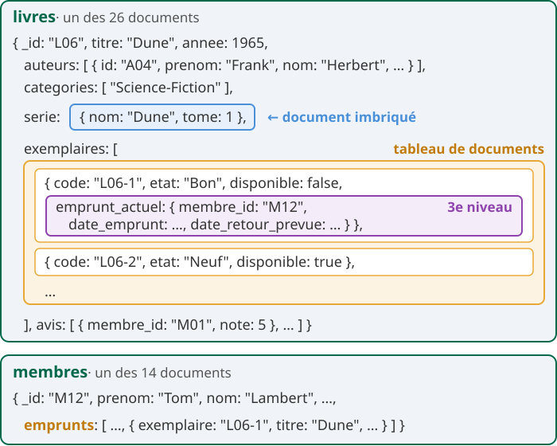

<!--
La séance 2 se fait dans le même dépôt que la séance 1, sur deux nouvelles collections. Les exercices de la séance 2 ne dépendent pas des réponses de la séance 1 : le correcteur automatique part toujours de l'état attendu. Ceux qui n'ont pas fini la séance 1 commencent quand même la partie 5 et reviendront aux exercices manquants plus tard.

Faire lire le document de Dune à voix haute, en retrouvant la structure de la diapositive précédente. Le modèle complet est dans l'énoncé, section « Modéliser la médiathèque ».

Pour le lien avec le TP4 : les mêmes livres et les mêmes membres deviendront des nœuds, et les emprunts et parrainages des relations. Ne pas répondre ici aux questions de modélisation 4 et 5 (chaîne de parrainage, « lecteurs de Dune ») : la comparaison se fera au TP4.
-->

---

## Embarquer ou référencer


<!--
(1 min 30)

Même relation un-à-plusieurs, deux modèles. À gauche, les critiques sont embarquées dans le film : un seul findOne lit le film et ses critiques, et une mise à jour du document entier est atomique. Le prix : le document grossit à chaque critique, et un document BSON ne dépasse pas 16 Mo.

À droite, les critiques sont dans leur propre collection, chacune avec l'_id du film (film_id), comme une clé étrangère. Les documents restent petits, on peut avoir autant de critiques qu'on veut, et en lire ou en modifier une seule. Le prix : deux lectures pour afficher le film et ses critiques, ou une jointure avec $lookup, vue au TP2.

En SQL, on n'aurait pas le choix : deux tables et une jointure. En MongoDB, le choix dépend de la façon dont l'application lit et écrit les données, pas seulement de leur structure.

L'énoncé du TP1 détaille ce choix dans « Modéliser la médiathèque », et le TP3 y revient avec les patterns de conception.
-->

---

## Trois sortes de relations

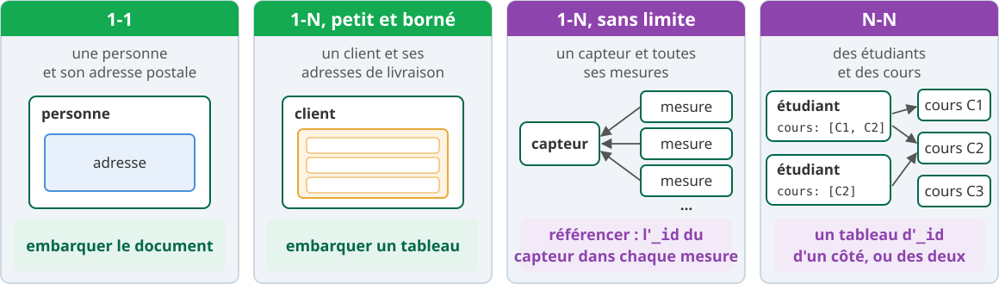

<p class="petit"><b>Pour trancher</b> : les données se lisent-elles ensemble ? Le nombre d'éléments est-il petit et borné ? La donnée change-t-elle souvent sans son parent ? Est-elle partagée par beaucoup de documents ?</p>

<div class="warn">

**Questions de modélisation** : 5 min, à deux, avant la partie 5 (non notées).

</div>

<!--
Lire le tableau, puis les quatre questions : une réponse « oui » aux deux premières pousse à embarquer, une réponse « oui » aux deux dernières à référencer, ou à recopier la donnée en acceptant de modifier toutes les copies.

Laisser vraiment les 5 minutes aux questions de modélisation de l'énoncé. Elles ne sont pas notées ; les réponses vont dans le bloc prévu du playground. Pour le N-N, ne pas donner d'exemple sur les livres et les auteurs : c'est la question de modélisation 2.

Mise en commun (3 minutes), sur les questions 1 à 3 seulement ; les questions 4 et 5 restent ouvertes jusqu'au TP4. Points à faire sortir pendant la mise en commun, pas avant :
- Embarquer, c'est parfois recopier : la même donnée vit dans plusieurs documents. Une lecture devient simple, une modification doit toucher toutes les copies.
- La duplication existe en SQL (dénormalisation), mais ici elle est le choix par défaut. Elle est voulue dans la médiathèque, et la partie 6 en montre le prix.
- Un document BSON ne dépasse pas 16 Mo : un tableau qui grandit sans fin finit par bloquer. https://www.mongodb.com/docs/manual/reference/limits/
-->

---

<!-- header: Partie 5 · interroger -->

<!-- _class: lead -->
<!-- _header: "" -->

# Partie 5 - Interroger des documents imbriqués et des tableaux

notation pointée, opérateurs sur les tableaux, `$elemMatch`, projection

<!--
(10 s)

Même titre que la partie 5 de l'énoncé du TP1.
-->

---


## Des films pour les exemples

```js
{ _id: "F1", titre: "Alien", annee: 1979,
  realisation: { nom: "Scott", pays: "Royaume-Uni" },
  genres: ["SF", "Horreur"],
  seances: [ { salle: "A", vo: true,  places: 0 },
             { salle: "B", vo: false, places: 35 } ] }
```

| `_id` | titre | realisation | genres | seances |
|---|---|---|---|---|
| F2 | Blade Runner | Scott, Royaume-Uni | SF, Policier | A : VO, 12 places |
| F3 | Le Voyage de Chihiro | Miyazaki, Japon | Animation, Fantastique | C : VO, 4 places · C : VF, 0 place |
| F4 | Les Dents de la mer | Spielberg, États-Unis | Horreur, Aventure, Thriller | aucune : `[]` |

<p class="petit">Les requêtes qui suivent renvoient le titre : <code>db.films.find(&lt;filtre&gt;, { _id: 0, titre: 1 })</code>.</p>

<!--
Un document représente un film. On l'écrit avec la notation des objets JavaScript : pas de guillemets autour des clés simples. MongoDB le stocke en BSON.

realisation est un document imbriqué, genres un tableau de valeurs, seances un tableau de documents : les trois formes de la médiathèque, sur d'autres données.

Pour rejouer les exemples, dans essais.mongodb.js (jamais dans le playground noté, jamais sur livres ou membres) :

use('demo');
db.films.deleteMany({});
db.films.insertMany([
  { _id: "F1", titre: "Alien", annee: 1979,
    realisation: { nom: "Scott", pays: "Royaume-Uni" },
    genres: ["SF", "Horreur"],
    seances: [ { salle: "A", vo: true, places: 0 }, { salle: "B", vo: false, places: 35 } ] },
  { _id: "F2", titre: "Blade Runner", annee: 1982,
    realisation: { nom: "Scott", pays: "Royaume-Uni" },
    genres: ["SF", "Policier"],
    seances: [ { salle: "A", vo: true, places: 12 } ] },
  { _id: "F3", titre: "Le Voyage de Chihiro", annee: 2001,
    realisation: { nom: "Miyazaki", pays: "Japon" },
    genres: ["Animation", "Fantastique"],
    seances: [ { salle: "C", vo: true, places: 4 }, { salle: "C", vo: false, places: 0 } ] },
  { _id: "F4", titre: "Les Dents de la mer", annee: 1975,
    realisation: { nom: "Spielberg", pays: "États-Unis" },
    genres: ["Horreur", "Aventure", "Thriller"],
    seances: [] }
]);

Sans sort, l'ordre des résultats n'est pas garanti : ceux des diapositives suivantes sont dans l'ordre obtenu sur MongoDB 9.0.4.
-->

---

## La notation pointée

<div class="cols">
<div>

```js
db.films.find(
  { "realisation.pays": "Japon" },
  { _id: 0, titre: 1 }
)
```

<div class="res">

```js
[ { titre: "Le Voyage de Chihiro" } ]
```

</div>

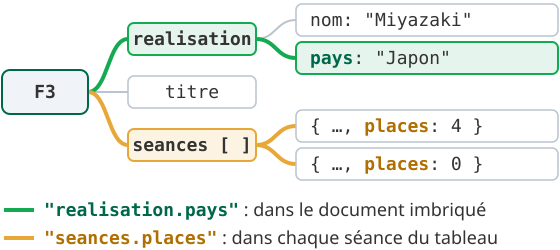

</div>
<div>

**Les guillemets sont obligatoires**

```js
db.films.find({ realisation.nom: "Scott" })
```

<div class="err">

```text
SyntaxError: Unexpected token, expected "," (1:27)
```

</div>

<p class="petit">Une clé simple s'écrit sans guillemets (<code>titre</code>), une clé qui contient un point toujours avec (<code>"realisation.nom"</code>).</p>

<p class="petit">La notation pointée sert aussi dans <code>sort</code> et dans la projection.</p>

</div>
</div>

<!--
Lire le schéma : on enchaîne les noms de champ sur autant de niveaux qu'il faut ("a.b.c") ; à travers un tableau, le chemin vise le champ de chaque élément, et un seul élément qui vérifie la condition suffit.

L'erreur vient de JavaScript, avant même d'atteindre le serveur : sans guillemets, realisation.nom est lu comme un accès à une propriété, pas comme une clé. Elle se produit à l'identique dans mongosh et dans le playground.
-->

---

## Document imbriqué : égalité exacte ou champ

```js
db.films.find({ realisation: { nom: "Scott" } })                       // []
db.films.find({ realisation: { nom: "Scott", pays: "Royaume-Uni" } })  // Alien, Blade Runner
db.films.find({ realisation: { pays: "Royaume-Uni", nom: "Scott" } })  // []
db.films.find({ "realisation.nom": "Scott" })                          // Alien, Blade Runner
```

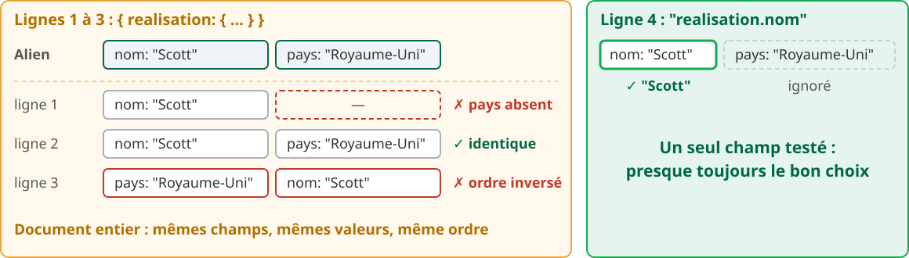

<!--
Les quatre requêtes ont été exécutées avec la projection { _id: 0, titre: 1 }, omise ici pour la lisibilité. Les commentaires donnent les titres obtenus.

Encadré de la partie 5 de l'énoncé : il signale ce piège. La troisième ligne surprend toujours, avec les deux mêmes champs dans un autre ordre et plus aucun résultat.

Le même piège existe sur les tableaux : diapositive suivante.
-->

---

## Tableaux de valeurs

```js
db.films.find({ genres: "Horreur" })                         // Alien, Les Dents de la mer
db.films.find({ genres: ["SF", "Horreur"] })                 // Alien
db.films.find({ genres: ["Horreur", "SF"] })                 // []
db.films.find({ genres: { $all: ["Horreur", "SF"] } })       // Alien
db.films.find({ genres: { $in: ["Policier", "Thriller"] } }) // Blade Runner, Les Dents de la mer
db.films.find({ genres: { $size: 3 } })                      // Les Dents de la mer
db.films.find({ "seances.0.places": 0 })                     // Alien
```

- Une valeur seule : le tableau **contient** cette valeur.
- Un tableau : égalité **exacte**, ordre compris.
- `$all` : **toutes** ces valeurs, dans n'importe quel ordre.
- `$in` : **au moins une** de ces valeurs.
- `$size` : **exactement** ce nombre d'éléments.
- `"seances.0"` : l'élément d'indice 0, le premier.

<!--
Projection { _id: 0, titre: 1 } omise ici aussi ; les commentaires donnent les titres obtenus.

Faire le parallèle avec la diapositive précédente : un tableau écrit dans le filtre demande une égalité exacte, comme un document imbriqué.

La notation "tableau.N" teste aussi une longueur : "seances.1" existe si le tableau a au moins deux éléments. $size existe sous deux formes : comme opérateur de requête, { genres: { $size: 3 } } (exactement 3 éléments ; pas de $size: { $gt: 2 }, il faut alors "genres.2": { $exists: true }), et comme opérateur d'expression dans un pipeline, pour calculer la longueur d'un tableau.
-->

---

## Tableau de documents : le piège des deux conditions

<div class="cols">
<div>

**Deux conditions séparées**

```js
db.films.find({ "seances.vo": true,
                "seances.places": { $gt: 0 } })
```

<div class="res">

```js
[ { titre: "Alien" }, { titre: "Blade Runner" },
  { titre: "Le Voyage de Chihiro" } ]
```

</div>

**`$elemMatch` : un même élément**

```js
db.films.find({ seances: { $elemMatch:
    { vo: true, places: { $gt: 0 } } } })
```

<div class="res">

```js
[ { titre: "Blade Runner" },
  { titre: "Le Voyage de Chihiro" } ]
```

</div>
</div>
<div>

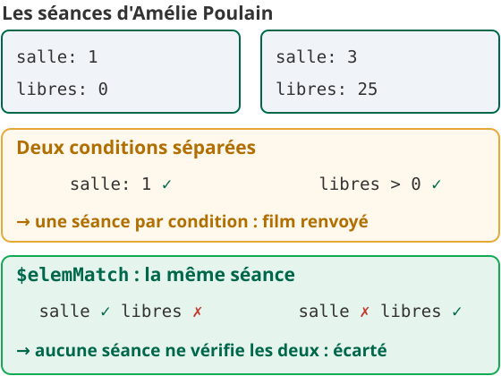 0 pour la séance B : Alien est renvoyé. Avec $elemMatch, aucune séance ne vérifie les deux : Alien est écarté." style="display:block; width:100%; max-height:460px; margin:0 auto;">

</div>
</div>

<!--
Note de la partie 5 de l'énoncé. Retenir le sens « requête » de $elemMatch : deux conditions qui doivent porter sur le même élément, c'est $elemMatch.

$elemMatch sert aussi dans le filtre d'une mise à jour, dès la partie 6.
-->

---

## Projeter un document imbriqué ou un tableau

<div class="cols">
<div>

**Projection pointée : l'imbrication reste**

```js
db.films.find({ _id: "F3" },
  { _id: 0, titre: 1, "realisation.pays": 1 })
```

<div class="res">

```js
[ { titre: "Le Voyage de Chihiro",
    realisation: { pays: "Japon" } } ]
```

</div>

**Expression : le champ remonte**

```js
db.films.find({ _id: "F3" },
  { _id: 0, titre: 1, pays: "$realisation.pays" })
```

<div class="res">

```js
[ { titre: "Le Voyage de Chihiro", pays: "Japon" } ]
```

</div>
</div>
<div>

**Projection positionnelle `"tableau.$"`**

```js
db.films.find(
  { seances: { $elemMatch:
      { vo: true, places: { $gt: 0 } } } },
  { _id: 0, titre: 1, "seances.$": 1 })
```

<div class="res">

```js
[ { titre: "Blade Runner",
    seances: [ { salle: "A", vo: true, places: 12 } ] },
  { titre: "Le Voyage de Chihiro",
    seances: [ { salle: "C", vo: true, places: 4 } ] } ]
```

</div>

<p class="petit">Seul le <b>premier</b> élément qui a satisfait le filtre reste. Le filtre doit porter sur ce tableau.</p>

</div>
</div>

<div class="box">

**Dates** : `ISODate("2026-11-15")`, comparées avec `$lt`, `$gte`... Jamais la date du jour : le résultat changerait d'un jour à l'autre.

</div>

<!--
Les trois requêtes ont été exécutées sur MongoDB 9.0.4.

Contre-exemple à montrer si le temps le permet : avec les deux conditions séparées de la diapositive précédente, la même projection "seances.$" renvoie pour Alien la séance B (vo: false, places: 35). Cette séance ne vérifie qu'une des deux conditions : le piège revient une seconde fois. Avec plusieurs conditions séparées sur le même tableau, la documentation ne garantit d'ailleurs pas quel élément "tableau.$" garde.

Pour les dates, le TP1 fixe sa date de référence au 15 novembre 2026 (encadré « Les dates » de la partie 5). Les dates de la médiathèque sont à minuit UTC.
-->

---

<!-- header: Partie 6 · modifier -->

<!-- _class: lead -->
<!-- _header: "" -->

# Partie 6 - Modifier des documents imbriqués et des tableaux

`$set` en notation pointée, `$push`, `$pull`, opérateur `$`, atomicité

<!--
(10 s)

Même titre que la partie 6 de l'énoncé du TP1.
-->

---


## Modifier un document imbriqué

<p style="margin-bottom: 0.4rem;"><b>Objectif</b> : l'auteur de la recette R1 a déménagé. On veut passer sa ville de «&nbsp;Aix&nbsp;» à «&nbsp;Marseille&nbsp;», <b>sans toucher au reste</b> du document imbriqué <code>auteur</code>.</p>

```js
// la recette, avant
{ _id: "R1", nom: "Crêpes", auteur: { pseudo: "lea13", ville: "Aix" }, ingredients: [ … ] }
```

```js
db.recettes.updateOne(
  { _id: "R1" },                              // 1er argument, le filtre : quel document
  { $set: { "auteur.ville": "Marseille" } }   // 2e argument, la mise à jour : quoi changer
)
```

<div class="res-titre" style="font-size: 0.6em; color: #00684a; font-weight: bold;">auteur, relu avec findOne</div>

```js
{ auteur: { pseudo: 'lea13', ville: 'Marseille' } }
```

<p class="petit"><code>"auteur.ville"</code> : la <b>notation pointée</b> désigne un champ à l'intérieur du document imbriqué, comme dans un filtre. Guillemets obligatoires.</p>

<!--
(1 min)

Lire l'objectif d'abord : on modifie un seul champ d'un document imbriqué. Puis l'appel : le premier argument dit quel document (comme un find), le second dit quoi changer, avec un opérateur ($set). Résultat sur MongoDB 9.0.4 : matchedCount 1, modifiedCount 1 ; seul ville a changé.

La diapositive suivante montre ce qui se passe si l'on oublie la notation pointée.
-->

---

## `$set` : notation pointée ou remplacement ?

<p class="petit" style="margin-bottom: 0.2rem;">Deux écritures du <code>$set</code> de la diapositive précédente, essayées chacune sur la recette de départ :</p>

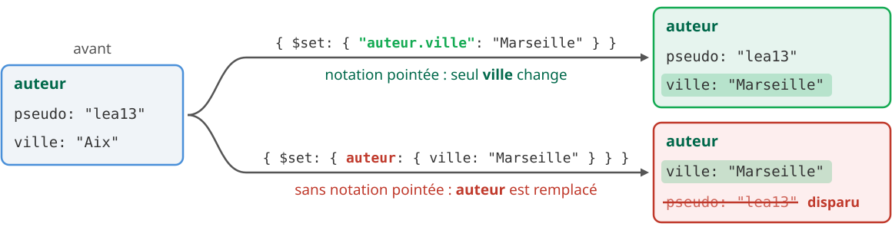

<p class="petit centre" style="margin-top: 0.5rem;">Sans notation pointée, <code>$set</code> remplace <b>tout</b> le document imbriqué.</p>

<!--
Les deux mises à jour du schéma ont été exécutées chacune sur la recette de départ. Chacune renvoie { acknowledged: true, insertedId: null, matchedCount: 1, modifiedCount: 1, upsertedCount: 0 }. La diapositive affiche le champ auteur relu avec findOne après chaque mise à jour.

Pour rejouer (essais.mongodb.js) ; le script remet aussi la recette dans son état de départ entre deux démos :

use('demo');
db.recettes.deleteMany({});
db.recettes.insertOne({ _id: "R1", nom: "Crêpes",
  auteur: { pseudo: "lea13", ville: "Aix" },
  ingredients: [
    { nom: "farine", qte: 250, unite: "g" },
    { nom: "lait", qte: 500, unite: "ml" },
    { nom: "oeufs", qte: 3, unite: "pièce" } ] });

Ne jamais faire ces essais sur livres ou membres ; si c'est arrivé, npm run seed -- --avant N remet la base dans l'état attendu.
-->

---

## Ajouter et retirer : `$push`, `$pull`

```js
db.recettes.updateOne({ _id: "R1" },
  { $push: { ingredients: { nom: "sucre", qte: 30, unite: "g" } } })
db.recettes.updateOne({ _id: "R1" },
  { $pull: { ingredients: { qte: { $lt: 100 } } } })
```

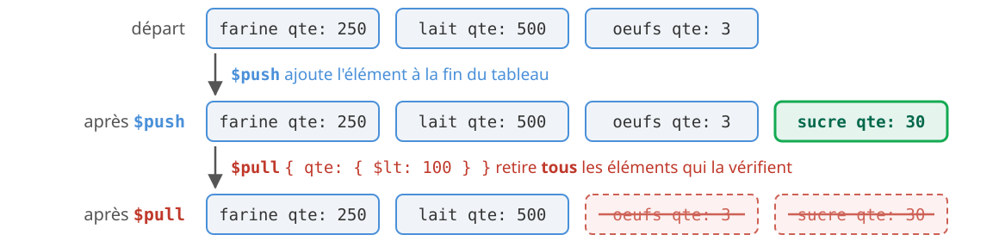

- `$push` ajoute n'importe quelle valeur, y compris un document entier.
- La condition de `$pull` s'écrit comme un filtre de `find`.

<!--
Exécutées l'une après l'autre sur la recette de départ. Pour la lisibilité, la diapositive résume le tableau par le nom et la quantité de chaque ingrédient ; le résultat complet contient aussi unite.

Le $pull avec une condition surprend : il ne retire pas « le » premier élément trouvé, mais tous ceux qui la vérifient. Ici les œufs (3) et le sucre (30), deux quantités inférieures à 100.

Rappel de la séance 1 : $push et $inc ne sont pas idempotents. Exécuter deux fois le même $push ajoute deux fois l'élément. Encore une raison d'éviter Ctrl+Alt+R sur tout le playground.
-->

---

## Modifier un élément précis : l'opérateur `$`

```js
db.recettes.updateOne(
  { _id: "R1", "ingredients.nom": "lait" },   // 1.
  { $set: { "ingredients.$.qte": 600 } }      // 2.
)
```

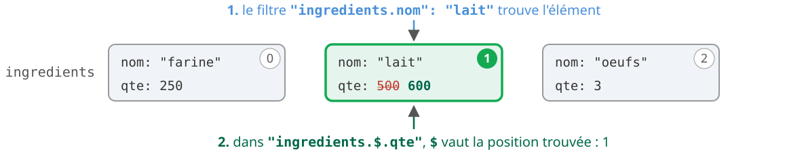

- `$` ne vise que le **premier** élément trouvé.
- Sans condition sur le tableau dans le filtre, MongoDB refuse :

<div class="err">

```text
MongoServerError: ... The positional operator did not find the match needed from the query.
```

</div>

<!--
Exécutée sur la recette de départ. L'erreur a été obtenue avec le filtre { _id: "R1" } seul et la même mise à jour : le message complet commence par « Plan executor error during update :: caused by :: ».

Deux critères sur le même élément : $elemMatch dans le filtre (diapo 9), puis $ dans la mise à jour.

Le $ positionnel s'utilise aussi avec $unset et $inc, et plusieurs champs du même élément peuvent être écrits dans la même mise à jour. Documentation : https://www.mongodb.com/docs/manual/reference/operator/update/positional/

Pour viser tous les éléments qui vérifient une condition, il existe $[<identifiant>] avec arrayFilters (bonus 4) : https://www.mongodb.com/docs/manual/reference/operator/update/positional-filtered/
-->

---

## Atomicité : un document à la fois

<div class="cols">
<div>

**Un document : tout ou rien**

```js
db.recettes.updateOne({ _id: "R1" },
  { $set: { "auteur.ville": "Marseille" },
    $push: { ingredients:
      { nom: "sel", qte: 1, unite: "pincée" } } })
```

</div>
<div>

**Deux documents : deux écritures**

```js
db.recettes.updateOne({ _id: "R1" },
  { $set: { publiee: true } })
db.auteurs.updateOne({ _id: "lea13" },
  { $inc: { nb_publiees: 1 } })
```

</div>
</div>

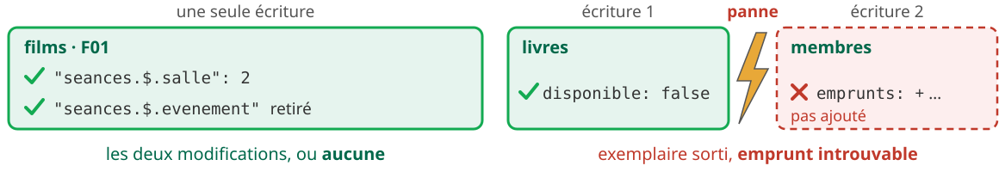

<div class="warn">

Une donnée recopiée dans deux documents s'écrit en deux fois, sans garantie entre les deux. Les **transactions multi-documents** lèvent ce risque : TP3.

</div>

<!--
L'encadré « Deux documents, deux écritures » de la partie 6 traite ce point : un emprunt est écrit dans le livre et dans le membre, donc en deux instructions. Ne pas en dire plus sur les exercices 37 et 38.

Les deux exemples ont été exécutés : chacun renvoie matchedCount: 1, modifiedCount: 1 (avec un document { _id: "lea13", nb_publiees: 0 } inséré au préalable dans auteurs).
-->


---

## Les opérateurs sur les tableaux : interroger et projeter

<style scoped>
.recap { display: grid; grid-template-columns: 1fr; gap: 0.6rem; font-size: 0.74em; margin-top: 0.3rem; }
.recap .bloc { background: #f0f4f8; border-left: 5px solid #4a90d9; border-radius: 6px; padding: 0.45rem 0.9rem; }
.recap .bloc b.t { display: block; color: #00684a; margin-bottom: 0.2rem; }
.recap table { display: table; width: 100%; font-size: 1em; margin: 0; border: none; border-collapse: collapse; }
.recap tr, .recap tr:nth-child(2n) { background: transparent !important; }
.recap td { padding: 0.1rem 0.8rem 0.1rem 0; border: none; background: transparent; vertical-align: top; }
.recap td:first-child, .recap td:first-child code { white-space: nowrap; width: 38%; }
.recap code { font-size: 0.92em; }
</style>

<div class="recap">
<div class="bloc" style="border-left-color: #4a90d9;"><b class="t">Interroger : filtre de find</b>
<table>
<tr><td><code>{ tab: v }</code></td><td>contient la valeur v</td></tr>
<tr><td><code>{ tab: [v1, v2] }</code></td><td>égal à ce tableau, ordre compris</td></tr>
<tr><td><code>$all</code> · <code>$in</code> · <code>$nin</code></td><td>toutes ces valeurs · au moins une · aucune</td></tr>
<tr><td><code>$size: n</code></td><td>exactement n éléments</td></tr>
<tr><td><code>$elemMatch</code></td><td>un même élément vérifie toutes les conditions</td></tr>
<tr><td><code>"tab.champ"</code> · <code>"tab.0"</code></td><td>un élément quelconque · l'élément d'indice 0</td></tr>
</table></div>
<div class="bloc" style="border-left-color: #13aa52;"><b class="t">Projeter : second argument de find</b>
<table>
<tr><td><code>{ "tab.champ": 1 }</code></td><td>ce champ dans chaque élément</td></tr>
<tr><td><code>$slice: n</code></td><td>les n premiers éléments (n négatif : les n derniers)</td></tr>
<tr><td><code>"tab.$": 1</code> · <code>$elemMatch</code></td><td>le premier élément qui correspond</td></tr>
</table></div>
</div>

<p class="legende">Vérifiés sur MongoDB 9.0.4. Manuel : <a href="https://www.mongodb.com/docs/manual/reference/operator/query-array/">opérateurs de requête</a> et <a href="https://www.mongodb.com/docs/manual/reference/operator/projection/">de projection</a> sur les tableaux.</p>

<!--
(30 s : diapositive de référence, à parcourir sans tout détailler ; les étudiants la retrouvent en ligne pendant le TP.)

Rappeler les deux pièges : un tableau écrit dans le filtre demande une égalité exacte, ordre compris ; deux conditions sur un tableau de documents peuvent être satisfaites par deux éléments différents, d'où $elemMatch.

$size ne se combine pas avec $gt : pour « au moins 3 éléments », on teste "tab.2": { $exists: true }.
-->

---

## Les opérateurs sur les tableaux : modifier et agréger

<style scoped>
.recap { display: grid; grid-template-columns: 1fr; gap: 0.6rem; font-size: 0.74em; margin-top: 0.3rem; }
.recap .bloc { background: #f0f4f8; border-left: 5px solid #4a90d9; border-radius: 6px; padding: 0.45rem 0.9rem; }
.recap .bloc b.t { display: block; color: #00684a; margin-bottom: 0.2rem; }
.recap table { display: table; width: 100%; font-size: 1em; margin: 0; border: none; border-collapse: collapse; }
.recap tr, .recap tr:nth-child(2n) { background: transparent !important; }
.recap td { padding: 0.1rem 0.8rem 0.1rem 0; border: none; background: transparent; vertical-align: top; }
.recap td:first-child, .recap td:first-child code { white-space: nowrap; width: 38%; }
.recap code { font-size: 0.92em; }
</style>

<div class="recap">
<div class="bloc" style="border-left-color: #e8a838;"><b class="t">Modifier : updateOne, updateMany</b>
<table>
<tr><td><code>$push</code> (avec <code>$each</code>)</td><td>ajoute à la fin (plusieurs valeurs)</td></tr>
<tr><td><code>$addToSet</code></td><td>ajoute si la valeur n'y est pas déjà</td></tr>
<tr><td><code>$pull</code> · <code>$pullAll</code></td><td>retire selon une condition · retire ces valeurs</td></tr>
<tr><td><code>$pop: 1</code> · <code>$pop: -1</code></td><td>retire le dernier · le premier élément</td></tr>
<tr><td><code>"tab.$"</code></td><td>l'élément trouvé par le filtre</td></tr>
<tr><td><code>"tab.$[]"</code> · <code>"tab.$[x]"</code></td><td>tous les éléments · ceux retenus par <code>arrayFilters</code></td></tr>
</table></div>
<div class="bloc" style="border-left-color: #8e44ad;"><b class="t">Agréger : dans un pipeline (partie 7)</b>
<table>
<tr><td><code>$unwind</code></td><td>un document par élément</td></tr>
<tr><td><code>$size</code> · <code>$arrayElemAt</code></td><td>la longueur · l'élément d'indice n</td></tr>
<tr><td><code>$filter</code></td><td>les éléments qui vérifient une condition</td></tr>
</table></div>
</div>

<p class="legende">Vérifiés sur MongoDB 9.0.4. Manuel : <a href="https://www.mongodb.com/docs/manual/reference/operator/update-array/">opérateurs de mise à jour</a> sur les tableaux.</p>

<!--
(30 s : diapositive de référence.)

$push ajoute même si la valeur est déjà là ; $addToSet non. $pull retire selon une condition écrite comme un filtre ; $pullAll retire une liste de valeurs exactes. "tab.$" modifie l'élément trouvé par le filtre ; "tab.$[]" tous les éléments ; "tab.$[x]" ceux qui vérifient la condition de arrayFilters.

Les opérateurs de pipeline reviennent en partie 7.
-->
---

<!-- header: Partie 7 · agréger -->

<!-- _class: lead -->
<!-- _header: "" -->

# Partie 7 - Premiers pipelines d'agrégation

`$match`, `$unwind`, `$group`, `$sort`

<!--
(10 s)

Début du second temps : à projeter quand la majorité du groupe attaque la partie 7.
-->

---


## Les pipelines d'agrégation

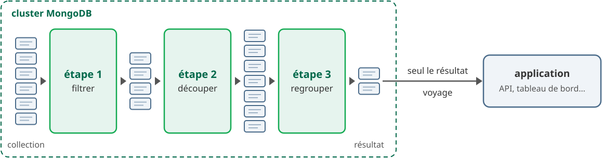

<div class="cols" style="margin-top: 0.4rem; align-items: stretch;">
<div class="box">

**C'est quoi ?** Une suite d'étapes. Chacune reçoit les documents de la précédente, les transforme et passe le résultat à la suivante, comme <code style="white-space: nowrap;">grep | sort | head</code> dans un terminal.

</div>
<div class="box">

**Pourquoi faire ?** `find` sélectionne des documents un par un, sans les combiner : pas de moyenne ni de total par groupe. Le pipeline calcule dans le cluster, sur les nœuds qui possèdent les données, et seul le résultat voyage.

</div>
</div>

<!--
(1 min 30)

Partir de la question que find ne résout pas : « quelle est la température moyenne de chaque pièce ? ». Avec find, il faudrait rapatrier toutes les mesures dans l'application et faire le calcul en JavaScript : beaucoup de données transférées pour trois nombres. Le pipeline fait ce calcul là où sont les données.

Cluster et pas serveur : si la collection est répartie sur plusieurs nœuds (sharding), chaque nœud exécute ce qu'il peut du pipeline sur sa part des données, par exemple, pour un $avg dans un $group, une somme et un nombre de valeurs partiels, puis les résultats partiels sont fusionnés. Seul ce qui est nécessaire circule entre les nœuds, et seul le résultat final part vers l'application.

Le parallèle avec le shell : cat mesures.txt | grep temperature | sort | head -5. Chaque commande lit la sortie de la précédente ; une étape d'agrégation lit les documents produits par l'étape d'avant. Le nombre de documents peut baisser (filtrer), monter (découper un tableau) ou se resserrer (regrouper).

Côté SQL, c'est le rôle de SELECT … WHERE … GROUP BY … ORDER BY : la diapositive suivante met les deux en regard.

C'est l'outil des tableaux de bord : le TP2 et le projet en feront une API qui renvoie des statistiques.
-->

---

## Le pipeline d'agrégation

```js
db.capteurs.aggregate([                // un TABLEAU d'étapes
  { $match: { type: "temperature" } }, // filtrer             WHERE
  { $unwind: "$mesures" },             // 1 doc. par mesure   JOIN mesures
  { $group: { _id: "$piece", ... } },  // regrouper           GROUP BY
  { $project: { ... } },               // choisir, calculer   SELECT
  { $sort: { moyenne: -1 } },          // trier (décroissant) ORDER BY
  { $limit: 5 }                        // limiter             LIMIT
])
```

- Chaque étape reçoit les documents de la précédente et en produit de nouveaux.
- Une étape peut revenir : un `$match` après `$group` filtre les groupes (`HAVING`).
- Dans `$group` ou `$project`, `"$piece"` désigne **la valeur** du champ `piece`. Dans `$match`, on écrit un filtre comme dans `find`.

<!--
(1 min)

Lire le code ligne à ligne avec la colonne SQL : c'est le repère des étudiants qui viennent du relationnel. La diapositive suivante montre ce pipeline sur les capteurs.

Pour l'équivalent SQL de $unwind : dans un schéma relationnel, les mesures seraient dans une table mesures (capteur_id, h, v) ; la jointure capteurs JOIN mesures donne une ligne par mesure, comme $unwind donne un document par mesure.

mongosh accepte une étape isolée, aggregate({ $match: ... }), mais la documentation et les pilotes, dont le driver Node du TP2 et du projet, passent toujours un tableau : prendre dès maintenant l'habitude de aggregate([ ... ]).

Le piège de "$piece" dans $match : { $match: { piece: "$piece" } } compare piece à la chaîne "$piece" et ne renvoie aucun document, alors que chaque capteur a bien une pièce. Comparer deux champs d'un même document demande $expr, hors programme ici.
-->

---

## Le pipeline sur les capteurs


<p class="centre" style="margin-top: 0.6rem;">Le nombre de documents change à chaque étape : <b>5 → 4 → 9 → 3 → 3</b>.<br><span class="petit">Les diapositives suivantes reprennent les étapes une par une.</span></p>

<!--
(1 min)

Lire le schéma de gauche à droite, en commençant par les nombres en haut des colonnes : $match en retire (5 puis 4), $unwind en crée (9, un par mesure), $group les rassemble (3, un par pièce), $sort ne fait que les réordonner (toujours 3).

C2, encadré en rouge, est le capteur d'humidité du Salon : c'est lui que $match écarte.

Le $group sort ses groupes dans un ordre quelconque (ici Cuisine, Salon, Chambre, celui d'une exécution réelle) : on y revient sur la diapo « L'ordre des groupes n'est pas garanti ». Le $sort final fixe l'ordre : Salon (20.75), Cuisine (20.5), Chambre (17.5). Les moyennes ne sont pas arrondies : le $project de cette diapo affiche 20.8 pour le Salon.

$project et $limit ne figurent pas dans le schéma : $project change la forme des documents, pas leur nombre, et { $limit: 5 } en fin de pipeline ne retirerait rien, il n'y a que 3 documents.
-->
---

## Les données : 5 capteurs, une journée

```js
{ _id: "C1", piece: "Salon",   type: "temperature",
  mesures: [ { h: 8, v: 19.5 }, { h: 12, v: 21 }, { h: 18, v: 22.5 } ] }
{ _id: "C2", piece: "Salon",   type: "humidite",
  mesures: [ { h: 8, v: 55 }, { h: 18, v: 48 } ] }
{ _id: "C3", piece: "Cuisine", type: "temperature",
  mesures: [ { h: 8, v: 18 }, { h: 12, v: 23 } ] }
{ _id: "C4", piece: "Salon",   type: "temperature",
  mesures: [ { h: 8, v: 20 } ] }
{ _id: "C5", piece: "Chambre", type: "temperature",
  mesures: [ { h: 8, v: 17 }, { h: 12, v: 17.5 }, { h: 18, v: 18 } ] }
```

<div class="cols" style="align-items: stretch;">
<div class="petit">

- Un document par capteur et par jour.
- `mesures` : un tableau de documents, l'heure `h` et la valeur `v`.
- C2 mesure l'humidité, pas la température.

</div>
<div class="box">

**La question** : quelle est la température moyenne de chaque pièce, de la plus chaude à la plus froide&nbsp;?

</div>
</div>

<!--
(1 min)

Lire la question avant le code : c'est elle qui dicte les étapes. Il faut écarter l'humidité ($match), aller chercher les valeurs dans le tableau ($unwind), calculer par pièce ($group), mettre en forme ($project), trier ($sort) et, si besoin, ne garder que le début ($limit).

Un document par capteur et par jour : on retrouvera cette idée au TP3 sous le nom de pattern Bucket. Ici, le nombre de mesures par document est borné, d'où l'embarquement.

Pour rejouer (essais.mongodb.js) :

use('demo');
db.capteurs.deleteMany({});
db.capteurs.insertMany([
  { _id: "C1", piece: "Salon", type: "temperature",
    mesures: [ { h: 8, v: 19.5 }, { h: 12, v: 21 }, { h: 18, v: 22.5 } ] },
  { _id: "C2", piece: "Salon", type: "humidite",
    mesures: [ { h: 8, v: 55 }, { h: 18, v: 48 } ] },
  { _id: "C3", piece: "Cuisine", type: "temperature",
    mesures: [ { h: 8, v: 18 }, { h: 12, v: 23 } ] },
  { _id: "C4", piece: "Salon", type: "temperature",
    mesures: [ { h: 8, v: 20 } ] },
  { _id: "C5", piece: "Chambre", type: "temperature",
    mesures: [ { h: 8, v: 17 }, { h: 12, v: 17.5 }, { h: 18, v: 18 } ] }
]);

Montrer la démarche en direct : on écrit l'étape 1, on sélectionne, Ctrl+Alt+S, on regarde ; on ajoute l'étape suivante, on réexécute, on regarde. Tous les résultats des diapositives suivantes ont été obtenus ainsi sur MongoDB 9.0.4.
-->

---

## Étape 1 : `$match`

<style scoped>
.cols { margin-top: 1.1rem; }
ul { margin-top: 1.6rem; }
li { margin: 0.55em 0; }
.cols > div:first-child { display: flex; }
.cols > div:first-child pre { flex: 1; margin: 0; display: grid; align-content: center; }
</style>

<div class="cols" style="grid-template-columns: 0.9fr 1.4fr; align-items: stretch; gap: 2.2rem;">
<div>

```js
db.capteurs.aggregate([
  { $match: { type: "temperature" } }
])

// 4 documents : C1, C3, C4, C5
```

</div>
<div>

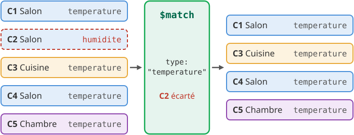

</div>
</div>

- Le filtre s'écrit **comme dans `find`**, avec les mêmes opérateurs (`$gt`, `$in`…).
- C2 ne passe pas : ses mesures d'humidité ne faussent pas les moyennes.
- `$match` se place **le plus tôt possible** : les étapes suivantes traitent moins de documents, et un `$match` en tête peut utiliser un index.

<!--
(1 min)

$match ne change pas les documents : il les laisse passer ou non. C'est le WHERE du SQL.

Plus tard dans un pipeline, après $group, un $match filtre les groupes : c'est le HAVING du SQL (diapositive « Le pipeline d'agrégation »).
-->

---

## Étape 2 : `$unwind`

<style scoped>
.cols { margin-top: 0.6rem; }
ul { margin-top: 1.1rem; }
li { margin: 0.4em 0; }
.cols > div:first-child { display: flex; }
.cols > div:first-child pre { flex: 1; margin: 0; display: grid; align-content: center; }
</style>

<div class="cols" style="grid-template-columns: 1fr 1.25fr; align-items: stretch;">
<div>

```js
db.capteurs.aggregate([
  { $match: { type: "temperature" } },
  { $unwind: "$mesures" }
])

// 9 documents : 3 + 2 + 1 + 3
```

</div>
<div>

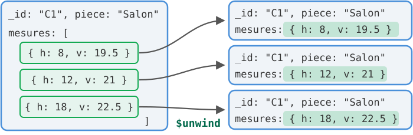

</div>
</div>

- **Un document par élément** du tableau ; les autres champs sont recopiés, avec le même `_id`.
- `mesures` n'est plus un tableau mais un document : sa valeur s'atteint par `"$mesures.v"`.
- Un document dont le tableau est vide ou absent **disparaît** (sauf avec `preserveNullAndEmptyArrays: true`).

<!--
(1 min 30)

Un document par élément : 9 en tout pour les 4 capteurs (le champ type est omis dans le schéma). Le même _id apparaît plusieurs fois, ce qui est normal à l'intérieur d'un pipeline.

Pourquoi cette étape : $group ne sait pas lire « dans » un tableau pour faire une moyenne sur toutes les mesures de tous les capteurs d'une pièce. Après $unwind, chaque mesure est un document, que $group peut ranger dans le groupe de sa pièce.

Le cas du tableau vide a été vérifié sur MongoDB 9.0.4 : un capteur ajouté avec mesures: [] ne sort pas de $unwind ; avec { $unwind: { path: "$mesures", preserveNullAndEmptyArrays: true } }, il sort, sans champ mesures. Pièce sans mesure = pièce absente du résultat, piège classique dans un tableau de bord.

Équivalent SQL : la jointure capteurs JOIN mesures, une ligne par mesure.
-->

---

## Étape 3 : `$group` et ses accumulateurs

<div class="cols" style="grid-template-columns: 1.15fr 1fr; align-items: center;">
<div>

```js
  { $group: {
      _id: "$piece",     // clé de regroupement
      moyenne: { $avg: "$mesures.v" },
      max: { $max: "$mesures.v" },
      nb: { $sum: 1 }
  } }
```

</div>
<div class="petit">

- `$sum: 1` compte les documents
- `$avg`, `$min`, `$max`
- `$first` : valeur du 1er document
- `$push` : tableau des valeurs
- `_id: null` : un seul groupe pour tout

</div>
</div>

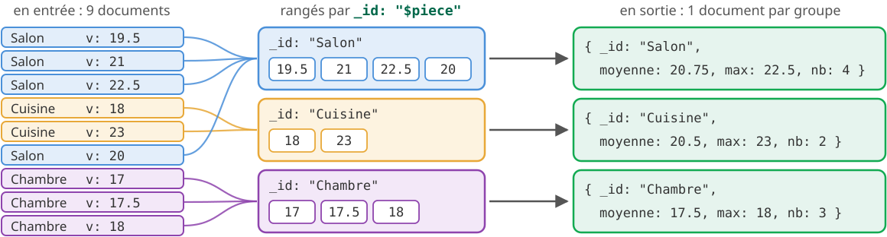

<!--
Un groupe = un document en sortie, avec la clé dans _id. Le Salon a 4 mesures : 3 du capteur C1 et 1 du capteur C4, soit (19.5 + 21 + 22.5 + 20) / 4 = 20.75. Le capteur d'humidité C2 a été écarté par le $match. Les documents d'entrée sont abrégés (champs h et type omis).

Le tableau des accumulateurs et leur équivalent SQL est dans l'énoncé, partie 7.
-->

---

## Étape 4 : `$project`

```js
  { $project: {
      _id: 0,                                 // retire _id
      piece: "$_id",                          // renomme : la valeur de _id
      moyenne: { $round: ["$moyenne", 1] },   // calcule : arrondi à 1 décimale
      nb: "$nb"                               // recopie nb
  } }
```

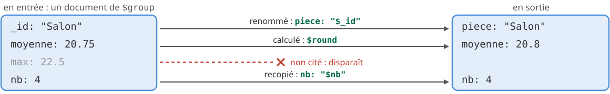

<div class="cols" style="grid-template-columns: 1.1fr 1fr; align-items: center;">
<div class="res">

```js
[ { piece: "Cuisine", moyenne: 20.5, nb: 2 },
  { piece: "Salon", moyenne: 20.8, nb: 4 },
  { piece: "Chambre", moyenne: 17.5, nb: 3 } ]
```

</div>
<div class="petit">

- `$project` **choisit, renomme et calcule** : c'est le `SELECT` du SQL.
- Toujours 3 documents, dans un ordre quelconque.

</div>
</div>

<!--
(1 min)

"$_id" désigne la valeur du champ _id produit par $group, ici le nom de la pièce : piece: "$_id" la recopie sous un nom parlant. _id: 0 retire le champ d'origine, sinon la pièce apparaîtrait deux fois.

$round arrondit 20.75 à 20.8. Les moyennes de $group restent exactes ; l'arrondi ne sert qu'à l'affichage, d'où sa place en fin de pipeline.

Résultat obtenu sur MongoDB 9.0.4. L'ordre Cuisine, Salon, Chambre est celui de cette exécution : il n'est pas garanti, c'est l'objet de l'étape 5.
-->

---

## `$project` calcule aussi : `$size`

<div class="cols" style="grid-template-columns: 1.2fr 1fr; align-items: center;">
<div>

```js
db.capteurs.aggregate([
  { $project: { piece: 1,
      nb_mesures: { $size: "$mesures" } } }
])

// { _id: "C1", piece: "Salon", nb_mesures: 3 }
// { _id: "C2", piece: "Salon", nb_mesures: 2 } …
```

</div>
<div>

- `$size` est une **expression**, comme `$round` : elle calcule une valeur dans une étape.
- Elle compte les éléments du tableau **de chaque document**.

</div>
</div>

<div class="warn" style="margin-top: 1rem;">

`$size` exige un tableau. Sur un document sans champ `mesures`, le pipeline s'arrête :<br><code>The argument to $size must be an array, but was of type: missing</code>

</div>

<p class="etiquette" style="margin-top: 1rem;">À ne pas confondre</p>

<div class="cols" style="align-items: stretch;">
<div class="box" style="margin-top: 0;">

**Dans `find`, `$size` filtre** :<br>`{ genres: { $size: 3 } }` garde les documents dont le tableau a exactement 3 éléments.

</div>
<div class="box" style="margin-top: 0;">

**Dans un pipeline, `$size` calcule** :<br>`{ $size: "$mesures" }` donne le nombre d'éléments et l'ajoute au document.

</div>
</div>

<!--
(1 min)

L'opérateur de requête $size a été vu sur la diapositive « Tableaux de valeurs », avec les films. Il ne se combine pas avec $gt ; l'expression, si : { $gt: [ { $size: "$mesures" }, 2 ] } dans un $match avec $expr, hors programme ici.

L'erreur a été obtenue sur MongoDB 9.0.4 en ajoutant un capteur sans champ mesures ; le message complet commence par « Executor error during aggregate command on namespace: demo.capteurs :: caused by :: ».
-->

---

## Étape 5 : `$sort`

<p style="margin-bottom: 0.2rem;">Sans <code>$sort</code>, l'ordre des documents n'est pas garanti.</p>

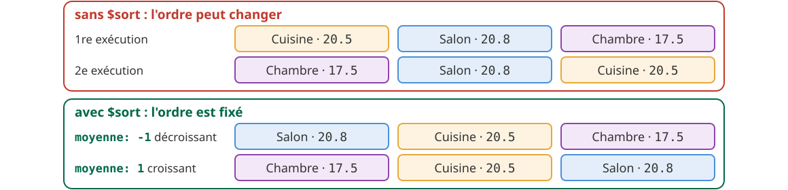

<div class="cols" style="grid-template-columns: 1fr 1fr; align-items: center;">
<div>

```js
  { $sort: { moyenne: -1 } }   // décroissant
```

<p class="petit">Plusieurs clés départagent les ex aequo : <code style="white-space: nowrap;">{ moyenne: -1, piece: 1 }</code></p>

</div>
<div class="warn" style="margin-top: 0.3em;">

Un résultat trié demande un **`$sort` explicite**, placé en fin de pipeline.

</div>
</div>

<!--
(1 min 30)

Les deux ordres viennent de six exécutions consécutives du même pipeline sur MongoDB 9.0.4 : l'ordre a changé d'une exécution à l'autre. Sur un autre poste, il peut encore être différent.

Avec { $sort: { moyenne: 1 } }, l'ordre devient Chambre, Cuisine, Salon (vérifié sur 9.0.4). Le 1 et le -1 sont ceux de sort() dans find : même convention, ORDER BY … ASC et ORDER BY … DESC en SQL.

Lien avec le TP : un exercice qui impose un tri et qui reçoit les bons documents dans le mauvais ordre ne rapporte que la moitié des points.
-->

---

## Étape 6 : `$limit`

<div class="cols" style="grid-template-columns: 1fr 1.1fr; align-items: center;">
<div>

```js
db.capteurs.aggregate([
  // étapes 1 à 4, inchangées
  { $sort: { moyenne: -1 } },
  { $limit: 2 }         // les 2 premiers
])
```

</div>
<div class="petit">

- `$limit: n` garde les **n premiers** documents et laisse tomber les autres : c'est le `LIMIT` du SQL.
- Il ne trie pas : il coupe le flux **dans l'ordre où il le reçoit**.

</div>
</div>

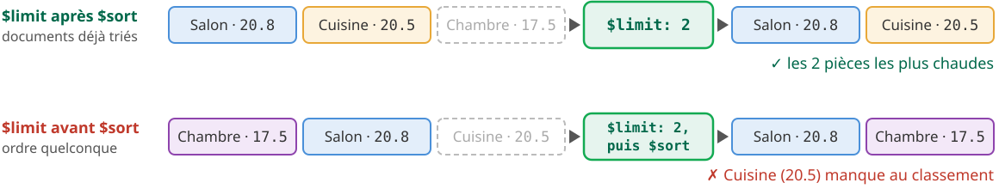

<!--
(1 min)

$limit ne trie pas et ne choisit pas : il coupe le flux après n documents. Tout dépend donc de l'ordre qu'il reçoit, d'où sa place après $sort.

Le second cas du schéma suppose que les groupes arrivent dans l'ordre de la 2e exécution de la diapositive précédente (Chambre, Salon, Cuisine). Sur quatre exécutions de $limit avant $sort, MongoDB 9.0.4 a rendu par hasard le bon classement : le piège ne se voit pas à tous les coups, d'où son danger.

Résultat du pipeline : [ { piece: "Salon", moyenne: 20.8, nb: 4 }, { piece: "Cuisine", moyenne: 20.5, nb: 2 } ].

Le pipeline complet, dont le résultat a été obtenu sur MongoDB 9.0.4 :

db.capteurs.aggregate([
  { $match: { type: "temperature" } },
  { $unwind: "$mesures" },
  { $group: { _id: "$piece", moyenne: { $avg: "$mesures.v" },
              max: { $max: "$mesures.v" }, nb: { $sum: 1 } } },
  { $project: { _id: 0, piece: "$_id",
      moyenne: { $round: ["$moyenne", 1] }, nb: "$nb" } },
  { $sort: { moyenne: -1 } },
  { $limit: 2 }
]) Sur nos 3 pièces, $limit: 5 (diapositive « Le pipeline d'agrégation ») ne retire rien.

Pour la pagination d'une API (TP2, projet), $skip: n saute les n premiers documents : $sort, puis $skip, puis $limit.
-->

---

## Écrire un pipeline sans se tromper

<style scoped>
table { width: 100%; }
td:nth-child(1) code, td:nth-child(2) code { white-space: nowrap; }
</style>

<div class="box" style="font-size: 0.9em; margin-top: 0;">

**La méthode : une étape à la fois.** On ajoute une étape, on exécute (sélection + `Ctrl+Alt+S`), on regarde ce qui sort, puis on passe à la suivante.

</div>

<p class="etiquette" style="margin-top: 1rem;">Les erreurs fréquentes</p>

| Au lieu de | Écrire | Pourquoi |
|---|---|---|
| `aggregate({ $match: … })` | `aggregate([ { $match: … } ])` | le pipeline est un **tableau**, même d'une seule étape |
| `{ $projection: … }` | `{ $project: … }` | `$projection` n'existe pas |
| `{ $project: { $piece: 1 } }` | `{ $project: { piece: 1 } }` | le `$` va dans la **valeur** (`"$piece"`), jamais dans la clé |

<div class="warn" style="margin-top: 1rem;">

**Pour le correcteur automatique** : la réponse se **termine** par <code style="white-space: nowrap">db.&lt;collection&gt;.aggregate([...])</code> (ou `.toArray()`). Un `find` ou un calcul placé après vaut 0.

</div>

<!--
(1 min 30)

Les messages d'erreur ont été obtenus sur MongoDB 9.0.4 :
- $projection : « Unrecognized pipeline stage name: '$projection' » ;
- $piece en clé : « Invalid $project :: caused by :: ... FieldPath field names may not start with '$', given '$piece'. »

mongosh accepte une étape isolée, aggregate({ $match: ... }), mais la documentation et les pilotes, dont le driver Node du TP2 et du projet, passent toujours un tableau.

Le playground suffit pour construire un pipeline : le squelette commenté de chaque exercice de la partie 7 est fait pour être complété étape par étape. Ne pas laisser un aggregate([]) vide sous la réponse.

Les messages du correcteur automatique dans ce cas : « Cet exercice demande un pipeline d'agrégation (aggregate) » ou « Terminez la réponse par le pipeline lui-même ».
-->

---

<!-- header: "" -->

## À vous : la séance 2

**Énoncé :** [iutinfoaix-r510.github.io/tp1](https://iutinfoaix-r510.github.io/tp1/), section « Séance 2 »

<div class="cols" style="grid-template-columns: 1.1fr 1fr; align-items: start;">
<div>

1. Questions de modélisation : **5 min**, à deux
2. Partie 5, interroger : **55 min**
3. Partie 6, modifier : **1 h**
4. Point cours, puis partie 7, agréger : **1 h 15**
5. **Deuxième rendu** : `r510-rendre`, **10 min**

<p class="petit">Minutage indicatif, sur une séance de 4 h.</p>

<div class="warn" style="font-size: 0.9em;">

**Rendu final du TP1 :**<br>dimanche 6 décembre 2026, 23&nbsp;h&nbsp;59

</div>

</div>
<div>

<div class="box" style="margin-top: 0.2rem;">

**Les points** : 18 exercices à 6 points, soit 108 des 208 points du TP1.

</div>

<div class="box">

**Le rendu** : `r510-rendre` lance `npm run check`, puis rend. Trois rendus au plus pour tout le TP1.

</div>

<div class="warn">

**Base abîmée** : `npm run seed -- --avant N` la remet dans l'état attendu avant l'exercice N.

</div>
</div>
</div>

<!--
(1 min)

Rappeler les trois rendus du TP1 : fin de séance 1, fin de séance 2, rendu final au plus tard le dimanche 6 décembre 2026 à 23 h 59.

Le minutage suppose le point cours de début de séance (25 min, questions de modélisation comprises) déjà fait. Reste : partie 5 (7 exercices), 55 min ; partie 6 (6 exercices, plus difficiles), 1 h ; le second temps du point cours (environ 15 min) puis la partie 7 (5 exercices), 1 h 15 ; le rendu, 10 min. Le total fait 3 h 45 : il reste un quart d'heure de marge. En cas de retard, faire le deuxième rendu quand même, les exercices manquants iront au rendu final. r510-sauver sauvegarde, il ne note pas : seul r510-rendre, qui pose le tag submit/…, déclenche la correction.
-->

---

## À vous : essayer et réviser

<style scoped>
table { font-size: 0.87em; width: 100%; }
th { text-align: left; }
td { padding-top: 0.45em; padding-bottom: 0.45em; }
.etiquette { margin-top: 1.4rem !important; }
</style>

<p class="etiquette">Essayer sans risque</p>

<div class="box" style="margin-top: 0.3rem;">

Les essais vont dans `essais.mongodb.js` : dans la collection `brouillon` de `tp1`, ou dans une base à part (`use('demo')`, sélectionnée avec l'essai). **Jamais sous un `// Votre réponse :`.**

</div>

<p class="etiquette" style="margin-top: 1rem;">Réviser : un quiz à la fin de chaque partie, dans Copilot Chat, Claude Code ou Codex</p>

| Partie | À demander à l'assistant |
|---|---|
| 5 | « Fais-moi un quiz sur la notation pointée et les requêtes sur les tableaux. » |
| 6 | « Fais-moi un quiz sur la mise à jour des documents imbriqués et des tableaux : `$push`, `$pull`, l'opérateur positionnel. » |
| 7 | « Fais-moi un quiz sur les pipelines d'agrégation : `$match`, `$unwind`, `$group`, `$project`, `$sort`. » |

<!--
(1 min)

Les assistants du codespace sont configurés en tuteurs : ils expliquent, proposent un quiz sur d'autres données que celles du TP et le corrigent question par question, mais n'écrivent pas la réponse d'un exercice. Conseil de l'énoncé : pour la partie 7, aller le plus loin possible seul avant de les solliciter.

Les trois invites sont celles de l'énoncé, à la fin de chaque partie.
-->

---

## Crédits

<div class="petit">

**Contenus repris** de MongoDB for Academia, sous licence [CC BY-NC-SA 3.0](https://creativecommons.org/licenses/by-nc-sa/3.0/deed.fr) :

- contenus reformulés : *MongoDB 101: Non-Relational for Beginners*, diapos 36 et 38 à 47 (relations et critères de choix)

Détail des reprises : `ATTRIBUTION.md` du dépôt [IUTInfoAix-R510/cours](https://github.com/IUTInfoAix-R510/cours).

**Ce support** : R5.Real.10, IUT d'Aix-Marseille, sous licence [CC BY-NC-SA 4.0](https://creativecommons.org/licenses/by-nc-sa/4.0/deed.fr). Exemples (films, recette, capteurs) écrits pour ce cours et exécutés sur MongoDB 9.0.4.

**Pour aller plus loin** : [requêtes sur les documents imbriqués](https://www.mongodb.com/docs/manual/tutorial/query-embedded-documents/) · [sur les tableaux](https://www.mongodb.com/docs/manual/tutorial/query-arrays/) · [opérateur positionnel](https://www.mongodb.com/docs/manual/reference/operator/update/positional/) · [`$[<identifiant>]` et `arrayFilters`](https://www.mongodb.com/docs/manual/reference/operator/update/positional-filtered/) · [pipeline d'agrégation](https://www.mongodb.com/docs/manual/core/aggregation-pipeline/) · [embarquer ou référencer](https://www.mongodb.com/docs/manual/data-modeling/concepts/embedding-vs-references/)

</div>

<!--
Les présentations d'origine sont en anglais et pensées pour Atlas et l'ancien shell. Les liens sont dans le README du dépôt cours.

Si des étudiants consultent les présentations officielles, voici les passages qui touchent cette séance, avec leurs écarts par rapport au TP (numéros de page de l'export PDF) :
- MongoDB 101, diapos 31 à 34 : le schéma part des besoins de l'application. Diapo 46 : l'exemple N-N des livres et des auteurs répond à la question de modélisation 2, à ne pas montrer avant la mise en commun.
- Querying Complex Data with MQL, diapo 38 : { dim_cm.1: { $gt: 25 } } sans guillemets, qui provoque la SyntaxError de la diapo 6. La diapo 36 est cassée. Les tableaux sont traités aux diapos 30-31, 33, 35, 38 et 40, $elemMatch aux diapos 49 à 54, sur une collection inventory.
- The MongoDB Query Language, diapo 53 : « toutes les écritures sont atomiques » ne vaut que pour un document (Inserting and Updating Data in MongoDB, diapo 43, le dit correctement). Diapo 67 : elle mélange le sens requête et le sens projection de $elemMatch.
- Aucune présentation ne traite l'opérateur positionnel $ dans une mise à jour.
- Querying Data with the MongoDB Aggregation Framework, diapos 5 à 9 : aggregate({ $match: ... }) avec une étape seule, sans tableau. Diapos 25 à 28 : { $project: { $field: <expr> } }, refusé par le serveur.
- The MongoDB Aggregation Framework, diapos 12 à 14 : correspondance avec find, à lire avec $project et non $projection, countDocuments() et non count(). Diapos 34 à 38 : $group sur une collection cow remplie au hasard, résultats non reproductibles ; les diapos 33 et 38 affichent des résultats sans $sort. Diapos 83 à 86 : constructeur de pipeline Compass ou Atlas, absent du codespace.
- Ne pas rejouer leurs démos (drop() sur inventory ou cow) dans la base tp1.
-->
