<!-- _class: lead -->
<!-- _paginate: false -->

<style scoped>
section {
  background-image: url('assets/logo.png');
  background-repeat: no-repeat;
  background-position: bottom 40px center;
  background-size: 380px;
}
h1 { font-size: 1.9em; }
</style>

# Requêtes avancées, agrégation, index

**R5.Real.10 - Nouveaux paradigmes de base de données**

Séance 3 · TP2 · semaine du 30 novembre 2026

<!--
Le point cours se fait en deux temps.

Premier temps, en début de séance : diapos 2 à 22 (données, parties 1 à 4) en 25 minutes, puis les deux diapos « À vous » (32 et 33, 2 minutes).

Second temps, quand la majorité du groupe attaque la partie 5 : diapos 23 à 31 (géospatial, $merge et $jsonSchema, pilote Java et Javalin), 10 minutes. Ces diapos servent aussi de référence pour la fin du TP en autonomie (parties 6 et 7).

Les exemples portent sur des films (collection inventée « brouillon »), pas sur les exercices du TP ; seules les diapos sur les données et sur explain() montrent les vraies collections. Tout a été exécuté sur MongoDB 9.0.4 et les résultats affichés sont ceux obtenus. Le script des films est dans les notes de la diapo « Des films pour les exemples ».
-->

---

<!-- header: Séance 3 · les données -->

## Les données : `sample_restaurants`


<div class="box" style="margin-top: 0.3rem; font-size: 0.68em;"><b>Au programme</b> : 7 parties, 20 exercices, 100 points. Parties 1 à 5 en séance ; parties 6 et 7 (dont le code Java) à terminer en autonomie. Des <b>données réelles</b> : restaurants de New York et leurs inspections sanitaires.</div>

<!--
(2 min)

Un vrai jeu de données, publié par MongoDB : les inspections sanitaires des restaurants de New York (NYC Open Data). Provenance et licences dans data/PROVENANCE.md du dépôt.

Faire lire la structure d'un restaurant : address est un document imbriqué, grades un tableau de documents, rangés de la plus récente à la plus ancienne inspection. Le score est un nombre de points de pénalité : plus il est bas, mieux c'est. Les notes A, B, C correspondent normalement aux scores 0-13, 14-27, 28 et plus.

Ce sont des données réelles, avec leurs défauts : 738 restaurants sans inspection, 13 scores à null, 51 restaurants au borough « Missing », des noms vides. Repérer ces défauts fait partie du travail (partie 1).

boroughs a été construite pour le TP, avec des chiffres du US Census Bureau ; elle sert au $lookup de la partie 3. neighborhoods sert au géospatial (partie 5).
-->

---

## Des films pour les exemples

<style scoped>
table { display: table; width: 100%; font-size: 0.8em; }
</style>

Les exemples des diapos portent sur une collection **inventée**, `brouillon`, comme dans les quiz de l'assistant IA du codespace :

| titre | annee | duree | realisateur | genres | notes |
|---|---|---|---|---|---|
| Le Voyage de Chihiro | 2001 | 125 | Miyazaki | animation, fantastique | presse 5, public 4 |
| Les Glaneurs et la Glaneuse | 2000 | 82 | Varda | documentaire | presse 4 |
| La Haine | 1995 | 98 | Kassovitz | drame | presse 5, public 2 |
| Amélie Poulain | 2001 | 122 | Jeunet | comédie, romance | *aucune* |

<p class="petit"><code>notes</code> est un tableau de documents <code>{ source, note }</code>. Une seconde collection, <code>brouillon_realisateurs</code>, donne le pays de Miyazaki (Japon), Varda et Jeunet (France), mais pas de Kassovitz.</p>

<!--
(30 s)

Script à coller dans essais.mongodb.js pour rejouer les exemples :

use('tp2');
db.brouillon.deleteMany({ titre: { $exists: true } });
db.brouillon.insertMany([
  { titre: "Le Voyage de Chihiro", annee: 2001, duree: 125, realisateur: "Miyazaki", genres: ["animation", "fantastique"],
    notes: [{ source: "presse", note: 5 }, { source: "public", note: 4 }] },
  { titre: "Les Glaneurs et la Glaneuse", annee: 2000, duree: 82, realisateur: "Varda", genres: ["documentaire"],
    notes: [{ source: "presse", note: 4 }] },
  { titre: "La Haine", annee: 1995, duree: 98, realisateur: "Kassovitz", genres: ["drame"],
    notes: [{ source: "presse", note: 5 }, { source: "public", note: 2 }] },
  { titre: "Amélie Poulain", annee: 2001, duree: 122, realisateur: "Jeunet", genres: ["comédie", "romance"], notes: [] }
]);
db.brouillon_realisateurs.deleteMany({});
db.brouillon_realisateurs.insertMany([
  { nom: "Miyazaki", pays: "Japon" }, { nom: "Varda", pays: "France" }, { nom: "Jeunet", pays: "France" }
])

Ce sont les mêmes films que ceux des skills de l'assistant (approfondir-une-notion et quiz-thematique).
-->

---

<!-- header: Partie 1 · filtrer -->

<!-- _class: lead -->
<!-- _header: "" -->

# Partie 1 - 🔎 Requêtes avancées

`$elemMatch`, `$expr`, types

<!--
(10 s)

Même titre que la partie 1 de l'énoncé du TP2.
-->

---

## Comparer deux valeurs d'un même document

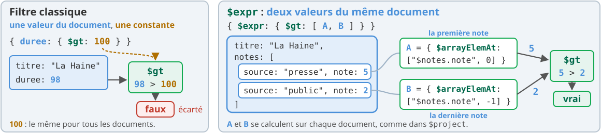

<div class="cols" style="margin-top: 0.4rem; align-items: stretch;">
<div class="box">

**C'est quoi ?** `$expr` permet d'écrire, **dans un filtre**, les expressions du pipeline : `$arrayElemAt`, `$subtract`, `$size`...

</div>
<div class="box">

**Pourquoi faire ?** Un filtre classique compare un champ à une **constante**. Comparer deux champs, ou un champ à une valeur calculée, demande `$expr`.

</div>
</div>

<!--
(1 min 30)

En SQL, WHERE a > b compare deux colonnes sans difficulté. En MongoDB, { a: { $gt: "$b" } } compare a à la CHAÎNE "$b" : le $ n'est interprété comme « valeur du champ » que dans une expression d'agrégation. D'où $expr.

Le coût : une condition dans $expr ne profite généralement pas d'un index. On la combine avec des conditions classiques qui, elles, réduisent les documents à examiner (par exemple un borough).
-->

---

## `$elemMatch` et `$expr` sur les films

<style scoped>
pre { font-size: 0.75em; }
.cols > div { display: flex; flex-direction: column; }
.cols > div > pre { flex: 1; }
</style>

<div class="cols" style="grid-template-columns: 1fr 1fr; align-items: stretch;">
<div>

<p class="etiquette">Rappel du TP1 : deux conditions, un même élément</p>

```js
// deux conditions, éléments quelconques
db.brouillon.countDocuments({
  "notes.source": "public",
  "notes.note": 5 })               // 2
// les deux sur le même élément
db.brouillon.countDocuments({
  notes: { $elemMatch: {
    source: "public", note: 5 } } }) // 0
```

<p class="petit">Sans <code>&#36;elemMatch</code>, « public » et « 5 » peuvent venir de deux notes différentes.</p>

</div>
<div>

<p class="etiquette">La première note meilleure que la dernière</p>

```js
db.brouillon.find(
  { $expr: { $gt: [
    { $arrayElemAt: ["$notes.note", 0] },
    { $arrayElemAt: ["$notes.note", -1] }
  ] } },
  { _id: 0, titre: 1 })
// [ { titre: "Le Voyage de Chihiro" },
//   { titre: "La Haine" } ]
```

<p class="petit">Indice <code>-1</code> : le dernier élément. Tableau vide : pas de valeur, comparaison fausse.</p>

</div>
</div>

<!--
(1 min 30)

Les deux comptages ont été obtenus sur MongoDB 9.0.4 avec les films de la diapo précédente : Chihiro et La Haine ont une note du public et une note 5, mais jamais dans la même note.

Sur les vrais restaurants, l'écart est spectaculaire : c'est l'exercice 1 ; ne pas donner les chiffres.

Pour $expr : Chihiro (5 puis 4) et La Haine (5 puis 2) sont retenus ; Amélie Poulain, sans note, ne l'est pas : $arrayElemAt sur un tableau vide ne renvoie rien. Dans les restaurants, grades est rangé de la plus récente à la plus ancienne inspection : l'indice 0 est la plus récente (exercice 2).
-->

---

## `null`, absent, ou d'un autre type

<style scoped>
table { display: table; width: 100%; font-size: 0.8em; }
</style>

| Filtre | Trouve |
|---|---|
| `{ duree: null }` | `duree` vaut `null` **ou** n'existe pas (les deux cas) |
| `{ duree: { $type: "null" } }` | `duree` existe et vaut `null` |
| `{ duree: { $exists: false } }` | `duree` n'existe pas |
| `{ genres: { $size: 0 } }` | le tableau `genres` est vide |
| `{ annee: { $type: "string" } }` | `annee` est une chaîne (et non un nombre) |

<div class="warn" style="margin-top: 0.8rem;">

Un schéma libre accepte des **données hétérogènes** : un champ manquant ici, un `null` là, un nombre écrit en texte ailleurs. Sur un jeu réel, on les cherche avant de calculer.

</div>

<!--
(1 min)

Vérifié sur MongoDB 9.0.4 avec deux films ajoutés pour l'essai : « Film sans durée » (duree: null) et « Film inconnu » (sans champ duree). { duree: null } trouve les deux ; { $type: "null" } seulement le premier ; { $exists: false } seulement le second.

C'est l'exercice 3 : une consigne qui dit « enregistré à null (le champ existe et vaut null) » appelle une seule de ces écritures.
-->

---

<!-- header: Partie 2 · calculer -->

<!-- _class: lead -->
<!-- _header: "" -->

# Partie 2 - 🧮 Calculer

`$addFields` et fenêtres

---

## Garder, résumer ou situer chaque document

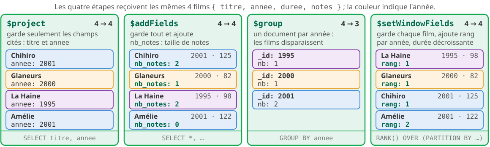

<div class="cols" style="margin-top: 0.3rem; align-items: stretch;">
<div class="box">

**`$addFields`** ajoute des champs calculés **sans retirer** les autres, contrairement à `$project`.

</div>
<div class="box">

**Une fenêtre** (`$setWindowFields`) garde **chaque** document et lui ajoute une valeur calculée sur son groupe : un rang, un cumul, une moyenne glissante.

</div>
</div>

<!--
(1 min 30)

Le schéma compare quatre étapes sur les mêmes documents : seul $group change le nombre de documents. $setWindowFields est l'équivalent de RANK() OVER (PARTITION BY ... ORDER BY ...) en SQL, que les étudiants ont pu voir en R4.03 ; sinon, le présenter comme un $group qui ne fusionne pas les documents.
-->

---

## `$addFields` : un champ calculé

```js
db.brouillon.aggregate([
  { $addFields: { nb_notes: { $size: "$notes" } } },   // ajoute, ne retire rien
  { $project: { _id: 0, titre: 1, annee: 1, nb_notes: 1 } },
  { $sort: { titre: 1 } }
])
// { titre: "Amélie Poulain", annee: 2001, nb_notes: 0 }
// { titre: "La Haine", annee: 1995, nb_notes: 2 }
// { titre: "Le Voyage de Chihiro", annee: 2001, nb_notes: 2 }
// { titre: "Les Glaneurs et la Glaneuse", annee: 2000, nb_notes: 1 }
```

- Un champ ajouté par `$addFields` sert aux **étapes suivantes** : un `$match` sur `nb_notes`, un `$sort`...
- Le même champ dans un `$project` ferait **disparaître** tous les champs non cités.

<div class="box" style="margin-top: 0.8rem;">

Le `$project` final ne sert qu'à l'affichage : il choisit les champs à montrer, une fois le calcul fait.

</div>

<!--
(1 min)

Résultat obtenu sur MongoDB 9.0.4.

L'exercice 4 utilise $addFields (nombre d'inspections, score moyen), puis un $match sur un champ calculé, avant de trier et de projeter.
-->

---

## `$setWindowFields` : un rang par groupe

```js
db.brouillon.aggregate([
  { $setWindowFields: {
      partitionBy: "$annee",          // un groupe par année
      sortBy: { duree: -1 },          // ordre dans le groupe
      output: { rang: { $rank: {} } } // champ ajouté à chaque document
  } },
  { $project: { _id: 0, titre: 1, annee: 1, duree: 1, rang: 1 } },
  { $sort: { annee: 1, rang: 1 } }
])
// { titre: "La Haine", annee: 1995, duree: 98, rang: 1 }
// { titre: "Les Glaneurs et la Glaneuse", annee: 2000, duree: 82, rang: 1 }
// { titre: "Le Voyage de Chihiro", annee: 2001, duree: 125, rang: 1 }
// { titre: "Amélie Poulain", annee: 2001, duree: 122, rang: 2 }
```

- `$rank` : deux documents à égalité ont le **même rang** (`$denseRank`, `$documentNumber` : autres choix).
- Une fenêtre ne trie pas la sortie : le `$sort` final fixe l'ordre d'affichage.

<!--
(1 min 30)

Résultat obtenu sur MongoDB 9.0.4. Équivalent SQL : RANK() OVER (PARTITION BY annee ORDER BY duree DESC).

L'exercice 5 classe les cuisines dans chaque borough avec $rank, après un $group par couple (borough, cuisine).
-->

---

## Une fenêtre glissante

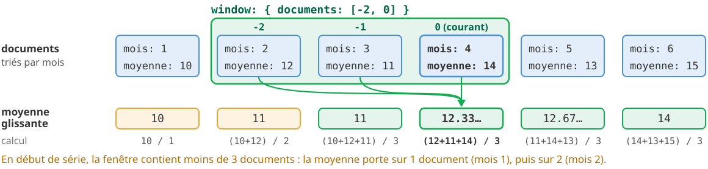

```js
{ $setWindowFields: { sortBy: { mois: 1 },
    output: { glissante: { $avg: "$moyenne", window: { documents: [-2, 0] } } } } }
```

<p class="petit"><code>documents: [-2, 0]</code> : les deux documents précédents et le document courant, dans l'ordre de <code>sortBy</code> ; <code>["unbounded", "current"]</code> : du premier au courant (un cumul).</p>

<!--
(1 min)

Les valeurs sont inventées pour le schéma. Une moyenne glissante lisse une courbe : c'est ce que demande l'exercice 6 sur les scores mensuels de 2014. Insister : on arrondit À LA FIN, pas avant de calculer la moyenne glissante.

window accepte aussi range avec une unité de temps (range: [-2, 0], unit: "month") quand sortBy porte sur une date.
-->

---

<!-- header: Partie 3 · joindre et résumer -->

<!-- _class: lead -->
<!-- _header: "" -->

# Partie 3 - 🔗 Joindre, classer, résumer

`$lookup`, `$bucket`, `$facet`

---

## Joindre deux collections : `$lookup`

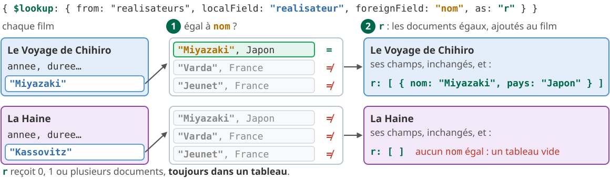

<div class="cols" style="margin-top: 0.3rem; align-items: stretch;">
<div class="box" style="margin-top: 0;">

**Pourquoi faire ?** Ce qui est partagé par beaucoup de documents se **référence** : la population d'un borough est dans `boroughs`, pas recopiée dans 25&nbsp;359 restaurants.

</div>
<div class="warn" style="margin-top: 0;">

Le résultat est **toujours un tableau**. Un `$unwind` derrière **retire** les documents sans correspondance. Une jointure coûte : on la garde pour les statistiques.

</div>
</div>

<!--
(1 min 30)

Le code de l'exemple :
db.brouillon.aggregate([
  { $lookup: { from: "brouillon_realisateurs", localField: "realisateur", foreignField: "nom", as: "r" } },
  { $project: { _id: 0, titre: 1, r: 1 } }, { $sort: { titre: 1 } }
])
Résultat réel : La Haine a r: [] ; les trois autres un tableau d'un document (avec son _id, que le schéma omet).

Équivalent SQL : LEFT OUTER JOIN. Avec $unwind ensuite, on obtient l'équivalent d'un INNER JOIN.

Conseil pour l'exercice 7 : regrouper d'abord (5 documents), joindre ensuite, plutôt que joindre 25 359 restaurants. Le TP3 revient sur le choix « embarquer ou référencer ».
-->

---

## Répartir en tranches : `$bucket`

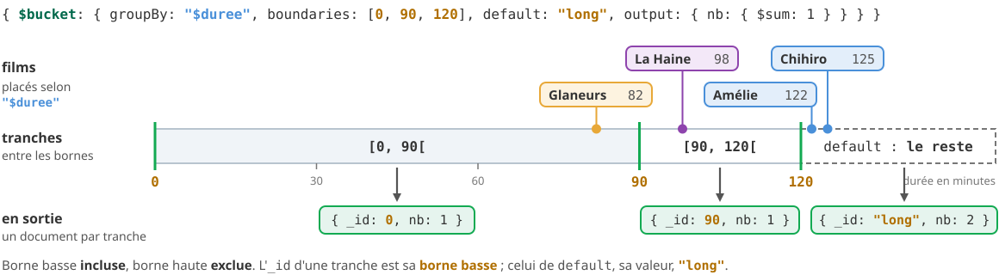

```js
{ $bucket: { groupBy: "$duree", boundaries: [0, 90, 120], default: "long",
             output: { nb: { $sum: 1 } } } }
```

- La borne basse est **incluse**, la borne haute **exclue** ; `default` reçoit tout le reste.
- L'`_id` d'une tranche est sa **borne basse** ; `groupBy` accepte une expression (<code style="white-space: nowrap">{ &#36;size: "&#36;notes" }</code>).

<!--
(1 min)

Résultat réel sur MongoDB 9.0.4 : { _id: 0, nb: 1 }, { _id: 90, nb: 1 }, { _id: "long", nb: 2 }. Avec titres: { $push: "$titre" } dans output, on obtient aussi la liste des titres de chaque tranche (Les Glaneurs et la Glaneuse ; La Haine ; Le Voyage de Chihiro, Amélie Poulain).

Sans default, un document hors bornes provoque une erreur. $bucketAuto (bonus 3) choisit lui-même les bornes pour faire des tranches d'effectifs voisins.
-->

---

## Plusieurs résumés en une passe : `$facet`

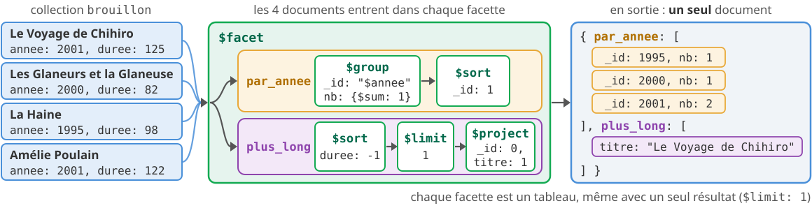

<div class="cols" style="margin-top: 0.4rem; align-items: stretch;">
<div class="box">

**Pourquoi faire ?** Un tableau de bord affiche plusieurs chiffres sur les **mêmes** données : une seule requête, un seul passage.

</div>
<div class="box">

Chaque facette reçoit **les mêmes documents** ; la sortie est **un seul document**, avec **un tableau par facette**. Filtrer **avant** `$facet`.

</div>
</div>

<!--
(1 min)

Le code : db.brouillon.aggregate([{ $facet: { par_annee: [{ $group: { _id: "$annee", nb: { $sum: 1 } } }, { $sort: { _id: 1 } }], plus_long: [{ $sort: { duree: -1 } }, { $limit: 1 }, { $project: { _id: 0, titre: 1 } }] } }]). Résultat réel affiché sur le schéma.

L'exercice 9 en fait un tableau de bord de Brooklyn. C'est ce que fera un écran d'accueil dans le projet.
-->

---

<!-- header: Partie 4 · indexer -->

<!-- _class: lead -->
<!-- _header: "" -->

# Partie 4 - ⚡ Index

`explain()` et règle ESR

---

## Sans index, tout est lu

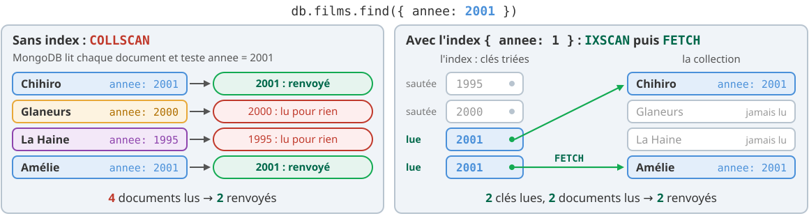

<div class="cols" style="margin-top: 0.3rem; align-items: stretch;">
<div class="box" style="margin-top: 0;">

**C'est quoi ?** Un index est une liste **triée** de valeurs d'un ou plusieurs champs, chacune avec l'adresse de son document.

</div>
<div class="warn" style="margin-top: 0;">

**Son prix** : de la place, et du temps à **chaque écriture**. On indexe ce que les requêtes fréquentes filtrent et trient.

</div>
</div>

<!--
(1 min 30)

Chiffres réels, base tp2, MongoDB 9.0.4 : sans index, totalDocsExamined 25359 pour nReturned 2338 ; avec { borough: 1 }, totalKeysExamined 2338, totalDocsExamined 2338.

Comparer avec l'index d'un livre : on va directement à la bonne page au lieu de tout lire. MongoDB crée toujours un index sur _id.
-->

---

## Lire un `explain("executionStats")`

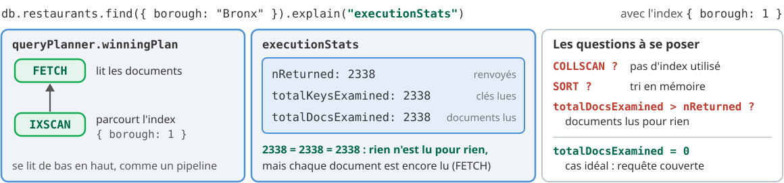

```js
db.restaurants.createIndex({ borough: 1 })
db.restaurants.find({ borough: "Bronx" }).explain("executionStats")
db.restaurants.dropIndexes()        // tous les index, sauf _id
```

<!--
(1 min 30)

explain() sans paramètre montre seulement le plan choisi ; avec "executionStats", MongoDB exécute la requête et compte ce qu'elle a coûté. executionTimeMillis varie d'une exécution à l'autre ; les compteurs, non.

Prévenir : dans la base tp2 de l'étudiant, les index créés restent d'un exercice à l'autre. Exemple D du playground : getIndexes() et dropIndexes(). Le correcteur automatique, lui, part toujours d'une base sans index.
-->

---

## Index composé : la règle ESR

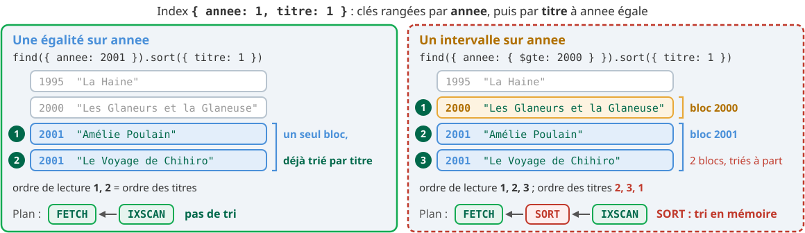

<p class="centre" style="margin-top: 0.3rem;"><b>É</b>galité, puis <b>S</b>ort (tri), puis <b>R</b>ange (intervalle) : l'ordre des champs dans l'index.</p>

<!--
(2 min)

Lire le schéma de haut en bas : l'index est trié par le premier champ, puis par le deuxième à l'intérieur de chaque valeur du premier, etc.

- Égalité d'abord : annee = 2001 désigne un seul bloc contigu de clés.
- Tri ensuite : dans ce bloc, les clés sont déjà rangées par titre ; pas de tri en mémoire.
- Intervalle à la fin : duree > 100 se vérifie dans la clé, sans lire le document.

Le schéma prend six films de plus pour que le bloc 2001 ait plusieurs titres (Gladiator 2000, 155 min ; Shrek 2001, 90 ; Donnie Darko 2001, 113 ; Ocean's Eleven 2001, 116 ; Amélie 2001, 122 ; Chicago 2002, 113). Plans obtenus sur MongoDB 9.0.4 avec ces films, les mêmes qu'avec la collection brouillon : { annee: 1, duree: 1 } donne SORT ← FETCH ← IXSCAN (3 clés, 3 documents) ; { annee: 1, titre: 1, duree: 1 } donne FETCH ← IXSCAN (5 clés lues, dont Shrek, écarté dans la clé : 3 documents) ; avec la projection { _id: 0, titre: 1, duree: 1 }, PROJECTION_COVERED ← IXSCAN. Résultat : Amélie, Donnie Darko, Ocean's Eleven.

Pourquoi l'intervalle avant le tri casse tout : un intervalle sur le deuxième champ couvre plusieurs « sous-blocs », chacun trié séparément ; l'ordre global par titre est perdu, d'où le SORT.
-->

---

## Requête couverte

<style scoped>
.box pre, .warn pre { font-size: 0.82em; }
</style>

<div class="cols" style="grid-template-columns: 1fr 1fr; align-items: stretch;">
<div class="box" style="margin-top: 0;">

**Couverte** : l'index contient **tous** les champs filtrés, triés **et** projetés. MongoDB répond avec l'index seul&nbsp;: `totalDocsExamined: 0`.

```js
// index { annee: 1, titre: 1, duree: 1 }
db.brouillon.find(
  { annee: 2001, duree: { $gt: 100 } },
  { _id: 0, titre: 1, duree: 1 }
).sort({ titre: 1 })
// plan : PROJECTION_COVERED ← IXSCAN
```

</div>
<div class="warn" style="margin-top: 0;">

**Le piège** : `_id` est projeté **par défaut**. S'il n'est pas dans l'index, il faut lire le document : la requête n'est plus couverte. Exclure `_id: 0`.

```js
db.brouillon.find(
  { annee: 2001, duree: { $gt: 100 } },
  { titre: 1, duree: 1 }      // _id inclus
).sort({ titre: 1 })
// plan : PROJECTION_SIMPLE ← FETCH ← IXSCAN
// totalDocsExamined: 2
```

</div>
</div>

<div class="carte vert" style="margin-top: 0.8rem;">
<b class="t">🤖 Pour le correcteur automatique</b>
Exercices 11 et 12 : le résultat ne suffit pas, le correcteur automatique vérifie aussi le plan de votre requête : index utilisé, pas de <code>SORT</code>, pas de document lu pour rien (ou aucun, pour une requête couverte).
</div>

<!--
(1 min)

Le correcteur automatique lit le profileur de MongoDB, pas la sortie de l'étudiant : il voit le plan réellement exécuté. Le bon résultat obtenu sans l'index demandé vaut 0 à ces deux exercices.

Rappeler l'ordre : créer l'index, PUIS exécuter la requête, dans la même réponse.
-->

---

## Écrire sans se tromper

<!-- _header: "Récapitulatif des parties 1 à 4" -->

<style scoped>
table { display: table; width: 100%; font-size: 0.8em; }
td:nth-child(1) code, td:nth-child(2) code { white-space: nowrap; }
</style>

| Au lieu de | Écrire | Pourquoi |
|---|---|---|
| `{ a: { $gt: "$b" } }` | `{ $expr: { $gt: ["$a", "$b"] } }` | hors de `$expr`, `"$b"` est une chaîne |
| `{ score: null }` | `{ score: { $type: "null" } }` | `null` trouve aussi les champs absents |
| `$project` pour ajouter un champ | `$addFields` | `$project` retire tout ce qu'il ne cite pas |
| `$lookup` puis rien | `$lookup` puis `$unwind` | le résultat est un tableau |
| `explain()` | `explain("executionStats")` | sans paramètre, pas de compteurs |

<div class="warn" style="margin-top: 0.8rem;">

**Pas de `Ctrl+Alt+R`** dans le TP2 : il créerait tous les index d'un coup et fausserait les `explain()`. Base abîmée&nbsp;? `npm run seed` la remet à zéro.

</div>

<!--
(1 min)

Chaque ligne correspond à une erreur vue sur les TP de 2025 ou à un piège des données. Le dernier point est propre au TP2 : les index, la collection avis et bilan_boroughs restent dans la base de l'étudiant.

Fin du premier temps : enchaîner sur les deux diapos « À vous » (diapos 32 et 33), puis lancer le travail. Le second temps commence à la partie 5.
-->

---

<!-- header: Partie 5 · localiser -->

<!-- _class: lead -->
<!-- _header: "" -->

# Partie 5 - 🗺️ Géospatial

`$geoIntersects` et `$geoWithin`

<!--
(10 s)

Début du second temps : à projeter quand la majorité du groupe attaque la partie 5. Diapos 23 à 31, 10 minutes.
-->

---

## Points et zones

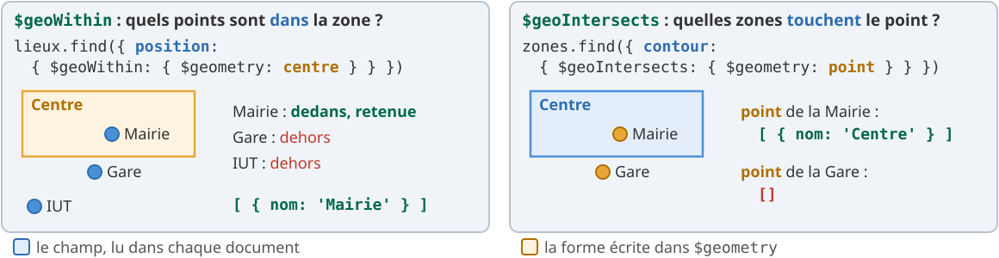

```js
const centre = db.zones.findOne({ nom: "Centre" }).contour      // le Polygon de la zone
db.lieux.find({ position: { $geoWithin: { $geometry: centre } } }, { _id: 0, nom: 1 })  // [ { nom: "Mairie" } ]
db.zones.find({ contour: { $geoIntersects: { $geometry: { type: "Point",
  coordinates: [5.4474, 43.5297] } } } }, { _id: 0, nom: 1 })                           // [ { nom: "Centre" } ]
```

<!--
(1 min 30)

GeoJSON : { type: "Point", coordinates: [longitude, latitude] } ; un Polygon est une liste de points dont le dernier répète le premier. Piège classique : inverser longitude et latitude, ce qui place les points dans l'océan.

$geoWithin et $geoIntersects fonctionnent sans index ; un index 2dsphere les accélère et devient obligatoire pour $nearSphere (trier par distance, bonus 1).

Dans les restaurants, address.coord est un couple [longitude, latitude], que MongoDB accepte comme un point. Les exercices 13 et 14 se font en deux instructions : chercher le document (restaurant ou quartier), puis l'utiliser dans la requête géospatiale.

Résultats réels sur MongoDB 9.0.4, avec des lieux inventés d'Aix-en-Provence (collections lieux et zones).
-->

---

<!-- header: Partie 6 · écrire et contraindre -->

<!-- _class: lead -->
<!-- _header: "" -->

# Partie 6 - 🧱 Écrire et contraindre

`$merge` et `$jsonSchema`

---

## Enregistrer un résultat : `$merge`

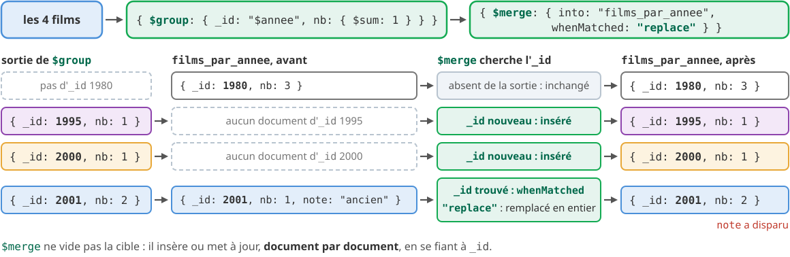

<div class="cols" style="margin-top: 0.3rem; align-items: stretch;">
<div class="box" style="margin-top: 0;">

**Recalculer la vue** : relancer le même pipeline. Avec `whenMatched: "replace"`, un champ qui a disparu du résultat disparaît aussi de la collection.

</div>
<div class="warn" style="margin-top: 0;">

`$merge` est la **dernière étape** du pipeline. Le défaut, `whenMatched: "merge"`, **garde** les anciens champs.

</div>
</div>

<!--
(1 min)

Exemple réel sur les films : db.brouillon.aggregate([{ $group: { _id: "$annee", nb: { $sum: 1 } } }, { $merge: { into: "films_par_annee", whenMatched: "replace" } }]) donne { _id: 1995, nb: 1 }, { _id: 2000, nb: 1 }, { _id: 2001, nb: 2 }.

L'exercice 15 est aussi noté sur une base où bilan_boroughs contient déjà un document avec un champ en trop : seul whenMatched: "replace" le fait disparaître.
-->

---

## Contraindre : `$jsonSchema`

<style scoped>
.cols > div:first-child { display: flex; }
.cols > div:first-child pre { flex: 1; margin: 0; }
</style>

<div class="cols" style="grid-template-columns: 1.15fr 1fr; align-items: stretch;">
<div>

```js
db.createCollection("contacts", {
  validator: { $jsonSchema: {
    required: ["nom", "age"],
    properties: {
      nom: { bsonType: "string" },
      age: { bsonType: "int", minimum: 0 }
    }
  } }
})
db.contacts.insertOne({ nom: "Lina", age: -3 })
// MongoServerError: Document failed validation
db.contacts.insertOne({ nom: "Lina", age: 30 })
// accepté
```

</div>
<div>

- `required` : les champs **obligatoires**.
- `properties` : le type (`bsonType`) et les bornes (`minimum`, `maximum`) de chaque champ.
- Un champ décrit sans être obligatoire est **facultatif**, mais vérifié s'il est présent.
- Un champ non décrit reste **permis**.

</div>
</div>

<div class="box" style="margin-top: 0.6rem;">

**Pourquoi ?** Un schéma libre n'empêche pas un document incohérent : la règle le refuse **à l'écriture**.

</div>

<!--
(1 min)

Exécuté sur MongoDB 9.0.4 ; le message complet de l'erreur détaille la règle violée (age < 0).

En mongosh, un nombre entier comme 30 est envoyé en int ; 4.5 en double. C'est ce qui distingue bsonType "int" de "double" (exercice 16 : la note est un entier).

Le correcteur automatique essaie une douzaine d'insertions, valides ou non, et compare ce que la règle de l'étudiant accepte à ce que la règle attendue accepte.
-->

---

<!-- header: Partie 7 · coder -->

<!-- _class: lead -->
<!-- _header: "" -->

# Partie 7 - ☕ Du shell au code

pilote Java de MongoDB et Javalin

---

## Du playground à l'API

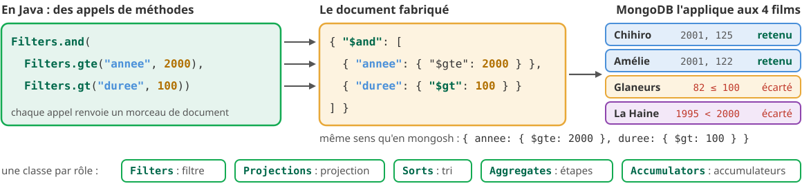

<div class="cols" style="margin-top: 0.3rem; align-items: stretch;">
<div class="box">

**Pourquoi ?** Le projet est une API REST en **Java** : les requêtes du TP y passent telles quelles, traduites avec les **classes d'aide** du pilote.

</div>
<div class="box">

Le dossier `requetes-java/` du TP2 : 3 méthodes et 1 route à écrire, à partir d'exemples fournis. Noté par `npm run check`.

</div>
</div>

<!--
(1 min)

Le pilote reprend les mêmes documents (org.bson.Document est une Map) et les mêmes opérateurs ; les classes d'aide évitent d'écrire les documents à la main et les fautes de frappe dans les noms d'opérateurs.

Le projet (S6 à S8) part d'un squelette Java, Javalin et MongoDB : cette partie en est la première prise en main.
-->

---

## Les classes d'aide du pilote

<style scoped>
table { display: table; width: 100%; font-size: 0.68em; }
td code { white-space: nowrap; }
pre { font-size: 0.68em; }
</style>

| mongosh | Java |
|---|---|
| `{ borough: "Bronx", cuisine: "Pizza" }` | `Filters.and(Filters.eq("borough", "Bronx"),`<br>`Filters.eq("cuisine", "Pizza"))` |
| `{ _id: 0, name: 1 }` | `Projections.fields(Projections.excludeId(),`<br>`Projections.include("name"))` |
| `.sort({ name: 1 })` | `.sort(Sorts.ascending("name"))` |
| `{ $group: { _id: "$annee", total: { $sum: 1 } } }` | `Aggregates.group("$annee", Accumulators.sum("total", 1))` |

```java
public List<Document> restaurantsParCuisine(String borough, String cuisine) {     // fourni
    return restaurants
            .find(Filters.and(Filters.eq("borough", borough), Filters.eq("cuisine", cuisine)))
            .projection(Projections.fields(Projections.excludeId(), Projections.include("name")))
            .sort(Sorts.ascending("name"))
            .into(new ArrayList<>());
}
```

<!--
(1 min)

into(new ArrayList<>()) transforme l'itérable du pilote en liste. Pour une expression sans classe d'aide ($round, $divide...), on écrit le document : new Document("$round", List.of(...)).

Méthode : écrire la requête dans le playground, la vérifier, puis la traduire étape par étape.
-->

---

## Une route Javalin

<div class="cols" style="grid-template-columns: 1.3fr 1fr; align-items: stretch;">
<div>

```java
Javalin.create(config -> {
    config.routes.get("/api/sante",
        ctx -> ctx.json(Map.of("statut", "ok")));
    config.routes.get("/api/boroughs/{borough}/restaurants",
        ctx -> ctx.json(requetes.restaurantsParCuisine(
            ctx.pathParam("borough"),       // {borough}
            ctx.queryParam("cuisine"))));   // ?cuisine=Pizza
});
```

</div>
<div style="font-size: 0.82em;">

- `{borough}` : **paramètre de chemin** (`ctx.pathParam`).
- `?cuisine=Pizza` : **paramètre de requête** (`ctx.queryParam`).
- `ctx.json(...)` : la réponse en JSON ; `ctx.status(404)` : une erreur.

</div>
</div>

<div class="bandeau" style="margin-top: 0.8rem; font-size: 0.85em;">

Dans `requetes-java/` : `./mvnw -q compile exec:java`, puis l'onglet **Ports** (7070) : `/api/sante`

</div>

<!--
(1 min)

Les deux routes sont fournies dans ApiRestaurants.java ; l'exercice 20 en ajoute une troisième, avec un paramètre de requête facultatif (valeur par défaut) et une réponse 404.

Au premier ./mvnw, Maven télécharge ses dépendances (une à deux minutes) : le faire dès le début de la séance.
-->

---

<!-- header: "" -->

## À vous : la séance 3

<style scoped>
.g2 > div { display: flex; flex-direction: column; gap: 0.6rem; }
.g2 > div > .orange { margin-top: auto; }
</style>

<div class="bandeau" style="font-size: 1em; padding: 0.45rem 1.2rem;">
<a href="https://iutinfoaix-r510.github.io/tp2/">iutinfoaix-r510.github.io/tp2</a> : accepter le TP2, puis <code>npm run seed</code>
</div>

<div class="g2" style="margin-top: 0.9rem; font-size: 0.8em; grid-template-columns: 1.1fr 1fr; align-items: stretch;">
<div>

1. Mise en place, `./mvnw -q compile` : **15 min**
2. Parties 1 et 2, filtrer et calculer : **50 min**
3. Partie 3, joindre et résumer : **35 min**
4. Partie 4, index : **30 min**
5. Point cours, puis partie 5 : **30 min**
6. **Premier rendu** : `r510-rendre`, **10 min**

<p style="font-size: 0.85em; margin: 0;">Minutage indicatif, sur une séance de 4 h.</p>

<div class="carte orange">
<b class="t">📅 Rendu final du TP2</b>
dimanche 13 décembre 2026, 23&nbsp;h&nbsp;59
</div>

</div>
<div>

<div class="carte vert">
<b class="t">Les points</b>
20 exercices à 5 points, dont 4 en Java : 100 points, 8 % de la note.
</div>

<div class="carte vert">
<b class="t">En autonomie</b>
Parties 6 et 7 (environ 1 h 30) : <code>&#36;merge</code>, <code>&#36;jsonSchema</code>, Java et Javalin.
</div>

<div class="carte orange">
<b class="t">Base abîmée ?</b>
<code>npm run seed</code> vide la base et recharge les données.
</div>

</div>
</div>

<!--
(1 min)

Trois rendus au plus : fin de séance 3, un rendu intermédiaire facultatif, puis le rendu final au plus tard le dimanche 13 décembre 2026 à 23 h 59.

Le minutage suppose le premier temps du point cours (25 min) déjà fait : 15 + 50 + 35 + 30 + 30 + 10 = 2 h 50, plus le point cours, soit 3 h 15 ; il reste trois quarts d'heure de marge. Les parties 6 et 7 se terminent en autonomie ; les diapos 25 à 31 servent de référence.
-->

---

## À vous : essayer et réviser

<style scoped>
table { font-size: 0.8em; width: 100%; }
td { padding-top: 0.3em; padding-bottom: 0.3em; }
</style>

<p class="etiquette">🧪 Essayer sans risque</p>

<div class="box" style="margin-top: 0.3rem;">

Les essais vont dans `essais.mongodb.js`, sur la collection `brouillon` (les films de ce cours). **Jamais sous un <code style="white-space: nowrap;">// Votre réponse :</code>.**

</div>

<p class="etiquette" style="margin-top: 0.9rem;">🧠 Réviser : un quiz à la fin de chaque partie, dans Copilot Chat, Claude Code ou Codex</p>

| Partie | À demander à l'assistant |
|---|---|
| 1 | « Fais-moi un quiz sur `$elemMatch`, `$expr` et les types BSON. » |
| 2 | « Fais-moi un quiz sur `$addFields` et les fonctions de fenêtre. » |
| 3 | « Fais-moi un quiz sur `$lookup`, `$bucket` et `$facet`. » |
| 4 | « Fais-moi un quiz sur les index, `explain()` et la règle ESR. » |
| 5 à 7 | « Fais-moi un quiz sur les requêtes géospatiales », « … sur `$merge` et `$jsonSchema` », « … sur le pilote Java de MongoDB et Javalin. » |

<!--
(1 min)

Les invites sont celles de l'énoncé, à la fin de chaque partie. Les assistants du codespace sont configurés en tuteurs : ils expliquent et font réviser, mais n'écrivent ni la requête ni le code Java d'un exercice.
-->

---

<!-- _class: lead -->

# Des questions ?

**Sébastien Nedjar** (GA1) · **Leïla Sakli Miled** (GA2)
IUT d'Aix-Marseille, département Informatique

<div style="margin-top: 1.2rem; font-size: 0.85em;">

[iutinfoaix-r510.github.io/tp2](https://iutinfoaix-r510.github.io/tp2/)
sebastien.nedjar@univ-amu.fr · leila.SAKLI@univ-amu.fr

</div>

<div class="bandeau" style="margin-top: 1.6rem; text-align: left; font-size: 0.95em;">

🎯 **Dès maintenant** : accepter le TP2, `npm run seed`, `./mvnw -q compile`, puis la partie 1, une requête à la fois.

</div>

<div class="warn" style="margin-top: 1rem;">

**D'ici le dimanche 13 décembre, 23&nbsp;h&nbsp;59** : terminez les parties 6 et 7 en autonomie, faites le quiz de chaque partie, puis le rendu final avec <code style="white-space: nowrap;">r510-rendre</code>.

</div>

<!--
(10 s)

Questions sur le cours : en séance, ou par courriel à l'enseignant de son groupe ; pour la partie en autonomie, une issue sur le dépôt syllabus.
-->

---

## Crédits

<div class="petit">

**Ce support** : R5.Real.10, IUT d'Aix-Marseille, sous licence [CC BY-NC-SA 4.0](https://creativecommons.org/licenses/by-nc-sa/4.0/deed.fr). Exemples (films, lieux d'Aix-en-Provence) écrits pour ce cours ; tous exécutés sur MongoDB 9.0.4.

**Données du TP** : `sample_restaurants` de MongoDB, issu de *DOHMH New York City Restaurant Inspection Results* (NYC Open Data) ; quartiers *Pediacities NYC Neighborhoods* sous licence [ODC-By 1.0](https://opendatacommons.org/licenses/by/1-0/) ; populations et superficies du US Census Bureau (recensement de 2020). Détail : `data/PROVENANCE.md` du TP2.

**Pour aller plus loin** : [`$expr`](https://www.mongodb.com/docs/manual/reference/operator/query/expr/) · [`$setWindowFields`](https://www.mongodb.com/docs/manual/reference/operator/aggregation/setWindowFields/) · [`$lookup`](https://www.mongodb.com/docs/manual/reference/operator/aggregation/lookup/) · [`$bucket`](https://www.mongodb.com/docs/manual/reference/operator/aggregation/bucket/) · [`$facet`](https://www.mongodb.com/docs/manual/reference/operator/aggregation/facet/) · [résultats d'`explain()`](https://www.mongodb.com/docs/manual/reference/explain-results/) · [règle ESR](https://www.mongodb.com/docs/manual/tutorial/equality-sort-range-guideline/) · [géospatial](https://www.mongodb.com/docs/manual/geospatial-queries/) · [`$merge`](https://www.mongodb.com/docs/manual/reference/operator/aggregation/merge/) · [validation](https://www.mongodb.com/docs/manual/core/schema-validation/specify-json-schema/) · [pilote Java](https://www.mongodb.com/docs/drivers/java/sync/current/fundamentals/builders/) · [Javalin](https://javalin.io/documentation)

</div>

<!--
Ce support ne reprend aucun contenu de MongoDB for Academia. Pour les étudiants qui consultent les présentations officielles (en anglais, pensées pour Atlas et l'ancien shell) : « Querying Data with Operators and Compound Conditions » traite $expr, « The MongoDB Aggregation Framework » $addFields, $out et $merge, « Querying Data with the MongoDB Aggregation Framework » $facet et $bucket. Liens dans le README du dépôt cours.
-->
