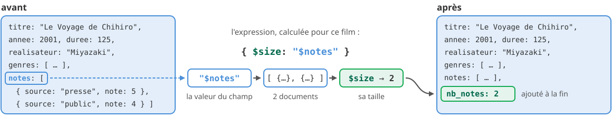
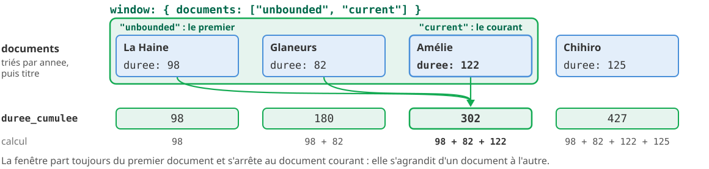
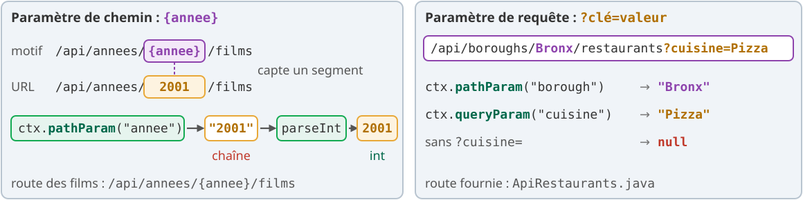

<!-- _class: lead -->
<!-- _paginate: false -->

<style scoped>
section {
  background-image: url('assets/logo.png');
  background-repeat: no-repeat;
  background-position: bottom 40px center;
  background-size: 380px;
}
h1 { font-size: 1.9em; }
</style>

# Requêtes avancées, agrégation, index

**R5.Real.10 - Nouveaux paradigmes de base de données**

Séance 3 · TP2 · semaine du 30 novembre 2026

<!--
(Hors minutage : diapo de titre.)

Le point cours se fait en deux temps.

Premier temps, en début de séance : diapos 2 à 37 (données, parties 1 à 4) en 30 minutes environ, puis les deux diapos « À vous » (55 et 56, 2 minutes).

Second temps, quand la majorité du groupe attaque la partie 5 : diapos 38 à 54 (géospatial, $merge et $jsonSchema, pilote Java et Javalin), 11 minutes environ. Ces diapos servent aussi de référence pour la fin du TP en autonomie (parties 6 et 7).

Les exemples portent sur des films (collections inventées « films » et « realisateurs »), pas sur les exercices du TP ; seules les diapos sur les données et sur explain() montrent les vraies collections. Tout a été exécuté sur MongoDB 9.0.4 et les résultats affichés sont ceux obtenus. Le script des films est dans les notes de la diapo « Des films pour les exemples ».
-->

---

<!-- header: Séance 3 · les données -->

## Les données : `sample_restaurants`


<div class="box" style="margin-top: 0.3rem; font-size: 0.68em;"><b>Au programme</b> : 7 parties, 20 exercices, 100 points. Parties 1 à 5 en séance ; parties 6 et 7 (dont le code Java) à terminer en autonomie. Des <b>données réelles</b> : restaurants de New York et leurs inspections sanitaires.</div>

<!--
(2 min)

Un vrai jeu de données, publié par MongoDB : les inspections sanitaires des restaurants de New York (NYC Open Data). Provenance et licences dans data/PROVENANCE.md du dépôt.

Faire lire la structure d'un restaurant : address est un document imbriqué, grades un tableau de documents, rangés de la plus récente à la plus ancienne inspection. Le score est un nombre de points de pénalité : plus il est bas, mieux c'est. Les notes A, B, C correspondent normalement aux scores 0-13, 14-27, 28 et plus.

Ce sont des données réelles, avec leurs défauts : 738 restaurants sans inspection, 13 scores à null, 51 restaurants au borough « Missing », des noms vides. Repérer ces défauts fait partie du travail (partie 1).

boroughs a été construite pour le TP, avec des chiffres du US Census Bureau ; elle sert au $lookup de la partie 3. neighborhoods sert au géospatial (partie 5).
-->

---

## Des films pour les exemples

<style scoped>
table { display: table; width: 100%; font-size: 0.8em; }
</style>

Les exemples des diapos portent sur une collection **inventée**, `films`, la même que dans l'énoncé et les quiz de l'assistant IA du codespace :

| titre | annee | duree | realisateur | genres | notes |
|---|---|---|---|---|---|
| Le Voyage de Chihiro | 2001 | 125 | Miyazaki | animation, fantastique | presse 5, public 4 |
| Les Glaneurs et la Glaneuse | 2000 | 82 | Varda | documentaire | presse 4 |
| La Haine | 1995 | 98 | Kassovitz | drame | presse 5, public 2 |
| Amélie Poulain | 2001 | 122 | Jeunet | comédie, romance | *aucune* |

<p class="petit"><code>notes</code> est un tableau de documents <code>{ source, note }</code>. Une seconde collection, <code>realisateurs</code>, donne le pays de Miyazaki (Japon), Varda et Jeunet (France), mais pas de Kassovitz.</p>

<!--
(30 s)

Script à coller dans essais.mongodb.js pour rejouer les exemples :

use('tp2');
db.films.deleteMany({});
db.films.insertMany([
  { titre: "Le Voyage de Chihiro", annee: 2001, duree: 125, realisateur: "Miyazaki", genres: ["animation", "fantastique"],
    notes: [{ source: "presse", note: 5 }, { source: "public", note: 4 }] },
  { titre: "Les Glaneurs et la Glaneuse", annee: 2000, duree: 82, realisateur: "Varda", genres: ["documentaire"],
    notes: [{ source: "presse", note: 4 }] },
  { titre: "La Haine", annee: 1995, duree: 98, realisateur: "Kassovitz", genres: ["drame"],
    notes: [{ source: "presse", note: 5 }, { source: "public", note: 2 }] },
  { titre: "Amélie Poulain", annee: 2001, duree: 122, realisateur: "Jeunet", genres: ["comédie", "romance"], notes: [] }
]);
db.realisateurs.deleteMany({});
db.realisateurs.insertMany([
  { nom: "Miyazaki", pays: "Japon" }, { nom: "Varda", pays: "France" }, { nom: "Jeunet", pays: "France" }
])

Ce sont les mêmes films que ceux des skills de l'assistant (approfondir-une-notion et quiz-thematique).
-->

---

<!-- header: Partie 1 · filtrer -->

<!-- _class: lead -->
<!-- _header: "" -->

# Partie 1 - 🔎 Requêtes avancées

`$elemMatch`, `$expr`, types

<!--
(10 s)

Même titre que la partie 1 de l'énoncé du TP2.
-->

---

## Rappel du TP1 : deux conditions, un même élément

<style scoped>
pre { font-size: 0.7em; }
table { display: table; width: 100%; font-size: 0.74em; }
</style>

<div class="cols" style="grid-template-columns: 1fr 1fr; align-items: stretch;">
<div>

<p class="etiquette">Sans <code>&#36;elemMatch</code></p>

```js
db.films.find(
  { "notes.source": "public",
    "notes.note": 5 },
  { _id: 0, titre: 1 })
// [ { titre: "Le Voyage de Chihiro" },
//   { titre: "La Haine" } ]
```

</div>
<div>

<p class="etiquette">Avec <code>&#36;elemMatch</code></p>

```js
db.films.find(
  { notes: { $elemMatch: {
      source: "public", note: 5 } } },
  { _id: 0, titre: 1 })
// []
```

</div>
</div>

| Film | notes | Sans `$elemMatch` | Avec `$elemMatch` |
|---|---|---|---|
| Le Voyage de Chihiro | presse **5**, **public** 4 | retenu : « 5 » et « public » viennent de deux notes | écarté |
| Les Glaneurs et la Glaneuse | presse 4 | écarté | écarté |
| La Haine | presse **5**, **public** 2 | retenu, pour la même raison | écarté |
| Amélie Poulain | *aucune* | écarté | écarté |

<p class="petit">Sans <code>&#36;elemMatch</code>, chaque condition cherche sa note dans le tableau ; avec, une <b>même</b> note doit remplir toutes les conditions.</p>

<!--
(45 s)

Rappel du TP1, à passer vite. Résultats obtenus sur MongoDB 9.0.4 avec les films de la diapo précédente.

Sur les vrais restaurants, l'écart est spectaculaire : c'est l'exercice 1 ; ne pas donner les chiffres.
-->

---

## Comparer deux valeurs d'un même document

 2, vrai." style="display:block; width:100%; margin:0.2rem auto 0;">

<div class="cols" style="margin-top: 0.4rem; align-items: stretch;">
<div class="box" style="margin-top: 0;">

**C'est quoi ?** `$expr` écrit une condition avec les **expressions du pipeline**, comme dans `$project` : `{ $gt: [A, B] }`. Dans une expression, `"$champ"` désigne la **valeur** du champ.

</div>
<div class="box" style="margin-top: 0;">

**Pourquoi faire ?** Comparer **deux valeurs du même document** : deux champs, deux éléments d'un tableau, un calcul. Un filtre classique ne compare qu'à une **constante** : dans un filtre, `"$annee"` n'est qu'une chaîne, pas la valeur du champ.

</div>
</div>

<!--
(1 min)

Lire le schéma par ses couleurs : en bleu, ce qui vient du document ; en ambre, ce qui est écrit dans la requête. À gauche, une seule valeur vient du document ; à droite, les deux.

En SQL, WHERE a > b compare deux colonnes sans difficulté. En MongoDB, { a: { $gt: "$b" } } compare a à la CHAÎNE "$b" : le $ n'est interprété comme « valeur du champ » que dans une expression d'agrégation. D'où $expr. Vérifié sur MongoDB 9.0.4 : { duree: { $gt: "$annee" } } ne renvoie aucun film.
-->

---

## `$expr` pas à pas : la première note contre la dernière

<style scoped>
pre { font-size: 0.7em; }
table { display: table; width: 100%; font-size: 0.74em; }
</style>

<div class="cols" style="grid-template-columns: 1fr 1fr; align-items: start;">
<div>

```js
db.films.find(
  { $expr: { $gt: [
    { $arrayElemAt: ["$notes.note", 0] },  // A
    { $arrayElemAt: ["$notes.note", -1] }  // B
  ] } },
  { _id: 0, titre: 1 })
// [ { titre: "Le Voyage de Chihiro" },
//   { titre: "La Haine" } ]
```

<p class="petit"><code>"&#36;notes.note"</code> : le tableau des notes du film, <code>[5, 4]</code> pour Chihiro. Indice <code>0</code> : la première note ; <code>-1</code> : la dernière.</p>

</div>
<div>

| Film | A | B | A > B ? |
|---|---|---|---|
| Le Voyage de Chihiro | 5 | 4 | vrai : retenu |
| Les Glaneurs et la Glaneuse | 4 | 4 | faux : une seule note, A = B |
| La Haine | 5 | 2 | vrai : retenu |
| Amélie Poulain | *absent* | *absent* | faux : tableau vide |

</div>
</div>

<div class="warn" style="margin-top: 0.8rem;">

`$expr` se calcule **document par document** et profite rarement d'un index : on l'accompagne de conditions classiques, qui réduisent les documents à examiner.

</div>

<!--
(1 min 15)

Résultat obtenu sur MongoDB 9.0.4 ; les colonnes A et B aussi, par un $project avec les mêmes expressions (pour Amélie Poulain, $arrayElemAt sur un tableau vide ne renvoie rien).

Dans les restaurants, grades est rangé de la plus récente à la plus ancienne inspection : l'indice 0 est la plus récente (exercice 2).

Le coût : une condition dans $expr ne profite généralement pas d'un index. On la combine avec des conditions classiques qui, elles, réduisent les documents à examiner (par exemple un borough).
-->

---

## `null`, absent, ou d'un autre type

<style scoped>
table { display: table; width: 100%; font-size: 0.8em; }
</style>

| Filtre | Trouve |
|---|---|
| `{ duree: null }` | `duree` vaut `null` **ou** n'existe pas (les deux cas) |
| `{ duree: { $type: "null" } }` | `duree` existe et vaut `null` |
| `{ duree: { $exists: false } }` | `duree` n'existe pas |
| `{ genres: { $size: 0 } }` | le tableau `genres` est vide |
| `{ annee: { $type: "string" } }` | `annee` est une chaîne (et non un nombre) |

<div class="warn" style="margin-top: 0.8rem;">

Un schéma libre accepte des **données hétérogènes** : un champ manquant ici, un `null` là, un nombre écrit en texte ailleurs. Sur un jeu réel, on les cherche avant de calculer.

</div>

<!--
(1 min)

Vérifié sur MongoDB 9.0.4 avec deux films ajoutés pour l'essai : « Film sans durée » (duree: null) et « Film inconnu » (sans champ duree). { duree: null } trouve les deux ; { $type: "null" } seulement le premier ; { $exists: false } seulement le second.

C'est l'exercice 3 : une consigne qui dit « enregistré à null (le champ existe et vaut null) » appelle une seule de ces écritures.
-->

---

<!-- header: Partie 2 · calculer -->

<!-- _class: lead -->
<!-- _header: "" -->

# Partie 2 - 🧮 Calculer

`$addFields` et fenêtres

<!--
(10 s)

Même titre que la partie 2 de l'énoncé du TP2.
-->

---

## Deux questions à se poser à chaque étape


<div class="cols" style="margin-top: 0.3rem; align-items: stretch;">
<div class="box" style="margin-top: 0;">

**`$addFields`** ajoute des champs calculés **sans retirer** les autres. En SQL : `SELECT *, …` plutôt que `SELECT titre, …`.

</div>
<div class="box" style="margin-top: 0;">

**`$setWindowFields`** calcule sur un **groupe**, comme `$group`, mais **garde chaque document**. En SQL : `COUNT(*) OVER (PARTITION BY annee)` plutôt que `GROUP BY annee`.

</div>
</div>

<!--
(1 min 15)

Deux questions à poser à chaque étape d'un pipeline : quels champs en sortent, et combien de documents.

À droite, c'est le même calcul des deux côtés (compter les films de l'année) : $group rend 3 documents, l'étape $setWindowFields { partitionBy: "$annee", output: { nb_annee: { $count: {} } } } rend les 4 films. Résultats obtenus sur MongoDB 9.0.4.

$setWindowFields correspond aux fonctions de fenêtre de SQL (RANK() OVER ...), que les étudiants ont pu voir en R4.03 ; sinon, la présenter comme un $group qui ne fusionne pas les documents.
-->

---

## `$addFields` : un calcul par document

<style scoped>
pre { font-size: 0.6em; margin-top: 0.4rem; }
.box { font-size: 0.85em; padding-top: 0.4rem; padding-bottom: 0.4rem; }
</style>



```js
db.films.aggregate([
  { $addFields: { nb_notes: { $size: "$notes" } } },   // calculé pour chaque film
  { $project: { _id: 0, titre: 1, annee: 1, nb_notes: 1 } },
  { $sort: { titre: 1 } }
])
// { titre: "Amélie Poulain", annee: 2001, nb_notes: 0 }
// { titre: "La Haine", annee: 1995, nb_notes: 2 }
// { titre: "Le Voyage de Chihiro", annee: 2001, nb_notes: 2 }
// { titre: "Les Glaneurs et la Glaneuse", annee: 2000, nb_notes: 1 }
```

<div class="box">

Le `$project` vient **après** le calcul : placé avant, il retirerait `notes`, et `$size` échouerait.

</div>

<!--
(1 min)

Une expression se calcule document par document : "$notes" est la valeur du champ notes du document en cours, comme dans $expr (diapo 6). Le champ ajouté sert aux étapes suivantes : un $match, un $sort...

Résultats obtenus sur MongoDB 9.0.4. Avec le $project avant le $addFields, l'agrégation échoue : « The argument to $size must be an array, but was of type: missing ».

L'exercice 4 utilise $addFields (nombre d'inspections, score moyen), puis un $match sur un champ calculé, avant de trier et de projeter.
-->

---

## `$setWindowFields` en trois temps : partitionner, trier, calculer


<div class="cols" style="margin-top: 0.4rem; align-items: stretch;">
<div class="box" style="margin-top: 0;">

**`partitionBy`** découpe les documents en groupes, ou **partitions** (sans lui : un seul groupe). **`sortBy`** ordonne chaque groupe.

</div>
<div class="box" style="margin-top: 0;">

**`output`** nomme les champs ajoutés et dit comment les calculer. Chaque film **garde tous ses champs** et reçoit `rang`.

</div>
</div>

<!--
(1 min 15)

Dérouler les trois temps de gauche à droite. Avant le tri, l'ordre dans un groupe n'est pas défini : Amélie et Chihiro arrivent dans un ordre quelconque.

L'exercice 5 classe les cuisines dans chaque borough avec $rank, après un $group par couple (borough, cuisine).
-->

---

## `$rank` : le code, et les égalités

<style scoped>
pre { font-size: 0.66em; }
table { display: table; width: 100%; font-size: 0.72em; }
</style>

```js
db.films.aggregate([
  { $setWindowFields: {
      partitionBy: "$annee", sortBy: { duree: -1 }, output: { rang: { $rank: {} } } } },
  { $project: { _id: 0, titre: 1, annee: 1, duree: 1, rang: 1 } },
  { $sort: { annee: 1, rang: 1 } }            // $setWindowFields ne trie pas la sortie
])
// { titre: "La Haine", annee: 1995, duree: 98, rang: 1 }
// { titre: "Les Glaneurs et la Glaneuse", annee: 2000, duree: 82, rang: 1 }
// { titre: "Le Voyage de Chihiro", annee: 2001, duree: 125, rang: 1 }
// { titre: "Amélie Poulain", annee: 2001, duree: 122, rang: 2 }
```

<div class="cols" style="grid-template-columns: 1fr 1fr; align-items: center;">
<div>

<p class="petit"><b>Quatre films fictifs</b>, un seul groupe (sans <code>partitionBy</code>), triés par <code>{ duree: -1 }</code> :</p>

| Film | duree | `$rank` | `$denseRank` | `$documentNumber` |
|---|---|---|---|---|
| F1 | 125 | 1 | 1 | 1 |
| F2 | 122 | **2** | **2** | 2 |
| F3 | 122 | **2** | **2** | 3 |
| F4 | 98 | **4** | **3** | 4 |

</div>
<div>

<p class="petit">F2 et F3 ont la même durée. <code>&#36;rank</code> leur donne le même rang, puis saute un rang ; <code>&#36;denseRank</code> ne saute pas ; <code>&#36;documentNumber</code> numérote sans égalité (l'ordre entre F2 et F3 n'est alors pas garanti). Ces trois opérateurs exigent un <code>sortBy</code>.</p>

</div>
</div>

<!--
(1 min)

Résultats obtenus sur MongoDB 9.0.4 ; le tableau, sur une collection d'essai de quatre films (F1 125, F2 122, F3 122, F4 98), sans partitionBy.

L'exercice 5 demande $rank : deux cuisines à égalité ont le même rang.
-->

---

## Une fenêtre de documents : le cumul

<style scoped>
pre { font-size: 0.68em; }
</style>

`$rank` n'a pas de `window`. `$sum` ou `$avg` calculent sur une **fenêtre** : une plage de documents, définie par rapport au document **courant**.



```js
{ $setWindowFields: { sortBy: { annee: 1, titre: 1 },
    output: { duree_cumulee: { $sum: "$duree", window: { documents: ["unbounded", "current"] } } } } }
```

<p class="petit">Sans <code>partitionBy</code> : un seul groupe. Sans <code>window</code> : <code>&#36;sum</code> porte sur tout le groupe, 427 pour chaque film.</p>

<!--
(1 min)

Résultat obtenu sur MongoDB 9.0.4 (c'est l'exemple de l'énoncé). Sans partitionBy, tous les films forment un seul groupe.

Sans window, $sum porte sur tout le groupe : 427 pour chaque film (vérifié sur MongoDB 9.0.4). C'est la fenêtre qui fait le cumul.
-->

---

## Une fenêtre glissante : lisser une série

<style scoped>
pre { font-size: 0.68em; }
</style>

Une série **inventée** : la note moyenne de chaque mois. Elle varie d'un mois à l'autre ; la moyenne des trois derniers mois **lisse** la série.


```js
{ $setWindowFields: { sortBy: { mois: 1 },
    output: { glissante: { $avg: "$moyenne", window: { documents: [-2, 0] } } } } }
```

<p class="petit"><code>documents: [-2, 0]</code> : les deux documents précédents et le courant, dans l'ordre de <code>sortBy</code>. Arrondir <b>à la fin</b>, sinon les moyennes suivantes sont faussées (le schéma arrondit pour l'affichage).</p>

<!--
(1 min)

Les valeurs sont inventées pour le schéma (vérifiées sur MongoDB 9.0.4 : 10, 11, 11, 12.333333333333334, 12.666666666666666, 14 ; le schéma les arrondit). Une moyenne glissante lisse une courbe : c'est ce que demande l'exercice 6 sur les scores mensuels de 2014. Insister : on arrondit À LA FIN, pas avant de calculer la moyenne glissante.

window accepte aussi range avec une unité de temps (range: [-2, 0], unit: "month") quand sortBy porte sur une date.
-->

---

<!-- header: Partie 3 · joindre et résumer -->

<!-- _class: lead -->
<!-- _header: "" -->

# Partie 3 - 🔗 Joindre, classer, résumer

`$lookup`, `$bucket`, `$facet`

<!--
(10 s)

Même titre que la partie 3 de l'énoncé du TP2. Trois étapes difficiles, chacune en plusieurs temps : le besoin, le principe sur les films, puis le code pas à pas.
-->

---

## Pourquoi joindre ? Embarquer ou référencer

<style scoped>
table { display: table; width: 100%; font-size: 0.78em; }
</style>

<p>Question : <b>de quel pays est le réalisateur de chaque film ?</b> L'information est rangée dans <b>une autre collection</b>.</p>

<div class="cols" style="grid-template-columns: 1fr 1fr; align-items: start;">
<div>

<p class="etiquette">collection films</p>

| titre | realisateur |
|---|---|
| Le Voyage de Chihiro | **Miyazaki** |
| Les Glaneurs et la Glaneuse | **Varda** |
| La Haine | **Kassovitz** |
| Amélie Poulain | **Jeunet** |

</div>
<div>

<p class="etiquette">collection realisateurs</p>

| nom | pays |
|---|---|
| **Miyazaki** | Japon |
| **Varda** | France |
| **Jeunet** | France |

<p class="petit">Kassovitz n'y figure pas.</p>

</div>
</div>

<div class="box" style="margin-top: 0.4rem;">

On **embarque** ce qu'on lit avec le document (les notes, dans le film). On **référence** ce que partagent plusieurs documents : le pays d'un réalisateur est écrit **une fois**, dans `realisateurs`. Pour le retrouver, il faut **joindre** les deux collections, comme un `JOIN` en SQL.

</div>

<!--
(45 s)

Partir de la question, avant toute syntaxe. Le lien entre les deux collections est une valeur commune : le champ realisateur d'un film et le champ nom d'un réalisateur. C'est une clé étrangère, mais MongoDB ne la vérifie pas : Kassovitz n'a pas de document dans realisateurs.

Dans le TP, la population de chaque borough est rangée à part, dans boroughs (exercice 7). Le TP3 revient sur le choix « embarquer ou référencer ».
-->

---

## Joindre deux collections : `$lookup`


<div class="cols" style="margin-top: 0.3rem; align-items: stretch;">
<div class="box" style="margin-top: 0;">

**C'est quoi ?** Pour chaque document, `$lookup` cherche dans la collection `from` ceux dont `foreignField` est **égal** à son `localField`, et les range dans un **tableau** `as`. En SQL : <code style="white-space: nowrap">LEFT OUTER JOIN</code>.

</div>
<div class="box" style="margin-top: 0;">

**Pourquoi faire ?** Recoller, **au moment de la requête**, ce qui est rangé à part : le pays du réalisateur n'est pas recopié dans chacun de ses films, `$lookup` va le chercher.

</div>
</div>

<!--
(1 min)

Dérouler le schéma ligne par ligne, en suivant les numéros : la valeur du champ localField (realisateur), la comparaison avec le champ foreignField (nom) de chaque document de from, le tableau as. Même travail pour les 4 films.

Vérifié sur MongoDB 9.0.4 : Le Voyage de Chihiro reçoit r: [ { _id: ObjectId(...), nom: "Miyazaki", pays: "Japon" } ] (chaque document trouvé garde son _id, que le schéma omet), La Haine reçoit r: []. Les deux autres films reçoivent un document chacun.
-->

---

## Ce que rend `$lookup` : toujours un tableau

<style scoped>
pre { font-size: 0.6em; }
table { display: table; width: 100%; font-size: 0.72em; }
</style>

```js
db.films.aggregate([
  { $lookup: { from: "realisateurs", localField: "realisateur", foreignField: "nom", as: "r" } },
  { $project: { _id: 0, titre: 1, "r.nom": 1, "r.pays": 1 } },
  { $sort: { titre: 1 } }
])
// { titre: "Amélie Poulain", r: [ { nom: "Jeunet", pays: "France" } ] }
// { titre: "La Haine", r: [] }
// { titre: "Le Voyage de Chihiro", r: [ { nom: "Miyazaki", pays: "Japon" } ] }
// { titre: "Les Glaneurs et la Glaneuse", r: [ { nom: "Varda", pays: "France" } ] }
```

| Film | `r` | pourquoi |
|---|---|---|
| Amélie Poulain | un document : `[ { nom: "Jeunet", … } ]` | un `nom` de `realisateurs` est égal à Jeunet |
| La Haine | un tableau vide : `[]` | aucun `nom` n'est égal à Kassovitz |
| Chihiro, Glaneurs | un document chacun | un `nom` égal (Miyazaki, Varda) |

<div class="warn" style="margin-top: 0.4rem;">

`"$r.pays"` est donc un **tableau** (`["France"]`), pas une valeur. Un calcul qui attend une valeur échoue : `$concat` avec `"$r.pays"` donne « `$concat supports only strings` ».

</div>

<!--
(50 s)

Même avec un seul document trouvé, r est un tableau : $lookup ne sait pas d'avance combien il en trouvera (deux réalisateurs du même nom donneraient deux documents).

Vérifié sur MongoDB 9.0.4 : le résultat affiché ; { $project: { pays: "$r.pays" } } donne ["France"] pour Amélie Poulain et [] pour La Haine ; { $concat: ["$titre", " (", "$r.pays", ")"] } fait échouer l'agrégation avec « $concat supports only strings ».

Lien avec l'exercice 7 : la population jointe est dans un tableau ; un $divide sur ce tableau échoue de la même façon. Il faut d'abord en sortir la valeur (diapo suivante).
-->

---

## `$unwind` : du tableau à la valeur

<style scoped>
pre { font-size: 0.64em; }
table { display: table; width: 100%; font-size: 0.72em; }
</style>

<div class="cols" style="grid-template-columns: 1fr 1fr; align-items: start;">
<div>

```js
db.films.aggregate([
  { $lookup: { from: "realisateurs",
      localField: "realisateur",
      foreignField: "nom", as: "r" } },
  { $unwind: "$r" },
  { $project: { _id: 0, titre: 1,
                pays: "$r.pays" } },
  { $sort: { titre: 1 } }
])
// { titre: "Amélie Poulain", pays: "France" }
// { titre: "Le Voyage de Chihiro", pays: "Japon" }
// { titre: "Les Glaneurs et la Glaneuse",
//   pays: "France" }
```

</div>
<div>

| Film | `r` après `$lookup` | après `$unwind` |
|---|---|---|
| Amélie | 1 document (Jeunet) | gardé, `r` = ce document |
| La Haine | `[]` | **retiré** : rien à dérouler |
| Chihiro | 1 document (Miyazaki) | gardé |
| Glaneurs | 1 document (Varda) | gardé |

<p class="petit">Comme un <code>INNER JOIN</code>. Avec <code>{ &#36;unwind: { path: "&#36;r", preserveNullAndEmptyArrays: true } }</code>, La Haine revient, sans champ <code>pays</code> : comme un <code>LEFT OUTER JOIN</code>.</p>

</div>
</div>

<div class="warn" style="margin-top: 0.4rem;">

`$lookup` fait une recherche dans `from` **pour chaque document** qui lui arrive. S'il suffit d'une valeur par groupe, **regrouper d'abord** (moins de documents), joindre ensuite.

</div>

<!--
(50 s)

Le $unwind vu au TP1 : un document par élément du tableau. Ici r contient au plus un document, donc $unwind « sort » la valeur du tableau ; un tableau vide ne donne rien, d'où la disparition de La Haine.

Vérifié sur MongoDB 9.0.4 : le résultat affiché ; avec preserveNullAndEmptyArrays: true, La Haine revient sans champ pays ; après $unwind, { $concat: ["$titre", " (", "$r.pays", ")"] } fonctionne (« Amélie Poulain (France) »...).

Lien avec l'exercice 7 : compter d'abord par borough (6 documents), joindre ensuite, plutôt que joindre 25 359 restaurants ; et se demander ce que devient le borough « Missing », qui n'a pas de correspondance dans boroughs (l'énoncé le signale).
-->

---

## Compter par plages de valeurs : le besoin

<style scoped>
pre { font-size: 0.66em; }
table { display: table; width: 100%; font-size: 0.76em; }
</style>

<p>Question : <b>combien de films courts (moins de 90 min), moyens (de 90 à 119 min), longs (120 min et plus) ?</b></p>

<div class="cols" style="grid-template-columns: 1fr 1fr; align-items: start;">
<div>

<p class="etiquette">Un <code style="text-transform: none;">&#36;group</code> sur la durée</p>

```js
db.films.aggregate([
  { $group: { _id: "$duree", nb: { $sum: 1 } } },
  { $sort: { _id: 1 } }
])
// { _id: 82, nb: 1 }
// { _id: 98, nb: 1 }
// { _id: 122, nb: 1 }
// { _id: 125, nb: 1 }
```

<p class="petit">Un groupe par durée <b>exacte</b> : quatre groupes d'un film.</p>

</div>
<div>

<p class="etiquette">Ce qu'on veut</p>

| tranche | films | nb |
|---|---|---|
| courts : moins de 90 | Glaneurs (82) | 1 |
| moyens : 90 à 119 | La Haine (98) | 1 |
| longs : 120 et plus | Amélie (122), Chihiro (125) | 2 |

</div>
</div>

<div class="box" style="margin-top: 0.4rem;">

Sur des valeurs **continues** (durées, scores, prix), presque chaque valeur fait son propre groupe. Il faut regrouper par **plages** de valeurs : c'est un **histogramme**.

</div>

<!--
(40 s)

Partir de la question. Le $group connu ne répond pas : vérifié sur MongoDB 9.0.4, quatre groupes (82, 98, 122, 125) d'un film chacun. Il faut décider des plages, puis compter dans chaque plage : c'est ce que fait $bucket.
-->

---

## Répartir en tranches : `$bucket`


<div class="cols" style="margin-top: 0.3rem; align-items: stretch;">
<div class="box" style="margin-top: 0;">

**C'est quoi ?** Un `$group` **par tranches** : chaque document va dans la tranche qui contient sa valeur de `groupBy` ; `boundaries` donne les bornes, `default` reçoit le reste, `output` se calcule par tranche.

</div>
<div class="box" style="margin-top: 0;">

**Pourquoi faire ?** Répondre à « combien de … par tranche ? » : durées, scores, prix, nombre d'inspections. En SQL, il faudrait un `GROUP BY` sur un `CASE WHEN`.

</div>
</div>

<!--
(45 s)

Lire le schéma de haut en bas : les bornes découpent l'axe, chaque film tombe dans une tranche, chaque tranche donne un document. Les bornes et la valeur de default, en ambre, sont écrites dans la requête ; elles deviennent les _id.

Résultat réel sur MongoDB 9.0.4 : { _id: 0, nb: 1 }, { _id: 90, nb: 1 }, { _id: "long", nb: 2 }.

Prépare l'exercice 8 (tranches du nombre d'inspections), sans en donner les bornes.
-->

---

## `$bucket` pas à pas : dans quelle tranche ?

<style scoped>
pre { font-size: 0.7em; }
table { display: table; width: 100%; font-size: 0.76em; }
</style>

<div class="cols" style="grid-template-columns: 0.8fr 1.2fr; align-items: start;">
<div>

```js
db.films.aggregate([
  { $bucket: {
      groupBy: "$duree",
      boundaries: [0, 90, 120],
      default: "long",
      output: { nb: { $sum: 1 } } } }
])
// { _id: 0, nb: 1 }
// { _id: 90, nb: 1 }
// { _id: "long", nb: 2 }
```

</div>
<div>

| Film | duree | test | `_id` |
|---|---|---|---|
| Glaneurs | 82 | 0 ≤ 82 < 90 | `0` |
| La Haine | 98 | 90 ≤ 98 < 120 | `90` |
| Amélie | 122 | 122 ≥ 120 : hors bornes | `"long"` |
| Chihiro | 125 | 125 ≥ 120 : hors bornes | `"long"` |

</div>
</div>

<div class="box" style="margin-top: 0.6rem;">

La borne **basse** est **incluse**, la borne **haute exclue**. Une tranche « de 90 à 119 min » s'écrit donc avec les bornes 90 et 120 : un film de 90 min irait dans la tranche `90`, un film de 120 min dans `default`.

</div>

<!--
(45 s)

Faire lire le tableau film par film.

Vérifié sur MongoDB 9.0.4 : le résultat affiché ; sur une collection d'essai, un film de 90 min va dans la tranche 90 et un film de 120 min dans default.

Lien avec l'exercice 8 : bien traduire les tranches de la consigne en bornes (basse incluse, haute exclue).
-->

---

## `$bucket` : quatre règles à connaître

<style scoped>
.g2 { gap: 0.6em; }
.carte { font-size: 0.7em; }
.carte pre { font-size: 0.82em; margin: 0.3em 0 0 0; }
.carte p { margin: 0.2em 0; }
</style>

<div class="g2">
<div class="carte"><b class="t">Une tranche vide n'apparaît pas</b>

Aucun film de moins de 60 min : pas de tranche `0`.

```js
boundaries: [0, 60, 90, 120], default: "long"
// { _id: 60, nb: 1 }, { _id: 90, nb: 1 },
// { _id: "long", nb: 2 }
```

</div>
<div class="carte rouge"><b class="t">Sans default, la requête échoue</b>

Dès qu'un document est hors bornes. Le message ne cite pas `$bucket` : pensez à `default`.

```text
$switch could not find a matching branch for
an input, and no default was specified.
```

</div>
<div class="carte vert"><b class="t">output choisit les champs de chaque tranche</b>

Sans `output` : un seul champ, `count`.

```js
output: { nb: { $sum: 1 }, titres: { $push: "$titre" } }
// …, { _id: "long", nb: 2, titres:
//   [ "Le Voyage de Chihiro", "Amélie Poulain" ] }
```

</div>
<div class="carte orange"><b class="t">groupBy accepte une expression</b>

Ici, l'âge du film, calculé pour chaque film.

```js
groupBy: { $subtract: [2026, "$annee"] },
boundaries: [0, 26, 30], default: "plus"
// { _id: 0, nb: 2 }, { _id: 26, nb: 1 },
// { _id: "plus", nb: 1 }
```

</div>
</div>

<!--
(50 s)

Tout est vérifié sur MongoDB 9.0.4, sur les 4 films : les résultats et le message d'erreur affichés. Des bornes non triées sont refusées, et default doit être hors des bornes.

Lien avec l'exercice 8 : groupBy y est une valeur calculée pour chaque restaurant (l'énoncé le dit dans son astuce), et la dernière tranche est le default. $bucketAuto (bonus 3) choisit lui-même les bornes pour faire des tranches d'effectifs voisins.
-->

---

## Plusieurs résumés des mêmes données : le besoin

<style scoped>
pre { font-size: 0.66em; }
</style>

<p>Un <b>tableau de bord</b> affiche plusieurs résumés des <b>mêmes</b> films : combien par année ? lequel est le plus long ?</p>

<div class="cols" style="grid-template-columns: 1fr 1fr; align-items: start;">
<div>

<p class="etiquette">Requête 1 : par année</p>

```js
db.films.aggregate([
  { $group: { _id: "$annee", nb: { $sum: 1 } } },
  { $sort: { _id: 1 } }
])
// { _id: 1995, nb: 1 }
// { _id: 2000, nb: 1 }
// { _id: 2001, nb: 2 }
```

</div>
<div>

<p class="etiquette">Requête 2 : le plus long</p>

```js
db.films.aggregate([
  { $sort: { duree: -1 } },
  { $limit: 1 },
  { $project: { _id: 0, titre: 1 } }
])
// { titre: "Le Voyage de Chihiro" }
```

</div>
</div>

<div class="box" style="margin-top: 0.4rem;">

Deux requêtes : deux allers-retours vers le serveur, deux lectures des films. Si l'on ne veut que les films depuis 2000, le filtre se recopie dans **chaque** requête.

</div>

<!--
(40 s)

Résultats obtenus sur MongoDB 9.0.4. Le contexte : un écran d'accueil (le tableau de bord du projet, par exemple) affiche plusieurs chiffres calculés sur les mêmes données. $facet les réunit en une requête.
-->

---

## Plusieurs résumés en une passe : `$facet`


<div class="cols" style="margin-top: 0.3rem; align-items: stretch;">
<div class="box" style="margin-top: 0;">

**C'est quoi ?** `$facet` lance plusieurs **sous-pipelines**, les facettes, sur **les mêmes documents** d'entrée. Il rend **un seul document** : un champ par facette, chacun **un tableau**.

</div>
<div class="box" style="margin-top: 0;">

**Pourquoi faire ?** Les résumés d'un **tableau de bord** en **une seule** requête : les deux requêtes de la diapo précédente deviennent deux facettes.

</div>
</div>

<!--
(45 s)

Montrer sur le schéma que chaque facette reçoit sa copie des 4 films : le $sort et le $limit de plus_long n'enlèvent rien à par_annee. Chaque facette est un pipeline complet, avec les étapes connues.

Prépare l'exercice 9 (tableau de bord de Brooklyn, trois facettes), sans en donner les chiffres.
-->

---

## Ce que rend `$facet` : un seul document

<style scoped>
pre { font-size: 0.6em; }
</style>

```js
db.films.aggregate([
  { $facet: {
      par_annee: [ { $group: { _id: "$annee", nb: { $sum: 1 } } }, { $sort: { _id: 1 } } ],
      plus_long: [ { $sort: { duree: -1 } }, { $limit: 1 }, { $project: { _id: 0, titre: 1 } } ] } }
])
// { par_annee: [ { _id: 1995, nb: 1 }, { _id: 2000, nb: 1 }, { _id: 2001, nb: 2 } ],
//   plus_long: [ { titre: "Le Voyage de Chihiro" } ] }
```

<div class="cols" style="grid-template-columns: 1fr 1fr; align-items: start; margin-top: 0.3rem;">
<div>

<p class="etiquette">Lire le résultat</p>

```js
  ...,                                   // après le $facet
  { $project: {
      nb_annees: { $size: "$par_annee" },
      le_plus_long: { $first: "$plus_long.titre" } } }
// { nb_annees: 3, le_plus_long: "Le Voyage de Chihiro" }
```

</div>
<div class="box" style="margin-top: 1.6em;">

Le résultat du `$facet` est **un document**, que les étapes suivantes peuvent transformer. Chaque facette est **un tableau**, même avec un seul élément : `$first`, `$size`, `$arrayElemAt` ou `$unwind` en tirent les valeurs.

</div>
</div>

<!--
(45 s)

Résultats obtenus sur MongoDB 9.0.4 : le $facet seul, puis suivi du $project montré à gauche.

En Java (partie 7), le document rendu se lit avec doc.getList("par_annee", Document.class).
-->

---

## `$facet` pas à pas : filtrer d'abord, résumer ensuite

<style scoped>
pre { font-size: 0.62em; }
table { display: table; width: 100%; font-size: 0.72em; }
</style>

<div class="cols" style="grid-template-columns: 1fr 1fr; align-items: start;">
<div>

```js
db.films.aggregate([
  { $match: { annee: { $gte: 2000 } } },
  { $facet: {
    par_annee: [
      { $group: { _id: "$annee", nb: { $sum: 1 } } },
      { $sort: { _id: 1 } } ],
    plus_long: [
      { $sort: { duree: -1 } }, { $limit: 1 },
      { $project: { _id: 0, titre: 1, duree: 1 } } ]
  } }
])
// { par_annee: [ { _id: 2000, nb: 1 },
//                { _id: 2001, nb: 2 } ],
//   plus_long: [ { titre: "Le Voyage de Chihiro",
//                  duree: 125 } ] }
```

</div>
<div>

| Film | `$match` | `par_annee` | `plus_long` |
|---|---|---|---|
| La Haine (1995) | **retiré** | absent | absent |
| Glaneurs (2000) | gardé | compté en 2000 | 82 min : 3<sup>e</sup>, écarté par `$limit` |
| Amélie (2001) | gardé | compté en 2001 | 122 min : 2<sup>e</sup>, écarté par `$limit` |
| Chihiro (2001) | gardé | compté en 2001 | 125 min : 1<sup>er</sup>, gardé par `$limit` |

<p class="petit">Le <code>&#36;match</code> est fait <b>une fois</b>, avant les facettes : les deux reçoivent les 3 mêmes films.</p>

</div>
</div>

<div class="warn" style="margin-top: 0.4rem;">

Un `$match` placé **dans** chaque facette filtrerait tous les films dans chaque facette, sans pouvoir utiliser d'index ; placé **avant** `$facet`, il est fait une fois et peut profiter d'un index (partie 4). Une facette qui ne reçoit rien rend `[]`.

</div>

<!--
(45 s)

Faire lire le tableau film par film : La Haine est retirée une seule fois, par le $match commun ; ensuite, chaque facette travaille sur les 3 mêmes films, sans voir les étapes de l'autre.

Vérifié sur MongoDB 9.0.4 : le résultat affiché ; avec un index { annee: 1 }, explain() montre un IXSCAN pour le $match placé avant $facet, et un COLLSCAN (les 4 films examinés) pour le même $match placé dans une facette ; avec un $match qui ne garde aucun film, le résultat est { par_annee: [], plus_long: [] }.

Lien avec l'exercice 9, le tableau de bord de Brooklyn : un filtre commun avant $facet, puis trois facettes (l'énoncé le dit dans son astuce).
-->

---

<!-- header: Partie 4 · indexer -->

<!-- _class: lead -->
<!-- _header: "" -->

# Partie 4 - ⚡ Index

`explain()` et règle ESR

<!--
(10 s)

Même titre que la partie 4 de l'énoncé du TP2.
-->

---

## Sans index, tout est lu

<style scoped>
.box, .warn { font-size: 0.74em; }
</style>


<div class="cols" style="margin-top: 0.3rem; align-items: stretch;">
<div class="box" style="margin-top: 0;">

**C'est quoi ?** Une liste **triée** des valeurs d'un champ, les **clés**, chacune avec l'adresse de son document, comme l'index d'un livre. `IXSCAN` parcourt l'index, `FETCH` lit le document pointé ; sans index, `COLLSCAN` lit toute la collection.

</div>
<div class="box" style="margin-top: 0;">

**Pourquoi faire ?** Ne lire **que** les documents qui conviennent : `createIndex({ annee: 1 })` (1 : croissant), comme `CREATE INDEX idx_annee ON films (annee)` en SQL. **Son prix** : de la place, et du temps à chaque écriture.

</div>
</div>

<!--
(1 min)

Le contexte d'abord : jusqu'ici, on a écrit des requêtes sans se demander comment MongoDB les exécute. Sur 4 films, peu importe ; sur 25 359 restaurants, ou sur les données du projet, c'est la différence entre tout lire et lire le nécessaire.

Lire le schéma de gauche à droite. COLLSCAN (collection scan) : chaque film est lu puis testé. IXSCAN (index scan) : MongoDB parcourt les clés de l'index, déjà triées, et saute directement aux clés 2001 ; FETCH lit ensuite les documents pointés par ces clés.

Vérifié sur MongoDB 9.0.4 avec les films de la diapo 3 : sans index, plan COLLSCAN, totalDocsExamined 4, nReturned 2 ; avec { annee: 1 }, plan FETCH ← IXSCAN, totalKeysExamined 2, totalDocsExamined 2, nReturned 2 (les deux clés 2001 sont lues dans l'ordre Chihiro, puis Amélie). Ces compteurs viennent de explain(), diapo suivante.

MongoDB crée toujours un index sur _id.
-->

---

## Mesurer : `explain("executionStats")`

<style scoped>
.box, .warn { font-size: 0.72em; }
pre { font-size: 0.6em; }
</style>


```js
db.restaurants.find({ borough: "Bronx" }).explain("executionStats")   // sans index : à gauche
db.restaurants.createIndex({ borough: 1 })
db.restaurants.find({ borough: "Bronx" }).explain("executionStats")   // avec l'index : à droite
```

<div class="cols" style="margin-top: 0.3rem; align-items: stretch;">
<div class="box" style="margin-top: 0;">

**Pourquoi ?** Un index sert-il ? On ne le devine pas, on le **mesure** : `"executionStats"` exécute la requête et compte. `explain()` seul ne donne que le plan.

</div>
<div class="warn" style="margin-top: 0;">

Vos index **restent** dans la base d'un exercice à l'autre et changent les plans : `getIndexes()` les liste, `dropIndexes()` les supprime, sauf `_id`.

</div>
</div>

<!--
(1 min)

Ici, les vraies données, comme dans l'énoncé (Exemple C du playground). Chiffres obtenus sur MongoDB 9.0.4, base tp2 : sans index, COLLSCAN, nReturned 2338, totalKeysExamined 0, totalDocsExamined 25359 ; avec { borough: 1 }, FETCH ← IXSCAN (index borough_1), 2338 partout. Plus de 90 % du travail était perdu sans index.

Lire le plan de l'intérieur vers l'extérieur : l'étape la plus imbriquée (inputStage) s'exécute en premier et alimente celle qui l'englobe, comme les étapes d'un pipeline lues à l'envers. executionTimeMillis varie d'une exécution à l'autre ; les compteurs, non. Vérifié : explain() sans paramètre ne contient pas de champ executionStats.

Exemple D du playground : getIndexes() et dropIndexes(). Un index de l'exercice 10 changerait le plan de l'exercice 11. L'exercice 10 demande justement l'un de ces compteurs (executionStats.totalDocsExamined). Le correcteur automatique, lui, part toujours d'une base sans index.
-->

---

## Une condition hors de l'index : des documents lus pour rien

<style scoped>
pre { font-size: 0.64em; }
table { display: table; width: 100%; font-size: 0.7em; }
</style>

<p class="petit">L'index <code>{ annee: 1 }</code> ne connaît que l'année. Pour « le film de Jeunet sorti en 2001 », il trouve les films de 2001 ; le réalisateur ne se vérifie qu'<b>après</b> la lecture du document (<code>FETCH</code>).</p>

<div class="cols" style="grid-template-columns: 0.9fr 1.1fr; align-items: start;">
<div>

```js
db.films.createIndex({ annee: 1 })
db.films.find({ annee: 2001,
                realisateur: "Jeunet" })
  .explain("executionStats").executionStats
// (extrait) nReturned: 1,
//   totalKeysExamined: 2,
//   totalDocsExamined: 2
```

</div>
<div>

| Film | Clé `annee` | `IXSCAN` | document lu, puis test de `realisateur` |
|---|---|---|---|
| La Haine | 1995 | sautée | jamais lu |
| Les Glaneurs et la Glaneuse | 2000 | sautée | jamais lu |
| Le Voyage de Chihiro | 2001 | lue | Miyazaki : **lu pour rien** |
| Amélie Poulain | 2001 | lue | Jeunet : renvoyé |

</div>
</div>

<div class="box" style="margin-top: 0.6rem;">

**Le remède** : un index qui porte **aussi** sur `realisateur`, `{ annee: 1, realisateur: 1 }` : 1 clé lue, 1 document lu, 1 renvoyé. C'est un **index composé** ; l'ordre de ses champs compte (diapo suivante). À l'exercice 10, gardez l'index demandé : c'est ce coût qu'on mesure.

</div>

<!--
(1 min)

Vérifié sur MongoDB 9.0.4 : avec { annee: 1 }, plan FETCH ← IXSCAN ; dans l'explain, le filtre { realisateur: { $eq: "Jeunet" } } est attaché à l'étape FETCH, pas à l'IXSCAN. nReturned 1, totalKeysExamined 2, totalDocsExamined 2. Avec { annee: 1, realisateur: 1 } : FETCH ← IXSCAN, 1 clé, 1 document, 1 renvoyé.

La règle à retenir : totalDocsExamined compte les documents pointés par les clés lues, pas les documents renvoyés. Toute condition absente de l'index se vérifie après lecture.

C'est la question posée par l'exercice 10 (un index sur cuisine seul, une recherche sur cuisine et borough) : pourquoi le nombre de documents examinés n'est pas le nombre de pizzerias du Queens. Ne pas donner le nombre.
-->

---

## Index composé : l'ordre des champs compte


<div class="cols" style="margin-top: 0.3rem; align-items: stretch;">
<div class="box" style="margin-top: 0;">

**C'est quoi ?** Un index sur **plusieurs** champs. Ses clés sont rangées par le 1<sup>er</sup> champ, puis par le 2<sup>e</sup> à valeur égale du 1<sup>er</sup> : comme un annuaire rangé par ville, puis par nom.

</div>
<div class="box" style="margin-top: 0;">

**Pourquoi faire ?** Filtrer **et** trier avec un seul index. Après une **égalité**, le champ suivant est déjà trié ; après un **intervalle**, il ne l'est plus : MongoDB doit trier en mémoire.

</div>
</div>

<!--
(1 min 15)

Analogie de l'annuaire : les Martin de Marseille sont consécutifs, et déjà rangés par prénom. Mais « toutes les villes de A à M, triées par nom » : chaque ville est rangée à part, il faut tout retrier.

Plans obtenus sur MongoDB 9.0.4, avec les 4 films et le seul index { annee: 1, titre: 1 } : égalité, FETCH ← IXSCAN (2 clés, 2 documents) ; intervalle, FETCH ← SORT ← IXSCAN (3 clés, 3 documents), résultat Amélie Poulain, Le Voyage de Chihiro, Les Glaneurs et la Glaneuse. L'ordre des clés du schéma est celui renvoyé par un find avec hint sur cet index.

Sur l'intervalle, mettre titre en premier, { titre: 1, annee: 1 }, supprime le SORT (FETCH ← IXSCAN), mais il faut parcourir toutes les clés : 4 lues pour 3 renvoyées. C'est ce compromis que règle la diapo suivante.
-->

---

## La règle ESR : égalité, puis tri (*Sort*), puis intervalle (*Range*)

<style scoped>
table { display: table; width: 100%; font-size: 0.6em; }
td:nth-child(1) code, td:nth-child(3) code { white-space: nowrap; }
.warn { font-size: 0.85em; }
</style>

<p class="petit">Une requête qui filtre par <b>égalité</b>, filtre par <b>intervalle</b> et <b>trie</b> : dans quel ordre ranger ces trois champs dans l'index ? On essaie les ordres possibles sur les films.</p>

<p class="centre"><code>db.films.find({ annee: 2001, duree: { &#36;gt: 100 } }).sort({ titre: 1 })</code><br><span class="petit"><b style="color: var(--bleu)">E</b> : <code>annee</code> · <b style="color: var(--vert-mongo)">S</b> : <code>titre</code> · <b style="color:#b06f00">R</b> : <code>duree</code></span></p>

| Index essayé | Ordre | Plan obtenu | Clés lues | Documents lus | Pourquoi |
|---|---|---|---|---|---|
| `{ annee: 1, duree: 1 }` | E R | `SORT ← FETCH ← IXSCAN` | 2 | 2 | dans le bloc 2001, clés rangées par durée : tri en mémoire |
| `{ annee: 1, duree: 1, titre: 1 }` | E R S | `FETCH ← SORT ← IXSCAN` | 2 | 2 | après l'intervalle, `titre` n'est plus trié |
| `{ titre: 1, annee: 1, duree: 1 }` | S E R | `FETCH ← IXSCAN` | **4** | 2 | pas de tri, mais toutes les clés sont parcourues |
| `{ annee: 1, titre: 1, duree: 1 }` | **E S R** | `FETCH ← IXSCAN` | 2 | 2 | un seul bloc, déjà trié par titre ; `duree` vérifiée dans la clé |

<div class="warn" style="margin-top: 0.6rem;">

**`SORT`, le tri en mémoire**, charge tous les résultats avant de renvoyer le premier : lent sur une grosse collection ; au-delà de 100 Mo, il passe par le disque, encore plus lent.

</div>

<!--
(1 min 15)

La même requête que l'énoncé (partie 4). Chaque ligne : la collection films avec ce seul index, exécutée sur MongoDB 9.0.4 ; plans et compteurs recopiés de explain("executionStats"), 2 films renvoyés à chaque fois.

- Égalité d'abord : annee = 2001 désigne un seul bloc de clés (2 lues au lieu de 4).
- Tri ensuite : dans ce bloc, les clés sont déjà rangées par titre, pas de SORT.
- Intervalle à la fin : vérifié dans l'explain, les bornes de l'IXSCAN incluent duree (100, inf] ; avec { annee: 1, titre: 1 } sans duree, le plan est le même, mais la condition sur duree est un filtre de l'étape FETCH : un film de 2001 trop court serait lu pour rien (diapo précédente).

memLimit vaut 104857600 octets dans l'étape SORT de l'explain. L'exercice 11 applique la règle à une égalité, un intervalle et un tri sur les restaurants : ne pas donner l'index.
-->

---

## Requête couverte : répondre avec l'index seul


<div class="cols" style="margin-top: 0.3rem; align-items: stretch;">
<div class="box" style="margin-top: 0;">

**C'est quoi ?** L'index contient **tous** les champs filtrés, triés **et** projetés : MongoDB construit le résultat avec les clés, sans lire un seul document.

</div>
<div class="box" style="margin-top: 0;">

**Pourquoi faire ?** Aucun document lu : le plus rapide. Comme le sommaire d'un livre : pour lister les chapitres et leurs pages, inutile d'ouvrir le livre.

</div>
</div>

<div class="warn" style="margin-top: 0.5rem;">

`_id` est projeté **par défaut** : s'il n'est pas dans l'index, chaque document est lu. Écrire `_id: 0`.

</div>

<!--
(1 min)

Plans obtenus sur MongoDB 9.0.4 avec le seul index { annee: 1, titre: 1, duree: 1 } : avec { _id: 0, titre: 1, duree: 1 }, PROJECTION_COVERED ← IXSCAN, totalKeysExamined 2, totalDocsExamined 0 ; avec { titre: 1, duree: 1 }, PROJECTION_SIMPLE ← FETCH ← IXSCAN, totalDocsExamined 2, et chaque résultat commence par son _id (ObjectId). Sans projection du tout, le plan est FETCH ← IXSCAN : il faut tout le document.

L'exercice 12 demande une requête couverte, avec deux égalités, un tri sur deux champs et deux champs projetés : tous doivent être dans l'index.
-->

---

## Vérifier un plan avant de rendre

<style scoped>
pre { font-size: 0.62em; }
table { display: table; width: 100%; font-size: 0.72em; }
</style>

```js
db.films.createIndex({ annee: 1, titre: 1, duree: 1 })
const e = db.films.find({ annee: 2001, duree: { $gt: 100 } }, { _id: 0, titre: 1, duree: 1 }).
              sort({ titre: 1 }).explain("executionStats")
[e.queryPlanner.winningPlan.stage, e.executionStats.totalDocsExamined]   // [ 'PROJECTION_COVERED', 0 ]
```

| Dans `explain("executionStats")` | Mauvais signe | Bon signe |
|---|---|---|
| l'étape qui lit les données | `COLLSCAN` : toute la collection | `IXSCAN` : l'index |
| une étape `SORT` | présente : tri en mémoire | absente |
| `totalDocsExamined` | plus grand que `nReturned` | égal à `nReturned`, ou `0` si la requête est couverte |

<div class="carte vert" style="margin-top: 0.6rem; font-size: 0.85em;">
<b class="t">🤖 Pour le correcteur automatique</b>
Exercices 11 et 12 : le résultat ne suffit pas. Le correcteur automatique lit aussi le plan de votre requête et se pose ces trois questions. Créez l'index, <b>puis</b> exécutez la requête, dans la même réponse.
</div>

<!--
(45 s)

Code exécuté sur MongoDB 9.0.4 : les deux valeurs en commentaire sont celles affichées par mongosh.

Le correcteur automatique lit le profileur de MongoDB, pas la sortie de l'étudiant : il voit le plan réellement exécuté. Le bon résultat obtenu sans l'index demandé vaut 0 aux exercices 11 et 12. Exercice 11 : index utilisé, pas de SORT, documents lus = renvoyés. Exercice 12 : index utilisé, pas de SORT, totalDocsExamined à 0.
-->

---

## Écrire sans se tromper

<!-- _header: "Récapitulatif des parties 1 à 4" -->

<style scoped>
table { display: table; width: 100%; font-size: 0.66em; }
.warn { font-size: 0.85em; }
td:nth-child(1) code, td:nth-child(2) code { white-space: nowrap; }
</style>

| Au lieu de | Écrire | Pourquoi |
|---|---|---|
| `{ a: { $gt: "$b" } }` | `{ $expr: { $gt: ["$a", "$b"] } }` | hors de `$expr`, `"$b"` est une chaîne |
| `{ score: null }` | `{ score: { $type: "null" } }` | `null` trouve aussi les champs absents |
| `$project` pour ajouter un champ | `$addFields` | `$project` retire tout ce qu'il ne cite pas |
| `$lookup` puis rien | `$lookup` puis `$unwind` | le résultat est un tableau |
| `explain()` | `explain("executionStats")` | sans paramètre, pas de compteurs |
| index `{ annee: 1, duree: 1, titre: 1 }` | index `{ annee: 1, titre: 1, duree: 1 }` | égalité (`annee`), tri (`titre`), puis intervalle (`duree`) |
| projection `{ titre: 1, duree: 1 }` | projection `{ _id: 0, titre: 1, duree: 1 }` | requête couverte : `_id` est projeté par défaut |

<div class="warn" style="margin-top: 0.8rem;">

**Pas de `Ctrl+Alt+R`** dans le TP2 : il créerait tous les index d'un coup et fausserait les `explain()`. Base abîmée&nbsp;? `npm run seed` la remet à zéro.

</div>

<!--
(1 min)

Chaque ligne correspond à une erreur vue sur les TP de 2025 ou à un piège des données ; les deux dernières résument la partie 4, sur l'exemple des films (find({ annee: 2001, duree: { $gt: 100 } }).sort({ titre: 1 })). Le dernier point est propre au TP2 : les index, la collection avis et bilan_boroughs restent dans la base de l'étudiant.

Fin du premier temps : enchaîner sur les deux diapos « À vous », puis lancer le travail. Le second temps commence à la partie 5.
-->

---

<!-- header: Partie 5 · localiser -->

<!-- _class: lead -->
<!-- _header: "" -->

# Partie 5 - 🗺️ Géospatial

`$geoIntersects` et `$geoWithin`

<!--
(10 s)

Début du second temps : à projeter quand la majorité du groupe attaque la partie 5. Diapos 38 à 54, 11 minutes environ.
-->

---

## Décrire un lieu : GeoJSON

<style scoped>
.box { font-size: 0.74em; }
.warn { font-size: 0.74em; padding-top: 0.3rem; padding-bottom: 0.3rem; }
</style>


<div class="cols" style="margin-top: 0.3rem; align-items: stretch;">
<div class="box" style="margin-top: 0;">

**C'est quoi ?** **GeoJSON**, un format standard pour décrire une forme sur la Terre : un `type` (`Point`, `Polygon`, `MultiPolygon` pour une zone en plusieurs morceaux) et des `coordinates` en degrés.

</div>
<div class="box" style="margin-top: 0;">

**Pourquoi faire ?** Répondre à « où ? » : quels lieux sont dans une zone, dans quelle zone est un lieu. Un quartier n'est pas un rectangle : des `$gt` et `$lt` sur les coordonnées n'y suffisent pas.

</div>
</div>

<div class="warn" style="margin-top: 0.3rem;">

**La longitude d'abord**, comme x avant y. Le contour se **referme** : sans le 5ᵉ point, la requête échoue (*Loop is not closed*).

</div>

<!--
(1 min)

Le contexte d'abord : la partie 5 pose deux questions, « dans quel quartier est ce restaurant ? » et « quels restaurants sont dans ce quartier ? ». Pour que MongoDB y réponde, les lieux et les zones doivent être décrits dans un format qu'il comprend : GeoJSON.

Lire la carte comme un repère : la longitude est l'abscisse (est-ouest), la latitude l'ordonnée (nord-sud). D'où l'ordre [longitude, latitude], l'inverse de l'habitude « latitude, longitude » des cartes en ligne. Un Polygon est une liste d'anneaux : le premier est le contour, les suivants seraient des trous ; d'où les doubles crochets.

Ce sont les lieux inventés de l'énoncé (collections lieux et zones, script dans la partie 5 du README). Vérifié sur MongoDB 9.0.4 : un Polygon sans le 5e point, passé à $geometry, fait échouer la requête (« Loop is not closed, first vertex does not equal last vertex ») ; il est accepté à l'insertion tant que le champ n'a pas d'index 2dsphere, refusé avec l'index.

Dans les vraies données : neighborhoods.geometry est un Polygon (168 quartiers) ou un MultiPolygon (27), compté sur MongoDB 9.0.4 ; address.coord des restaurants est un couple [longitude, latitude] seul, que MongoDB accepte comme un point (vérifié avec $geoWithin sur un document de test).
-->

---

## Deux opérateurs, deux questions inverses

<style scoped>
.box { font-size: 0.8em; }
</style>


<div class="cols" style="margin-top: 0.4rem; align-items: stretch;">
<div class="box" style="margin-top: 0;">

**C'est quoi ?** Une condition sur un champ GeoJSON. `$geoWithin` garde les documents dont le champ est **entièrement dans** la forme donnée ; `$geoIntersects`, ceux dont le champ a **au moins un point commun** avec elle.

</div>
<div class="box" style="margin-top: 0;">

**Lequel choisir ?** Des **points dans une zone** : `$geoWithin`, sur la collection des points. **La zone d'un point** : `$geoIntersects`, sur la collection des zones. Un point n'a pas d'intérieur : `$geoWithin` le refuse dans `$geometry`.

</div>
</div>

<!--
(50 s)

Lire le schéma par ses couleurs, comme pour $expr : en bleu, le champ filtré, lu dans chaque document ; en ambre, la forme écrite dans la requête ($geometry), la même pour tous. Les rôles s'inversent d'un côté à l'autre : à gauche les points sont dans les documents et la zone dans la requête ; à droite, c'est l'inverse.

En SQL avec PostGIS, ce sont ST_Within et ST_Intersects.

Vérifié sur MongoDB 9.0.4 : les deux résultats affichés ; avec le point de la Gare, $geoIntersects renvoie [] ; $geoWithin avec un Point dans $geometry échoue (« $within not supported with provided geometry »).

Exercice 14 : des points (restaurants) dans une zone (un quartier). Exercice 13 : la zone (un quartier) d'un point (un restaurant).
-->

---

## `$geoWithin` : chercher la zone, puis filtrer

<style scoped>
pre { font-size: 0.62em; }
table { display: table; width: 100%; font-size: 0.7em; }
.box, .warn { font-size: 0.78em; padding-top: 0.35em; padding-bottom: 0.35em; }
</style>

<div class="cols" style="grid-template-columns: 1.3fr 1fr; align-items: center;">
<div>

```js
// 1. chercher la zone, ranger son contour
const centre = db.zones.findOne({ nom: "Centre" }).contour
// 2. s'en servir comme forme dans le filtre
db.lieux.find(
  { position: { $geoWithin: { $geometry: centre } } },
  { _id: 0, nom: 1 })
// [ { nom: "Mairie" } ]
```

</div>
<div>

<p class="petit">Centre est un rectangle (longitude de 5.440 à 5.455, latitude de 43.525 à 43.535), pour qu'on puisse vérifier à la main. Un vrai quartier a des dizaines de sommets : là, seul <code>&#36;geoWithin</code> répond.</p>

</div>
</div>

| Lieu | Longitude | Latitude | Verdict |
|---|---|---|---|
| Mairie | 5.440 ≤ 5.4474 ≤ 5.455 | 43.525 ≤ 43.5297 ≤ 43.535 | dedans : retenu |
| Gare | 5.4458 | 43.5236 < 43.525 | au sud : écarté |
| IUT | 5.4401 | 43.5141 < 43.525 | au sud : écarté |

<div class="warn" style="margin-top: 0.4rem;">

`findOne` renvoie le **document entier** : la forme est son champ `.contour`. Sans `.contour`, `$geometry` échoue (*unknown GeoJSON type*).

</div>

<div class="box" style="margin-top: 0.4rem;">

Une condition géospatiale est une condition **comme les autres** : elle se combine, dans le même filtre, avec d'autres conditions : `{ position: { $geoWithin: { $geometry: centre } }, nom: { $ne: "Mairie" } }` renvoie `[]`.

</div>

<!--
(1 min)

La forme de la zone est déjà un objet GeoJSON dans la collection : on ne la recopie pas, on la lit avec findOne et on la range dans une variable. Le playground accepte plusieurs instructions ; c'est la dernière qui affiche le résultat.

Vérifié sur MongoDB 9.0.4 : le résultat affiché ; findOne({ nom: "Centre" }) passé sans .contour donne « unknown GeoJSON type (type field missing or not a string) » ; findOne({ nom: "centre" }) renvoie null, et mongosh répond « Cannot read properties of null (reading 'contour') ».

$geoWithin et $geoIntersects fonctionnent sans index ; un index 2dsphere les accélère et devient obligatoire pour $nearSphere (trier par distance, bonus 1).

Exercice 14 : même mécanisme, avec un quartier de neighborhoods et une condition de plus sur la cuisine. Ne pas donner la requête.
-->

---

## `$geoIntersects` pas à pas : la zone d'un point

<style scoped>
pre { font-size: 0.66em; }
table { display: table; width: 100%; font-size: 0.74em; margin-top: 0.7rem; }
.warn { font-size: 0.8em; }
</style>

```js
db.zones.find(
  { contour: { $geoIntersects: { $geometry: { type: "Point", coordinates: [5.4474, 43.5297] } } } },
  { _id: 0, nom: 1 })
// [ { nom: "Centre" } ]
```

| Point écrit dans `$geometry` | Où tombe-t-il ? | Résultat |
|---|---|---|
| `[5.4474, 43.5297]`, la Mairie | dans Centre | `[ { nom: "Centre" } ]` |
| `[5.4458, 43.5236]`, la Gare | juste au sud de Centre | `[]` |
| `[43.5297, 5.4474]`, la Mairie inversée | en Éthiopie, à 5 600 km d'Aix | `[]`, sans erreur |

<div class="warn" style="margin-top: 0.6rem;">

**Inverser longitude et latitude ne déclenche pas d'erreur** : le point existe, ailleurs sur la Terre, et la requête renvoie `[]`. Seules des coordonnées hors bornes, comme une latitude au-delà de 90, sont refusées (*Longitude/latitude is out of bounds*).

</div>

<!--
(45 s)

Dérouler le tableau ligne par ligne : le même filtre, trois points. La troisième ligne est le piège de l'exercice 13 : un résultat vide sans message d'erreur doit faire vérifier l'ordre des coordonnées.

Vérifié sur MongoDB 9.0.4 : les trois résultats du tableau ; [5.4474, 143.5297] est refusé avec « Longitude/latitude is out of bounds, lng: 5.4474 lat: 143.53 ».

Exercice 13 : les coordonnées d'un restaurant deviennent les coordinates d'un point GeoJSON, puis on cherche le quartier qui le touche. Ne pas donner la requête.
-->

---

<!-- header: Partie 6 · écrire et contraindre -->

<!-- _class: lead -->
<!-- _header: "" -->

# Partie 6 - 🧱 Écrire et contraindre

`$merge` et `$jsonSchema`

<!--
(10 s)

Même titre que la partie 6 de l'énoncé du TP2. Partie à finir en autonomie (environ 20 minutes) : ces quatre diapos servent de référence.
-->

---

## Enregistrer un résultat : `$merge`


<div class="cols" style="margin-top: 0.4rem; align-items: stretch;">
<div class="box" style="margin-top: 0;">

**C'est quoi ?** La **dernière étape** d'un pipeline : elle écrit chaque document de la sortie dans une collection. Si son `_id` est nouveau, le document est inséré ; s'il existe déjà, `whenMatched` décide.

</div>
<div class="box" style="margin-top: 0;">

**Pourquoi faire ?** Une **vue matérialisée** : un tableau de bord relit un résultat enregistré au lieu de relancer le pipeline à chaque affichage. En SQL : `INSERT … SELECT … ON CONFLICT (id) DO UPDATE`.

</div>
</div>

<!--
(40 s)

Le contexte d'abord : un tableau de bord affiche les mêmes statistiques des centaines de fois par jour ; on les calcule une fois, on les range dans une collection, et on relance le calcul de temps en temps (la nuit, après un import...). C'est une vue matérialisée.

Lire le schéma ligne par ligne : la clé de la correspondance est _id. Le $group fabrique des _id (les années) ; $merge cherche chacun dans la cible. 1995 et 2000 sont nouveaux : insérés. 2001 existe : whenMatched décide, ici "replace". 1980 n'est pas dans la sortie : $merge n'y touche pas, il ne vide pas la cible.

Résultat obtenu sur MongoDB 9.0.4 avec les films de la diapo 3 et une cible préremplie (code sur la diapo suivante).
-->

---

## `$merge` pas à pas : que deviennent les documents déjà là ?

<style scoped>
pre { font-size: 0.6em; }
table { display: table; width: 100%; font-size: 0.64em; }
td code, th code { white-space: nowrap; }
.warn { font-size: 0.85em; }
</style>

<div class="cols" style="grid-template-columns: 1.15fr 1fr; align-items: center;">
<div>

```js
db.films_par_annee.drop()            // repartir de zéro
db.films_par_annee.insertMany([      // la cible, avant
  { _id: 2001, nb: 1, note: "ancien" },
  { _id: 1980, nb: 3 } ])
db.films.aggregate([
  { $group: { _id: "$annee", nb: { $sum: 1 } } },
  { $merge: { into: "films_par_annee", whenMatched: "replace" } }
])                       // [] : rien à afficher, il écrit
db.films_par_annee.find().sort({ _id: 1 })
// { _id: 1980, nb: 3 }, { _id: 1995, nb: 1 },
// { _id: 2000, nb: 1 }, { _id: 2001, nb: 2 }
```

</div>
<div>

<p class="petit">La cible contient déjà <b>2001</b> (avec <code>note</code>) et <b>1980</b>. 1995 et 2000, nouveaux, sont insérés dans tous les cas ; pour 2001, <code>whenMatched</code> décide (tableau).</p>

<div class="warn" style="margin-top: 0.3rem;">

**Recalculer la vue** : relancer le pipeline. Seul `"replace"` efface un champ disparu, seul `$out` un document disparu. `$merge` vient **en dernier**.

</div>

</div>
</div>

| Option | Ce qu'elle fait | `_id: 2001` devient | `_id: 1980` |
|---|---|---|---|
| `"replace"` | remplace le document entier par celui de la sortie | `nb: 2` | reste |
| `"merge"` (le défaut) | fusionne : les champs de la sortie écrasent ceux de même nom, les autres restent | `nb: 2, note: "ancien"` | reste |
| `"keepExisting"` | garde l'ancien, ignore la sortie | `nb: 1, note: "ancien"` | reste |
| `$out` (à la place de `$merge`) | vide la collection, puis écrit la sortie | `nb: 2` | **supprimé** |

<!--
(45 s)

Tout exécuté sur MongoDB 9.0.4, cible remise dans le même état avant chaque essai : les quatre lignes du tableau sont les contenus réellement obtenus pour 2001 et 1980 (ordre des champs compris : _id, nb, note). L'aggregate renvoie un tableau vide : on relit la collection pour voir le résultat. Placé avant une autre étape, $merge provoque l'erreur « $merge can only be the final stage in the pipeline ».

"merge", le défaut, fusionne : les champs de la sortie écrasent ceux de même nom, les autres restent. C'est pratique pour compléter un document, piégeux pour recalculer une vue.

Lien avec l'exercice 15 : le correcteur automatique exécute la réponse sur une base où bilan_boroughs contient déjà un document du Bronx avec un champ en trop (il doit disparaître), puis sur une base où elle contient le document d'un autre borough (il doit rester) : premier cas : la colonne _id: 2001, ligne "replace" ; second cas : la colonne _id: 1980, que $out supprimerait (dernière ligne). Pour compter sous condition, l'énoncé renvoie à $cond.
-->

---

## Contraindre : `$jsonSchema`


<div class="cols" style="margin-top: 0.4rem; align-items: stretch;">
<div class="box" style="margin-top: 0;">

**C'est quoi ?** Une **règle de validation** attachée à la collection. MongoDB la vérifie à **chaque écriture** ; un document qui ne la respecte pas est **refusé**, avec une erreur.

</div>
<div class="box" style="margin-top: 0;">

**Pourquoi faire ?** Un schéma libre accepte un document mal formé, qui fausse ensuite les requêtes **sans aucune erreur**. En SQL : le type des colonnes, `NOT NULL`, `CHECK (annee >= 1895)`.

</div>
</div>

<!--
(35 s)

Le contexte : à gauche, rien n'empêche d'écrire l'année en texte ; la requête suivante ne voit plus le film, et personne n'est prévenu. C'est le problème des données hétérogènes de la diapo « null, absent, ou d'un autre type », pris à la source : on refuse le document au moment où il est écrit.

À droite, lire la règle ligne par ligne : présence, type, bornes. Détail utile : minimum ne regarde que les nombres ; c'est bsonType qui refuse la chaîne. Vérifié sur MongoDB 9.0.4 : une règle avec seulement { minimum: 1895 } accepte annee: "1".

Tout est réel sur MongoDB 9.0.4 : le find sans règle ne renvoie que Les Glaneurs ; avec la règle, l'insertion échoue avec « MongoServerError: Document failed validation », et errInfo.details donne operatorName "bsonType", reason "type did not match", consideredType "string".
-->

---

## `$jsonSchema` pas à pas : cinq essais d'insertion

<style scoped>
pre { font-size: 0.58em; }
table { display: table; width: 100%; font-size: 0.64em; }
td code { white-space: nowrap; }
td { padding-top: 0.2em; padding-bottom: 0.2em; }
.warn { font-size: 0.7em; }
</style>

```js
db.catalogue.drop()                  // repartir de zéro
db.createCollection("catalogue", { validator: { $jsonSchema: {   // la règle de la collection
  required: ["titre", "annee"],                   // obligatoires
  properties: {                                    // pour chaque champ : type et bornes
    titre: { bsonType: "string" },
    annee: { bsonType: "int", minimum: 1895 },
    duree: { bsonType: "int", minimum: 1 }        // décrit, pas obligatoire : facultatif
  } } } })
```

| On insère | Résultat |
|---|---|
| `{ titre: "La Haine", annee: 1995, realisateur: "Kassovitz" }` | **accepté** : `realisateur`, non décrit, est permis ; `duree` peut manquer |
| `{ titre: "Amélie Poulain" }` | **refusé** : `annee` manque (`required`) |
| `{ titre: "La Haine", annee: "1995" }` | **refusé** : une chaîne n'est pas un `int` (`bsonType`) |
| `{ titre: "Chihiro", annee: 2001, duree: 124.5 }` | **refusé** : `duree`, présent, est vérifié ; `124.5` est un `double` |
| `{ titre: "Le Cheval au galop", annee: 1878 }` | **refusé** : 1878 &lt; 1895 (`minimum`) |

<div class="warn" style="margin-top: 0.5rem;">

En mongosh, `1995` part en `int`, `124.5` en `double`. **Pas** d'`additionalProperties: false` : il refuserait tout champ non décrit, `_id` compris. Pour changer la règle, `drop()` d'abord : sinon « already exists, but with different options ».

</div>

<!--
(50 s)

Les cinq insertions ont été exécutées sur MongoDB 9.0.4, une par une, sur la collection créée par le code : seule la première passe ; chaque refus donne « MongoServerError: Document failed validation », et errInfo nomme la règle violée (missingProperties ["annee"], bsonType « type did not match », minimum « comparison failed »). Vérifié aussi : la mise à jour { $set: { annee: "1995" } } est refusée, la règle vaut pour toute écriture ; une règle avec additionalProperties: false et sans _id dans properties refuse même { titre: "La Haine" } (additionalProperties ["_id"]) ; bsonType "number" accepterait 1995.5 ; recréer la collection avec une règle différente donne « namespace 'tp2.catalogue' already exists, but with different options ».

1895 : la première projection publique des frères Lumière ; « Le Cheval au galop » renvoie aux photographies de Muybridge (1878).

Lien avec l'exercice 16 : le correcteur automatique essaie une douzaine d'insertions dans avis, valides ou non, et compare ce que la règle de l'étudiant accepte à ce qu'accepte la règle attendue. Faire essayer les mêmes familles de cas que ce tableau : champ absent, mauvais type, nombre décimal, nombre en texte, valeur hors bornes.
-->

---

<!-- header: Partie 7 · coder -->

<!-- _class: lead -->
<!-- _header: "" -->

# Partie 7 - ☕ Du shell au code

pilote Java de MongoDB et Javalin

<!--
(10 s)

Même titre que la partie 7 de l'énoncé du TP2. Les exemples de la partie portent sur les films ; seule la route fournie du TP (ApiRestaurants.java) touche aux restaurants.
-->

---

## Du navigateur à la base, et retour


<p class="legende" style="margin: 0.1rem 0 0;">Exemple du cours : cette route des films n'est pas dans <code>requetes-java/</code> (voir la dernière diapo de la partie).</p>

<div class="cols" style="margin-top: 0.4rem; align-items: stretch;">
<div class="box" style="margin-top: 0;">

**C'est quoi ?** **Javalin** associe une URL à une méthode Java. Le **pilote** MongoDB envoie depuis Java les requêtes que vous écrivez dans le playground : c'est le JDBC de MongoDB.

</div>
<div class="box" style="margin-top: 0;">

**Pourquoi faire ?** Le front du projet ne parle jamais à MongoDB : il demande une URL à une **API REST**, qui répond en **JSON**. La partie 7 en écrit un morceau.

</div>
</div>

<!--
(40 s)

Dérouler les six messages de haut en bas : trois à l'aller (traits pleins), trois au retour (pointillés). Suivre la valeur 2001 : elle arrive dans l'URL, devient l'argument de la méthode, puis la valeur du filtre.

Vérifié sur MongoDB 9.0.4, avec mongodb-driver-sync 5.14.0 et Javalin 7.2.4 (les versions de requetes-java/pom.xml) : la route des films et la méthode filmsDeLAnnee, écrites pour le cours, renvoient exactement le JSON affiché. Elles n'existent pas dans requetes-java/.

Dans le TP : 3 méthodes à écrire dans RequetesRestaurants.java (exercices 17 à 19) et 1 route dans ApiRestaurants.java (exercice 20), vérifiées par le correcteur automatique (npm run check). Le projet (S6 à S8) part d'un squelette Java, Javalin et MongoDB : cette partie en est la première prise en main.
-->

---

## Les classes d'aide fabriquent le document

<style scoped>
.box code { white-space: nowrap; }
</style>


<div class="cols" style="margin-top: 0.4rem; align-items: stretch;">
<div class="box" style="margin-top: 0;">

**C'est quoi ?** Des méthodes **statiques**, une par opérateur : `Filters.eq`, `Filters.gt`, `Filters.and`... Chacune renvoie un morceau de document : celui que vous écririez en mongosh.

</div>
<div class="box" style="margin-top: 0;">

**Pourquoi faire ?** Java n'a pas d'écriture `{ annee: 2001 }`. Les classes d'aide évitent d'assembler ces documents à la main ; le **compilateur** vérifie le nom de chaque méthode, mais **pas** les noms de champs : `"anee"` compile et ne trouve rien.

</div>
</div>

<!--
(45 s)

Lire le schéma ligne à ligne : chaque appel Java fabrique une ligne du document. Le document du milieu est celui qu'affiche toBsonDocument().toJson() avec le pilote 5.14.0 : {"$and": [{"annee": {"$gte": 2000}}, {"duree": {"$gt": 100}}]}. En mongosh, le « et » est implicite ; le pilote écrit $and : même sens. Exécutée sur MongoDB 9.0.4, la requête renvoie Le Voyage de Chihiro et Amélie Poulain.

Comparer avec JDBC : on n'y concatène pas de SQL à la main, on passe par un PreparedStatement ; ici, on ne concatène pas de JSON, on passe par les classes d'aide.

Exercice 17 : Filters, Projections, Sorts ; exercices 18 et 19 : Aggregates, Accumulators. Le tableau de l'énoncé donne d'autres équivalents (Filters.size, Aggregates.lookup).
-->

---

## Une requête `find`, appel par appel

<style scoped>
pre { font-size: 0.58em; }
table { display: table; width: 100%; font-size: 0.64em; }
td:nth-child(1) code { white-space: nowrap; }
.petit code { white-space: nowrap; }
</style>

<div class="cols" style="grid-template-columns: 0.9fr 1.1fr; align-items: start;">
<div>

```java
public List<Document> filmsDeLAnnee(int annee) {
    return films     // MongoCollection<Document>
        .find(Filters.eq("annee", annee))
        .projection(Projections.fields(
            Projections.excludeId(),
            Projections.include("titre", "duree")))
        .sort(Sorts.ascending("titre"))
        .into(new ArrayList<>());
}
// filmsDeLAnnee(2001) renvoie :
// [Document{{titre=Amélie Poulain, duree=122}},
//  Document{{titre=Le Voyage de Chihiro, duree=125}}]
```

</div>
<div>

| Appel | En mongosh | Effet |
|---|---|---|
| `find(…)` | `find({ annee: 2001 })` | 2 films sur 4 |
| `projection(…)` | le 2<sup>e</sup> argument de `find` | 2 champs restent |
| `sort(…)` | `.sort({ titre: 1 })` | Amélie, puis Chihiro |
| `into(…)` | rien : le shell affiche le résultat tout seul | la requête part → `List<Document>` |

<p class="petit" style="margin-top: 0.5rem;">Chaque <code>Document</code> est une <code>Map</code> : <code>doc.getString("titre")</code> donne <code>"Amélie Poulain"</code>.</p>

</div>
</div>

<div class="warn" style="margin-top: 0.6rem;">

**`find(…)` ne lance rien** : il prépare la requête, c'est `into(…)` qui l'envoie. Et le **type** compte : `Filters.eq("annee", "2001")`, avec une chaîne, ne trouve **aucun** film.

</div>

<!--
(45 s)

Exécuté sur MongoDB 9.0.4 avec le pilote 5.14.0 : filmsDeLAnnee(2001) renvoie la liste affichée. Sans le sort, MongoDB rend Chihiro avant Amélie (ordre d'insertion) : c'est le sort qui met Amélie en premier. find(...) renvoie un FindIterable : rien n'est lu tant qu'on ne le parcourt pas (into, une boucle for). Filters.eq("annee", "2001") renvoie une liste vide : la chaîne "2001" n'est pas le nombre 2001 (partie 1, types BSON). Un org.bson.Document est une Map<String, Object> : sur le premier résultat, getString("titre") donne "Amélie Poulain" et getInteger("duree") 122.

films est un champ MongoCollection<Document>, obtenu par base.getCollection("films"), comme restaurants dans RequetesRestaurants.java. La méthode a la même forme que restaurantsParCuisine, fournie : c'est le point de départ de l'exercice 17.
-->

---

## Un pipeline : une étape, un appel

<style scoped>
pre { font-size: 0.62em; }
.box pre { font-size: 0.82em; margin: 0.3rem 0 0; }
</style>

<div class="cols" style="grid-template-columns: 1fr 1fr; align-items: stretch;">
<div>

<p class="etiquette">mongosh</p>

```js
db.films.aggregate([
  { $match: { annee: { $gte: 2000 } } },
  { $group: { _id: "$annee",
      duree_moy: { $avg: "$duree" } } },
  { $sort: { _id: 1 } }
])
// { _id: 2000, duree_moy: 82 }
// { _id: 2001, duree_moy: 123.5 }
```

</div>
<div>

<p class="etiquette">Java</p>

```java
films.aggregate(List.of(
    Aggregates.match(Filters.gte("annee", 2000)),
    Aggregates.group("$annee",
        Accumulators.avg("duree_moy", "$duree")),
    Aggregates.sort(Sorts.ascending("_id"))
)).into(new ArrayList<>());
// [Document{{_id=2000, duree_moy=82.0}},
//  Document{{_id=2001, duree_moy=123.5}}]
```

</div>
</div>

<p class="petit" style="margin-top: 0.4rem;">Le tableau <code>[ … ]</code> devient <code>List.of(…)</code>, chaque étape <code>{ &#36;match: … }</code> un appel <code>Aggregates.match(…)</code>.</p>

<div class="cols" style="margin-top: 0.2rem; align-items: stretch;">
<div class="box" style="margin-top: 0;">

**Pas de classe d'aide** pour une expression (`$toUpper`, `$round`...) ? On écrit le document :

```java
// mongosh : { $project: { titre_maj: { $toUpper: "$titre" } } }
Aggregates.project(Projections.computed("titre_maj",
    new Document("$toUpper", "$titre")))
```

</div>
<div class="warn" style="margin-top: 0;">

**Le `$` compte**, comme en mongosh : pour **nommer** un champ (filtre, tri, champ produit), sans `$` : `"annee"` ; pour **lire sa valeur** dans chaque document (`_id` du groupe, expression), avec : `"$annee"`. Oublié : `group("annee", …)` rend un seul groupe `{ _id: "annee" }`, `avg("duree_moy", "duree")` donne `null`.

</div>
</div>

<!--
(45 s)

Les deux versions exécutées sur MongoDB 9.0.4 : mêmes documents ; mongosh affiche 82, Java 82.0 (un double dans les deux cas).

Vérifié avec le pilote 5.14.0 : Aggregates.group("annee", Accumulators.avg("duree_moy", "$duree")) renvoie un seul document, { _id: "annee", duree_moy: 106.75 }, sans erreur ; Accumulators.avg("duree_moy", "duree") donne duree_moy null pour chaque année. Projections.computed("nb_notes", new Document("$size", "$notes")) donne 0, 2, 2 et 1 notes, comme en mongosh.

Méthode à conseiller pour les exercices 18 et 19 : écrire le pipeline dans essais.mongodb.js, le vérifier, puis le traduire étape par étape. L'énoncé signale Sorts.orderBy (plusieurs critères de tri) et Projections.computed.
-->

---

## Une route Javalin : de l'URL aux paramètres

 ctx.json(filmsDeLAnnee(Integer.parseInt(ctx.pathParam(&quot;annee&quot;))))) : le motif /api/annees/{annee}/films est comparé à l'URL /api/annees/2001/films, {annee} capte le segment 2001 ; ctx.pathParam(&quot;annee&quot;) renvoie la chaîne &quot;2001&quot;, que Integer.parseInt convertit en l'entier 2001. À droite, un paramètre de requête, sur la route fournie du TP /api/boroughs/{borough}/restaurants, appelée avec /api/boroughs/Bronx/restaurants?cuisine=Pizza : ctx.pathParam(&quot;borough&quot;) renvoie &quot;Bronx&quot;, ctx.queryParam(&quot;cuisine&quot;) renvoie &quot;Pizza&quot;, et null si l'URL n'a pas de ?cuisine=." style="display:block; width:100%; margin:0.2rem auto 0;">

<div class="cols" style="margin-top: 0.4rem; align-items: stretch;">
<div class="box" style="margin-top: 0;">

**C'est quoi ?** Une **route** associe une méthode HTTP (`get`) et un **motif** de chemin à une fonction. Cette fonction reçoit le **contexte** `ctx` : elle y lit la requête et y écrit la réponse.

</div>
<div class="box" style="margin-top: 0;">

**Pourquoi faire ?** Le **chemin** désigne ce qu'on demande (les films de 2001) ; un paramètre **de requête** précise la demande et **peut manquer**. Les deux arrivent en `String`.

</div>
</div>

<!--
(45 s)

À gauche, la route des films de la diapo « Du navigateur à la base » ; à droite, la route fournie dans ApiRestaurants.java, celle que les étudiants vont ouvrir dans le navigateur. Vérifié avec Javalin 7.2.4 sur MongoDB 9.0.4 : pathParam("annee") renvoie la chaîne "2001" ; queryParam("cuisine") renvoie "Pizza", ou null quand l'URL n'a pas de ?cuisine=.

Javalin sait aussi convertir : ctx.pathParamAsClass("annee", Integer.class).get() renvoie directement un entier. L'énoncé de l'exercice 20 indique l'équivalent pour un paramètre de requête, avec une valeur par défaut.
-->

---

## Ce que renvoie une route : un statut et un corps

<style scoped>
table { display: table; width: 100%; font-size: 0.66em; }
td code { white-space: nowrap; }
</style>

<p class="petit">Les routes <code>/api/annees/…</code> sont l'exemple du cours, pas dans <code>requetes-java/</code> ; <code>/api/boroughs/{borough}/restaurants</code> y est fournie.</p>

| URL demandée | Statut | Corps de la réponse | Pourquoi |
|---|---|---|---|
| `/api/annees/2001/films` | **200** | `[{"titre":"Amélie Poulain",…},…]` | 2 films |
| `/api/annees/1990/films` | **200** | `[]` | aucun film : une liste vide, pas une erreur |
| `/api/annees/deux-mille/films` | **500** | `Server Error` | `Integer.parseInt` lève une exception |
| `/api/films` | **404** | `Endpoint GET /api/films not found` | aucune route n'a ce motif |
| `/api/boroughs/Bronx/restaurants` | **200** | `[]` | sans `?cuisine`, le filtre cherche une cuisine `null` |

<div class="warn" style="margin-top: 0.6rem;">

Pour Javalin, une liste vide est une **réponse normale** (200). Répondre **404** est une décision de la route : `ctx.status(404)` change le statut, `ctx.json(…)` écrit le corps.

</div>

<div class="bandeau" style="margin-top: 0.6rem; font-size: 0.85em;">

Dans `requetes-java/` : `./mvnw -q compile exec:java`, puis l'onglet **Ports** (7070) : `/api/sante`

</div>

<!--
(40 s)

Les cinq lignes ont été exécutées avec Javalin 7.2.4 et le pilote 5.14.0 sur MongoDB 9.0.4 : les quatre premières avec la route des films, la dernière avec la route fournie (ApiRestaurants.java). Avec ?cuisine=Pizza, cette route renvoie la liste des pizzerias du Bronx ; sans, ctx.queryParam renvoie null et Filters.eq("cuisine", null) ne trouve aucun restaurant. Avec pathParamAsClass au lieu de parseInt, « deux-mille » donne un statut 400 et un corps JSON qui décrit l'erreur de conversion, au lieu de 500.

Lien avec l'exercice 20 : la route doit elle-même décider du 404 quand le borough n'existe pas ; ce n'est pas une liste vide qui le déclenche.

Au premier ./mvnw, Maven télécharge ses dépendances (une à deux minutes) : le lancer dès le début de la séance. Ctrl+C arrête l'API.
-->

---

<!-- header: "" -->

## À vous : la séance 3

<style scoped>
.g2 > div { display: flex; flex-direction: column; gap: 0.6rem; }
.g2 > div > .orange { margin-top: auto; }
</style>

<div class="bandeau" style="font-size: 1em; padding: 0.45rem 1.2rem;">
<a href="https://iutinfoaix-r510.github.io/tp2/">iutinfoaix-r510.github.io/tp2</a> : accepter le TP2, puis <code>npm run seed</code>
</div>

<div class="g2" style="margin-top: 0.9rem; font-size: 0.8em; grid-template-columns: 1.1fr 1fr; align-items: stretch;">
<div>

1. Mise en place, compilation de <code style="white-space: nowrap">requetes-java/</code> : **15 min**
2. Parties 1 et 2, filtrer et calculer : **50 min**
3. Partie 3, joindre et résumer : **35 min**
4. Partie 4, index : **30 min**
5. Point cours, puis partie 5 : **30 min**
6. **Premier rendu** : `r510-rendre`, **10 min**

<p style="font-size: 0.85em; margin: 0;">Minutage indicatif, sur une séance de 4 h.</p>

<div class="carte orange">
<b class="t">📅 Rendu final du TP2</b>
dimanche 13 décembre 2026, 23&nbsp;h&nbsp;59. Trois rendus au plus.
</div>

</div>
<div>

<div class="carte vert">
<b class="t">Les points</b>
20 exercices à 5 points, dont 4 en Java : 100 points, 8 % de la note.
</div>

<div class="carte vert">
<b class="t">En autonomie</b>
Parties 6 et 7 (environ 1 h 30) : <code>&#36;merge</code>, <code>&#36;jsonSchema</code>, Java et Javalin.
</div>

<div class="carte orange">
<b class="t">Base abîmée ?</b>
<code>npm run seed</code> vide la base et recharge les données.
</div>

</div>
</div>

<!--
(1 min)

Trois rendus au plus : fin de séance 3, un rendu intermédiaire facultatif, puis le rendu final au plus tard le dimanche 13 décembre 2026 à 23 h 59.

Le minutage suppose le premier temps du point cours (30 min environ) déjà fait : 15 + 50 + 35 + 30 + 30 + 10 = 2 h 50, plus le point cours, soit 3 h 20 ; il reste 40 minutes de marge. Les parties 6 et 7 se terminent en autonomie ; les diapos 43 à 54 servent de référence.
-->

---

## À vous : essayer et réviser

<style scoped>
table { font-size: 0.8em; width: 100%; }
td { padding-top: 0.3em; padding-bottom: 0.3em; }
</style>

<p class="etiquette">🧪 Essayer sans risque</p>

<div class="box" style="margin-top: 0.3rem;">

Les essais vont dans `essais.mongodb.js`, sur les collections `films` et `realisateurs` (les films de ce cours). **Jamais sous un <code style="white-space: nowrap;">// Votre réponse :</code>.**

</div>

<p class="etiquette" style="margin-top: 0.9rem;">🧠 Réviser : un quiz à la fin de chaque partie, dans Copilot Chat, Claude Code ou Codex</p>

| Partie | À demander à l'assistant |
|---|---|
| 1 | « Fais-moi un quiz sur `$elemMatch`, `$expr` et les types BSON. » |
| 2 | « Fais-moi un quiz sur `$addFields` et les fonctions de fenêtre. » |
| 3 | « Fais-moi un quiz sur `$lookup`, `$bucket` et `$facet`. » |
| 4 | « Fais-moi un quiz sur les index, `explain()` et la règle ESR. » |
| 5 | « Fais-moi un quiz sur les requêtes géospatiales. » |
| 6 | « Fais-moi un quiz sur `$merge` et la validation `$jsonSchema`. » |
| 7 | « Fais-moi un quiz sur le pilote Java de MongoDB et Javalin. » |

<!--
(1 min)

Les invites sont celles de l'énoncé, à la fin de chaque partie. Les assistants du codespace sont configurés en tuteurs : ils expliquent et font réviser, mais n'écrivent ni la requête ni le code Java d'un exercice.
-->

---

<!-- _class: lead -->

# Des questions ?

**Sébastien Nedjar** (GA1) · **Leïla Sakli Miled** (GA2)
IUT d'Aix-Marseille, département Informatique

<div style="margin-top: 1.2rem; font-size: 0.85em;">

[iutinfoaix-r510.github.io/tp2](https://iutinfoaix-r510.github.io/tp2/)
sebastien.nedjar@univ-amu.fr · leila.SAKLI@univ-amu.fr

</div>

<div class="bandeau" style="margin-top: 1.6rem; text-align: left; font-size: 0.95em;">

🎯 **Dès maintenant** : accepter le TP2, `npm run seed`, `./mvnw -q compile` dans <code style="white-space: nowrap">requetes-java/</code>, puis la partie 1, une requête à la fois.

</div>

<div class="warn" style="margin-top: 1rem;">

**D'ici le dimanche 13 décembre, 23&nbsp;h&nbsp;59** : terminez les parties 6 et 7 en autonomie, faites le quiz de chaque partie, puis le rendu final avec <code style="white-space: nowrap;">r510-rendre</code>.

</div>

<!--
(10 s)

Questions sur le cours : en séance, ou par courriel à l'enseignant de son groupe ; pour la partie en autonomie, une issue sur le dépôt syllabus.
-->

---

## Crédits

<div class="petit">

**Ce support** : R5.Real.10, IUT d'Aix-Marseille, sous licence [CC BY-NC-SA 4.0](https://creativecommons.org/licenses/by-nc-sa/4.0/deed.fr). Exemples (films, lieux d'Aix-en-Provence) écrits pour ce cours ; tous exécutés sur MongoDB 9.0.4.

**Données du TP** : `sample_restaurants` de MongoDB, issu de *DOHMH New York City Restaurant Inspection Results* (NYC Open Data) ; quartiers *Pediacities NYC Neighborhoods* sous licence [ODC-By 1.0](https://opendatacommons.org/licenses/by/1-0/) ; populations et superficies du US Census Bureau (recensement de 2020). Détail : `data/PROVENANCE.md` du TP2.

**Pour aller plus loin** : [`$expr`](https://www.mongodb.com/docs/manual/reference/operator/query/expr/) · [`$setWindowFields`](https://www.mongodb.com/docs/manual/reference/operator/aggregation/setWindowFields/) · [`$lookup`](https://www.mongodb.com/docs/manual/reference/operator/aggregation/lookup/) · [`$bucket`](https://www.mongodb.com/docs/manual/reference/operator/aggregation/bucket/) · [`$facet`](https://www.mongodb.com/docs/manual/reference/operator/aggregation/facet/) · [résultats d'`explain()`](https://www.mongodb.com/docs/manual/reference/explain-results/) · [règle ESR](https://www.mongodb.com/docs/manual/tutorial/equality-sort-range-guideline/) · [géospatial](https://www.mongodb.com/docs/manual/geospatial-queries/) · [`$merge`](https://www.mongodb.com/docs/manual/reference/operator/aggregation/merge/) · [validation](https://www.mongodb.com/docs/manual/core/schema-validation/specify-json-schema/) · [pilote Java](https://www.mongodb.com/docs/drivers/java/sync/current/fundamentals/builders/) · [Javalin](https://javalin.io/documentation)

</div>

<!--
(Hors minutage : diapo de référence, laissée en fin de support.)

Ce support ne reprend aucun contenu de MongoDB for Academia. Pour les étudiants qui consultent les présentations officielles (en anglais, pensées pour Atlas et l'ancien shell) : « Querying Data with Operators and Compound Conditions » traite $expr, « The MongoDB Aggregation Framework » $addFields, $out et $merge, « Querying Data with the MongoDB Aggregation Framework » $facet et $bucket. Liens dans le README du dépôt cours.
-->
