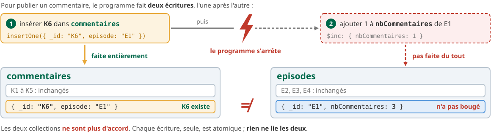
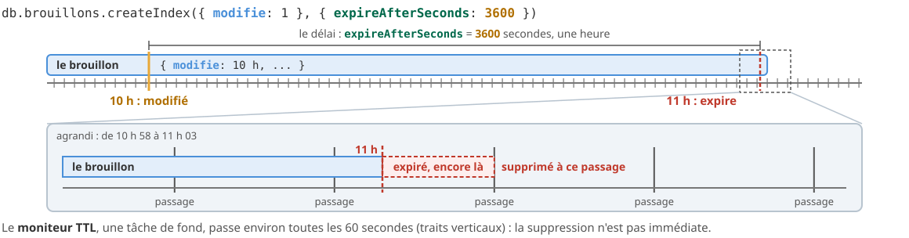

<!-- _class: lead -->
<!-- _paginate: false -->

<style scoped>
section {
  background-image: url('assets/logo.png');
  background-repeat: no-repeat;
  background-position: bottom 40px center;
  background-size: 380px;
}
h1 { font-size: 1.9em; }
</style>

# Modéliser à partir des requêtes

**R5.Real.10 - Nouveaux paradigmes de base de données**

Séance 4 · TP3 · semaine du 30 novembre 2026

<!--
(Hors minutage : diapo de titre.)

Le point cours se fait en deux temps.

Premier temps, en début de séance : diapos 2 à 33 (données, parties 1 à 3 : partir des requêtes, Subset, Computed, atomicité et transactions), 29 minutes environ, puis les deux diapos « À vous » (64 et 65, 2 minutes). C'est le cours le plus conceptuel du module : chaque pattern suit la même fiche (le symptôme, le principe, les documents avant et après, la requête qui en profite, le coût, l'instance dans le TP).

Second temps, quand la majorité du groupe attaque la partie 4 : diapos 34 à 56 (Bucket, séries temporelles et rétention, synthèse, Java), 18 minutes environ. Les diapos 57 à 63 (autres patterns : référence étendue, Attribute, Outlier, Polymorphic, Schema Versioning, CQRS, Archive) se présentent en 5 minutes à la suite, ou se laissent en lecture pour les bonus.

Deux jeux de données, comme dans l'énoncé : 🚲 les vélos de Valcerise (les données du TP, seulement pour présenter les données et le problème, jamais une réponse) et 🧪 les podcasts d'entraînement (tous les exemples exécutables). Tout a été exécuté sur MongoDB 9.0.4 ; les résultats affichés sont ceux obtenus. Le script des podcasts est dans les notes de la diapo « Des podcasts pour les exemples ».
-->

---

<!-- header: Séance 4 · les données -->

## 🚲 Les données du TP : les vélos de Valcerise


<div class="box" style="margin-top: 0.3rem; font-size: 0.68em;"><b>Au programme</b> : 7 parties, 12 exercices, 60 points, tout en séance. Des données <b>inventées</b>, mais cohérentes : la même ville d'une partie à l'autre.</div>

<!--
(1 min 30)

Une ville qui n'existe pas, Valcerise, et son réseau de vélos. Faire repérer les trois collections qui grandissent sans fin (avis, trajets, relevés) et les deux qui restent petites (24 stations, 300 vélos) : c'est déjà une question de modélisation.

Les flèches sont des références : un avis connaît sa station, un trajet son vélo et ses stations. Les champs stats et derniersTrajets sont tenus à jour par l'application : on y reviendra (Computed, Subset).

Ces données ne servent ici qu'à poser le problème. Tous les exemples exécutables du cours sont sur les podcasts (diapo suivante).
-->

---

## 🧪 Des podcasts pour les exemples

<style scoped>
table { display: table; width: 100%; font-size: 0.74em; }
</style>

Les exemples des diapos portent sur une plateforme de podcasts **inventée**, celle de l'énoncé et des quiz de l'assistant IA :

| `episodes` | `commentaires` | `ecoutes` |
|---|---|---|
| E1 *Les trous noirs*, E2 *Le sommeil*, E3 *Les volcans* : émission « Sciences en poche » | K1 à K3 sur E1 (K2 et K3 à la même minute) | E1 : 23 h 50 le 7 septembre, puis 0 h 10 et 7 h 30 le 8 |
| E4 *La disparue de Vernon* : « Polar du soir » | K4 sur E2, K5 sur E4 | E4 : 19 h et 19 h 30 le 10 septembre |

<p class="petit">Un épisode : <code>{ _id, emission, titre, duree, publie }</code>. Un commentaire : <code>{ _id, episode, auteur, note, date }</code>. Une écoute : <code>{ episode, t, auditeurs }</code>. Le script est dans l'énoncé, section « Deux jeux de données ».</p>

<div class="bandeau" style="margin-top: 0.6rem; font-size: 0.9em;">🚲 les vélos : le problème à résoudre · 🧪 les podcasts : les exemples à exécuter, dans <code>essais.mongodb.js</code></div>

<!--
(45 s)

Pourquoi deux jeux de données : un exemple sur les vélos donnerait la réponse d'un exercice. Les podcasts montrent le mécanisme ; les vélos, le problème.

Script à coller dans essais.mongodb.js pour rejouer les exemples :

use('tp3');
db.episodes.deleteMany({});
db.episodes.insertMany([
  { _id: "E1", emission: "Sciences en poche", titre: "Les trous noirs", duree: 32, publie: ISODate("2026-09-07T06:00:00Z") },
  { _id: "E2", emission: "Sciences en poche", titre: "Le sommeil", duree: 28, publie: ISODate("2026-09-14T06:00:00Z") },
  { _id: "E3", emission: "Sciences en poche", titre: "Les volcans", duree: 35, publie: ISODate("2026-09-21T06:00:00Z") },
  { _id: "E4", emission: "Polar du soir", titre: "La disparue de Vernon", duree: 47, publie: ISODate("2026-09-10T19:00:00Z") }
]);
db.commentaires.deleteMany({});
db.commentaires.insertMany([
  { _id: "K1", episode: "E1", auteur: "lou", note: 5, date: ISODate("2026-09-07T08:12:00Z") },
  { _id: "K2", episode: "E1", auteur: "sam", note: 3, date: ISODate("2026-09-08T21:40:00Z") },
  { _id: "K3", episode: "E1", auteur: "ana", note: 4, date: ISODate("2026-09-08T21:40:00Z") },
  { _id: "K4", episode: "E2", auteur: "lou", note: 2, date: ISODate("2026-09-15T07:05:00Z") },
  { _id: "K5", episode: "E4", auteur: "max", note: 5, date: ISODate("2026-09-11T22:30:00Z") }
]);
db.ecoutes.deleteMany({});
db.ecoutes.insertMany([
  { episode: "E1", t: ISODate("2026-09-07T23:50:00Z"), auditeurs: 40 },
  { episode: "E1", t: ISODate("2026-09-08T00:10:00Z"), auditeurs: 35 },
  { episode: "E1", t: ISODate("2026-09-08T07:30:00Z"), auditeurs: 52 },
  { episode: "E4", t: ISODate("2026-09-10T19:00:00Z"), auditeurs: 18 },
  { episode: "E4", t: ISODate("2026-09-10T19:30:00Z"), auditeurs: 21 }
])
-->

---

<!-- header: Partie 1 · partir des requêtes -->

<!-- _class: lead -->
<!-- _header: "" -->

# Partie 1 - 🧭 Partir des requêtes

mesurer, puis décider

<!--
(10 s)

Même titre que la partie 1 de l'énoncé du TP3.
-->

---

## Deux façons de concevoir un modèle


<div class="cols" style="margin-top: 0.3rem; align-items: stretch;">
<div class="box" style="margin-top: 0;">

**En relationnel**, on normalise d'abord : chaque fait est écrit **une fois**, et les jointures recollent les morceaux à la lecture.

</div>
<div class="box" style="margin-top: 0;">

**Avec MongoDB**, on part des **requêtes** : ce qui est **lu ensemble** est **rangé ensemble**, quitte à recopier.

</div>
</div>

<!--
(1 min 15)

Le point de départ du TP1 (« Modéliser la médiathèque ») : embarquer ou référencer. Ici, on change d'angle : avant de choisir, on mesure ce que l'application fait des données.

La normalisation optimisait la place, la ressource chère des années 1970. Aujourd'hui, ce qui coûte, c'est le temps de réponse d'une lecture fréquente. En relationnel aussi on dénormalise pour les requêtes, mais après coup ; avec MongoDB, on le décide dès le départ.

Une conséquence importante : il n'y a pas un bon schéma dans l'absolu. Deux applications qui stockent les mêmes données avec des requêtes différentes auront deux schémas différents, tous deux justes.
-->

---

## La démarche : trois étapes vers le schéma

<style scoped>
.g3 { gap: 0.7em; align-items: stretch; }
.carte { font-size: 0.74em; }
</style>

<div class="g3" style="margin-top: 0.6rem;">
<div class="carte"><b class="t">1. La charge de travail</b>

Quelles **lectures** et quelles **écritures**&nbsp;? À quelle **fréquence**&nbsp;? Sur quels **volumes**, et comment **grandissent**-ils ?

Un tableau, avec des chiffres.

</div>
<div class="carte vert"><b class="t">2. Les relations</b>

Pour chaque relation : **embarquer** ou **référencer** ? Les questions du TP1, avec les chiffres de l'étape 1.

</div>
<div class="carte orange"><b class="t">3. Les patterns</b>

Des solutions **éprouvées** à des problèmes qui reviennent : garder les derniers éléments, compter sans relire, regrouper des mesures...

</div>
</div>

<div class="bandeau" style="margin-top: 0.8rem;">Les patterns sont des outils de l'étape 3 : on ne les applique pas par principe, on les choisit pour une requête.</div>

<!--
(45 s)

C'est la démarche que décrit la documentation de MongoDB (« Identify Application Workload », « Map Relationships », « Apply Patterns »). Les parties du TP la suivent : partie 1, étapes 1 et 2 ; parties 2 à 5, étape 3.
-->

---

## Un pattern de conception, c'est quoi ?

<style scoped>
.g3 { gap: 0.6em; align-items: stretch; }
.carte { font-size: 0.68em; }
</style>

Une **solution éprouvée** à un **problème qui revient**, avec un **nom** et un **prix**. Chaque pattern de ce cours suit la même fiche :

<div class="g3" style="margin-top: 0.5rem;">
<div class="carte rouge"><b class="t">Le symptôme</b>
une requête fréquente lit trop, un document grossit sans fin, un calcul se répète...
</div>
<div class="carte"><b class="t">Le principe et les documents</b>
le modèle <b>avant</b>, le modèle <b>après</b>, document par document
</div>
<div class="carte vert"><b class="t">La requête qui en profite</b>
ce qu'elle lisait avant, ce qu'elle lit après
</div>
</div>

<div class="g3" style="margin-top: 0.5rem;">
<div class="carte orange"><b class="t">Le prix</b>
une écriture de plus, une donnée recopiée, un risque de dérive
</div>
<div class="carte violet"><b class="t">Quand l'utiliser</b>
le symptôme qui le justifie ; sans lui, le pattern complique pour rien
</div>
<div class="carte"><b class="t">🚲 Dans le TP</b>
où le pattern apparaît sur les vélos
</div>
</div>

<!--
(45 s)

Comme les design patterns objet (Gang of Four) : un nom partagé pour une solution connue, avec son contexte et ses conséquences. Ce n'est pas une règle à appliquer partout ; un pattern sans le symptôme qui le justifie complique le modèle pour rien.
-->

---

## Étape 1 : le tableau de charge de travail

<style scoped>
table { display: table; width: 100%; font-size: 0.72em; }
</style>

Sur la plateforme de podcasts :

| Action | Type | Fréquence | Données lues ou écrites |
|---|---|---|---|
| ouvrir la page d'un épisode | lecture | **50 000 / jour** | l'épisode, ses 2 derniers commentaires, son nombre de commentaires |
| publier un commentaire | écriture | 500 / jour | un commentaire |
| lire tous les commentaires d'un épisode | lecture | 200 / jour | les commentaires, page par page |
| relever le nombre d'auditeurs | écriture | 1 par minute et par épisode en diffusion | une mesure |
| tracer la courbe d'écoute d'une journée | lecture | 300 / jour | les mesures d'un épisode sur un jour |
| publier un épisode | écriture | 10 / semaine | un épisode |

<div class="warn" style="margin-top: 0.4rem;">

Ajouter pour chaque collection sa **taille** et sa **croissance** : 4 épisodes, mais des commentaires **sans limite** (un épisode « viral » en reçoit 10 000) et des mesures qui s'accumulent **chaque minute**.

</div>

<!--
(1 min 15)

Des chiffres inventés pour l'exemple, mais du bon ordre de grandeur. Faire lire la colonne Fréquence : la page d'un épisode est lue 100 fois plus souvent qu'un commentaire n'est écrit. C'est ce rapport qui va décider des choix de modèle.

Lien avec l'exercice 1 : il mesure la charge réelle du réseau de vélos (avis par station, trajets par jour). Le tableau de l'exercice 2 est un tableau de charge de ce type.
-->

---

## Lire le tableau : on paie à l'écriture pour gagner à la lecture

<style scoped>
.cols { align-items: stretch; }
</style>

<div class="cols" style="margin-top: 0.4rem;">
<div class="carte rouge"><b class="t">Tout calculer à la lecture</b>

La page de l'épisode compte ses commentaires et cherche les 2 derniers **à chaque ouverture** : 50 000 fois par jour, pour un résultat qui ne change que 500 fois.

</div>
<div class="carte vert"><b class="t">Préparer à l'écriture</b>

Chaque nouveau commentaire met à jour, **une fois**, le compte et la liste des 2 derniers rangés dans l'épisode : 500 mises à jour, et 50 000 lectures d'un seul document.

</div>
</div>

<div class="bandeau" style="margin-top: 0.8rem;">Une requête fréquente doit lire peu de documents. Le travail se déplace vers l'écriture, moins fréquente.</div>

<!--
(1 min)

C'est le fil de tout le cours : chaque pattern déplace du travail de la lecture vers l'écriture, ou d'une requête fréquente vers une requête rare. Le prix : des données recopiées, à tenir cohérentes.

Faire calculer : 50 000 lectures × (1 épisode + tous ses commentaires) contre 500 écritures × 2 documents. Même avec beaucoup d'approximations, l'écart est de deux ordres de grandeur.
-->

---

## Étape 2 : embarquer ou référencer, selon la taille


<div class="box" style="margin-top: 0.3rem; font-size: 0.75em;">

Un **tableau qui grandit sans fin** ne s'embarque pas : le document grossit à chaque écriture et finit par bloquer à **16 Mo**. Bien avant, il ralentit chaque lecture de la page. Pour des mesures lues **par période**, on peut aussi les **regrouper** : c'est le pattern Bucket (partie 4).

</div>

<!--
(1 min 15)

Les trois tailles viennent d'un billet classique de William Zola (MongoDB, « 6 Rules of Thumb for MongoDB Schema Design ») : one-to-few, one-to-many, one-to-squillions. Ce sont des ordres de grandeur, pas des seuils.

Le sens de la référence compte : quand le côté « plusieurs » grandit sans fin, c'est lui qui porte la référence (chaque écoute connaît son épisode), jamais un tableau d'_id dans l'épisode, qui grandirait aussi sans fin.

Rappel du TP1 : les quatre questions (lus ensemble ? combien ? sans limite ? modifiés indépendamment ?). On les pose maintenant avec les chiffres du tableau de charge.
-->

---

## Le coût d'une jointure : ce que fait `$lookup`


<div class="cols" style="margin-top: 0.3rem; align-items: stretch;">
<div class="box" style="margin-top: 0;">

**Sans index** sur le champ de jointure, `$lookup` parcourt **toute** la collection jointe pour trouver les documents liés.

</div>
<div class="box" style="margin-top: 0;">

**Avec un index**, il ne lit que les documents liés. Mais il lit **toujours plus** que si les commentaires étaient imbriqués dans l'épisode.

</div>
</div>

<!--
(1 min)

Le TP2 annonçait que le TP3 reviendrait sur le coût de $lookup : le voici. $lookup reste utile pour une requête rare (une statistique, une page d'administration), avec un index sur foreignField. Sur une page lue 50 000 fois par jour, son coût se répète 50 000 fois.

Vérifié sur MongoDB 9.0.4 : sans index, la jointure parcourt la collection jointe (collectionScans: 1 pour la page de E1 ; sur plusieurs épisodes à la fois, le plan peut être une jointure par hachage, strategy « HashJoin », qui ne la lit qu'une fois en tout) ; avec un index, une recherche par l'index.
-->

---

## 🧪 Mesurer : `explain()` sur la page d'un épisode

<style scoped>
pre { font-size: 0.6em; }
table { display: table; width: 100%; font-size: 0.74em; }
</style>

```js
db.episodes.explain("executionStats").aggregate([
  { $match: { _id: "E1" } },
  { $lookup: { from: "commentaires", localField: "_id", foreignField: "episode", as: "c" } }
]).stages[1]
// { '$lookup': { ... }, nReturned: Long('1'), ..., totalDocsExamined: Long('5'),
//   totalKeysExamined: Long('0'), collectionScans: Long('1'), indexesUsed: [], ... }
```

| Lecture de la page de E1 | Documents examinés par la jointure |
|---|---|
| `$lookup`, sans index sur `commentaires.episode` | **5** (toute la collection) |
| `$lookup`, avec un index sur `episode` | **3** (et 3 clés d'index) |
| commentaires utiles **embarqués** dans l'épisode | **aucune jointure** : 1 document en tout |

<!--
(1 min)

Pour un pipeline, les compteurs de la jointure sont dans l'étape $lookup du tableau stages, pas dans l'executionStats habituel du TP2.

Vérifié sur MongoDB 9.0.4 : les trois mesures du tableau ; la troisième est un find sur _id (totalDocsExamined: 1).
-->

---

## 🚲 Dans le TP : la page d'une station

<style scoped>
table { display: table; width: 100%; font-size: 0.78em; }
</style>

La fiche de la station ST04, qui a **29** avis parmi les **981** de la collection, mesurée de la même façon :

| Lecture de la fiche de ST04 | Documents examinés |
|---|---|
| la station, puis `$lookup` vers `avis`, sans index | 1 + **981** |
| la station, puis `$lookup` vers `avis`, avec un index sur `avis.station` | 1 + **29** |
| la station seule, si les avis affichés y sont rangés | **1** |

<div class="warn" style="margin-top: 0.5rem;">

Et la fiche n'affiche que **3** avis : sans index, 981 documents lus pour en montrer 3.

</div>

<!--
(45 s)

Vérifié sur MongoDB 9.0.4, sur les données du TP (la base chargée par npm run seed) : 981 documents examinés et un parcours de collection sans index, 29 documents et 29 clés avec l'index, 1 document pour un find sur la station.

C'est la motivation des exercices 1 (mesurer) et 2 (décider), et du pattern de la partie 2.
-->

---

## Cinq façons de ranger une relation


<div class="box" style="margin-top: 0.3rem; font-size: 0.75em;">

Les deux premiers viennent du TP1. Les trois suivants sont des **patterns de conception** : Subset (partie 2), Computed (partie 3), Bucket (partie 4).

</div>

<!--
(1 min)

C'est le vocabulaire de l'exercice 2 : pour chaque relation du tableau de l'énoncé, un de ces cinq choix. Deux relations peuvent avoir le même. Ne pas donner les réponses : faire lire les colonnes Fréquence et Croissance de l'énoncé.
-->

---

<!-- header: Partie 2 · Subset -->

<!-- _class: lead -->
<!-- _header: "" -->

# Partie 2 - ✂️ Le pattern Subset

garder les plus récents

<!--
(10 s)

Même titre que la partie 2 de l'énoncé du TP3.
-->

---

## Le symptôme : une page qui lit trop

<style scoped>
.cols { align-items: stretch; }
</style>

<p>La page d'un épisode affiche ses <b>2 derniers commentaires</b>. Un épisode « viral » en a <b>10 000</b>.</p>

<div class="cols" style="margin-top: 0.4rem;">
<div class="carte rouge"><b class="t">Tout embarquer</b>

L'épisode contient ses 10 000 commentaires : chaque ouverture de la page les transfère tous, pour en afficher 2. Le document grossit à chaque commentaire, vers la limite de 16 Mo.

</div>
<div class="carte rouge"><b class="t">Tout référencer</b>

L'épisode ne contient rien : chaque ouverture fait une jointure, ou une seconde requête, triée, sur `commentaires`.

</div>
</div>

<div class="warn" style="margin-top: 0.6rem;">

Le vrai coût est en **mémoire** : MongoDB garde en mémoire les documents et les index utilisés souvent. Des documents énormes, dont on n'utilise qu'une petite partie, en chassent les autres.

</div>

<!--
(1 min)

Les deux solutions du TP1 échouent ici, pour des raisons opposées. Le pattern Subset prend un peu de chaque.

Le « working set » : la partie des données et des index lue souvent, qui doit tenir en mémoire vive. C'est la motivation première du pattern dans la documentation de MongoDB, plus encore que la limite de 16 Mo.
-->

---

## Le principe : un sous-ensemble embarqué, le tout à part


<div class="cols" style="margin-top: 0.3rem; align-items: stretch;">
<div class="box" style="margin-top: 0;">

**C'est quoi ?** Le document principal embarque **les quelques éléments les plus utiles** d'une liste sans fin ; la liste **complète** reste dans sa propre collection.

</div>
<div class="box" style="margin-top: 0;">

**Pourquoi faire ?** Que la requête **fréquente** lise un seul document, de taille **bornée** ; la requête **rare** paie la jointure.

</div>
</div>

<!--
(1 min)

Faire suivre les trois chemins : la lecture fréquente (vert) ne lit qu'un document ; la lecture rare (gris) lit la collection complète ; l'écriture (orange) touche deux collections.

« Les plus utiles » dépend de la requête : les plus récents (ici), les mieux notés, les plus lus. Exemple classique de la documentation : un produit et ses 10 derniers avis.
-->

---

## 🧪 Avant, après : l'épisode E1

<style scoped>
pre { font-size: 0.58em; }
</style>

<div class="cols" style="grid-template-columns: 1fr 1.15fr; align-items: start;">
<div>

<p class="etiquette">Avant : deux collections</p>

```js
// episodes
{ _id: 'E1', emission: 'Sciences en poche',
  titre: 'Les trous noirs', duree: 32,
  publie: ISODate('2026-09-07T06:00:00.000Z') }
// commentaires, 3 sur E1
{ _id: 'K1', episode: 'E1', auteur: 'lou', note: 5,
  date: ISODate('2026-09-07T08:12:00.000Z') }
{ _id: 'K2', episode: 'E1', auteur: 'sam', note: 3,
  date: ISODate('2026-09-08T21:40:00.000Z') }
{ _id: 'K3', episode: 'E1', auteur: 'ana', note: 4,
  date: ISODate('2026-09-08T21:40:00.000Z') }
```

</div>
<div>

<p class="etiquette">Après : les 2 plus récents dans l'épisode, comme la page</p>

```js
// episodes (collection commentaires inchangée)
{ _id: 'E1', emission: 'Sciences en poche',
  titre: 'Les trous noirs', duree: 32,
  publie: ISODate('2026-09-07T06:00:00.000Z'),
  derniersCommentaires: [
    { auteur: 'ana', note: 4,
      date: ISODate('2026-09-08T21:40:00.000Z') },
    { auteur: 'sam', note: 3,
      date: ISODate('2026-09-08T21:40:00.000Z') }
  ] }
```

</div>
</div>

<div class="box" style="margin-top: 0.3rem; font-size: 0.72em;">

K2 et K3 ont la **même date** : il faut un **second critère** de tri pour savoir lequel vient d'abord. Ici, l'`_id` décroissant : K3 avant K2.

</div>

<!--
(1 min 15)

Lire document par document. K1 n'est pas dans le sous-ensemble : c'est le plus ancien. Chaque élément embarqué est réduit aux champs affichés (pas de texte, pas d'_id) : le sous-ensemble ne recopie que ce que la page montre.

Vérifié sur MongoDB 9.0.4 : l'état « après » est celui obtenu en rangeant dans E1 ses 2 commentaires les plus récents, triés par date puis _id décroissants.

Lien avec l'exercice 3 : la même idée sur les avis des stations, avec 3 avis et la forme cible de l'énoncé ; la règle de départage y est imposée.
-->

---

## La requête qui en profite

<style scoped>
pre { font-size: 0.64em; }
table { display: table; width: 100%; font-size: 0.76em; }
</style>

```js
db.episodes.findOne({ _id: "E1" })
// l'épisode et ses 2 derniers commentaires : la page est prête
```

| Afficher la page de E1 | Documents lus |
|---|---|
| avant : l'épisode, puis `$lookup` vers `commentaires` (sans index) | 1 + 5 |
| après : l'épisode seul | **1** |
| la liste complète, rarement demandée | toujours dans `commentaires` |

<div class="bandeau" style="margin-top: 0.6rem;">La lecture fréquente ne fait plus de jointure ; la lecture rare n'a pas changé.</div>

<!--
(30 s)

Vérifié sur MongoDB 9.0.4 : explain du findOne sur E1, totalDocsExamined: 1.
-->

---

## 🧪 Construire un sous-ensemble d'un coup : `$topN`

<style scoped>
pre { font-size: 0.62em; }
</style>

Pour remplir le sous-ensemble à partir de la collection complète, un `$group` garde **les N premiers de chaque groupe** selon un tri. Les 2 épisodes les plus longs de chaque émission :

```js
db.episodes.aggregate([
  { $group: { _id: "$emission",
      plusLongs: { $topN: { n: 2, sortBy: { duree: -1 }, output: { titre: "$titre", duree: "$duree" } } } } },
  { $sort: { _id: 1 } }
])
// { _id: 'Polar du soir', plusLongs: [ { titre: 'La disparue de Vernon', duree: 47 } ] }
// { _id: 'Sciences en poche',
//   plusLongs: [ { titre: 'Les volcans', duree: 35 }, { titre: 'Les trous noirs', duree: 32 } ] }
```

<div class="box" style="margin-top: 0.4rem; font-size: 0.74em;">

`n` : combien en garder ; `sortBy` : l'ordre (ajoutez un second critère pour les égalités) ; `output` : la forme de chaque élément. Pour ranger le résultat dans les documents principaux, le pipeline se termine par un `$merge` (TP2).

</div>

<!--
(1 min)

Deux temps de vie d'un sous-ensemble : on le construit une fois (ou on le reconstruit) par une agrégation, puis on le tient à jour à chaque écriture ($push borné, diapo suivante).

Vérifié sur MongoDB 9.0.4 : le résultat affiché. « Polar du soir » n'a qu'un épisode : un seul élément.

Lien avec l'exercice 3 : la construction, pour les avis des stations, se termine par un $merge (TP2) qui ajoute le champ aux stations existantes.
-->

---

## 🧪 Tenir le sous-ensemble à jour : `$push` borné


```js
db.episodes.updateOne({ _id: "E3" }, { $push: { derniersCommentaires: {
  $each: [ { auteur: "lou", note: 4, date: ISODate("2026-09-21T08:00:00Z") },
           { auteur: "sam", note: 5, date: ISODate("2026-09-23T19:30:00Z") },
           { auteur: "zoe", note: 3, date: ISODate("2026-09-22T12:15:00Z") } ],
  $sort: { date: -1 }, $slice: 2 } } })
// derniersCommentaires : [ { auteur: 'sam', note: 5, date: ...T19:30 }, { auteur: 'zoe', note: 3, date: ...T12:15 } ]
```

<!--
(1 min 15)

Les trois modificateurs s'appliquent dans cet ordre : ajouter, trier tout le tableau (anciens et nouveaux éléments), couper. Un nombre positif dans $slice garde les premiers, un nombre négatif les derniers. Le tableau n'existait pas : $push l'a créé.

Vérifié sur MongoDB 9.0.4 : le résultat affiché (findOne sur E3).

Lien avec l'exercice 4 : c'est l'écriture qui maintient un sous-ensemble, ici les derniers trajets d'un vélo, à chaque nouveau trajet.
-->

---

## Le prix du Subset

<style scoped>
.g2 { gap: 0.6em; }
.carte { font-size: 0.72em; }
</style>

<div class="g2" style="margin-top: 0.4rem; align-items: stretch;">
<div class="carte orange"><b class="t">Deux écritures par commentaire</b>
Insérer dans <code>commentaires</code>, puis pousser dans l'épisode. Entre les deux, les deux collections ne sont pas d'accord.
</div>
<div class="carte orange"><b class="t">Des données recopiées</b>
L'auteur et la note existent deux fois. Un commentaire <b>supprimé</b> par la modération doit l'être aussi dans l'épisode, et le sous-ensemble complété par le suivant.
</div>
<div class="carte vert"><b class="t">Une taille à choisir</b>
2, parce que la page en montre 2. Le sous-ensemble ne se règle pas sur les données, mais sur l'<b>affichage</b>.
</div>
<div class="carte violet"><b class="t">Quand l'utiliser</b>
Une liste sans fin dont une requête <b>fréquente</b> ne lit que quelques éléments, toujours les mêmes (les plus récents, les mieux notés).
</div>
</div>

<!--
(1 min)

Le prix est toujours le même avec une donnée recopiée : plus d'écritures et un risque d'incohérence. Il est acceptable ici parce que l'écriture est 100 fois moins fréquente que la lecture (tableau de charge).
-->

---

## 🚲 Dans le TP : deux sous-ensembles

<style scoped>
pre { font-size: 0.62em; }
</style>

<div class="cols" style="align-items: start;">
<div>

<p class="etiquette">Exercice 3 : construire</p>

Les **3 derniers avis** de chaque station, rangés dans la station (forme cible de l'énoncé) :

```js
// stations
{ _id: "ST00", nom: "...", ...,
  derniersAvis: [ { auteur, note, date }, ... ] }
```

</div>
<div>

<p class="etiquette">Exercice 4 : tenir à jour</p>

Les **5 derniers trajets** de chaque vélo, déjà rangés dans le vélo ; chaque nouveau trajet y entre :

```js
// velos
{ _id: "V002", type: "electrique", ...,
  derniersTrajets: [ { trajet, depart, arrivee, t, duree }, ... ] }
```

</div>
</div>

<div class="warn" style="margin-top: 0.4rem;">

À l'exercice 4, les trajets anciens ne sont **plus** dans `trajets` (archivés) : recalculer `derniersTrajets` à partir de `trajets` les perdrait. On **pousse**, on ne recalcule pas.

</div>

<!--
(45 s)

Les formes cibles sont celles de l'énoncé : rien de plus. Faire remarquer que les deux exercices montrent les deux temps de vie d'un sous-ensemble : la construction (une agrégation) et l'entretien (une écriture à chaque événement).
-->

---

<!-- header: Partie 3 · Computed -->

<!-- _class: lead -->
<!-- _header: "" -->

# Partie 3 - 🧮 Le pattern Computed

calculer à l'écriture

<!--
(10 s)

Même titre que la partie 3 de l'énoncé du TP3.
-->

---

## Le symptôme : recompter à chaque lecture

<style scoped>
pre { font-size: 0.66em; }
</style>

La page de l'épisode affiche **son nombre de commentaires**. Le calculer à la lecture :

```js
db.commentaires.countDocuments({ episode: "E1" })
// 3
```

<div class="cols" style="margin-top: 0.4rem; align-items: stretch;">
<div class="carte rouge"><b class="t">À chaque lecture</b>
50 000 fois par jour, on relit les commentaires de l'épisode (ou leur index) pour retrouver un nombre qui n'a pas changé.
</div>
<div class="carte vert"><b class="t">À chaque écriture</b>
500 fois par jour, on ajoute 1 au nombre rangé dans l'épisode. La lecture n'a plus rien à calculer.
</div>
</div>

<!--
(45 s)

Même raisonnement qu'au tableau de charge : la valeur est lue 100 fois plus souvent qu'elle ne change. Les sources de MongoDB donnent l'exemple d'un million de lectures par heure contre mille écritures : mille fois moins de calculs.

Vérifié sur MongoDB 9.0.4 : countDocuments renvoie 3 pour E1.
-->

---

## Le principe : la valeur calculée est rangée dans le document


<div class="cols" style="margin-top: 0.3rem; align-items: stretch;">
<div class="box" style="margin-top: 0;">

**C'est quoi ?** Une valeur **dérivée** (un compte, une somme, une moyenne) est calculée au moment de l'**écriture** et rangée dans le document qui l'affiche.

</div>
<div class="box" style="margin-top: 0;">

**Pourquoi faire ?** Lire sans calculer. En SQL : une colonne **dénormalisée**, tenue à jour par l'application (ou un *trigger*).

</div>
</div>

<!--
(1 min)

$inc est atomique : deux commentaires écrits en même temps ajoutent bien 2 ; aucune écriture n'écrase l'autre.

Pour une moyenne, on ne range pas la moyenne elle-même : on range la somme et le nombre (deux $inc), et la moyenne se calcule à la lecture par une division.
-->

---

## 🧪 Avant, après : un commentaire, un `$inc`

<style scoped>
pre { font-size: 0.62em; }
table { display: table; width: 100%; font-size: 0.74em; }
</style>

```js
// E1 est à jour : 3 commentaires, nbCommentaires: 3
db.commentaires.insertOne({ _id: "K6", episode: "E1", auteur: "zoe", note: 5, date: ISODate("2026-09-12T09:00:00Z") });
db.episodes.updateOne({ _id: "E1" }, { $inc: { nbCommentaires: 1 } });
db.episodes.findOne({ _id: "E1" }, { _id: 0, titre: 1, nbCommentaires: 1 })
// { titre: 'Les trous noirs', nbCommentaires: 4 }
```

| Moment | `commentaires` (sur E1) | `nbCommentaires` de E1 |
|---|---|---|
| avant | K1, K2, K3 | 3 |
| après l'`insertOne` | K1, K2, K3, **K6** | 3 (pas encore à jour) |
| après le `$inc` | K1, K2, K3, K6 | **4** |

<!--
(1 min)

Le calcul se fait au moment de l'écriture, par une petite mise à jour : on n'a jamais recompté les commentaires. La ligne du milieu est le moment fragile (diapo « Atomicité ») : les deux collections ne sont pas d'accord. $inc crée le champ s'il est absent ; pour initialiser un compteur sur des données existantes, on le calcule une fois par lot.

Vérifié sur MongoDB 9.0.4, à partir de E1 avec nbCommentaires: 3 : le résultat affiché.

Lien avec l'exercice 5 : la même chose sur les compteurs stats des stations, pour chaque nouveau trajet, avec deux stations par trajet (départ et arrivée).
-->

---

## Deux façons de tenir un calcul à jour

<style scoped>
table { display: table; width: 100%; font-size: 0.74em; }
</style>

| | À l'écriture (`$inc`) | Par lot (`$merge`, TP2) |
|---|---|---|
| quand | à chaque écriture, juste après | de temps en temps : chaque nuit, chaque heure |
| fraîcheur | toujours à jour | en retard d'un lot |
| coût | une mise à jour de plus par écriture | une agrégation sur toute la collection |
| risque | une écriture oubliée ou faite deux fois fausse le compte **pour toujours** | aucune dérive durable : le lot repart des données |
| exemple | le nombre de commentaires sur la page | la vue matérialisée du TP2 (exercice 15) |

<div class="bandeau" style="margin-top: 0.6rem;">En pratique : calculer à l'écriture, et recalculer de temps en temps pour contrôler.</div>

<!--
(1 min)

Au TP2, l'exercice 15 recalculait une vue entière par lot avec $merge : c'était déjà un pattern Computed, rafraîchi périodiquement. Ici, on tient le calcul à jour à chaque écriture.

Le choix dépend de la fraîcheur exigée : un compteur affiché à l'utilisateur doit être à jour ; une statistique mensuelle peut attendre la nuit.
-->

---

## 🧪 Quand le calcul dérive

<style scoped>
pre { font-size: 0.6em; }
</style>

<div class="cols" style="grid-template-columns: 1fr 1fr; align-items: start;">
<div>

<p class="etiquette">Le même message reçu deux fois</p>

```js
// le $inc de K6, rejoué par erreur
db.episodes.updateOne({ _id: "E1" }, { $inc: { nbCommentaires: 1 } });
db.episodes.findOne({ _id: "E1" },
  { _id: 0, titre: 1, nbCommentaires: 1 })
// { titre: 'Les trous noirs', nbCommentaires: 5 }
```

</div>
<div>

<p class="etiquette">Le contrôle par recalcul</p>

```js
db.episodes.aggregate([
  { $lookup: { from: "commentaires", localField: "_id",
      foreignField: "episode", as: "c" } },
  { $project: { stocke: "$nbCommentaires",
      recalcule: { $size: "$c" } } },
  { $match: { $expr: { $ne: ["$stocke", "$recalcule"] } } }
])
// { _id: 'E1', stocke: 5, recalcule: 4 }, ...
```

</div>
</div>

<div class="warn" style="margin-top: 0.4rem;">

Rien n'empêche une écriture d'être faite **deux fois**, ou **oubliée** : le compteur reste faux sans que personne ne le voie. Le recalcul le révèle ; il est rare, il peut se permettre une jointure.

</div>

<!--
(1 min)

Vérifié sur MongoDB 9.0.4 : après le $inc rejoué, nbCommentaires vaut 5 pour 4 commentaires. Le contrôle renvoie E1 (5 contre 4), et aussi E2, E3 et E4, qui n'ont pas de compteur du tout (stocke absent, différent de recalcule) : le contrôle compare tout, y compris l'absence.

Une écriture « idempotente » donnerait le même résultat exécutée deux fois : $inc ne l'est pas, $set le serait.

Lien avec le bonus 6 : le même contrôle sur les compteurs des stations.
-->

---

## Atomicité : un document à la fois



<div class="cols" style="margin-top: 0.3rem; align-items: stretch;">
<div class="box" style="margin-top: 0;">

**Une** écriture sur **un** document est **atomique** : tous ses champs changent ensemble, ou aucun.

</div>
<div class="box" style="margin-top: 0;">

**Deux** écritures sur **deux** documents ne le sont pas : chaque donnée recopiée ajoute un moment où le modèle est incohérent.

</div>
</div>

<!--
(1 min)

Rappel du TP1 (« Deux documents, deux écritures ») et du point cours S2. C'est le prix des patterns de ce cours : Subset et Computed ajoutent chacun une seconde écriture.

Le plus souvent, cette incohérence brève est tolérable (un compteur faux d'une unité pendant quelques millisecondes), et le recalcul de contrôle rattrape les rares pannes.
-->

---

## Deux façons de garder deux données d'accord

<style scoped>
pre { font-size: 0.6em; }
.cols { align-items: stretch; }
</style>

<div class="cols">
<div class="carte vert"><b class="t">Les ranger dans le même document</b>

Si le compteur et la liste des derniers commentaires sont **dans l'épisode**, **une seule** `updateOne` les modifie ensemble :

```js
db.episodes.updateOne({ _id: "E1" }, {
  $inc: { nbCommentaires: 1 },
  $push: { derniersCommentaires: { ... } } })
```

C'est la solution à préférer : le modèle porte l'atomicité (le commentaire, lui, s'insère toujours à part dans `commentaires`).

</div>
<div class="carte orange"><b class="t">Une transaction multi-documents</b>

Quand les données vivent **forcément** dans deux documents (un commentaire et son épisode, un virement entre deux comptes), une **transaction** rend l'ensemble atomique : tout ou rien.

Elle coûte plus cher qu'une écriture simple, et demande un *replica set* : plusieurs serveurs qui gardent chacun une copie des données.

</div>
</div>

<div class="bandeau" style="margin-top: 0.6rem;">Une transaction ne remplace pas un bon modèle : d'abord ranger ensemble ce qui change ensemble.</div>

<!--
(1 min)

La phrase du bandeau vient de la documentation de MongoDB : la disponibilité des transactions ne doit pas remplacer une conception efficace du schéma. Le cas d'école où une transaction est indispensable : le virement bancaire, deux comptes qui ne peuvent pas être fusionnés en un document.

Le code de gauche n'est pas exécuté tel quel : les « ... » remplacent le commentaire à pousser.
-->

---

## 🧪 Une transaction, sur un *replica set*

<style scoped>
pre { font-size: 0.56em; }
.err pre { font-size: 0.6em; }
</style>

```js
// départ : 4 commentaires sur E1, nbCommentaires: 4
const session = db.getMongo().startSession();
const s = session.getDatabase("tp3");
session.startTransaction();
s.commentaires.insertOne({ _id: "K7", episode: "E1", auteur: "max", note: 4, date: ISODate("2026-09-12T10:00:00Z") });
s.episodes.updateOne({ _id: "E1" }, { $inc: { nbCommentaires: 1 } });
session.commitTransaction();     // les deux écritures, ou aucune
db.episodes.findOne({ _id: "E1" }, { _id: 0, titre: 1, nbCommentaires: 1 })
// { titre: 'Les trous noirs', nbCommentaires: 5 }

session.startTransaction();
s.commentaires.insertOne({ _id: "K8", episode: "E1", auteur: "lou", note: 1, date: ISODate("2026-09-12T11:00:00Z") });
// dans la transaction : 6 commentaires sur E1 ; hors transaction : 5
session.abortTransaction();      // K8 n'a jamais existé
db.commentaires.findOne({ _id: "K8" })
// null
```

<div class="cols" style="grid-template-columns: 1.1fr 1fr; align-items: center; margin-top: 0.3rem;">
<div class="err" style="margin-top: 0;">

```text
This MongoDB deployment does not support retryable writes.
Please add retryWrites=false to your connection string.
```

</div>
<div>

<p class="petit">Dans le codespace, mongosh refuse la transaction dès la première écriture : le MongoDB du codespace est un serveur seul, pas un <i>replica set</i>. Les exercices n'en ont pas besoin.</p>

</div>
</div>

<!--
(1 min 15)

Vérifié sur MongoDB 9.0.4, dans un conteneur lancé en replica set à un nœud (mongod --replSet rs0, puis rs.initiate()), à partir des podcasts et de la diapo « Avant, après » (E1 : 4 commentaires, nbCommentaires remis à 4 après la dérive) : la transaction validée donne nbCommentaires: 5 ; la transaction annulée ne laisse aucune trace de K8 ; pendant la transaction, la session compte 6 commentaires sur E1 et le reste de la base 5 (isolation : les écritures en cours ne se voient pas du dehors). Sur un serveur seul, le message affiché en bas, à la première écriture.

Les transactions existent depuis MongoDB 4.0 (2018). Une transaction dure au plus 60 secondes par défaut.
-->

---

## 🚲 Dans le TP : les compteurs des stations

<style scoped>
pre { font-size: 0.66em; }
</style>

Chaque station porte ses compteurs, tenus à jour par l'application :

```js
// stations
{ _id: 'ST04', nom: 'Campus Sciences', quartier: 'Université', capacite: 24,
  ouverture: ISODate('2024-05-23T00:00:00.000Z'),
  stats: { departs: 287, arrivees: 255, minutes: 4308 } }
```

<div class="cols" style="margin-top: 0.4rem; align-items: stretch;">
<div class="carte"><b class="t">Exercice 5</b>
Pour chaque nouveau trajet, mettre à jour les compteurs de la station de départ <b>et</b> de la station d'arrivée, avec <code>&#36;inc</code>, sans rien recalculer.
</div>
<div class="carte violet"><b class="t">Bonus 6</b>
Trouver, par un recalcul, les stations dont les compteurs ne correspondent plus aux trajets.
</div>
</div>

<!--
(30 s)

Le document montré est une vraie station des données (ST04) : ce n'est pas une réponse, c'est la donnée de départ.

Fin du premier temps : enchaîner sur les deux diapos « À vous » (64 et 65), puis lancer le travail. Le second temps commence à la partie 4.
-->

---

<!-- header: Partie 4 · Bucket -->

<!-- _class: lead -->
<!-- _header: "" -->

# Partie 4 - 🪣 Le pattern Bucket

une station, un jour, un document

<!--
(10 s)

Début du second temps : à projeter quand la majorité du groupe attaque la partie 4. Diapos 34 à 56, 18 minutes environ (puis, si le temps le permet, les autres patterns, diapos 57 à 63, 5 minutes).

Même titre que la partie 4 de l'énoncé du TP3.
-->

---

## Un mot, trois sens


<div class="bandeau" style="margin-top: 0.4rem;">Dans ce cours, « bucket » seul désigne le pattern. Les deux autres disent toujours « l'étape <code>&#36;bucket</code> » ou « les buckets internes ».</div>

<!--
(45 s)

La confusion est fréquente et légitime : les trois parlent de « ranger dans des seaux ». Mais l'étape $bucket du TP2 range des documents existants dans des tranches au moment d'une requête ; le pattern change la forme des documents stockés ; les buckets internes sont invisibles et gérés par le serveur.
-->

---

## Le symptôme : des mesures trop nombreuses

<style scoped>
.cols { align-items: stretch; }
</style>

Le nombre d'auditeurs d'un épisode en diffusion est relevé **chaque minute** : 1 440 mesures par jour et par épisode, chacune dans un document.

<div class="cols" style="margin-top: 0.4rem;">
<div class="carte rouge"><b class="t">Une mesure, un document</b>
La courbe d'une journée lit <b>1 440 documents</b>. Chaque mesure répète l'<code>episode</code> et occupe une entrée de chaque index : des millions d'entrées en quelques semaines.
</div>
<div class="carte rouge"><b class="t">Toutes les mesures dans l'épisode</b>
Un tableau qui grandit <b>sans fin</b> : c'est le cas « un-à-sans-fin » de la partie 1, à ne jamais embarquer.
</div>
</div>

<!--
(45 s)

Les deux extrêmes échouent, comme pour le Subset : ni un document par mesure, ni toutes les mesures dans un document. Le Bucket coupe la série en morceaux de taille bornée.
-->

---

## Le principe : un document par entité et par période


<div class="cols" style="margin-top: 0.3rem; align-items: stretch;">
<div class="box" style="margin-top: 0;">

**C'est quoi ?** Les mesures d'**une entité** pendant **une période** sont rangées dans **un document**, avec quelques **résumés** (ici le nombre et le maximum).

</div>
<div class="box" style="margin-top: 0;">

**Pourquoi faire ?** La courbe d'un jour lit **un** document ; le tableau reste **borné** (une journée a 1 440 minutes au plus).

</div>
</div>

<!--
(1 min)

Le Bucket combine deux idées déjà vues : un tableau borné embarqué (la période fixe une taille maximale) et des valeurs calculées (Computed : nb et max, qui évitent même de parcourir le tableau).

La période se choisit d'après la lecture fréquente : une courbe par jour, donc un document par jour. Un bucket par heure obligerait à lire 24 documents ; un par mois ferait un tableau de 43 200 mesures.
-->

---

## 🧪 Avant, après : cinq écoutes, trois buckets

<style scoped>
pre { font-size: 0.56em; }
</style>

<div class="cols" style="grid-template-columns: 0.85fr 1.15fr; align-items: start;">
<div>

<p class="etiquette">Avant : ecoutes</p>

```js
{ episode: 'E1', auditeurs: 40,
  t: ISODate('2026-09-07T23:50:00.000Z') }
{ episode: 'E1', auditeurs: 35,
  t: ISODate('2026-09-08T00:10:00.000Z') }
{ episode: 'E1', auditeurs: 52,
  t: ISODate('2026-09-08T07:30:00.000Z') }
{ episode: 'E4', auditeurs: 18,
  t: ISODate('2026-09-10T19:00:00.000Z') }
{ episode: 'E4', auditeurs: 21,
  t: ISODate('2026-09-10T19:30:00.000Z') }
```

</div>
<div>

<p class="etiquette">Après : un document par épisode et par jour</p>

```js
{ _id: 'E1-2026-09-07', episode: 'E1',
  jour: ISODate('2026-09-07T00:00:00.000Z'), nb: 1, max: 40,
  mesures: [ { t: ISODate('2026-09-07T23:50:00.000Z'), auditeurs: 40 } ] }
{ _id: 'E1-2026-09-08', episode: 'E1',
  jour: ISODate('2026-09-08T00:00:00.000Z'), nb: 2, max: 52,
  mesures: [ { t: ISODate('2026-09-08T00:10:00.000Z'), auditeurs: 35 },
             { t: ISODate('2026-09-08T07:30:00.000Z'), auditeurs: 52 } ] }
{ _id: 'E4-2026-09-10', episode: 'E4',
  jour: ISODate('2026-09-10T00:00:00.000Z'), nb: 2, max: 21,
  mesures: [ { t: ISODate('2026-09-10T19:00:00.000Z'), auditeurs: 18 },
             { t: ISODate('2026-09-10T19:30:00.000Z'), auditeurs: 21 } ] }
```

</div>
</div>

<!--
(1 min 15)

Lire écoute par écoute : la première écoute de E1 (23 h 50 le 7) part seule dans le bucket du 7 ; les deux suivantes, le 8, dans le bucket du 8. Les deux écoutes de E4 sont le même jour : un seul bucket.

L'_id est fabriqué à partir de l'épisode et du jour : on retrouve un bucket sans le chercher. Les mesures sont triées par heure, et chaque mesure ne garde que t et auditeurs (episode est déjà dans le bucket).

Les trois documents sont ceux obtenus sur MongoDB 9.0.4 en regroupant ecoutes par épisode et par jour UTC (les champs y sont dans un autre ordre, sans importance).

Vérifié sur MongoDB 9.0.4 : l'état seul est montré ; le pipeline qui le construit est celui de l'exercice 6 (sur les relevés), il n'est pas donné ici. Ses outils sont présentés dans l'énoncé, un par un : $dateTrunc, $concat et $dateToString pour l'_id, $sortArray pour l'ordre des mesures.

Lien avec l'exercice 6 : la même construction sur les relevés des stations, avec la forme cible de l'énoncé (créneaux, minimum et maximum).
-->

---

## 🧪 Les bornes d'une période : en UTC

<style scoped>
pre { font-size: 0.58em; }
table { display: table; width: 100%; font-size: 0.74em; }
</style>

```js
db.ecoutes.aggregate([ { $match: { episode: "E1" } }, { $project: { _id: 0, t: 1,
  jourUTC: { $dateTrunc: { date: "$t", unit: "day" } },
  jourParis: { $dateTrunc: { date: "$t", unit: "day", timezone: "Europe/Paris" } } } } ])
```

| Écoute (`t`, en UTC) | `jourUTC` | `jourParis` |
|---|---|---|
| 7 septembre, 23 h 50 | **7** septembre, 0 h UTC | 7 septembre, **22 h UTC** (minuit le 8 à Paris) |
| 8 septembre, 0 h 10 | **8** septembre, 0 h UTC | 7 septembre, 22 h UTC |
| 8 septembre, 7 h 30 | 8 septembre, 0 h UTC | 7 septembre, 22 h UTC |

<div class="warn" style="margin-top: 0.4rem;">

Une même écoute change de bucket selon le **fuseau**. Dans le TP, un jour commence à **0 h UTC**, c'est-à-dire 1 h du matin à Paris en novembre (minuit à Paris, c'est 23 h UTC) : c'est `$dateTrunc` sans `timezone`.

</div>

<!--
(1 min)

Vérifié sur MongoDB 9.0.4 : le tableau reprend le résultat obtenu (jourParis vaut 2026-09-07T22:00:00Z pour les trois écoutes, car Paris est à UTC+2 en septembre).

Le choix du fuseau est une décision de modèle, comme la période : il faut le fixer une fois pour toutes et l'écrire dans la forme cible. Les données du TP ont des relevés à 23 h 45 UTC, qui tombent le lendemain à l'heure de Paris.
-->

---

## Écrire une mesure dans son bucket


<div class="cols" style="margin-top: 0.3rem; align-items: stretch;">
<div class="box" style="margin-top: 0;">

**Trouver ou créer** : l'`_id` du bucket se calcule à partir de la mesure (épisode et jour) ; un `upsert` crée le bucket s'il manque.

</div>
<div class="box" style="margin-top: 0;">

**Tenir les résumés** : `$inc` pour le nombre, `$max` (ou `$min`) qui ne remplace la valeur que si la nouvelle est plus grande (plus petite).

</div>
</div>

<!--
(1 min 15)

Les deux cas de l'upsert (TP1, partie 3) : le document existe, on le modifie ; il n'existe pas, on le crée, et les champs de $setOnInsert ne s'écrivent qu'à ce moment-là (episode, jour).

Vérifié sur MongoDB 9.0.4 : les deux états « après » du schéma sont ceux obtenus (E1-2026-09-08 : nb 3, max 61, trois mesures ; E4-2026-09-11 créé avec nb 1, max 9).

Lien avec l'exercice 7 : la même écriture pour chaque nouveau relevé d'une station, dans l'ordre des heures. Le schéma ne donne pas le code : les opérateurs sont dans l'énoncé, un par un.
-->

---

## Le prix du Bucket

<style scoped>
.g2 { gap: 0.6em; }
.carte { font-size: 0.72em; }
</style>

<div class="g2" style="margin-top: 0.4rem; align-items: stretch;">
<div class="carte vert"><b class="t">Ce qui devient simple</b>
La courbe d'un jour : <b>un</b> document. Le maximum du jour : un champ, sans parcourir le tableau. Moins de documents, des index plus petits.
</div>
<div class="carte orange"><b class="t">Ce qui devient compliqué</b>
Une requête sur <b>une</b> mesure (les minutes à plus de 50 auditeurs) doit dérouler les tableaux (<code>&#36;unwind</code>). Corriger une mesure demande de la retrouver dans un tableau.
</div>
<div class="carte orange"><b class="t">Ce qu'il faut décider</b>
La période (un jour ? une heure ?), le fuseau, l'<code>_id</code>, l'ordre du tableau. Et ce qui arrive aux mesures en retard.
</div>
<div class="carte violet"><b class="t">Quand l'utiliser</b>
Des mesures nombreuses, régulières, toujours lues par entité et par période. Si l'on n'a besoin ni de résumés rangés ni d'un schéma imposé, une collection time series (partie 5) fait le même travail.
</div>
</div>

<!--
(45 s)

Les mesures en retard sont fréquentes avec des capteurs : un relevé arrive après que son bucket a été construit. L'upsert les range dans le bon bucket, mais $push les ajoute en fin de tableau : si l'ordre du tableau compte, il faut écrire les mesures dans l'ordre des heures (ou trier en poussant). Exercice 7 : des relevés du 1er novembre arrivés en retard.
-->

---

## 🚲 Dans le TP : l'occupation des stations

<style scoped>
pre { font-size: 0.6em; }
</style>

L'historique de la semaine précédente est **déjà** rangé en buckets ; la semaine courante est encore dans `releves`, un relevé par document :

```js
// occupation (tableau creneaux raccourci)
{ _id: 'ST04-2026-10-28', station: 'ST04', jour: ISODate('2026-10-28T00:00:00.000Z'), nb: 96,
  creneaux: [ { t: ISODate('2026-10-28T00:00:00.000Z'), velos: 6 },
              { t: ISODate('2026-10-28T00:15:00.000Z'), velos: 7 }, ... ],
  velosMin: 5, velosMax: 24 }
```

<div class="cols" style="margin-top: 0.4rem; align-items: stretch;">
<div class="carte"><b class="t">Exercice 6</b>
Construire les buckets de la semaine courante, à côté de l'historique.
</div>
<div class="carte"><b class="t">Exercice 7</b>
Écrire chaque nouveau relevé dans son bucket, existant ou à créer.
</div>
</div>

<!--
(30 s)

Le document est un vrai bucket de l'historique (données de départ) : il montre la forme cible de l'exercice 6, déjà donnée dans l'énoncé.
-->

---

<!-- header: Partie 5 · séries temporelles -->

<!-- _class: lead -->
<!-- _header: "" -->

# Partie 5 - ⏱️ Séries temporelles et rétention

le bucket que MongoDB écrit pour vous

<!--
(10 s)

Même titre que la partie 5 de l'énoncé du TP3.
-->

---

## Le principe : une mesure par document, des buckets internes


<div class="cols" style="margin-top: 0.3rem; align-items: stretch;">
<div class="box" style="margin-top: 0;">

**C'est quoi ?** Une collection créée avec `timeseries` : on y écrit **une mesure par document** (sa date : `timeField` ; ce qui identifie la série : `metaField`), et le serveur les regroupe lui-même en **buckets internes**.

</div>
<div class="box" style="margin-top: 0;">

**Pourquoi faire ?** Avoir le stockage du pattern Bucket (compact, peu d'entrées d'index) sans en écrire le code.

</div>
</div>

<!--
(1 min)

Le vocabulaire de MongoDB : une mesure (measurement) a une date (timeField), une étiquette qui identifie la série et change rarement (metaField : l'épisode, la station, le capteur) et des valeurs (metrics).

Les mesures sont compressées colonne par colonne dans chaque bucket : une série de 1 440 mesures prend beaucoup moins de place que 1 440 documents.
-->

---

## 🧪 Créer une collection time series

<style scoped>
pre { font-size: 0.58em; }
table { display: table; width: 100%; font-size: 0.72em; }
</style>

```js
// pour l'exemple : des écoutes relevées toutes les quelques heures
db.createCollection("ecoutes_ts",
  { timeseries: { timeField: "t", metaField: "episode", granularity: "hours" } });
db.ecoutes_ts.insertMany(db.ecoutes.find({}, { _id: 0 }).toArray());
db.ecoutes_ts.findOne({}, { _id: 0 })
// { t: ISODate('2026-09-07T23:50:00.000Z'), episode: 'E1', auditeurs: 40 }
db.getCollectionInfos({ name: "ecoutes_ts" })[0].options
// { timeseries: { timeField: 't', metaField: 'episode', granularity: 'hours',
//                 bucketMaxSpanSeconds: 2592000, fixedBucketing: true } }
```

| `granularity` | pour des mesures d'une même série espacées de... | un bucket interne couvre au plus |
|---|---|---|
| `"seconds"` (par défaut) | quelques secondes | 1 heure |
| `"minutes"` | quelques minutes | 1 jour |
| `"hours"` | quelques heures | 30 jours |

<!--
(1 min)

Pour l'exemple, on suppose des écoutes relevées toutes les quelques heures. La granularité dit l'intervalle habituel entre deux mesures d'une même série ; MongoDB en déduit la durée maximale d'un bucket interne (bucketMaxSpanSeconds). Trop fine, elle multiplie les petits buckets ; trop grossière, une requête sur un jour lit des buckets d'un mois.

Vérifié sur MongoDB 9.0.4 : les sorties affichées ; avec seconds, minutes et hours, bucketMaxSpanSeconds vaut 3600, 86400 et 2592000.

Lien avec l'exercice 8 : choisir la granularité adaptée à des relevés toutes les 15 minutes.
-->

---

## 🧪 Le bucket que MongoDB a écrit

<style scoped>
pre { font-size: 0.56em; }
</style>

<div class="cols" style="grid-template-columns: 1.15fr 1fr; align-items: start;">
<div>

```js
db.runCommand({ find: "ecoutes_ts", rawData: true,
                filter: { meta: "E4" } }).cursor.firstBatch
// [ { _id: ObjectId('6aa1f3002f28f29d68daafe1'),
//     control: { version: 2,
//       min: { t: ISODate('2026-09-10T00:00:00.000Z'), auditeurs: 18, ... },
//       max: { t: ISODate('2026-09-10T19:30:00.000Z'), auditeurs: 21, ... },
//       count: 2 },
//     meta: 'E4',
//     data: { _id: Binary..., t: Binary..., auditeurs: Binary... } } ]
```

</div>
<div>

| Bucket interne | Pattern Bucket (partie 4) |
|---|---|
| `meta` | `episode` |
| `control.min.t` | `jour` (arrondi au jour avec `hours`) |
| `control.count` | `nb` |
| `control.max.auditeurs` | `max` |
| `data` (colonnes compressées) | `mesures` |

</div>
</div>

<div class="box" style="margin-top: 0.3rem; font-size: 0.72em;">

Avec `hours`, les 3 écoutes de E1 tiennent dans **un** bucket interne, là où le pattern de la partie 4 en faisait deux (un par jour). Ne pas **combiner** les deux : une collection time series de documents déjà regroupés perd tout l'intérêt du regroupement interne.

</div>

<!--
(1 min)

La commande find avec rawData: true lit les buckets internes tels que MongoDB les range ; c'est un outil d'observation, pas une requête d'application.

Vérifié sur MongoDB 9.0.4 : la sortie affichée (raccourcie : les _id des mesures dans control et le contenu des colonnes Binary) ; 2 buckets internes pour 5 mesures. L'ancien accès par system.buckets.ecoutes_ts est refusé en 9.0 : « Direct access to timeseries buckets namespaces is not allowed anymore… Use the rawData API ». La borne control.min.t est arrondie au début du jour pour la granularité hours.

La documentation de MongoDB le dit explicitement : ne pas utiliser le pattern Bucket dans une collection time series.
-->

---

## 🧪 Ce qu'une collection time series refuse

<style scoped>
table { display: table; width: 100%; font-size: 0.72em; }
</style>

| Essai | Réponse de MongoDB 9.0.4 |
|---|---|
| corriger une mesure : `updateOne({ episode: "E1" }, { $set: ... })` | `Cannot perform a non-multi update on a time-series collection` |
| imposer un schéma : `collMod` avec `validator` | `option not supported on a time-series collection: validator` |
| écrire par `$merge` dans la collection | `Cannot find index to verify that join fields will be unique: Timeseries collections cannot have unique indexes` |

<div class="cols" style="margin-top: 0.5rem; align-items: stretch;">
<div class="box" style="margin-top: 0;">

**Permis** : insérer, lire, agréger, supprimer une mesure (`deleteOne`), remplir par `$out` avec l'option `timeseries`.

</div>
<div class="box" style="margin-top: 0;">

`updateMany` n'y modifie que le **metaField** : une mesure ne se corrige pas, elle se supprime et se réinsère.

</div>
</div>

<!--
(45 s)

Une collection time series est faite pour des mesures qu'on ajoute et qu'on ne touche plus. Tous les messages sont recopiés de MongoDB 9.0.4. Le message de updateMany : « Cannot perform an update on a time-series collection which updates a field that is not the metaField ».
-->

---

## Bucket à la main ou collection time series ?

<style scoped>
table { display: table; width: 100%; font-size: 0.74em; }
</style>

| | Pattern Bucket (partie 4) | Collection time series |
|---|---|---|
| l'écriture | un `upsert` à écrire soi-même | un `insertOne` par mesure |
| la lecture d'une période | un document, déjà prêt (résumés compris) | un `find` ou un pipeline : MongoDB lit ses buckets |
| les résumés (nombre, max) | rangés, gratuits à la lecture | calculés à la lecture (un `$group`) |
| corriger une mesure | une mise à jour dans un tableau | supprimer, puis réinsérer |
| imposer un schéma (`$jsonSchema`) | oui | non |
| la rétention | à écrire (TTL sur le bucket, ou un lot) | une option : `expireAfterSeconds` |

<div class="bandeau" style="margin-top: 0.5rem;">Des mesures qu'on ajoute et qu'on agrège : time series. Un document par période, avec des résumés lus très souvent : le pattern.</div>

<!--
(1 min)

Depuis MongoDB 5.0, la documentation recommande les collections time series pour les séries temporelles ; le pattern Bucket écrit à la main garde sa place quand on veut un document par période, prêt à lire, ou un schéma contrôlé.
-->

---

## Faire expirer des documents : le TTL



<div class="cols" style="margin-top: 0.3rem; align-items: stretch;">
<div class="box" style="margin-top: 0;">

**C'est quoi ?** Un index sur **un champ date**, avec un délai `expireAfterSeconds` (en **secondes**) : un document expire quand sa date plus le délai est passée.

</div>
<div class="box" style="margin-top: 0;">

**Pourquoi faire ?** Que les données temporaires (sessions, brouillons, mesures brutes) disparaissent **seules**, sans programme de nettoyage.

</div>
</div>

<!--
(1 min)

La suppression n'est pas immédiate : le moniteur passe toutes les 60 secondes environ, et peut prendre du retard sous forte charge. Un document dont le champ n'est pas une date (une chaîne, par exemple) n'expire jamais. L'index TTL porte sur un seul champ.

Vérifié sur MongoDB 9.0.4 : un document daté du 1er janvier 2026 disparaît moins de trois minutes après la création de l'index TTL.
-->

---

## 🧪 Deux façons de fixer une rétention

<style scoped>
pre { font-size: 0.58em; }
</style>

<div class="cols" style="grid-template-columns: 1fr 1fr; align-items: start;">
<div>

<p class="etiquette">Un index TTL sur une collection</p>

```js
db.brouillons.createIndex({ modifie: 1 }, { expireAfterSeconds: 3600 })
// modifie_1
db.brouillons.getIndexes()[1]
// { v: 2, key: { modifie: 1 }, name: 'modifie_1',
//   expireAfterSeconds: 3600 }
```

</div>
<div>

<p class="etiquette">Une option de collection time series</p>

```js
db.createCollection("ecoutes_recentes", {
  timeseries: { timeField: "t", metaField: "episode",
                granularity: "minutes" },
  expireAfterSeconds: 86400 })
// { ok: 1 }
db.ecoutes_recentes.createIndex({ t: 1 },
  { expireAfterSeconds: 60 })
```

</div>
</div>

<div class="err" style="margin-top: 0.3rem;">

```text
TTL indexes on time-series collections require a partialFilterExpression on the metaField
```

</div>

<p class="petit">Le message du second <code>createIndex</code> : un index TTL ordinaire est refusé sur une collection time series. Celle-ci supprime un bucket interne <b>entier</b>, quand toutes ses mesures ont expiré.</p>

<!--
(1 min)

Vérifié sur MongoDB 9.0.4 : les sorties et le message affichés. Recréer l'index avec un autre délai échoue (« An equivalent index already exists with the same name but different options ») : il faut le supprimer d'abord, ou modifier le délai avec collMod.

Pour essayer : brouillons n'est pas dans le script des podcasts ; db.brouillons.insertOne({ _id: "B1", episode: "E4", modifie: new Date() }) crée la collection avec un document, qui disparaît une heure après sa date modifie (au passage suivant du moniteur TTL, chaque minute environ).

Lien avec l'exercice 9 : un index TTL et une collection time series avec rétention, notés sur leur seule définition (les documents disparaissent à un moment qu'on ne choisit pas).
-->

---

## Supprimer ou déplacer ?

<style scoped>
.cols { align-items: stretch; }
</style>

<div class="cols" style="margin-top: 0.4rem;">
<div class="carte orange"><b class="t">Supprimer : le TTL</b>

Ce qui n'a plus aucune valeur une fois périmé : une session de l'application, un brouillon, une mesure brute dont on a gardé les résumés.

</div>
<div class="carte violet"><b class="t">Déplacer : le pattern Archive</b>

Ce qu'on lit rarement mais qu'on doit garder : les écoutes de l'an dernier, déplacées vers une collection d'archives (`$merge`, puis `deleteMany`). La collection chaude reste petite.

</div>
</div>

<div class="warn" style="margin-top: 0.6rem;">

Avant de faire expirer des mesures, se demander ce qui a été **calculé** à partir d'elles : un bucket, un résumé, un compteur. Ils survivent à leurs sources.

</div>

<!--
(45 s)

Archive est l'un des patterns présentés sans exercice noté (fin du support). Le déplacement en deux temps ($merge puis deleteMany) n'est pas atomique : une transaction, ou une archive idempotente, évite de perdre ou de dupliquer des documents.

C'est aussi une question de la note de modélisation (bonus 7) : la purge des relevés de plus d'un an.
-->

---

<!-- header: Partie 6 · synthèse -->

<!-- _class: lead -->
<!-- _header: "" -->

# Partie 6 - 🧩 Synthèse

la fiche station

<!--
(10 s)

Même titre que la partie 6 de l'énoncé du TP3.
-->

---

## Plusieurs patterns dans un même document


<div class="box" style="margin-top: 0.3rem; font-size: 0.75em;">

Un document fait pour **une page** : tout ce qu'elle affiche, et rien d'autre. Il peut être reconstruit par lot (un pipeline terminé par `$merge` ou `$out`), ou tenu à jour à chaque écriture.

</div>

<!--
(1 min)

Une fiche reconstruite par lot est une vue matérialisée (TP2, exercice 15) : un modèle de lecture, séparé du modèle d'écriture. Pousser cette idée jusqu'au bout donne CQRS (fin du support).

Lien avec l'exercice 10 : la fiche d'une station, construite par une seule agrégation à partir des données de départ ; les champs en plus sont tolérés, et deux requêtes de référence lisent la fiche sans jointure.
-->

---

## Quel pattern, pour quel symptôme ?

<style scoped>
table { display: table; width: 100%; font-size: 0.74em; }
</style>

| Le symptôme | Le pattern |
|---|---|
| une page fréquente lit une liste sans fin pour en afficher quelques éléments | **Subset** |
| une valeur dérivée est recalculée à chaque lecture | **Computed** |
| des mesures nombreuses, une par document, lues par période | **Bucket** ou **time series** |
| une jointure fréquente pour lire un ou deux champs qui changent rarement | **référence étendue** |
| des dizaines de champs rares, tous à indexer | **Attribute** |
| quelques documents énormes imposent un modèle mauvais pour tous | **Outlier** |
| des objets proches mais pas identiques, interrogés ensemble | **Polymorphic** |
| le schéma doit évoluer sans tout migrer d'un coup | **Schema Versioning** |
| des années d'historique ralentissent les données récentes | **Archive** |

<!--
(1 min)

Se lit de gauche à droite : on part toujours du symptôme. Pour le réviser, cacher la colonne de droite et faire retrouver le pattern ; c'est aussi un bon quiz à demander à l'assistant du codespace.

Les six derniers sont présentés à la fin du support (diapos de référence), avec CQRS ; quatre d'entre eux ont un bonus dans l'énoncé.
-->

---

<!-- header: Partie 7 · du modèle au code -->

<!-- _class: lead -->
<!-- _header: "" -->

# Partie 7 - ☕ Du modèle au code

lire un bucket en Java

<!--
(10 s)

Même titre que la partie 7 de l'énoncé du TP3.
-->

---

## 🧪 Lire un document, puis son tableau

<style scoped>
pre { font-size: 0.62em; }
</style>

Afficher les derniers commentaires d'un épisode, trouvé par son titre :

```java
Document episode = episodes.find(Filters.eq("titre", "Les volcans")).first();   // le document, ou null
if (episode == null) {
    System.out.println("aucun épisode de ce titre");
} else {
    for (Document c : episode.getList("derniersCommentaires", Document.class, List.of())) {
        System.out.println(c.getString("auteur") + " : " + c.getInteger("note"));
    }
}
```

<div class="cols" style="margin-top: 0.4rem; align-items: stretch;">
<div class="box" style="margin-top: 0;">

**`first()`** termine une requête qui vise un seul document. S'il n'y en a pas, elle renvoie `null` : à tester **avant** de s'en servir.

</div>
<div class="box" style="margin-top: 0;">

**`getList`** lit un tableau de documents imbriqués : une `List<Document>`. Sans le 3ᵉ argument, un champ **absent** donne `null`, et la boucle lève une `NullPointerException` ; `List.of()` donne une liste vide.

</div>
</div>

<!--
(1 min)

Le pilote et ses classes d'aide sont ceux du S3 ; la nouveauté est de lire un document précis et un tableau imbriqué. Sur E3 après la diapo « Tenir le sous-ensemble à jour », la boucle affiche sam : 5 puis zoe : 3.

Lien avec les exercices 11 et 12 : lire un bucket d'occupation (un document, puis son tableau), puis le servir par une route Javalin ; la méthode d'exemple station(id) de l'énoncé montre find(...).first().
-->

---

<!-- header: Pour aller plus loin · autres patterns -->

## Référence étendue : recopier ce qui ne bouge pas

<style scoped>
pre { font-size: 0.6em; }
</style>

<div class="cols" style="grid-template-columns: 1fr 1fr; align-items: start;">
<div>

<p class="etiquette">Avant : la référence seule</p>

```js
// commentaires
{ _id: "K1", episode: "E1", auteur: "lou", note: 5 }
// pour afficher le titre de l'épisode :
// une jointure à chaque fois
```

</div>
<div>

<p class="etiquette">Après : la référence et une copie</p>

```js
// commentaires
{ _id: "K1", episode: "E1", auteur: "lou", note: 5,
  titreEpisode: "Les trous noirs" }
```

</div>
</div>

<div class="box" style="margin-top: 0.4rem; font-size: 0.74em;">

On garde l'`_id` (la référence) et on recopie **un ou deux champs** lus souvent et **rarement modifiés**. Le prix : une copie à mettre à jour si le titre change. Une copie peut aussi être **voulue** : le prix d'un article figé dans une commande.

</div>

<!--
(45 s)

Le TP1 l'utilisait sans la nommer : le titre du livre recopié dans l'historique des emprunts. Ne jamais recopier un champ qui change souvent (un stock, un nombre d'écoutes).
-->

---

## Attribute : des champs rares en paires `{ k, v }`

<style scoped>
pre { font-size: 0.58em; }
</style>

<div class="cols" style="grid-template-columns: 1fr 1.1fr; align-items: start;">
<div>

<p class="etiquette">Avant : un champ par propriété</p>

```js
{ _id: "E1", langue: "fr", explicite: false, saison: 2 }
{ _id: "E4", langue: "fr", narrateur: "Inès Valcourt" }
// un index par champ : langue, explicite,
// saison, narrateur... et tous les prochains
```

</div>
<div>

<p class="etiquette">Après : un tableau, un seul index</p>

```js
{ _id: "E1", proprietes: [ { k: "langue", v: "fr" },
  { k: "explicite", v: false }, { k: "saison", v: 2 } ] }
// E4 de même : [ { k: "langue", ... }, { k: "narrateur", ... } ]
db.episodes.createIndex({ "proprietes.k": 1, "proprietes.v": 1 })
db.episodes.find({ proprietes:
  { $elemMatch: { k: "langue", v: "fr" } } }, { titre: 1 })
// [ { _id: 'E1', titre: 'Les trous noirs' },
//   { _id: 'E4', titre: 'La disparue de Vernon' } ]
```

</div>
</div>

<p class="petit">Le plan utilise l'index <code>proprietes.k_1_proprietes.v_1</code> (IXSCAN). <code>&#36;elemMatch</code> (TP1) garantit que <code>k</code> et <code>v</code> viennent du même élément.</p>

<!--
(45 s)

Vérifié sur MongoDB 9.0.4 : le résultat et le plan (IXSCAN sur l'index composé, isMultiKey: true). Bonus 1 : les caractéristiques variables des vélos électriques et cargos.
-->

---

## Outlier : ne pas modéliser pour l'exception

<style scoped>
pre { font-size: 0.6em; }
</style>

Le modèle embarque les commentaires de chaque épisode, 50 au plus : il convient à 99 % des épisodes. Un épisode **viral** en reçoit 10 000 : faut-il changer le modèle de **tous** pour lui ?

```js
{ _id: "E1", titre: "Les trous noirs", commentaires: [ /* au plus 50 */ ] }
{ _id: "E9", titre: "L'épisode viral", commentaires: [ /* les 50 plus récents */ ],
  debordement: true }    // les autres sont dans commentaires_debordement
```

<div class="box" style="margin-top: 0.4rem; font-size: 0.74em;">

On garde le modèle fait pour le **cas courant**, et on **signale** l'exception par un champ (`debordement: true`) : l'application ne va chercher la suite que pour les documents marqués. Le prix : deux chemins de code.

</div>

<!--
(40 s)

Exemple classique des sources : le livre à succès dont la liste d'acheteurs dépasserait 16 Mo. Le drapeau est un booléen, pas une chaîne. Bonus 2 : les stations très commentées des données du TP.
-->

---

## Polymorphic : des formes voisines dans une collection

<style scoped>
pre { font-size: 0.6em; }
</style>

```js
// contenus : trois types, des champs communs (titre) et propres (duree, debut, places)
{ _id: "C1", type: "episode", titre: "Les trous noirs", duree: 32 }
{ _id: "C2", type: "bande-annonce", titre: "Saison 2", duree: 1, pourEmission: "Sciences en poche" }
{ _id: "C3", type: "direct", titre: "Questions des auditeurs", debut: ISODate("2026-10-01T18:00:00Z"), places: 200 }
db.contenus.find({ $or: [ { type: "episode", duree: { $gte: 30 } }, { type: "direct" } ] }, { titre: 1, type: 1 })
// [ { _id: 'C1', type: 'episode', titre: 'Les trous noirs' },
//   { _id: 'C3', type: 'direct', titre: 'Questions des auditeurs' } ]
```

<div class="box" style="margin-top: 0.4rem; font-size: 0.74em;">

Une **seule** collection, un champ **discriminant** (`type`) : la liste « tous les contenus » se lit sans jointure. En SQL, il faudrait une table par type, ou une table pleine de colonnes vides. À ne pas confondre avec Attribute : ici, ce sont les **documents** qui ont des formes différentes.

</div>

<!--
(40 s)

Pour essayer : contenus n'est pas dans le script des podcasts ; un insertMany des trois documents affichés (avec ISODate pour debut) la crée.

Vérifié sur MongoDB 9.0.4 : le résultat affiché. Bonus 3 : les vélos mécaniques, électriques et cargos, dans la même collection.
-->

---

## Schema Versioning : faire évoluer sans tout migrer

<style scoped>
pre { font-size: 0.6em; }
</style>

```js
// auditeurs : deux versions du schéma cohabitent
{ _id: "A1", nom: "Lou Martin", ville: "Lyon" }                                    // version 1
{ _id: "A2", versionSchema: 2, prenom: "Sam", nom: "Petit", adresse: { ville: "Brest" } }
db.auditeurs.aggregate([ { $project: {
  ville: { $ifNull: ["$adresse.ville", "$ville"] },
  version: { $ifNull: ["$versionSchema", 1] } } } ])
// [ { _id: 'A1', ville: 'Lyon', version: 1 }, { _id: 'A2', ville: 'Brest', version: 2 } ]
```

<div class="box" style="margin-top: 0.4rem; font-size: 0.74em;">

Un champ `versionSchema` dit la forme du document ; l'application lit **toutes** les versions, et migre un document **quand elle l'écrit** (migration paresseuse). Sans `ALTER TABLE` ni arrêt de service.

</div>

<!--
(40 s)

Le S1 l'annonçait : faire évoluer un schéma reste du travail, même sans ALTER TABLE. Le travail est dans l'application, qui doit comprendre chaque version.

Pour essayer : auditeurs n'est pas dans le script des podcasts ; un insertMany des deux documents affichés la crée.

Vérifié sur MongoDB 9.0.4 : le résultat affiché. Bonus 4 : les abonnés du réseau de vélos, en versions 1 et 2.
-->

---

## CQRS : un modèle pour écrire, un modèle pour lire


<div class="cols" style="margin-top: 0.3rem; align-items: stretch;">
<div class="box" style="margin-top: 0;">

Séparer **commandes** (écritures) et **requêtes** (lectures) : chacune a son modèle. La fiche de la partie 6 est déjà un petit modèle de lecture.

</div>
<div class="warn" style="margin-top: 0;">

Le prix : un retard entre les deux modèles, et de la complexité. Pour la plupart des applications, un seul modèle suffit (Martin Fowler).

</div>
</div>

<!--
(40 s)

Pas d'exercice : une idée d'architecture, à reconnaître. Computed, Subset et la fiche de synthèse en sont des versions locales. Ne pas confondre avec l'event sourcing, souvent présenté avec.
-->

---

## Archive : garder petit ce qui est chaud

<style scoped>
pre { font-size: 0.6em; }
</style>

```js
// les écoutes de plus d'un an rejoignent les archives, puis quittent la collection chaude
db.ecoutes.aggregate([ { $match: { t: { $lt: ISODate("2025-09-01T00:00:00Z") } } },
                       { $merge: { into: "ecoutes_archives" } } ]);
db.ecoutes.deleteMany({ t: { $lt: ISODate("2025-09-01T00:00:00Z") } })
```

<div class="cols" style="margin-top: 0.4rem; align-items: stretch;">
<div class="box" style="margin-top: 0;">

La collection **chaude** ne garde que ce qui est lu souvent : ses index tiennent en mémoire. Les **archives** restent interrogeables, plus lentement, ou partent ailleurs (autre serveur, stockage de fichiers).

</div>
<div class="warn" style="margin-top: 0;">

Deux opérations, sans atomicité : entre le `$merge` et le `deleteMany`, une écoute existe deux fois. Un `$merge` relancé ne duplique pas (même `_id`).

</div>
</div>

<!--
(40 s)

Pas d'exécution sur les podcasts (aucune écoute n'a plus d'un an) : le code montre la forme. Le TTL supprime, l'Archive déplace (diapo « Supprimer ou déplacer ? »).
-->

---

<!-- header: "" -->

## À vous : la séance 4

<style scoped>
.g2 > div { display: flex; flex-direction: column; gap: 0.6rem; }
.g2 > div > .orange { margin-top: auto; }
</style>

<div class="bandeau" style="font-size: 1em; padding: 0.45rem 1.2rem;">
<a href="https://iutinfoaix-r510.github.io/tp3/">iutinfoaix-r510.github.io/tp3</a> : accepter le TP3, puis <code>npm run seed</code>
</div>

<div class="g2" style="margin-top: 0.9rem; font-size: 0.8em; grid-template-columns: 1.1fr 1fr; align-items: stretch;">
<div>

1. Mise en place, compilation de <code style="white-space: nowrap">requetes-java/</code> : **10 min**
2. Parties 1 à 3, mesurer, Subset, Computed : **50 min**
3. Point cours, puis partie 4, Bucket : **50 min**
4. Parties 5 et 6 : **35 min**
5. Partie 7, Java : **25 min**
6. **Premier rendu** : `r510-rendre`, **5 min**

<p style="font-size: 0.85em; margin: 0;">Minutage indicatif, sur une séance de 4 h.</p>

<div class="carte orange">
<b class="t">📅 Rendu final du TP3</b>
dimanche 13 décembre 2026, 23&nbsp;h&nbsp;59. Trois rendus au plus.
</div>

</div>
<div>

<div class="carte vert">
<b class="t">Les points</b>
12 exercices à 5 points, dont 2 en Java : 60 points, 8 % de la note.
</div>

<div class="carte vert">
<b class="t">Deux jeux de données</b>
🚲 les vélos pour les exercices, dans le playground&nbsp;; 🧪 les podcasts pour essayer, dans <code>essais.mongodb.js</code>.
</div>

<div class="carte orange">
<b class="t">Base abîmée ?</b>
<code>npm run seed</code> vide la base et recharge les données (puis rechargez les podcasts).
</div>

</div>
</div>

<!--
(1 min)

Trois rendus au plus : fin de séance 4, un rendu intermédiaire facultatif, puis le rendu final au plus tard le dimanche 13 décembre 2026 à 23 h 59.

Le minutage suppose le premier temps du point cours (29 min, plus ces 2 min) déjà fait : 10 + 50 + 50 (dont le second temps, 18 min) + 35 + 25 + 5 = 2 h 55, plus le premier temps, soit 3 h 26 ; il reste environ 35 minutes de marge, dont 5 pour les autres patterns. Tout le TP se fait en séance ; les bonus prolongent en autonomie.
-->

---

## À vous : essayer et réviser

<style scoped>
table { font-size: 0.78em; width: 100%; }
td { padding-top: 0.3em; padding-bottom: 0.3em; }
</style>

<p class="etiquette">🧪 Essayer sans risque</p>

<div class="box" style="margin-top: 0.3rem;">

Les essais vont dans `essais.mongodb.js`, sur les podcasts (`episodes`, `commentaires`, `ecoutes`). **Jamais sous un <code style="white-space: nowrap;">// Votre réponse :</code>.**

</div>

<p class="etiquette" style="margin-top: 0.9rem;">🧠 Réviser : un quiz à la fin de chaque partie, dans Copilot Chat, Claude Code ou Codex</p>

| Partie | À demander à l'assistant |
|---|---|
| 1 | « Fais-moi un quiz sur embarquer ou référencer, et le coût de `$lookup`. » |
| 2 | « Fais-moi un quiz sur le pattern Subset, `$topN` et `$push` avec `$slice`. » |
| 3 | « Fais-moi un quiz sur le pattern Computed et le recalcul par lot. » |
| 4 | « Fais-moi un quiz sur le pattern Bucket, et sur ce qui le distingue de l'étape `$bucket`. » |
| 5 | « Fais-moi un quiz sur les collections time series et les index TTL. » |
| 6 et 7 | « Fais-moi un quiz pour choisir le bon pattern de conception selon la situation », « ... sur la lecture d'un document et de ses tableaux avec le pilote Java. » |

<!--
(1 min)

Les invites sont celles de l'énoncé, à la fin de chaque partie. Les assistants du codespace sont configurés en tuteurs : ils expliquent et font réviser, mais n'écrivent ni la requête ni le code Java d'un exercice, et ne donnent pas les choix de l'exercice 2.
-->

---

<!-- _class: lead -->

# Des questions ?

**Sébastien Nedjar** (GA1) · **Leïla Sakli Miled** (GA2)
IUT d'Aix-Marseille, département Informatique

<div style="margin-top: 1.2rem; font-size: 0.85em;">

[iutinfoaix-r510.github.io/tp3](https://iutinfoaix-r510.github.io/tp3/)
sebastien.nedjar@univ-amu.fr · leila.SAKLI@univ-amu.fr

</div>

<div class="bandeau" style="margin-top: 1.6rem; text-align: left; font-size: 0.95em;">

🎯 **Dès maintenant** : accepter le TP3, `npm run seed`, `./mvnw -q compile` dans <code style="white-space: nowrap">requetes-java/</code>, charger les podcasts, puis la partie 1 : mesurer avant de décider.

</div>

<div class="warn" style="margin-top: 1rem;">

**D'ici le dimanche 13 décembre, 23&nbsp;h&nbsp;59** : finissez les exercices, faites le quiz de chaque partie, rédigez la note de modélisation (bonus 7), puis le rendu final avec <code style="white-space: nowrap;">r510-rendre</code>.

</div>

<!--
(10 s)

Questions sur le cours : en séance, ou par courriel à l'enseignant de son groupe ; après la séance, une issue sur le dépôt syllabus.
-->

---

## Crédits

<div class="petit">

**Ce support** : R5.Real.10, IUT d'Aix-Marseille, sous licence [CC BY-NC-SA 4.0](https://creativecommons.org/licenses/by-nc-sa/4.0/deed.fr). Exemples (podcasts) écrits pour ce cours ; tous exécutés sur MongoDB 9.0.4.

**Données du TP** : le réseau de vélos de Valcerise, ville et données inventées pour ce cours (`data/PROVENANCE.md` du TP3).

**Pour aller plus loin** : [modélisation des données](https://www.mongodb.com/docs/manual/data-modeling/) · [charge de travail](https://www.mongodb.com/docs/manual/data-modeling/schema-design-process/identify-workload/) · [patterns de conception](https://www.mongodb.com/docs/manual/data-modeling/design-patterns/) · W. Zola, [*6 Rules of Thumb for MongoDB Schema Design*](https://www.mongodb.com/company/blog/mongodb/6-rules-of-thumb-for-mongodb-schema-design) · D. Coupal et K. W. Alger, [*Building with Patterns*](https://www.mongodb.com/company/blog/building-with-patterns-a-summary) · [time series](https://www.mongodb.com/docs/manual/core/timeseries-collections/) · [index TTL](https://www.mongodb.com/docs/manual/core/index-ttl/) · [transactions](https://www.mongodb.com/docs/manual/core/transactions/) · M. Fowler, [*CQRS*](https://martinfowler.com/bliki/CQRS.html)

</div>

<!--
(Hors minutage : diapo de référence, laissée en fin de support.)

Ce support ne reprend ni ne reformule aucun contenu de MongoDB for Academia : ses exemples (podcasts) et ses schémas (assets/schemas/s4-*.svg) sont faits pour ce cours. La démarche en trois étapes et le catalogue des patterns viennent de la documentation et du blog de MongoDB (Coupal et Alger), les trois tailles de relation de William Zola, la mise en garde sur CQRS de Martin Fowler : ce sont des idées citées, pas des passages recopiés. Pour les étudiants qui consultent les présentations officielles de MongoDB for Academia : « Data Modeling and Schema Design Patterns » traite embarquer ou référencer et les patterns Polymorphic, Schema Versioning, Attribute, Bucket et Subset.
-->
