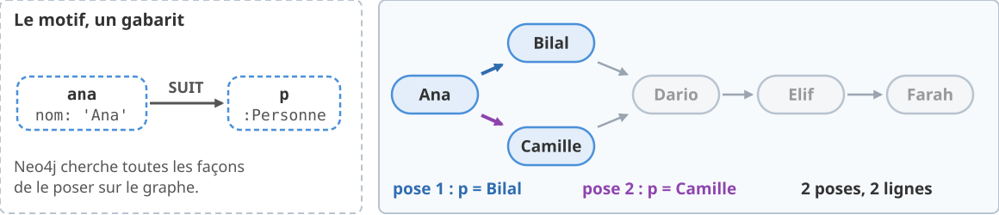
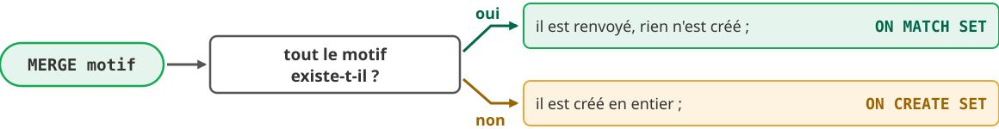
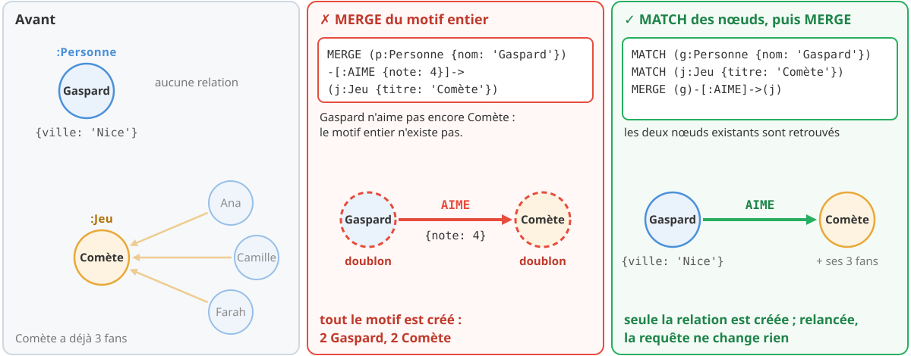
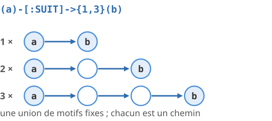
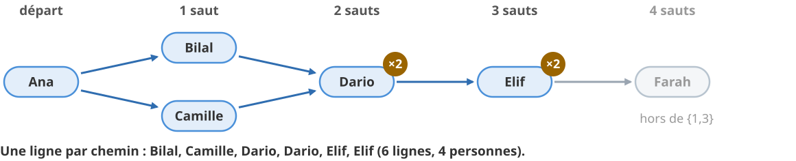
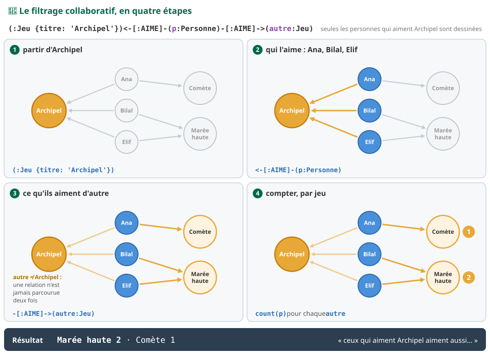

<!-- _class: lead -->
<!-- _paginate: false -->

<style scoped>
section {
  background-image: url('assets/logo.png');
  background-repeat: no-repeat;
  background-position: bottom 40px center;
  background-size: 380px;
}
h1 { font-size: 1.9em; }
</style>

# Du relationnel au graphe

**R5.Real.10 - Nouveaux paradigmes de base de données**

Séance 5 · TP4 · Neo4j et Cypher · semaine du 7 décembre 2026

<!--
(Hors minutage : diapo de titre.)

Le point cours se fait en deux temps.

Premier temps, en début de séance : diapos 2 à 31 (données, parties 1 à 4 : le graphe de propriétés, lire un motif, agréger, modifier), 30 minutes environ, puis les deux diapos « À vous » (diapos 47 et 48, 2 minutes). C'est le premier contact avec un nouveau paradigme : chaque notion suit la même suite (le besoin, le principe avec son schéma, l'exemple déroulé nœud par nœud sur le petit graphe d'essai, ce qui change par rapport au SQL et à MongoDB, le renvoi au TP).

Second temps, quand la majorité du groupe attaque la partie 5 : diapos 32 à 46 (chemins, coût mesuré, LOAD CSV, recommandation, comparaison des paradigmes, norme et passage à l'échelle), 15 minutes environ.

Trois jeux de données, comme dans l'énoncé : 📦 les paquets du registre Ruche et 📚 la médiathèque du TP1 (les données du TP, seulement pour présenter les données, jamais une réponse) et 🧪 les personnes et leurs jeux de société (tous les exemples exécutables). Tout a été exécuté sur Neo4j 2026.10.1 Community (Cypher 25), MongoDB 9.0.4 et PostgreSQL 18.4 ; les résultats affichés sont ceux obtenus. Le script de l'exemple d'essai est dans les notes de la diapo « Un petit graphe pour les exemples ».
-->

---

<!-- header: Séance 5 · les données -->

## 📦📚 Les données du TP : un registre de paquets et la médiathèque


<div class="box" style="margin-top: 0.3rem; font-size: 0.68em;"><b>Au programme</b> : 6 parties, 12 exercices notés (60 points), tout en séance, et 12 bonus. Parties 1 à 5 sur les paquets ; partie 6 sur la médiathèque, pour répondre enfin aux questions 4 et 5 du TP1.</div>

<!--
(1 min)

Un registre de paquets, comme npm ou Maven Central, inventé pour le TP : des paquets qui dépendent d'autres paquets, des développeurs qui les maintiennent, des failles de sécurité. Tout le monde ici a déjà écrit un pom.xml ou un package.json : le sens des relations va de soi (le paquet dépend de sa dépendance).

Puis la médiathèque du TP1, la même, avec les mêmes identifiants. Ce sont les données du TP : elles servent à poser les problèmes, jamais à montrer une réponse. Les exemples sont sur un tout petit graphe (diapo suivante).
-->

---

## 🧪 Un petit graphe pour les exemples


<div class="bandeau" style="margin-top: 0.3rem; font-size: 0.85em;">📦📚 les données du TP : le problème à résoudre · 🧪 personnes et jeux : les exemples à exécuter, dans <code>essais.cypher</code></div>

<!--
(45 s)

Dix nœuds, deux labels (Personne, Jeu), deux types de relation (SUIT, AIME). SUIT se lit dans le sens de la flèche : Ana suit Bilal, Bilal ne suit pas Ana. C'est l'exemple de l'énoncé et des réponses de l'assistant IA.

Script, dans essais.cypher (déjà fourni) :

MATCH (n) WHERE n:Personne OR n:Jeu DETACH DELETE n
WITH count(*) AS supprimes
CREATE (ana:Personne {nom: 'Ana', ville: 'Aix'}),
       (bilal:Personne {nom: 'Bilal', ville: 'Marseille'}),
       (camille:Personne {nom: 'Camille', ville: 'Aix'}),
       (dario:Personne {nom: 'Dario', ville: 'Toulon'}),
       (elif:Personne {nom: 'Elif', ville: 'Marseille'}),
       (farah:Personne {nom: 'Farah', ville: 'Aix'}),
       (archipel:Jeu {titre: 'Archipel', joueurs: 4}),
       (comete:Jeu {titre: 'Comète', joueurs: 2}),
       (maree:Jeu {titre: 'Marée haute', joueurs: 5}),
       (sortilege:Jeu {titre: 'Sortilège', joueurs: 3}),
       (ana)-[:SUIT]->(bilal), (ana)-[:SUIT]->(camille),
       (bilal)-[:SUIT]->(dario), (camille)-[:SUIT]->(dario), (dario)-[:SUIT]->(elif),
       (elif)-[:SUIT]->(farah),
       (ana)-[:AIME {note: 5}]->(archipel), (ana)-[:AIME {note: 3}]->(comete),
       (bilal)-[:AIME {note: 4}]->(archipel), (bilal)-[:AIME {note: 5}]->(maree),
       (camille)-[:AIME {note: 4}]->(comete), (camille)-[:AIME {note: 5}]->(sortilege),
       (dario)-[:AIME {note: 4}]->(maree), (dario)-[:AIME {note: 2}]->(sortilege),
       (elif)-[:AIME {note: 3}]->(archipel), (elif)-[:AIME {note: 4}]->(maree),
       (farah)-[:AIME {note: 5}]->(comete);
-->

---

<!-- header: Partie 1 · du relationnel au graphe -->

<!-- _class: lead -->
<!-- _header: "" -->

# Partie 1 - 🔗 Du relationnel au graphe

ranger les liens eux-mêmes · 📦 exercices 1 et 2

<!--
(10 s)

Même titre que la partie 1 de l'énoncé du TP4.
-->

---

## Deux questions restées ouvertes au TP1

<div class="cols" style="align-items: stretch; font-size: 0.82em;">
<div class="carte orange">
<b class="t">❓ Question 4</b>

Les membres parrainés par Marie Dupont (M01), puis ceux qu'ils ont parrainés, **et ainsi de suite**.

Avec `parrain_id` dans chaque membre : **une requête par niveau**, en réinjectant les identifiants trouvés, jusqu'à un niveau vide.

</div>
<div class="carte orange">
<b class="t">❓ Question 5</b>

Les livres empruntés par **les lecteurs de Dune**.

Deux requêtes (les lecteurs, puis leurs livres), ou une seule parce que le **titre est recopié** dans chaque emprunt du membre.

</div>
</div>

<div class="bandeau" style="margin-top: 0.7rem; font-size: 0.9em;">Des questions qui <b>suivent des liens</b>, sur une longueur qu'on ne connaît pas à l'avance</div>

<!--
(1 min)

Rappeler le modèle du TP1 : les exemplaires embarqués dans le livre, les emprunts dans le membre avec le titre recopié, parrain_id comme référence. On reposera ces deux questions en partie 6, sur les mêmes données, et on comparera.
-->

---

## L'idée : ranger les liens eux-mêmes


<div class="box" style="margin-top: 0.3rem; font-size: 0.72em;">L'<b>adjacence sans index</b> : le coût d'un parcours dépend de la partie du graphe <b>visitée</b>, pas de la taille de la base. L'index sert toujours, mais seulement à trouver le point de départ.</div>

<!--
(1 min 30)

En relationnel, un lien n'existe pas physiquement : c'est une valeur (la clé étrangère) qu'on recherche dans une autre table au moment de la requête, par un index (un arbre B). Chaque saut repaie cette recherche.

Dans une base graphe, chaque nœud garde la liste de ses relations, et chaque relation connaît ses deux nœuds. Suivre une relation, c'est suivre un pointeur.

Nuance honnête, sur laquelle on reviendra avec des mesures (partie 5) : sur un ou deux sauts, une base relationnelle bien indexée fait aussi bien. L'écart vient quand le nombre de sauts grandit, ou quand on ne le connaît pas.
-->

---

## Le graphe de propriétés


<p class="petit" style="margin-top: 0.3rem;">Vocabulaire du module : <b>nœud</b>, <b>label</b>, <b>relation</b>, <b>type de relation</b>, <b>sens</b>, <b>propriété</b>, puis <b>motif</b> et <b>chemin</b>.</p>

<!--
(1 min 30)

Un nœud représente une chose ; il porte un ou plusieurs labels (ce qu'il est) et des propriétés typées : chaîne, entier, flottant, booléen, date, liste. Pas de schéma imposé : deux nœuds Personne peuvent avoir des propriétés différentes.

Une relation a exactement un type, un sens (d'un nœud de départ vers un nœud d'arrivée) et, elle aussi, des propriétés. C'est la grande différence avec une clé étrangère : la note d'Ana sur Archipel appartient à la relation, comme une colonne de table de liaison.

Ce vocabulaire est celui de l'énoncé et de l'assistant IA : on ne dit ni sommet ni arête.
-->

---

## 🧪 Un nœud, une relation, pas à pas

```cypher
// 🧪 Exemple d'essai
MATCH (ana:Personne {nom: 'Ana'}) RETURN ana;
// (:Personne {nom: "Ana", ville: "Aix"})
MATCH (:Personne {nom: 'Ana'})-[a:AIME]->(j:Jeu) RETURN a, j.titre;
// [:AIME {note: 3}], "Comète"
// [:AIME {note: 5}], "Archipel"
```

<div class="cols" style="margin-top: 0.4rem; font-size: 0.76em; align-items: stretch;">
<div class="box" style="margin-top: 0;">Un nœud s'affiche avec ses <b>labels</b> et ses <b>propriétés</b>. Une relation, avec son <b>type</b> et ses propriétés.</div>
<div class="box" style="margin-top: 0;">Ana aime <b>deux</b> jeux : deux relations, donc deux lignes. Le nombre de lignes suit le nombre de façons de trouver le motif.</div>
</div>

<!--
(1 min)

Lire les deux résultats lentement : un nœud entier, puis une relation et une propriété d'un nœud voisin. Dans le TP, on ne renvoie jamais un nœud entier dans une réponse notée : on renvoie ses propriétés, nommées avec AS. Ici, c'est pour regarder.

Dans l'extension Neo4j de VS Code, le même résultat se lit en tableau, ou en dessin quand la requête renvoie des nœuds et des relations.
-->

---

## Du relationnel au graphe : cinq règles, ligne par ligne


<div class="warn" style="margin-top: 0.3rem; font-size: 0.72em;">Le <b>sens</b> de la relation se choisit pour se lire comme une phrase : le développeur <b>maintient</b> le paquet, le paquet <b>dépend de</b> sa dépendance.</div>

<!--
(1 min 30)

Ce sont les règles du guide « relational to graph » de Neo4j. La règle 2 surprend : une relation pointe directement vers son nœud, elle n'a pas besoin d'un numéro. On garde la clé métier, unique, et on la protège par une contrainte (partie 4). Le guide Northwind de Neo4j, qu'on trouve partout, garde au contraire des colonnes en chaînes, les dates notamment (SET n = row) : c'est ce qu'il ne faut pas faire (règle 5).

Suivre chaque ligne pointillée : quatre lignes de tables, trois nœuds et deux relations. Ce sont de vraies lignes des données du TP : on les retrouve dans la base.

L'exercice 1 traduit une ligne de paquet, l'exercice 2 deux lignes de la table de jointure dependance.
-->

---

## Le document du TP1, le graphe du TP4

(:Livre) ; (:Livre)-[:ECRIT_PAR]->(:Auteur) ; (:Livre)-[:DANS]->(:Categorie) ; (:Categorie)-[:SOUS_CATEGORIE_DE]->(:Categorie), en boucle ; (:Livre)-[:SUITE_DE]->(:Livre), en boucle ; (:Membre)-[:EMPRUNTE {date_emprunt, date_retour_prevue, date_retour}]->(:Exemplaire), 48 emprunts ; (:Membre)-[:PARRAINE]->(:Membre), en boucle, 7 parrainages ; (:Membre)-[:A_NOTE {note}]->(:Livre), 36 avis. En bas : mêmes identifiants (L06, M13…) : un emprunt est une relation, pas une copie." style="display:block; height:540px; margin:0 auto;">

<!--
(1 min 15)

Mêmes livres, mêmes membres, mêmes identifiants. Ce qui était imbriqué devient un nœud (l'exemplaire), ce qui était recopié disparaît (le titre n'est écrit que dans le livre), ce qui était une référence devient une relation (PARRAINE).

Le modèle document choisit un ordre de lecture (le membre et ses emprunts) ; le graphe n'en impose aucun : on part du membre, de l'exemplaire ou du livre. C'est la partie 6 du TP.
-->

---

<!-- header: Partie 2 · lire un motif -->

<!-- _class: lead -->
<!-- _header: "" -->

# Partie 2 - ✏️ Lire un motif

dessiner ce qu'on cherche · 📦 exercices 3 et 4

<!--
(10 s)
-->

---

## Une requête est un dessin

<style scoped>
.box code { white-space: nowrap; }
</style>

<div class="cols-62" style="align-items: center;">
<div>

```
(:Personne {nom: 'Ana'})-[:SUIT]->(p:Personne)
 │                       │         │
 │                       │         └─ un nœud de label Personne, dans la variable p
 │                       └─ une relation de type SUIT, dans ce sens
 └─ un nœud de label Personne, filtré sur une propriété
```

</div>
<div class="box" style="font-size: 0.72em;">

`(…)` un **nœud**, comme un cercle ; `()` un nœud quelconque
`-[…]->` une **relation**, comme une flèche ; `<-[…]-` dans l'autre sens ; `-[…]-` sans sens
`:Label`, `:TYPE` ce qu'ils sont
`{nom: 'Ana'}` un filtre sur une propriété

</div>
</div>

<div class="bandeau" style="margin-top: 0.6rem; font-size: 0.88em;">Avant d'écrire une requête, <b>dessinez son motif</b> : les nœuds, les relations, leur sens, ce qu'on renvoie</div>

<!--
(1 min 30)

C'est l'idée de Cypher, que le livre Graph Databases appelle « la spécification par l'exemple » : on dessine en texte ce qu'on cherche. Les parenthèses sont les cercles, les crochets et la flèche sont la relation.

Les études sur les erreurs des étudiants en Cypher (Pachera et al. 2025 ; Chen et al. 2021, équipe d'Alawini à l'UIUC) montrent que la plupart ne sont pas des fautes de syntaxe : une flèche à l'envers, une condition oubliée, une ligne en double. Le réflexe du TP : dessiner le motif avant de l'écrire. L'assistant IA du codespace sait redessiner une requête écrite.
-->

---

## 🧪 Le motif posé sur le graphe

(p:Personne), un nœud ana dont le nom est Ana, une flèche SUIT, un nœud p qui peut être n'importe quelle personne. À droite, le graphe SUIT de l'exemple d'essai : Ana suit Bilal et Camille, Bilal et Camille suivent Dario, Dario suit Elif, Elif suit Farah. Le motif s'y pose deux fois : pose 1, Ana vers Bilal, en bleu ; pose 2, Ana vers Camille, en violet ; les autres relations sont grisées. Deux lignes sont renvoyées : p = Bilal et p = Camille." style="display:block; width:92%; margin:0 auto;">

```cypher
MATCH (ana:Personne {nom: 'Ana'})-[:SUIT]->(p:Personne)
RETURN p.nom AS nom ORDER BY nom;
// "Bilal"
// "Camille"
```

<!--
(1 min)

Neo4j cherche toutes les façons de poser le dessin sur le graphe ; chacune donne une ligne. Ici, deux. AS nomme la colonne (sinon elle s'appellerait p.nom) ; ORDER BY trie, comme en SQL. Dans le TP, les noms des colonnes et le tri sont imposés par la consigne : le correcteur automatique les compare.
-->

---

## De SQL à Cypher

<style scoped>
table { font-size: 0.74em; width: 100%; }
</style>

| SQL | Cypher | |
|---|---|---|
| `FROM personne p JOIN suit s ON … JOIN personne q ON …` | `MATCH (p:Personne)-[:SUIT]->(q:Personne)` | les jointures sont dessinées |
| `WHERE p.nom = 'Ana'` | `WHERE p.nom = 'Ana'` ou `{nom: 'Ana'}` | pareil |
| `SELECT q.nom AS nom` | `RETURN q.nom AS nom` | la sélection vient **à la fin** |
| `ORDER BY nom LIMIT 3` | `ORDER BY nom LIMIT 3` | pareil |
| `SELECT DISTINCT` | `RETURN DISTINCT` | pareil |
| `WHERE NOT EXISTS (SELECT …)` | `WHERE NOT EXISTS { (p)-[:AIME]->(…) }` | un motif à l'intérieur |

<!--
(1 min)

Pour qui connaît SQL, l'ordre des clauses change (on décrit d'abord ce qu'on cherche, on dit ensuite ce qu'on renvoie), mais beaucoup de mots restent les mêmes. La table de liaison suit disparaît : la jointure est une flèche.

Le correspondant MongoDB : MATCH ressemble à un find avec des $lookup déjà écrits, RETURN à la projection.
-->

---

## 🧪 Le sens compte

```cypher
MATCH (:Personne {nom: 'Dario'})-[:SUIT]->(p:Personne)
RETURN p.nom AS nom ORDER BY nom;
// "Elif"

MATCH (:Personne {nom: 'Dario'})-[:SUIT]-(p:Personne)
RETURN p.nom AS nom ORDER BY nom;
// "Bilal"
// "Camille"
// "Elif"
```

<div class="warn" style="margin-top: 0.3rem; font-size: 0.74em;">Sans flèche, le motif cherche dans les deux sens : Bilal et Camille, <b>qui suivent</b> Dario, s'ajoutent à Elif, <b>que Dario suit</b>. Une autre question. Vérifiez le sens de chaque flèche dans la présentation des données.</div>

<!--
(1 min)

C'est l'erreur la plus fréquente des débutants (27 fois sur 59 participants dans l'étude de Pachera et al.). Dans le TP, les données d'E′, le second jeu de la note officielle, sont construites pour qu'une flèche inversée ou oubliée change le résultat.
-->

---

## 🧪 Filtrer, tester l'existence d'un motif

```cypher
MATCH (p:Personne)-[a:AIME]->(j:Jeu)
WHERE a.note >= 5
RETURN p.nom AS nom, j.titre AS jeu ORDER BY nom;
// "Ana", "Archipel"   "Bilal", "Marée haute"   "Camille", "Sortilège"   "Farah", "Comète"

MATCH (p:Personne)
WHERE NOT EXISTS { (p)-[:AIME]->(:Jeu {titre: 'Archipel'}) }
RETURN p.nom AS nom ORDER BY nom;
// "Camille"   "Dario"   "Farah"
```

<p class="petit">On filtre sur une propriété de la <b>relation</b> (<code>a.note</code>) comme sur un nœud. <code>EXISTS { motif }</code> est vrai quand le motif existe au moins une fois : la sous-requête <code>NOT EXISTS</code> de SQL, avec un dessin dedans.</p>

<!--
(1 min)

Les quatre lignes du premier résultat sont écrites sur une seule ligne pour tenir sur la diapo.

Les supports en ligne anciens écrivent exists(n.prop), retiré de Cypher 5 : on écrit n.prop IS NOT NULL. Un motif nu dans le WHERE marche encore, mais on écrit EXISTS { … }.
-->

---

## Trois réflexes

<div class="g3" style="font-size: 0.78em; align-items: stretch;">
<div class="carte vert">
<b class="t">Écrire le label</b>
<code>(p {nom: 'Elif'})</code> parcourt <b>tous</b> les nœuds ; <code>(p:Personne {nom: 'Elif'})</code> seulement les personnes (partie 4).
</div>
<div class="carte orange">
<b class="t">Lire les avertissements</b>
Un label ou un type de relation mal écrit ne fait pas d'erreur : zéro ligne, et un avertissement <code>01N51</code>.
</div>
<div class="carte violet">
<b class="t">Renvoyer des propriétés</b>
<code>RETURN p.nom AS nom</code>, pas <code>RETURN p</code> : le correcteur automatique compare des valeurs.
</div>
</div>

```text
01N51 warn: relationship type does not exist. The relationship type `DEPENDS_ON`
does not exist in database `neo4j`. Verify that the spelling is correct.
```

<!--
(1 min)

Neo4j n'a pas de schéma : un label ou un type inconnu n'est pas une erreur, juste un motif qui ne se trouve pas. L'avertissement est affiché par l'extension, et le correcteur automatique le recopie dans son message.
-->

---

<!-- header: Partie 3 · agréger -->

<!-- _class: lead -->
<!-- _header: "" -->

# Partie 3 - 🧮 Agréger

compter, collecter, filtrer après · 📦 exercices 5 à 7

<!--
(10 s)
-->

---

## Le regroupement implicite


<div class="box" style="margin-top: 0.3rem; font-size: 0.74em;">Pas de <code>GROUP BY</code> : <b>les colonnes du <code>RETURN</code> qui ne sont pas des agrégations forment la clé de groupe</b>. Une colonne de plus, et les groupes changent.</div>

<!--
(1 min 30)

C'est le $group du TP1, sans l'écrire : la clé du groupe se déduit du RETURN. Piège classique (blog de Neo4j, « Common confusions ») : ajouter p.nom au RETURN pour l'afficher fait une ligne par couple (jeu, personne), et le compte vaut 1 partout.
-->

---

## 🧪 Compter, faire la moyenne, collecter

```cypher
MATCH (p:Personne)-[a:AIME]->(j:Jeu)
RETURN j.titre AS jeu, count(p) AS fans, round(avg(a.note), 1) AS moyenne
ORDER BY fans DESC, jeu;
// "Archipel", 3, 4.0     "Comète", 3, 4.0     "Marée haute", 3, 4.3     "Sortilège", 2, 3.5

MATCH (p:Personne {nom: 'Ana'})-[:AIME]->(j:Jeu)
RETURN p.nom AS nom, collect(j.titre) AS jeux;
// "Ana", ["Comète", "Archipel"]
```

<div class="cols" style="margin-top: 0.3rem; font-size: 0.72em; align-items: stretch;">
<div class="box" style="margin-top: 0;"><code>collect</code> rassemble les valeurs d'un groupe dans une <b>liste</b>, <b>sans ordre garanti</b> : « Comète » avant « Archipel » ne veut rien dire.</div>
<div class="box" style="margin-top: 0;">Cypher 25 accepte aussi <code>GROUP BY jeu</code> après le <code>RETURN</code>, pour qui préfère l'écrire : même résultat.</div>
</div>

<!--
(1 min 15)

round(x, 1) arrondit à une décimale ; avg renvoie un flottant, count un entier. Pour une liste triée, il faut trier les lignes avant de collecter (WITH … ORDER BY … puis collect).

GROUP BY explicite est arrivé dans Neo4j 2026.07 ; tous les supports en ligne utilisent la forme implicite, qu'il faut savoir lire.
-->

---

## 🧪 Filtrer après l'agrégation : WITH

<div class="cols" style="align-items: stretch;">
<div>

```cypher
MATCH (j:Jeu)<-[a:AIME]-(:Personne)
WHERE avg(a.note) >= 4
RETURN j.titre AS jeu;
```

<div class="err">

```
42I24: syntax error or access rule violation - invalid
use of aggregate function. Aggregate expression
'avg(a.note)' is not allowed in this context.
```

</div>
</div>
<div>

```cypher
MATCH (j:Jeu)<-[a:AIME]-(:Personne)
WITH j, avg(a.note) AS moyenne
WHERE moyenne >= 4
RETURN j.titre AS jeu, moyenne
ORDER BY jeu;
// "Archipel", 4.0
// "Comète", 4.0
// "Marée haute", 4.333333333333333
```

</div>
</div>

<div class="bandeau" style="margin-top: 0.4rem; font-size: 0.86em;"><code>WITH</code> = une étape de pipeline : <code>WITH … WHERE</code> après une agrégation, c'est <code>&#36;group</code> puis <code>&#36;match</code> (TP2), ou <code>HAVING</code></div>

<!--
(1 min 30)

C'est la difficulté numéro 1 de Cypher dans les études sur les débutants (UIUC, 40 000 soumissions) : vouloir filtrer un agrégat dans le WHERE du MATCH. WITH termine une étape et passe ses colonnes à la suivante.

Deuxième piège : après un WITH, seules les variables qu'il liste existent encore. Une variable oubliée qu'on réutilise dans un MATCH suivant devient une nouvelle variable, sans erreur.
-->

---

## 🧪 Zéro compris : OPTIONAL MATCH


```cypher
MATCH (p:Personne) OPTIONAL MATCH (p)<-[:SUIT]-(a:Personne)
RETURN p.nom AS nom, count(a) AS abonnes ORDER BY abonnes DESC, nom;
// "Dario", 2   "Bilal", 1   "Camille", 1   "Elif", 1   "Farah", 1   "Ana", 0
```

<!--
(1 min 15)

OPTIONAL MATCH est le LEFT JOIN de Cypher : la ligne reste, avec null. count(a) ignore les null, count(*) compte les lignes : avec count(*), Ana aurait 1 abonné. Autre piège de comptage : un nœud atteint par deux chemins est compté deux fois ; count(DISTINCT a) le compte une fois.
-->

---

## 🧪 Compter un motif : COUNT { … }

```cypher
MATCH (p:Personne)
RETURN p.nom AS nom, COUNT { (p)-[:AIME]->(:Jeu) } AS jeux,
       COUNT { (p)<-[:SUIT]-() } AS abonnes
ORDER BY nom;
// "Ana", 2, 0   "Bilal", 2, 1   "Camille", 2, 1
// "Dario", 2, 2   "Elif", 2, 1   "Farah", 1, 1
```

<div class="box" style="margin-top: 0.4rem; font-size: 0.76em;"><code>COUNT { motif }</code> compte, pour chaque ligne, les façons de poser un motif autour d'un nœud, <b>sans regrouper</b> le reste de la requête. Utilisable dans <code>WHERE</code> comme dans <code>RETURN</code>.</div>

<!--
(1 min)

Une sous-requête de comptage : deux colonnes (les jeux aimés, les abonnés) sans regrouper toute la requête, et sans que les deux comptes se multiplient, comme ils le feraient avec deux MATCH avant une seule agrégation. Elle s'emploie aussi dans un WHERE. Elle remplace size() appliqué à un motif, retiré de Cypher 5.
-->

---

<!-- header: Partie 4 · modifier le graphe -->

<!-- _class: lead -->
<!-- _header: "" -->

# Partie 4 - ✍️ Modifier le graphe

créer sans doublon · 📦 exercice 8

<!--
(10 s)
-->

---

## 🧪 CREATE : tout ce que décrit le motif

```cypher
CREATE (:Personne {nom: 'Gaspard', ville: 'Nice'});

MATCH (g:Personne {nom: 'Gaspard'})
MATCH (j:Jeu {titre: 'Comète'})
CREATE (g)-[:AIME {note: 4}]->(j);
```

<div class="cols" style="margin-top: 0.4rem; font-size: 0.76em; align-items: stretch;">
<div class="carte vert"><b class="t">Relier deux nœuds existants</b> On les <b>retrouve</b> d'abord (<code>MATCH</code>), puis on crée la relation entre les variables.</div>
<div class="carte rouge"><b class="t">Sans MATCH</b> <code>CREATE (g:Personne {…})-[:AIME]->(j:Jeu {…})</code> crée un <b>nouveau</b> Gaspard et un <b>nouveau</b> Comète.</div>
</div>

<!--
(1 min)

CREATE crée toujours, sans regarder ce qui existe. Les propriétés s'écrivent avec leur type : une date avec date('…'), un entier sans guillemets. Un MATCH qui ne trouve rien ne crée rien, sans erreur : vérifier d'abord le MATCH seul.
-->

---

## 🧪 MERGE : trouver, ou créer



```cypher
MATCH (p:Personne {nom: 'Gaspard'}) DETACH DELETE p;  // on repart
CREATE (:Personne {nom: 'Gaspard', ville: 'Nice'});  // d'un Gaspard sans relation

MERGE (p:Personne {nom: 'Gaspard'})      // Gaspard existe, à Nice
  ON CREATE SET p.ville = 'Lyon'
RETURN p.ville AS ville;
// "Nice"
```

<!--
(1 min)

Les deux premières lignes remettent Gaspard dans l'état de l'énoncé (à Nice, sans relation), après la diapo précédente.

MERGE est l'upsert de Cypher (updateOne avec upsert: true et $setOnInsert, au TP1). Gaspard existe : rien n'est créé, et ON CREATE SET ne s'applique pas.

Attention : la leçon MERGE de GraphAcademy décrit un comportement nœud par nœud qui n'est pas le bon. Le manuel et la base de connaissances de Neo4j sont clairs : tout le motif existe, ou tout le motif est créé.
-->

---

## Le piège : MERGE compare tout son motif

(j:Jeu {titre: 'Comète'}). Gaspard n'aime pas encore Comète, le motif entier n'existe pas : MERGE crée un nouveau Gaspard et un nouveau Comète, en pointillés rouges, reliés par AIME {note: 4}. Tout le motif est créé : 2 Gaspard, 2 Comète. À droite, en vert, à suivre : MATCH (g:Personne {nom: 'Gaspard'}) MATCH (j:Jeu {titre: 'Comète'}) MERGE (g)-[a:AIME]->(j) ON CREATE SET a.note = 4. Les deux nœuds existants sont retrouvés, et une seule relation AIME {note: 4} est créée entre le Gaspard et le Comète existants ; relancée, la requête ne change rien." style="display:block; width:96%; margin:0.4rem auto 0;">

<!--
(1 min 30)

Deux pièges, sur l'exemple d'essai :
- MERGE (p:Personne {nom: 'Gaspard', ville: 'Lyon'}) ne trouve pas de Gaspard à Lyon : il crée un second Gaspard. On met dans le motif seulement ce qui identifie le nœud, le reste dans ON CREATE SET.
- MERGE (Gaspard)-[:AIME]->(Comète) écrit d'un bloc crée tout le motif, nœuds compris, s'il n'existe pas en entier : deux Gaspard, deux Comète.

La bonne forme : retrouver (ou fusionner) chaque nœud séparément, puis fusionner la relation entre les variables.

En direct : le schéma part de l'état « Avant ». Après la forme fautive, supprimer les doublons (première ligne de la diapo « Contraintes », et MATCH (j:Jeu {titre: 'Comète'}) WHERE j.joueurs IS NULL DELETE j), puis recréer Gaspard à Nice, avant de lancer la bonne forme ; sinon elle crée trois relations.
-->

---

## 🧪 Modifier, supprimer

<div class="cols" style="align-items: stretch;">
<div>

```cypher
MATCH (:Personne {nom: 'Dario'})
      -[a:AIME]->(:Jeu {titre: 'Sortilège'})
SET a.note = 3;

MATCH (p:Personne {nom: 'Farah'})
DELETE p;
```

<div class="err">

```
G1001: dependent object error - edges still exist
```

</div>
</div>
<div style="font-size: 0.8em;">

<div class="box" style="margin-top: 0;"><code>SET</code> modifie une propriété, d'un nœud comme d'une relation.</div>

<div class="box">Un nœud qui a encore des relations ne se supprime pas seul : Farah est suivie par Elif et aime Comète.</div>

<div class="carte vert"><b class="t">DETACH DELETE</b> <code style="white-space: nowrap;">MATCH (p:Personne {nom: 'Farah'})</code> <code style="white-space: nowrap;">DETACH DELETE p</code> supprime le nœud <b>et</b> ses relations.</div>

</div>
</div>

<!--
(1 min)

Neo4j ne laisse jamais une relation sans ses deux nœuds : d'où l'erreur. DETACH DELETE est l'équivalent d'un ON DELETE CASCADE sur les relations du nœud.
-->

---

## 🧪 Contraintes : ce que Community permet

```cypher
MATCH (p:Personne {nom: 'Gaspard'}) DETACH DELETE p;   // les doublons du piège
MATCH (j:Jeu {titre: 'Comète'}) WHERE j.joueurs IS NULL DELETE j;
CREATE CONSTRAINT personne_nom FOR (p:Personne) REQUIRE p.nom IS UNIQUE;
CREATE (:Personne {nom: 'Ana'});
```

<div class="err">

```
22N80: data exception - index entry conflict. Index entry conflict: Node(222) already
exists with label `Personne` and property `nom` = 'Ana'.
```

</div>

```cypher
CREATE CONSTRAINT jeu_titre_existe FOR (j:Jeu) REQUIRE j.titre IS NOT NULL;
```

<div class="err">

```
51N27: system configuration or operation exception - not supported in this edition.
Property existence constraint is not supported in community edition.
```

</div>

<p class="petit">Neo4j Community : <b>unicité</b> seulement. Existence (<code>IS NOT NULL</code>), type (<code>IS :: STRING</code>) et clé (<code>IS NODE KEY</code>) : Enterprise.</p>

<!--
(1 min)

Sans contrainte, Neo4j ne vérifie rien : un MERGE mal écrit crée un doublon en silence. Avec une contrainte d'unicité, le doublon devient une erreur, et MERGE est protégé même quand deux imports tournent en même temps.

Le message de refus d'Enterprise est le vrai texte de Neo4j 2026.10.1 Community.
-->

---

## PROFILE : ce que change un label, ce que change un index


<div class="box" style="margin-top: 0.3rem; font-size: 0.74em;"><code>PROFILE</code> devant une requête : son plan et ses <b>accès à la base</b> (db hits), comme <code>explain()</code> au TP2. Une contrainte d'unicité crée son index.</div>

<!--
(1 min)

Les chiffres sont mesurés dans la base de l'étudiant, données du TP et exemple d'essai chargés. « Estimés » est la prévision du planificateur, « lues » ce qui a vraiment été lu : on compare les db hits, pas les estimations. Le label divise déjà le travail ; l'index le réduit à presque rien. L'index ne sert qu'à trouver le point de départ : la suite d'un motif suit les relations (partie 1). Bonus 4 du TP.
-->

---

<!-- header: Séance 5 · à vous -->

## Premier temps : ce qu'il faut retenir

<div class="g2" style="font-size: 0.78em; align-items: stretch;">
<div class="carte vert"><b class="t">Le modèle</b> Des nœuds (labels, propriétés) et des relations (type, sens, propriétés). Une jointure devient une relation.</div>
<div class="carte vert"><b class="t">Lire</b> Dessiner le motif, puis <code>MATCH … WHERE … RETURN … AS</code>. Une ligne par façon de poser le motif.</div>
<div class="carte orange"><b class="t">Agréger</b> Clé de groupe implicite ; <code>WITH … WHERE</code> pour filtrer après ; <code>OPTIONAL MATCH</code> et <code>count(x)</code> pour le zéro.</div>
<div class="carte orange"><b class="t">Écrire</b> <code>MATCH</code> puis <code>CREATE</code> ; <code>MERGE</code> sur chaque nœud séparément, puis sur la relation ; <code>DETACH DELETE</code> ; contrainte d'unicité.</div>
</div>

<div class="bandeau" style="margin-top: 0.6rem; font-size: 0.86em;">Parties 1 à 4 du TP : environ 1 h 35. Second temps du point cours avant la partie 5.</div>

<!--
(30 s)

Fin du premier temps (environ 30 minutes). Passer aux deux diapos « À vous » en fin de support, puis lancer le TP.
-->

---

<!-- header: Partie 5 · suivre des chemins -->

<!-- _class: lead -->
<!-- _header: "" -->

# Partie 5 - 🧭 Suivre des chemins

quand on ne connaît pas la longueur · 📦 exercices 9 et 10

<!--
(10 s)

Début du second temps (environ 15 minutes).
-->

---

## Le besoin : des chaînes de longueur inconnue

<div class="g3" style="font-size: 0.8em; align-items: stretch;">
<div class="carte"><b class="t">📚 Parrainages</b> Les filleuls de Marie, puis les leurs, et ainsi de suite.</div>
<div class="carte"><b class="t">📦 Dépendances</b> Tout ce qu'une application embarque, directement ou non (<code>mvn dependency:tree</code>).</div>
<div class="carte"><b class="t">📦 Impact</b> Tout ce qu'une faille touche, en remontant les dépendances.</div>
</div>

<div class="box" style="margin-top: 0.8rem; font-size: 0.78em;">En SQL : une requête <b>récursive</b> (<code>WITH RECURSIVE</code>). En MongoDB : <code>&#36;graphLookup</code>, ou une requête par niveau. En Cypher : un <b>quantificateur</b> sur une relation.</div>

<!--
(45 s)

Trois questions du TP, qui ont la même forme : suivre la même relation un nombre de fois qu'on ne connaît pas. C'est là que le graphe se distingue.
-->

---

## Les quantificateurs

<div class="cols-62" style="align-items: center;">
<div>

{1,3}(b) est égal à l'union de trois motifs fixes : (a)->(b), de longueur 1 ; (a)->( )->(b), de longueur 2 ; (a)->( )->( )->(b), de longueur 3, où chaque flèche est une relation SUIT et ( ) un nœud anonyme. Une union de motifs fixes ; chaque motif trouvé est un chemin." style="display:block; width:100%;">

</div>
<div style="font-size: 0.74em;">

| Quantificateur | Répétitions |
|---|---|
| `{2}` | exactement 2 fois |
| `{1,3}` | de 1 à 3 fois |
| `+` | au moins 1 fois |
| `*` | 0 fois ou plus |

`c = (…)-[…]->{1,3}(…)` nomme le **chemin** : `length(c)`, `nodes(c)`.

</div>
</div>

<!--
(1 min)

Un quantificateur répète une relation : {1,3} déplie le motif en trois motifs, de une à trois relations. Le manuel Cypher dessine les chemins quantifiés comme cette union.

Ancienne syntaxe, qu'on trouve partout sur le Web : [:SUIT*1..3]. Elle fonctionne encore, mais n'est pas conforme à la norme GQL : le TP écrit -[:SUIT]->{1,3}.
-->

---

## 🧪 Un parcours, étape par étape

{1,3}(p), sur le graphe SUIT de l'exemple d'essai (Ana suit Bilal et Camille, Bilal et Camille suivent Dario, Dario suit Elif, Elif suit Farah). Étape 1, 1 saut : Bilal et Camille sont atteints, par les chemins Ana→Bilal et Ana→Camille. Étape 2, 2 sauts : Dario est atteint par deux chemins, Ana→Bilal→Dario et Ana→Camille→Dario, d'où la pastille ×2. Étape 3, 3 sauts : Elif est atteint par deux chemins, Ana→Bilal→Dario→Elif et Ana→Camille→Dario→Elif, ×2. Farah, à 4 sauts, reste gris : hors de {1,3}. Les lignes renvoyées (nom, sauts) : Bilal 1, Camille 1, Dario 2, Dario 2, Elif 3, Elif 3. Un chemin par ligne : Dario et Elif sortent deux fois." style="display:block; width:56%; margin:0 auto;">

```cypher
MATCH (:Personne {nom: 'Ana'})-[:SUIT]->{1,3}(p:Personne)
RETURN p.nom AS nom ORDER BY nom;
// "Bilal"   "Camille"   "Dario"   "Dario"   "Elif"   "Elif"
```

<!--
(1 min 30)

Neo4j renvoie une ligne par chemin, pas une ligne par personne. Dario est atteint par deux chemins : il sort deux fois. Pour avoir chaque personne une seule fois, il faut une ligne par personne : c'est le travail de l'exercice 9, qui demande en plus une distance par personne.

Dans un même chemin, Neo4j ne repasse jamais par la même relation : un cycle ne fait pas tourner une requête en rond (bonus 8).
-->

---

## 🧪 Le plus court chemin


```cypher
MATCH c = SHORTEST 1 (:Personne {nom: 'Ana'})-[:SUIT]->+(:Personne {nom: 'Farah'})
RETURN length(c) AS sauts;
// 4
MATCH c = ALL SHORTEST (:Personne {nom: 'Ana'})-[:SUIT]->+(:Personne {nom: 'Farah'})
RETURN count(c) AS chemins;
// 2
```

<!--
(1 min)

SHORTEST 1 renvoie un plus court chemin ; quand il y en a plusieurs de même longueur, Neo4j en choisit un. ALL SHORTEST les renvoie tous. « Plus court » compte les relations, pas une distance : pour un poids (des minutes, des kilomètres), il faut la bibliothèque GDS ou un calcul à la main sur des chemins bornés.

nodes(c) donne la liste des nœuds du chemin, dans l'ordre ; une compréhension de liste, [x IN liste | expression], en tire une liste de propriétés (comme map en Java ou $map en MongoDB) : l'énoncé la montre sur une liste de nombres. Ancienne syntaxe : shortestPath(), qui marche encore.
-->

---

## La même question, trois langages

<style scoped>
.etiquette code { text-transform: none; }
</style>

<div class="g3" style="font-size: 0.84em; align-items: stretch;">
<div>
<p class="etiquette">SQL : <code>WITH RECURSIVE</code></p>

```sql
WITH RECURSIVE r(nom, niveau) AS (
  SELECT cible, 1 FROM suit
  WHERE source = 'Ana'
  UNION
  SELECT s.cible, r.niveau + 1
  FROM suit s JOIN r
    ON s.source = r.nom
  WHERE r.niveau < 3
)
SELECT DISTINCT nom
FROM r ORDER BY nom;
-- Bilal, Camille,
-- Dario, Elif
```

</div>
<div>
<p class="etiquette">MongoDB : <code>&#36;graphLookup</code></p>

```js
db.personnes.aggregate([
  { $match: { _id: "Ana" } },
  { $graphLookup: {
      from: "personnes",
      startWith: "$suit",
      connectFromField: "suit",
      connectToField: "_id",
      maxDepth: 2,
      depthField: "d",
      as: "atteints" } }
])
// atteints : Dario (d: 1), Bilal (0),
//   Camille (0), Elif (2)
```

</div>
<div>
<p class="etiquette">Cypher : un quantificateur</p>

```cypher
MATCH (:Personne {nom: 'Ana'})
      -[:SUIT]->{1,3}(p:Personne)
RETURN DISTINCT p.nom AS nom;
// "Bilal", "Camille",
// "Dario", "Elif"
```

<div class="box" style="font-size: 0.95em;"><code>&#36;graphLookup</code> ne renvoie que les documents atteints et leur profondeur, <b>sans ordre</b> et sans le chemin.</div>

</div>
</div>

<!--
(1 min 30)

Les trois requêtes, exécutées sur le même petit réseau (PostgreSQL 18.4, MongoDB 9.0.4, Neo4j 2026.10.1, le 11/11/2026), donnent les mêmes personnes : Bilal, Camille, Dario, Elif. Sorties abrégées, mais dans l'ordre obtenu (mongosh affiche d: Long('1')) : $graphLookup compte la profondeur à partir de 0 et ne trie pas ; DISTINCT ne trie pas non plus. Les trois versions renvoient les personnes atteintes ; MongoDB y ajoute la profondeur.

Tables SQL : personne(nom PK, ville), suit(source, cible). Collection MongoDB : personnes { _id: "Ana", suit: ["Bilal", "Camille"] }.

La requête récursive SQL construit les niveaux un par un, UNION élimine les doublons ; $graphLookup fait la même chose côté MongoDB (maxDepth compte à partir de 0) ; Cypher dessine le chemin. La différence n'est pas seulement d'écriture : Cypher garde les chemins (length, nodes, SHORTEST).
-->

---

## Le coût d'un parcours, mesuré

<div class="warn" style="font-size: 0.7em;">Le tableau souvent cité (<i>Graph Databases</i>, d'après Partner et Vukotic) : 1 million de personnes, 50 amis chacune ; à 4 niveaux, <b>1&nbsp;543&nbsp;s</b> en relationnel contre <b>1,4 s</b> pour Neo4j. Mais le SGBD et ses réglages ne sont pas donnés, et Neo4j y est interrogé en Java, pas en Cypher. Avec un index, du cache et une requête réécrite, PostgreSQL passe de 60 s à 0,06 s (Hohenstein et Jergler, 2019).</div>

<p class="etiquette" style="margin-top: 0.5rem;">Nos mesures : même réseau, mêmes réglages écrits</p>

<div style="font-size: 0.62em;">

| sauts | personnes atteintes | Neo4j | PostgreSQL `WITH RECURSIVE` | `$graphLookup` (liste imbriquée) | `$graphLookup` (collection de liens) |
|---|---|---|---|---|---|
| 1 | 20 | 0,008 s | 0,0002 s | 0,002 s | 0,002 s |
| 2 | ≈ 420 | 0,010 s | 0,001 s | 0,007 s | 0,003 s |
| 3 | ≈ 8 000 | 0,012 s | 0,005 s | 0,08 s | 0,014 s |
| 4 | ≈ 80 000 | **0,09 s** | **0,11 s** | 11 s | 1,7 s |
| 5 | 99 999 (tout) | **0,76 s** | **0,81 s** | 22 s | > 120 s |

</div>

<div class="box" style="font-size: 0.62em; margin-top: 0.3rem;">100 000 personnes, 20 liens chacune, médiane de 10 départs. Neo4j 2026.10.1, PostgreSQL 18.4 (index sur la source), MongoDB 9.0.4 ; mêmes personnes trouvées par les trois. <b>Ce qui coûte, c'est le volume parcouru, pas le paradigme</b> : Neo4j et un PostgreSQL indexé restent au coude à coude ; <code>&#36;graphLookup</code> décroche dès 4 sauts.</div>

<!--
(2 min)

Mesures faites le 11/11/2026 sur un portable (Core Ultra 7, 30 Gio), un conteneur Docker par moteur limité à 4 Go ; protocole complet, requêtes exactes et plans dans tp4/grading/mesures/README.md. Chaque case : médiane de 10 départs, après une exécution de chauffe ; les maxima sont du même ordre (Neo4j 0,17 s à 4 sauts, PostgreSQL 0,13 s).

Message à faire passer, honnêtement :
- à faible profondeur, PostgreSQL indexé fait aussi bien, et même mieux : jusqu'à 3 sauts, tout répond en moins de 0,1 s ;
- à 4 et 5 sauts, Neo4j et PostgreSQL restent du même ordre de grandeur : l'écart du livre, 1 543 s contre 1,4 s, ne se reproduit pas avec une base relationnelle réglée ;
- ce qui coûte, c'est le nombre de personnes atteintes : de 3 à 4 sauts on passe de 8 000 à 80 000 personnes, et le temps est multiplié par 7 à 25 ;
- $graphLookup dépanne pour 2 ou 3 sauts, puis décroche ; le modèle MongoDB change le temps d'un facteur 6, et le meilleur à 4 sauts est le pire à 5.

Une nuance Cypher : Neo4j n'élague (chaque personne développée une fois) que si on ne demande que les personnes, avec count(DISTINCT f). Si la requête a besoin des chemins, il les énumère : 3,4 millions à 5 sauts, 2,3 s ; ANY SHORTEST, juste mais plus lent ici, 7,8 s.

Le graphe garde l'avantage pour l'écriture de la requête, quand la profondeur n'est pas connue à l'avance, et pour les questions sur les chemins eux-mêmes (SHORTEST, nodes).
-->

---

<!-- header: Partie 6 · la médiathèque, deux paradigmes -->

<!-- _class: lead -->
<!-- _header: "" -->

# Partie 6 - 📚 La médiathèque, deux paradigmes

charger, suivre, recommander · 📚 exercices 11 et 12

<!--
(10 s)
-->

---

## LOAD CSV : tout arrive en chaînes

```cypher
LOAD CSV WITH HEADERS FROM 'file:///emprunts-decembre.csv' AS ligne
RETURN ligne LIMIT 2;
// {date_emprunt: "2026-12-01", membre_id: "M14", date_retour: NULL,
//  date_retour_prevue: "2026-12-15", code_exemplaire: "L16-1"}
// {date_emprunt: "2026-12-02", membre_id: "M05", date_retour: "2026-12-07", ...}
```

<div class="g3" style="margin-top: 0.4rem; font-size: 0.74em; align-items: stretch;">
<div class="carte orange"><b class="t">Des chaînes</b> <code>"2026-12-01"</code> n'est pas une date : convertir avec <code>date()</code>, <code>toInteger()</code>.</div>
<div class="carte orange"><b class="t">Vide = null</b> Un champ vide vaut <code>null</code> ; <code>date(null)</code> aussi, et une propriété <code>null</code> n'est pas écrite.</div>
<div class="carte orange"><b class="t">file:///</b> Le dossier <code>data/</code> du dépôt. Lire d'abord, écrire ensuite.</div>
</div>

<!--
(1 min)

LOAD CSV lit un fichier ligne par ligne ; avec WITH HEADERS, chaque ligne est une map. On regarde toujours quelques lignes avant de les écrire dans le graphe. Le CASE WHEN '' qu'on trouve dans beaucoup de tutoriels est inutile : vérifié sur Neo4j 2026.10.1, un champ vide arrive déjà à null. C'est le fichier du bonus 9, qu'on se contente ici de lire : l'énoncé montre la même lecture.
-->

---

## Recommander : le filtrage collaboratif

(autre:Jeu) ; seules les personnes qui aiment Archipel sont dessinées. Étape 1 : partir d'Archipel. Étape 2 : qui l'aime, Ana, Bilal et Elif, par <-[:AIME]-(p:Personne). Étape 3 : ce qu'ils aiment d'autre, par -[:AIME]->(autre:Jeu) : Ana aime Comète, Bilal aime Marée haute, Elif aime Marée haute ; autre ne vaut jamais Archipel, car une relation n'est jamais parcourue deux fois dans un même motif. Étape 4 : compter count(p) pour chaque autre : Marée haute 2 (Bilal et Elif), Comète 1 (Ana). Résultat : Marée haute 2, Comète 1, « ceux qui aiment Archipel aiment aussi… »." style="display:block; width:70%; margin:0 auto;">

<!--
(1 min)

L'idée de toute recommandation « les clients qui ont acheté ceci ont aussi acheté cela » : on part d'un objet, on remonte vers ceux qui l'aiment, on redescend vers ce qu'ils aiment d'autre, et on compte. C'est un chemin de longueur 2, puis une agrégation.
-->

---

## 🧪 Le filtrage collaboratif en une requête

```cypher
MATCH (:Jeu {titre: 'Archipel'})<-[:AIME]-(p:Personne)-[:AIME]->(autre:Jeu)
RETURN autre.titre AS jeu, count(p) AS score ORDER BY score DESC, jeu;
// "Marée haute", 2
// "Comète", 1
```

<div class="g3" style="margin-top: 0.4rem; font-size: 0.74em; align-items: stretch;">
<div class="carte vert"><b class="t">Archipel exclu</b> Dans un même motif, Neo4j ne réutilise pas une relation : on ne revient pas sur Archipel.</div>
<div class="carte orange"><b class="t">Déjà aimé ?</b> Pour recommander à quelqu'un, retirer ce qu'il aime déjà : <code>NOT EXISTS { … }</code>.</div>
<div class="carte rouge"><b class="t">Popularité</b> Un jeu que tout le monde aime ressort partout : le score ne tient compte ni des notes ni de la popularité.</div>
</div>

<!--
(1 min 15)

Une seule requête : le motif dessine le chemin aller-retour, count compte. Les limites sont celles de toute recommandation simple : biais de popularité, objets déjà connus, absence des notes (le guide Recommendations de Neo4j les corrige ensuite avec Jaccard ou le cosinus). Dans la médiathèque, le chemin est plus long : un membre emprunte un exemplaire, pas un livre (exercice 12, bonus 10).
-->

---

## Les mêmes questions, deux modèles

<style scoped>
table { font-size: 0.68em; width: 100%; }
</style>

| | 📄 MongoDB (TP1) | 🔗 Neo4j (TP4) |
|---|---|---|
| **Q4** filleuls à tous les niveaux | une requête **par niveau**, ou `$graphLookup` (profondeur, pas de chemin, sans ordre) | un seul motif, quelle que soit la profondeur ; le chemin et sa longueur |
| **Q5** lecteurs de Dune | deux requêtes, ou une agrégation grâce au **titre recopié** | un seul motif, sans copie |
| Changer un titre | dans le livre **et** dans chaque emprunt | dans le livre seulement |
| Lire un membre et ses emprunts d'un coup | **un document** | un motif, plusieurs nœuds |
| Additionner sur tous les emprunts | pipeline efficace | possible, sans avantage |

<div class="bandeau" style="margin-top: 0.4rem; font-size: 0.84em;">Pas de meilleur paradigme : un modèle fait pour <b>les requêtes</b> qu'on lui pose (TP3)</div>

<!--
(1 min 30)

Comparaison honnête, sur les mêmes données. Le document gagne quand on lit un agrégat entier d'un coup (le membre et ses emprunts) ; le graphe gagne quand on suit des liens, surtout sur une longueur inconnue, et quand on refuse de recopier. Les versions MongoDB sont dans l'énoncé, exécutées sur MongoDB 9.0.4.
-->

---

## Quand ne pas prendre un graphe

<div class="g2" style="font-size: 0.78em; align-items: stretch;">
<div class="carte vert"><b class="t">Un graphe aide</b>
Des liens nombreux et variés ; des chemins de longueur inconnue ; des recommandations ; des réseaux (dépendances, transports, fraudes, organisations).
</div>
<div class="carte rouge"><b class="t">Un graphe n'aide pas</b>
Lire un objet entier d'un coup ; des agrégats sur des millions de lignes (un entrepôt de données) ; des données sans liens ; beaucoup d'écritures simples.
</div>
</div>

<div class="box" style="margin-top: 0.6rem; font-size: 0.74em;">Le projet garde MongoDB ; son module graphe, en bonus, met dans Neo4j la partie qui se parcourt (bonus 12 du TP : le pilote Java).</div>

<!--
(45 s)

Les limites sont aussi celles qu'énumèrent les cours de bases de données (Dauphine, Cambridge) : le graphe n'est pas adapté aux opérations ensemblistes massives ni aux données sans liens.
-->

---

## Une norme : GQL

<div class="cols" style="align-items: stretch; font-size: 0.78em;">
<div class="carte"><b class="t">GQL, ISO/IEC 39075:2024</b>
La première norme ISO de langage de requête depuis SQL, pour les graphes de propriétés. SQL:2023 ajoute aussi des requêtes de graphe dans SQL (SQL/PGQ).
</div>
<div class="carte"><b class="t">Cypher 25</b>
Le Cypher de Neo4j suit GQL : <code>{1,3}</code>, <code>SHORTEST</code>, <code>FILTER</code>, <code>LET</code>. L'ancienne syntaxe (<code>*1..3</code>, <code>shortestPath()</code>) marche encore ; <code>id()</code> aussi, mais déprécié.
</div>
</div>

<!--
(45 s)

Cypher a inspiré GQL, comme SEQUEL a inspiré SQL. Neo4j 2026 parle Cypher 25 par défaut ; les supports qu'on trouve en ligne sont souvent en Cypher 3 ou 4 : savoir lire l'ancienne syntaxe, écrire la nouvelle.
-->

---

## Passer à l'échelle

<div class="g3" style="font-size: 0.76em; align-items: stretch;">
<div class="carte"><b class="t">Un serveur</b> Neo4j Community : une base, un serveur. Celle du codespace.</div>
<div class="carte"><b class="t">Des copies</b> Enterprise et Aura : des copies en lecture, pour répartir les requêtes.</div>
<div class="carte orange"><b class="t">Découper un graphe</b> Difficile : une relation entre deux serveurs coûte un aller-retour réseau. MongoDB découpe des documents, bien plus facilement.</div>
</div>

<!--
(45 s)

Le passage à l'échelle horizontal est le point faible des bases graphe : couper un graphe en morceaux casse les relations qui traversent la coupure. C'est l'inverse des documents, conçus pour être répartis (le sharding de MongoDB). Une base graphe grandit d'abord en mémoire et en copies.
-->

---

<!-- header: Séance 5 · à vous -->

## À vous : la séance 5

<style scoped>
.g2 > div { display: flex; flex-direction: column; gap: 0.6rem; }
.g2 > div > .orange { margin-top: auto; }
</style>

<div class="bandeau" style="font-size: 1em; padding: 0.45rem 1.2rem;">
<a href="https://iutinfoaix-r510.github.io/tp4/">iutinfoaix-r510.github.io/tp4</a> : accepter le TP4, puis <code>npm run seed</code>
</div>

<div class="g2" style="margin-top: 0.9rem; font-size: 0.8em; grid-template-columns: 1.1fr 1fr; align-items: stretch;">
<div>

1. Mise en place, extension Neo4j, exemple d'essai : **10&nbsp;min**
2. Parties 1 à 4, relationnel, motifs, agrégation, écriture : **1&nbsp;h&nbsp;35**
3. Point cours, puis partie 5, chemins : **45&nbsp;min**
4. Partie 6, la médiathèque : **30&nbsp;min**
5. **Premier rendu** : `r510-rendre`, **5&nbsp;min**

<p style="font-size: 0.85em; margin: 0;">Minutage indicatif, sur une séance de 4 h.</p>

<div class="carte orange">
<b class="t">📅 Rendu final du TP4</b>
dimanche 20 décembre 2026, 23&nbsp;h&nbsp;59. Trois rendus au plus.
</div>

</div>
<div>

<div class="carte vert">
<b class="t">Les points</b>
12 exercices à 5 points : 60 points, 8 % de la note. 12 bonus pour aller plus loin.
</div>

<div class="carte vert">
<b class="t">Trois jeux de données</b>
📦 les paquets et 📚 la médiathèque pour les exercices, dans le playground&nbsp;; 🧪 personnes et jeux pour essayer, dans <code>essais.cypher</code>.
</div>

<div class="carte orange">
<b class="t">Base abîmée ?</b>
<code>npm run seed</code> vide la base et recharge les données (puis rechargez l'exemple d'essai).
</div>

</div>
</div>

<!--
(1 min)

Trois rendus au plus : fin de séance 5, un rendu intermédiaire facultatif, puis le rendu final au plus tard le dimanche 20 décembre 2026 à 23 h 59.

Le minutage suppose le premier temps du point cours (30 min, plus ces 2 min) déjà fait : 10 + 95 + 45 (dont le second temps, 15 min) + 30 + 5 = 3 h 05, plus le premier temps (32 min), soit 3 h 37 ; il reste environ 20 minutes de marge. Tout le TP se fait en séance ; les bonus prolongent en autonomie.
-->

---

## À vous : essayer et réviser

<style scoped>
table { font-size: 0.78em; width: 100%; }
td { padding-top: 0.3em; padding-bottom: 0.3em; }
</style>

<p class="etiquette">🧪 Essayer sans risque</p>

<div class="box" style="margin-top: 0.3rem;">

Les essais vont dans `essais.cypher`, sur les personnes et les jeux. **Jamais sous un <code style="white-space: nowrap;">// Votre réponse :</code>.** Demandez à l'assistant de **redessiner votre motif** quand un résultat vous étonne.

</div>

<p class="etiquette" style="margin-top: 0.9rem;">🧠 Réviser : un quiz à la fin de chaque partie, dans Copilot Chat, Claude Code ou Codex</p>

| Partie | À demander à l'assistant |
|---|---|
| 1 | « Fais-moi un quiz sur le graphe de propriétés et la traduction d'un schéma relationnel. » |
| 2 | « Fais-moi un quiz sur les motifs Cypher et le sens des relations. » |
| 3 | « Explique-moi WITH comme si je connaissais `$group` et `$match`, puis fais-moi un quiz. » |
| 4 | « Fais-moi un quiz sur MERGE, ON CREATE SET et DETACH DELETE. » |
| 5 | « Fais-moi un quiz sur les chemins de longueur variable et SHORTEST. » |
| 6 | « Fais-moi un quiz qui compare Cypher et MongoDB sur la médiathèque. » |

<!--
(1 min)

Les invites sont celles de l'énoncé, à la fin de chaque partie. Les assistants du codespace sont configurés en tuteurs : ils expliquent, redessinent un motif et font réviser, mais n'écrivent pas la requête d'un exercice.
-->

---

<!-- _class: lead -->

# Des questions ?

**Sébastien Nedjar** (GA1) · **Leïla Sakli Miled** (GA2)
IUT d'Aix-Marseille, département Informatique

<div style="margin-top: 1.2rem; font-size: 0.85em;">

[iutinfoaix-r510.github.io/tp4](https://iutinfoaix-r510.github.io/tp4/)
sebastien.nedjar@univ-amu.fr · leila.SAKLI@univ-amu.fr

</div>

<div class="bandeau" style="margin-top: 1.6rem; text-align: left; font-size: 0.95em;">

🎯 **Dès maintenant** : accepter le TP4, `npm run seed`, se connecter avec l'extension Neo4j, charger l'exemple d'essai, puis la partie 1 : traduire une ligne en nœud.

</div>

<div class="warn" style="margin-top: 1rem;">

**D'ici le dimanche 20 décembre, 23&nbsp;h&nbsp;59** : finissez les exercices, faites le quiz de chaque partie, essayez le bonus 12 (le pilote Java, utile au projet), puis le rendu final avec <code style="white-space: nowrap;">r510-rendre</code>.

</div>

<!--
(10 s)

Questions sur le cours : en séance, ou par courriel à l'enseignant de son groupe ; après la séance, une issue sur le dépôt syllabus.
-->

---

## Crédits

<div class="petit">

**Ce support** : R5.Real.10, IUT d'Aix-Marseille, sous licence [CC BY-NC-SA 4.0](https://creativecommons.org/licenses/by-nc-sa/4.0/deed.fr). Exemples (personnes et jeux de société) écrits pour ce cours ; tous exécutés sur Neo4j 2026.10.1 Community, MongoDB 9.0.4 et PostgreSQL 18.4. Mesures de coût faites pour ce cours, le 11/11/2026 (protocole et requêtes dans le dépôt enseignant du TP4).

**Données du TP** : le registre de paquets Ruche, inventé pour ce cours, et la médiathèque du TP1 (`data/PROVENANCE.md` du TP4). Le TP4 s'appuie sur l'ébauche de TP Neo4j et les ressources Neo4j de Leïla Sakli Miled.

**Sources** : [manuel Cypher](https://neo4j.com/docs/cypher-manual/current/) · [du relationnel au graphe](https://neo4j.com/docs/getting-started/data-modeling/relational-to-graph-modeling/) · [Cypher pour qui connaît SQL](https://neo4j.com/docs/getting-started/cypher-intro/cypher-sql/) · N. White, [*Common Confusions on Cypher*](https://neo4j.com/blog/cypher-and-gql/common-confusions-cypher/) · I. Robinson, J. Webber, E. Eifrem, [*Graph Databases*](https://neo4j.com/graph-databases-book/), 2e éd., O'Reilly, 2015 · R. Hohenstein, M. Jergler, [*Database Performance Comparisons: An Inspection of Fairness*](https://scitepress.org/Papers/2019/79266/pdf/index.html), DATA 2019 · S. Chen et al. (UIUC), [*A Quantitative Analysis of Student Solutions to Graph Database Problems*](https://sethpoulsen.github.io/papers/chen2021quantitative.pdf), ITiCSE 2021 · A. Pachera et al., [*Understanding Student Errors in Graph Query Formulation*](https://github.com/pake97/Understanding-Student-Errors-in-Graph-Query-Formulation), ACM TOCE 2025 · [&#36;graphLookup](https://www.mongodb.com/docs/manual/reference/operator/aggregation/graphLookup/) · [GQL, ISO/IEC 39075:2024](https://www.iso.org/standard/76120.html)

</div>

<!--
(Hors minutage : diapo de référence, laissée en fin de support.)

Les règles de traduction viennent du guide « relational to graph » de Neo4j ; la critique du tableau des amis d'amis, de Hohenstein et Jergler ; les erreurs fréquentes des débutants, des études de l'UIUC et de Pachera et al. ; la mise en garde sur MERGE, du manuel et de la base de connaissances de Neo4j. Les exemples et les schémas (assets/schemas/s5-*.svg) sont faits pour ce cours.

-->
