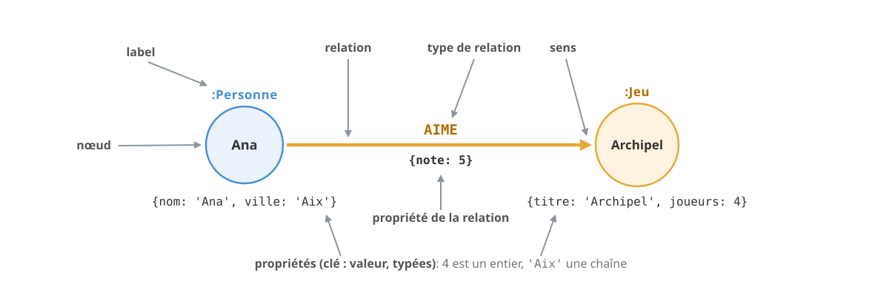
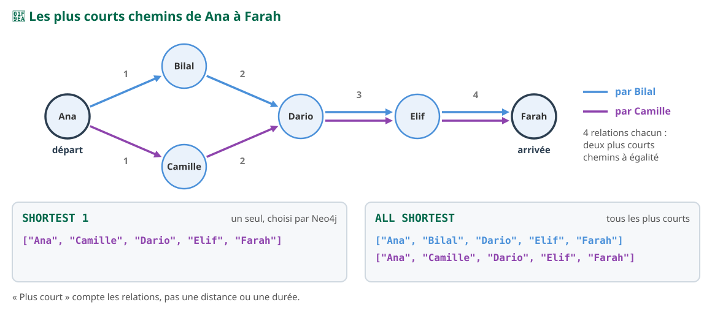
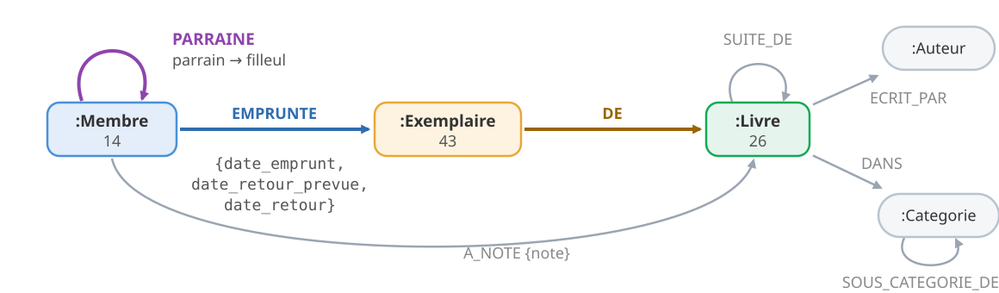

<!-- _class: lead -->
<!-- _paginate: false -->

<style scoped>
section {
  background-image: url('assets/logo.png');
  background-repeat: no-repeat;
  background-position: bottom 40px center;
  background-size: 340px;
}
h1 { font-size: 1.9em; }
p.question { font-size: 0.85em; color: #5c6c75; font-style: italic; margin-top: 0.8em; }
</style>

# Du relationnel au graphe

**R5.Real.10 - Nouveaux paradigmes de base de données**

Séance 5 · TP4 · Neo4j et Cypher · semaine du 7 décembre 2026

<p class="question">Au TP1, deux questions sont restées sans bonne réponse : que faut-il à une base pour suivre des liens, sans recopier et sans une requête par niveau ?</p>

<!--
(20 s)

Question directrice de la séance : « Au TP1, deux questions sont restées sans bonne réponse : que faut-il à une base pour suivre des liens, sans recopier et sans une requête par niveau ? » Ce sont les questions de modélisation 4 (les parrainages) et 5 (les lecteurs de Dune). Deux jalons : Q5 est cochée au premier temps (un motif de longueur fixe, diapo 16), Q4 au second (un quantificateur, diapo 38). La réponse est dans les deux « À retenir » ; la clôture dit quand ce choix vaut la peine.

Le point cours se fait en trois temps (somme des durées notées en tête de chaque diapo) :

Premier temps, en début de séance, 23 min 10 (« À vous » compris) :
- titre, objectifs, données (diapos 1 à 3) : 1 min 55 ;
- le besoin (diapos 4 et 5) : 2 min ;
- partie 1, traduire (diapos 6 à 10) : 3 min 40, prédiction diapo 9 ;
- partie 2, lire (diapos 11 à 16) : 3 min 55, prédiction diapo 14 ;
- partie 3, agréger (diapos 17 à 22) : 4 min 50, prédiction diapo 21 ;
- partie 4, écrire (diapos 23 à 28) : 4 min 45, prédiction diapo 25 ;
- « À retenir » (29), « À vous » (30), « Nouveau dans ce TP » (31) : 2 min 05.

Second temps, quand la majorité du groupe attaque la partie 5, 9 min 15 :
- partie 5, parcourir (diapos 32 à 36) : 4 min 55, prédiction diapo 34 ;
- partie 6, comparer (diapos 37 à 40) : 3 min 35, prédiction diapo 39 ;
- « À retenir » (41) : 45 s.

Clôture, en fin de séance, une fois les exercices 11 et 12 faits (diapos 42 et 43) : 4 min 30, comptées dans le créneau « Partie 6, puis clôture » de « À vous » ; puis « Des questions ? » (10 s).

L'annexe (après les Crédits, 6 diapos) n'est pas projetée : PROFILE détaillé, le coût d'un parcours (le chiffre souvent cité, nos mesures), LOAD CSV, GQL et l'ancienne syntaxe, Cypher depuis Java.

Trois jeux de données, comme dans l'énoncé : 📦 les paquets du registre Ruche et 📚 la médiathèque du TP1 (les données du TP : seulement pour poser le problème, jamais une réponse) et 🧪 les personnes et leurs jeux de société (tous les exemples exécutables). Tout a été exécuté le 13/11/2026 sur neo4j:2026.10.1-community (Cypher 25), dans une base qui contient les données du TP (chargées par le seed du TP4) et l'exemple d'essai, dans l'ordre des diapos ; le SQL sur PostgreSQL 18.4, l'upsert de S1 sur MongoDB 9.0.4. Les résultats affichés sont ceux obtenus (format de cypher-shell). Le script de l'exemple d'essai est dans les notes de la diapo 3 ; chaque diapo qui modifie l'exemple dit dans ses notes comment le remettre en état.
-->

---

<!-- header: Séance 5 · objectifs -->

## Suivre des liens : ce que la séance construit

<div class="bandeau" style="font-size: 0.82em; text-align: left;">
❓ Que faut-il à une base pour suivre des liens, sans recopier et sans une requête par niveau ?
</div>

<div class="g2" style="margin-top: 0.8rem; font-size: 0.74em; align-items: stretch;">
<div class="carte vert">
<b class="t">🎯 À la fin de la séance, vous saurez</b>

1. **traduire** un schéma relationnel en graphe, le **créer** ;
2. **lire** un motif, **agréger**, **écrire** sans doublon ;
3. **suivre** des chemins de longueur inconnue, **recommander** ;
4. **comparer** le graphe et le document sur les mêmes questions.

</div>
<div class="carte">
<b class="t">🧠 Déjà vu</b>

- **SQL** : jointures, `GROUP BY`, `LEFT JOIN`
- **S1** : l'upsert et `$setOnInsert`
- **S2** : la médiathèque ; `$group` puis `$match`
- **S3** : `$lookup`, `explain()`
- **S4** : le coût d'un `$lookup`, mesuré

</div>
</div>

<!--
(50 s)

Lire la question directrice : toute la séance y répond.

Les quatre objectifs suivent les niveaux de l'énoncé : Comprendre (ex. 1 et 2), Appliquer (ex. 3 à 8), Analyser (ex. 9 à 12) ; le quatrième est la partie 6 et ses questions ✍️.

« Déjà vu » : la jointure SQL revient en partie 2 (pont SQL), GROUP BY et LEFT JOIN en partie 3 ; l'upsert de S1 (le capteur du garage, avec $setOnInsert) est le modèle de MERGE (partie 4) ; la médiathèque de S2 revient en partie 6, et $group puis $match annoncent WITH (partie 3) ; $lookup et explain() (S3) puis la mesure de S4 (la page d'un épisode : 5 commentaires examinés sans index, 3 avec, 1 document s'ils sont embarqués) servent de point de départ : suivre un lien, c'est une jointure.
-->

---

<!-- header: Séance 5 · les données -->

## Trois jeux de données


<div class="box" style="margin-top: 0.4rem; font-size: 0.74em;">

🧪 **Personnes et jeux** (ci-dessus) : les exemples à exécuter, dans `essais.cypher`.
📦 **Les paquets du registre Ruche**, parties 1 à 5 : 12 exercices notés, 60 points, tout en séance.
📚 **La médiathèque du TP1**, en graphe à la partie 6, pour répondre enfin aux questions 4 et 5.

</div>

<!--
(45 s)

Dix nœuds, deux labels (Personne, Jeu), deux types de relation (SUIT, AIME). SUIT se lit dans le sens de la flèche : Ana suit Bilal, Bilal ne suit pas Ana. Le tableau de droite, ce sont les onze relations AIME, chacune avec sa note. C'est l'exemple de l'énoncé et du tuteur ; toutes les requêtes des diapos portent sur lui.

Les données du TP : un registre de paquets, comme npm ou Maven Central, inventé pour le TP (79 paquets, 25 développeurs, 6 failles ; des paquets qui dépendent d'autres paquets) ; puis la médiathèque du TP1, la même, avec les mêmes identifiants. Elles posent les problèmes, jamais une réponse. Le graphe de la médiathèque n'est projeté qu'à la partie 6 : le montrer ici répondrait à une question ✍️ de la partie 1 (où range-t-on un emprunt ?). Au programme : 6 parties, 12 exercices notés (60 points), 12 bonus.

Script, dans essais.cypher (déjà fourni ; une seule requête, à relancer pour remettre l'exemple en état : elle efface aussi Gaspard, Hugo et tout essai sur Personne ou Jeu) :

MATCH (n) WHERE n:Personne OR n:Jeu DETACH DELETE n
WITH count(*) AS supprimes
CREATE (ana:Personne {nom: 'Ana', ville: 'Aix'}),
       (bilal:Personne {nom: 'Bilal', ville: 'Marseille'}),
       (camille:Personne {nom: 'Camille', ville: 'Aix'}),
       (dario:Personne {nom: 'Dario', ville: 'Toulon'}),
       (elif:Personne {nom: 'Elif', ville: 'Marseille'}),
       (farah:Personne {nom: 'Farah', ville: 'Aix'}),
       (archipel:Jeu {titre: 'Archipel', joueurs: 4}),
       (comete:Jeu {titre: 'Comète', joueurs: 2}),
       (maree:Jeu {titre: 'Marée haute', joueurs: 5}),
       (sortilege:Jeu {titre: 'Sortilège', joueurs: 3}),
       (ana)-[:SUIT]->(bilal), (ana)-[:SUIT]->(camille),
       (bilal)-[:SUIT]->(dario), (camille)-[:SUIT]->(dario), (dario)-[:SUIT]->(elif),
       (elif)-[:SUIT]->(farah),
       (ana)-[:AIME {note: 5}]->(archipel), (ana)-[:AIME {note: 3}]->(comete),
       (bilal)-[:AIME {note: 4}]->(archipel), (bilal)-[:AIME {note: 5}]->(maree),
       (camille)-[:AIME {note: 4}]->(comete), (camille)-[:AIME {note: 5}]->(sortilege),
       (dario)-[:AIME {note: 4}]->(maree), (dario)-[:AIME {note: 2}]->(sortilege),
       (elif)-[:AIME {note: 3}]->(archipel), (elif)-[:AIME {note: 4}]->(maree),
       (farah)-[:AIME {note: 5}]->(comete)
WITH count(*) AS fait
MATCH (n) WHERE n:Personne OR n:Jeu
RETURN count(n) AS noeuds_essai;

Résultat : noeuds_essai = 10.
-->

---

<!-- header: Séance 5 · le besoin -->

## Deux questions restées sans bonne réponse

<div class="cols" style="align-items: stretch; font-size: 0.8em;">
<div class="carte orange">
<b class="t">❓ Question 4 : les parrainages</b>

Les filleuls de Marie Dupont (M01), puis les leurs, **et ainsi de suite**.

Avec `parrain_id` : **une requête par niveau**, jusqu'à un niveau vide. Combien de niveaux ? On ne le sait **pas d'avance**.

</div>
<div class="carte orange">
<b class="t">❓ Question 5 : les lecteurs de Dune</b>

Les livres empruntés par **les lecteurs de Dune**.

Deux requêtes, ou une seule grâce au titre **recopié** dans chaque emprunt. Le chemin a une longueur **fixe** : il faut le suivre sans recopier.

</div>
</div>

<div class="bandeau" style="margin-top: 0.7rem; font-size: 0.86em;">Deux questions qui <b>suivent des liens</b> : l'une sur une longueur fixe, l'autre sur une longueur inconnue</div>

<!--
(50 s)

Rappeler le modèle du TP1 : les exemplaires embarqués dans le livre, les emprunts dans le membre avec le titre recopié, parrain_id comme référence vers un autre membre. Ce sont les questions de modélisation 4 et 5 de la séance 2 (et le bonus 6 du TP1 pour Q5).

La différence entre les deux compte pour la suite : Q5 a une longueur fixe (un livre, ses lecteurs, leurs livres), on saura l'écrire dès la partie 2 ; Q4 a une longueur inconnue, il faudra la partie 5.

Ne pas compter ici les requêtes de Q4 pour 10 niveaux : c'est une question ✍️ de la partie 6.
-->

---

## Suivre un lien : une jointure à chaque saut

<p style="font-size: 0.74em; margin: 0 0 0.3rem;">En S4, la page d'un épisode et ses commentaires : un <code>&#36;lookup</code> examinait <b>5</b> documents sans index, <b>3</b> avec, et la page en lisait <b>1</b> s'ils étaient embarqués. Une jointure par saut, à chaque saut.</p>


<div class="warn" style="margin-top: 0.3rem; font-size: 0.72em;">Sur un ou deux sauts, une base relationnelle bien indexée fait <b>aussi bien</b>. Et au-delà ? Réponse à la clôture, mesures à l'appui.</div>

<!--
(1 min 10)

Le pont avec S4 : on y a mesuré le coût d'une jointure ($lookup sans index, puis avec) ; ici, chaque saut d'un parcours en est une. En relationnel, un lien n'existe pas physiquement : c'est une valeur (la clé étrangère) qu'on recherche dans une autre table au moment de la requête, par un index (un arbre B). Chaque saut repaie cette recherche. Les tables du schéma sont celles de la clôture : personne(nom PK, ville), suit(source, cible), avec les noms comme clés.

Dans une base graphe, chaque nœud garde la liste de ses relations, et chaque relation connaît ses deux nœuds : suivre une relation, c'est suivre un pointeur (l'adjacence sans index). L'index sert toujours, mais seulement à trouver le point de départ.

La nuance, à l'écran, et ne pas la trancher ici : sur un ou deux sauts, une base relationnelle indexée fait aussi bien ; nos mesures (annexe) montrent que, à profondeur égale, PostgreSQL indexé fait jeu égal avec Neo4j jusqu'à 5 sauts. Le graphe gagne surtout à l'écriture de la requête, quand la profondeur est inconnue : c'est la clôture.
-->

---

<!-- header: Partie 1 · traduire -->

<!-- _class: lead -->
<!-- _header: "" -->

# Partie 1 - 🔗 Du relationnel au graphe

Où ranger un lien, sinon dans une clé étrangère ?

<!--
(10 s)

Même titre que la partie 1 de l'énoncé du TP4 (exercices 1 et 2, sur les paquets).
-->

---

## Du relationnel au graphe : cinq règles, ligne par ligne


<div class="g2" style="margin-top: 0.3rem; font-size: 0.7em; gap: 0.2rem 1.2rem;">
<div><b>1</b> une ligne → un <b>nœud</b> ; la table → son <b>label</b></div>
<div><b>2</b> la clé technique <code>id</code> <b>disparaît</b> ; la clé métier identifie</div>
<div><b>3</b> une clé étrangère → une <b>relation</b></div>
<div><b>4</b> une table de jointure → une <b>relation</b>, ses colonnes → ses propriétés</div>
<div><b>5</b> chaque valeur, son <b>vrai type</b> : <code>date('…')</code>, entier</div>
<div>Le <b>sens</b> se lit comme une phrase : le développeur <b>maintient</b> le paquet</div>
</div>

<!--
(1 min 20)

Ce sont les règles du guide « relational to graph » de Neo4j, et celles de l'énoncé. Suivre chaque pointillé : quatre lignes de tables, trois nœuds et deux relations. Ce sont de vraies lignes des données du TP : on les retrouve dans la base. Un nœud porte des labels et des propriétés typées ; une relation, un type, un sens et des propriétés (le vocabulaire est dessiné diapo suivante).

Le pont avec le document : en S2, une relation plusieurs-à-plusieurs obligeait à choisir (un tableau d'_id d'un côté ou des deux), et chaque cardinalité (1-1, 1-N bornée, 1-N sans limite) posait la question « embarquer ou référencer ». Dans un graphe, toutes deviennent une relation : il n'y a plus ce choix.

La règle 2 surprend : une relation pointe directement vers son nœud, elle n'a pas besoin d'un numéro. On garde la clé métier, unique, et on la protège par une contrainte (partie 4). La règle 5 est celle que le guide Northwind de Neo4j oublie (SET n = row garde les dates en chaînes).

Renvoi : l'exercice 1 traduit une ligne de paquet, l'exercice 2 deux lignes de la table de jointure dependance.

✍️ Questions de la partie 1, à garder pour la mise en commun (ne pas projeter) : une table dependance(id, paquet_id, dependance_id, contrainte) donnerait la même relation, l'id technique disparaît (règle 2) ; l'emprunt, recopié dans le livre et dans le membre au TP1, devient une seule relation EMPRUNTE entre le membre et l'exemplaire.
-->

---

## Nœuds, relations, propriétés : les créer



<div class="cols-62" style="margin-top: 0.3rem; align-items: stretch;">
<div class="dense">

```cypher
CREATE (:Personne {nom: 'Gaspard', ville: 'Nice',
                   inscrit: date('2026-12-07')});
MATCH (g:Personne {nom: 'Gaspard'})
MATCH (a:Personne {nom: 'Ana'})
CREATE (g)-[:SUIT]->(a);
MATCH (g:Personne {nom: 'Gaspard'}) RETURN g.inscrit AS inscrit;
// 2026-12-07
```

</div>
<div class="box" style="font-size: 0.72em;">Relier deux nœuds : les <b>retrouver</b> (<code>MATCH</code>), puis créer la relation. Une date : <code>date('…')</code> ; <code>4</code> est un entier, <code>'4'</code> ne le trouve pas. Sur une relation, entre crochets : <code>-[:AIME {note: 4}]-></code>. Effacer un essai : <code>DETACH DELETE</code>.</div>
</div>

<!--
(1 min 10)

Un nœud représente une chose ; il porte un ou plusieurs labels (ce qu'il est) et des propriétés typées : chaîne, entier, flottant, booléen, date, liste. Pas de schéma imposé. Une relation a exactement un type, un sens et, elle aussi, des propriétés : la note d'Ana sur Archipel appartient à la relation, comme une colonne de table de liaison. Vocabulaire du module, celui de l'énoncé et du tuteur : nœud, label, relation, type de relation, sens, propriété, puis motif et chemin ; ni sommet ni arête.

CREATE crée tout ce que décrit son motif : des nœuds entre parenthèses, des relations entre crochets. Les propriétés s'écrivent avec leur type (comme 3700 contre "3700" en S1) : une date s'affiche sans guillemets. Un MATCH qui ne trouve rien ne crée rien, sans erreur : vérifier d'abord le MATCH seul. Exécuté sur l'exemple d'essai fraîchement chargé ; vérifié aussi : MATCH (j:Jeu) WHERE j.joueurs = '4' RETURN j.titre AS titre ne renvoie aucune ligne, avec 4 il renvoie "Archipel".

Effacer : MATCH (p:Personne {nom: 'Farah'}) DELETE p; échoue (exécuté) avec « G1001: dependent object error - edges still exist » (l'extension donne le message long « Cannot delete node<…>, because it still has relationships ») : Farah est suivie par Elif et aime Comète, et Neo4j ne laisse jamais une relation sans ses deux nœuds. DETACH DELETE supprime le nœud et ses relations, comme un ON DELETE CASCADE.

Renvoi : exercices 1 (un nœud, avec ses types) et 2 (deux relations avec une propriété, entre des nœuds qui existent). La diapo suivante part de cet état (Gaspard suit Ana).
-->

---

## ❓ Hugo suit Ana : combien d'Ana ?

<style scoped>
.g3 { gap: 0.8em; align-items: stretch; }
.carte { font-size: 0.8em; text-align: center; }
</style>

```cypher
CREATE (:Personne {nom: 'Hugo', ville: 'Nice'})-[:SUIT]->(:Personne {nom: 'Ana'});

MATCH (a:Personne {nom: 'Ana'}) RETURN count(a) AS ana;
```

<p style="font-size: 0.8em;">Que renvoie la seconde requête ?</p>

<div class="g3" style="margin-top: 0.4rem;">
<div class="carte"><b class="t">A</b>1 : Hugo suit l'Ana qui existe</div>
<div class="carte"><b class="t">B</b>2 : une nouvelle Ana</div>
<div class="carte"><b class="t">C</b>une erreur : Ana existe déjà</div>
</div>

<!--
(25 s)

Faire voter à main levée, sans commenter. Réponse : B, sur la diapo suivante.
-->

---

## Réponse : deux Ana, la nouvelle sans ville

```cypher
MATCH (a:Personne {nom: 'Ana'}) RETURN count(a) AS ana;
// 2
MATCH (a:Personne {nom: 'Ana'}) RETURN a.ville AS ville;
// "Aix"
// NULL
```

<div class="cols" style="margin-top: 0.4rem; font-size: 0.76em; align-items: stretch;">
<div class="carte rouge"><b class="t">CREATE crée tout son motif</b> Il ne regarde pas ce qui existe : <code>(:Personne {nom: 'Ana'})</code> y décrit une <b>nouvelle</b> Ana.</div>
<div class="carte vert"><b class="t">La bonne forme</b> <code>MATCH</code> chaque nœud existant, puis <code>CREATE</code> la relation entre les variables (diapo 8).</div>
</div>

<!--
(35 s)

Sans contrainte, rien n'empêche deux Ana : le doublon passe en silence (on y revient en partie 4). La nouvelle Ana n'a que la propriété décrite dans le motif.

Remise en état, avant la partie 2 : relancer le bloc de chargement de l'exemple d'essai (il efface Gaspard, Hugo et la seconde Ana). Les deux requêtes de la diapo précédente et celles-ci ont été exécutées à la suite, après la diapo 8.
-->

---

<!-- header: Partie 2 · lire -->

<!-- _class: lead -->
<!-- _header: "" -->

# Partie 2 - ✏️ Lire un motif

Comment demander un chemin plutôt qu'une jointure ?

<!--
(10 s)

Exercices 3 et 4, sur les paquets.
-->

---

## De SQL à Cypher : la jointure devient une flèche

<style scoped>
table { display: table; font-size: 0.76em; width: 100%; }
</style>

| SQL, sur `personne(nom, ville)` et `suit(source, cible)` | Cypher | |
|---|---|---|
| `FROM personne p JOIN suit s ON s.source = p.nom JOIN personne q ON q.nom = s.cible` | `MATCH (p:Personne)-[:SUIT]->(q:Personne)` | les jointures sont **dessinées** |
| `WHERE p.nom = 'Ana'` | `WHERE p.nom = 'Ana'` ou `{nom: 'Ana'}` | pareil |
| `SELECT q.nom AS nom` | `RETURN q.nom AS nom` | la sélection vient **à la fin** |
| `ORDER BY nom LIMIT 3`, `DISTINCT` | `ORDER BY nom LIMIT 3`, `RETURN DISTINCT` | pareil |
| `WHERE NOT EXISTS (SELECT …)` | `WHERE NOT EXISTS { (p)-[:AIME]->(…) }` | un motif à l'intérieur |

<div class="bandeau" style="margin-top: 0.5rem; font-size: 0.84em;">La table <code>suit</code> disparaît : le lien est rangé, la requête le <b>dessine</b></div>

<!--
(50 s)

Le pont d'abord, avant le dessin : pour qui connaît SQL, beaucoup de mots restent les mêmes. Ce qui change : l'ordre des clauses (on décrit d'abord ce qu'on cherche, on dit ensuite ce qu'on renvoie) et la jointure, qui devient une flèche ; la table de liaison n'apparaît plus.

Où l'analogie casse : pas de GROUP BY à écrire (partie 3) ; un label ou un type mal écrit n'est pas une erreur, mais zéro ligne et un avertissement (« À vous »).

Le correspondant MongoDB : MATCH ressemble à un find avec des $lookup déjà écrits, RETURN à la projection.
-->

---

## Un motif se pose sur le graphe


<div class="cols-62" style="margin-top: 0.4rem; align-items: center;">
<div>

```cypher
MATCH (ana:Personne {nom: 'Ana'})-[:SUIT]->(p:Personne)
RETURN p.nom AS nom ORDER BY nom;
// "Bilal"
// "Camille"
```

</div>
<div class="box" style="font-size: 0.68em;"><code>( )</code> un nœud · <code>-[ ]-></code> une relation et son sens · <code>:Label</code>, <code>:TYPE</code> · <code>{nom: 'Ana'}</code> un filtre · <code>AS</code> nomme la colonne</div>
</div>

<!--
(55 s)

C'est l'idée de Cypher : on dessine en texte ce qu'on cherche. Les parenthèses sont les cercles, les crochets et la flèche sont la relation. Neo4j cherche toutes les façons de poser le dessin sur le graphe ; chacune donne une ligne. Ici, deux.

AS nomme la colonne (sinon elle s'appellerait p.nom) ; ORDER BY trie, comme en SQL. Dans le TP, les noms des colonnes et le tri sont imposés par la consigne : le correcteur automatique les compare. On renvoie des propriétés, jamais un nœud entier (RETURN p est refusé) : MATCH (ana:Personne {nom: 'Ana'}) RETURN ana; affiche (:Personne {nom: "Ana", ville: "Aix"}), utile pour regarder seulement.

Le réflexe du TP : dessiner le motif avant de l'écrire. Les études sur les erreurs des étudiants en Cypher (Pachera et al. 2025 ; Chen et al. 2021, UIUC) montrent que la plupart ne sont pas des fautes de syntaxe : une flèche à l'envers, une condition oubliée, une ligne en double.
-->

---

## ❓ Dario, avec ou sans pointe de flèche

<style scoped>
.g3 { gap: 0.8em; align-items: stretch; }
.carte { font-size: 0.78em; text-align: center; }
</style>

```cypher
MATCH (:Personne {nom: 'Dario'})-[:SUIT]->(p:Personne)
RETURN p.nom AS nom ORDER BY nom;

MATCH (:Personne {nom: 'Dario'})-[:SUIT]-(p:Personne)
RETURN p.nom AS nom ORDER BY nom;
```

<p style="font-size: 0.8em;">Que renvoient-elles ? (graphe : diapo 3)</p>

<div class="g3" style="margin-top: 0.3rem;">
<div class="carte"><b class="t">A</b>Elif, puis Elif</div>
<div class="carte"><b class="t">B</b>Elif, puis Bilal, Camille, Elif</div>
<div class="carte"><b class="t">C</b>Bilal et Camille, puis Elif</div>
</div>

<!--
(25 s)

Faire voter, sans commenter. Réponse : B, sur la diapo suivante.
-->

---

## Réponse : sans flèche, une autre question

```cypher
MATCH (:Personne {nom: 'Dario'})-[:SUIT]->(p:Personne)
RETURN p.nom AS nom ORDER BY nom;
// "Elif"

MATCH (:Personne {nom: 'Dario'})-[:SUIT]-(p:Personne)
RETURN p.nom AS nom ORDER BY nom;
// "Bilal"
// "Camille"
// "Elif"
```

<div class="warn" style="margin-top: 0.3rem; font-size: 0.74em;">Sans pointe, le motif cherche dans les deux sens : Bilal et Camille, <b>qui suivent</b> Dario, s'ajoutent à Elif, <b>que Dario suit</b>. Vérifiez le sens de chaque flèche dans la présentation des données.</div>

<!--
(35 s)

C'est l'erreur la plus fréquente des débutants (27 fois sur 59 participants dans l'étude de Pachera et al.). Dans le TP, le second jeu de données de la note officielle est construit pour qu'une flèche inversée ou oubliée change le résultat.

Renvoi : exercice 3 (« qui dépend de lui ? ») : où est le paquet, et d'où part la flèche DEPEND_DE ? Le dessiner avant d'écrire.
-->

---

## Filtrer, tester l'existence d'un motif

```cypher
MATCH (p:Personne)-[a:AIME]->(j:Jeu)
WHERE a.note >= 5
RETURN p.nom AS nom, j.titre AS jeu ORDER BY nom;
// "Ana", "Archipel"   "Bilal", "Marée haute"   "Camille", "Sortilège"   "Farah", "Comète"

MATCH (p:Personne)
WHERE NOT EXISTS { (p)-[:AIME]->(:Jeu {titre: 'Archipel'}) }
RETURN p.nom AS nom ORDER BY nom;
// "Camille"   "Dario"   "Farah"
```

<p class="petit">On filtre sur une propriété de la <b>relation</b> (<code>a.note</code>) comme sur un nœud. <code>EXISTS { motif }</code> : vrai si le motif existe au moins une fois.</p>

<div class="bandeau" style="margin-top: 0.3rem; font-size: 0.8em; text-align: left;">✔ <b>Question 5</b> : un livre, ses lecteurs, leurs livres. Un motif de <b>longueur fixe</b>, sans titre recopié : vous savez l'écrire (exercice 12).</div>

<!--
(1 min)

Les quatre lignes du premier résultat sont écrites sur une seule ligne pour tenir sur la diapo (cypher-shell les affiche une par ligne). EXISTS { … } est la sous-requête NOT EXISTS de SQL, avec un dessin dedans. Les supports en ligne anciens écrivent exists(n.prop), retiré : on écrit n.prop IS NOT NULL (annexe).

Renvoi : exercice 4 (les paquets que personne ne maintient).

Premier jalon de la question directrice : Q5 ne demande qu'un motif de longueur fixe, que le graphe suit sans recopie. Ne pas dessiner ce motif : c'est l'exercice 12, en partie 6, où le graphe de la médiathèque sera projeté (diapo 38).
-->

---

<!-- header: Partie 3 · agréger -->

<!-- _class: lead -->
<!-- _header: "" -->

# Partie 3 - 🧮 Agréger

Combien de liens autour de chaque nœud, zéro compris ?

<!--
(10 s)

Exercices 5 à 7, sur les paquets.
-->

---

## Combien de fans par jeu ? Sans GROUP BY

<div class="dense">

```cypher
MATCH (p:Personne)-[a:AIME]->(j:Jeu)
RETURN j.titre AS jeu, count(p) AS fans, round(avg(a.note), 1) AS moyenne ORDER BY fans DESC, jeu;
```

</div>


<div class="box" style="margin-top: 0.2rem; font-size: 0.68em;"><b>Les colonnes non agrégées forment la clé de groupe</b> : le <code>&#36;group</code> de S2, sans l'écrire. <code>collect(j.titre)</code> rassemble un groupe en liste, sans ordre garanti.</div>

<!--
(1 min 10)

Résultat exécuté, dans l'ordre du tri : "Archipel", 3, 4.0 ; "Comète", 3, 4.0 ; "Marée haute", 3, 4.3 ; "Sortilège", 2, 3.5 (la colonne 3 du schéma).

C'est le $group de S2 sans l'écrire, et le GROUP BY de SQL sans l'écrire : la clé du groupe se déduit du RETURN. Piège classique (blog de Neo4j, « Common confusions ») : ajouter p.nom au RETURN pour l'afficher fait une ligne par couple (jeu, personne), et le compte vaut 1 partout.

collect, exécuté : MATCH (p:Personne {nom: 'Ana'})-[:AIME]->(j:Jeu) RETURN p.nom AS nom, collect(j.titre) AS jeux; a donné "Ana", ["Comète", "Archipel"] sur une base, puis "Ana", ["Archipel", "Comète"] sur la même base rechargée : l'ordre n'est pas garanti. Pour une liste triée, trier les lignes avant de collecter (WITH … ORDER BY … puis collect). round(x, 1) arrondit à une décimale ; avg renvoie un flottant, count un entier.

Cypher 25 accepte aussi un GROUP BY explicite (annexe) ; tous les supports en ligne utilisent la forme implicite, qu'il faut savoir lire.

Renvoi : exercice 5 (compter et collecter).
-->

---

## Filtrer après l'agrégation : WITH

<div class="cols" style="align-items: stretch;">
<div>

```cypher
MATCH (j:Jeu)<-[a:AIME]-(:Personne)
WHERE avg(a.note) >= 4
RETURN j.titre AS jeu;
```

<div class="err">

```
42I24: syntax error or access rule violation -
invalid use of aggregate function. Aggregate
expression 'avg(a.note)' is not allowed in this
context.
```

</div>
</div>
<div>

```cypher
MATCH (j:Jeu)<-[a:AIME]-(:Personne)
WITH j, avg(a.note) AS moyenne
WHERE moyenne >= 4
RETURN j.titre AS jeu, moyenne
ORDER BY jeu;
// "Archipel", 4.0
// "Comète", 4.0
// "Marée haute", 4.333333333333333
```

</div>
</div>

<div class="bandeau" style="margin-top: 0.4rem; font-size: 0.84em;"><code>WITH</code> termine une étape : <code>WITH … WHERE</code> après une agrégation, c'est <code>&#36;group</code> puis <code>&#36;match</code> (S2), ou <code>HAVING</code></div>

<!--
(1 min 10)

C'est la difficulté numéro 1 de Cypher dans les études sur les débutants (UIUC, 40 000 soumissions) : vouloir filtrer un agrégat dans le WHERE du MATCH. Message complet de cypher-shell : 42I24 (… in this context. (line 2, column 7 (offset: 42))), puis 42001: syntax error or access rule violation - invalid syntax ; il est coupé ici à la première cause.

WITH termine une étape et passe ses colonnes à la suivante, comme une étape de pipeline. Second piège : après un WITH, seules les variables qu'il liste existent encore. Une variable oubliée qu'on réutilise dans un MATCH suivant devient une nouvelle variable, sans erreur.

Renvoi : exercice 7 (filtrer après avoir compté).
-->

---

## Zéro compris : OPTIONAL MATCH


```cypher
MATCH (p:Personne)
OPTIONAL MATCH (p)<-[:SUIT]-(a:Personne)
RETURN p.nom AS nom, count(a) AS abonnes ORDER BY abonnes DESC, nom;
// "Dario", 2   "Bilal", 1   "Camille", 1   "Elif", 1   "Farah", 1   "Ana", 0
```

<!--
(55 s)

OPTIONAL MATCH est le LEFT JOIN de Cypher : la ligne reste, avec null. count(a) ignore les null, count(*) compte les lignes : avec count(*), Ana aurait 1 abonné (c'est dans l'énoncé). Les six lignes du résultat sont écrites sur une seule ligne pour tenir sur la diapo.

Renvoi : exercice 6 (zéro compris). Son astuce renvoie à count(DISTINCT …), montré après la prédiction.
-->

---

## ❓ Dario : 2 jeux aimés, 2 abonnés. Et ici ?

<style scoped>
.g3 { gap: 0.8em; align-items: stretch; }
.carte { font-size: 0.8em; text-align: center; }
</style>

```cypher
MATCH (p:Personne {nom: 'Dario'})
OPTIONAL MATCH (p)-[:AIME]->(j:Jeu)
OPTIONAL MATCH (p)<-[:SUIT]-(a:Personne)
RETURN count(j) AS jeux, count(a) AS abonnes;
```

<div class="g3" style="margin-top: 0.6rem;">
<div class="carte"><b class="t">A</b>2, 2</div>
<div class="carte"><b class="t">B</b>4, 4</div>
<div class="carte"><b class="t">C</b>2, 4</div>
</div>

<!--
(25 s)

Faire voter. Indice si la salle hésite : combien de lignes arrivent au RETURN ? Réponse : B, sur la diapo suivante.
-->

---

## Réponse : 4 et 4, les lignes se multiplient

<div class="cols" style="align-items: stretch;">
<div>

<p class="etiquette">Les lignes qui arrivent au RETURN</p>

| `j.titre` | `a.nom` |
|---|---|
| Sortilège | Bilal |
| Marée haute | Bilal |
| Sortilège | Camille |
| Marée haute | Camille |

<p class="petit">2 jeux × 2 abonnés = 4 lignes : chaque compte vaut 4.</p>

</div>
<div>

```cypher
MATCH (p:Personne {nom: 'Dario'})
RETURN COUNT { (p)-[:AIME]->(:Jeu) } AS jeux,
       COUNT { (p)<-[:SUIT]-(:Personne) } AS abonnes;
// 2, 2
```

<div class="box" style="font-size: 0.72em;"><code>COUNT { motif }</code> compte un motif autour d'un nœud, <b>sans multiplier</b> les lignes. Autre remède : <code>count(DISTINCT j)</code>, <code>count(DISTINCT a)</code> : 2, 2. Il sert aussi quand un même nœud est atteint par <b>deux chemins</b>.</div>

</div>
</div>

<!--
(1 min)

Exécuté : la même requête qui renvoie j.titre AS jeu, a.nom AS abonne donne les quatre lignes du tableau, dans cet ordre. Deux motifs indépendants dans la même étape se multiplient (c'est l'avertissement de l'énoncé, partie 3) : chaque ligne du premier est combinée à chaque ligne du second.

Deux remèdes, exécutés : COUNT { … } compte, pour chaque ligne, les façons de poser un motif, sans regrouper ni multiplier (utilisable aussi dans un WHERE) ; count(DISTINCT j) et count(DISTINCT a) comptent chaque nœud une fois (2, 2). Un même nœud atteint par deux chemins, lui aussi, compterait deux fois sans DISTINCT : exécuté, MATCH (:Personne {nom: 'Ana'})-[:SUIT]->(:Personne)-[:SUIT]->(q:Personne) RETURN count(q) AS lignes, count(DISTINCT q) AS personnes; donne 2, 1 (Dario, par Bilal et par Camille). Troisième solution, dans l'énoncé : agréger un motif (WITH … count(…)) avant d'aller chercher le suivant.

COUNT { } remplace size() appliqué à un motif, qui n'est plus accepté (annexe).

Renvoi : exercices 6 (count(DISTINCT …)) et 7 (deux comptes dans la même requête).

✍️ Question de la partie 3, à garder pour la mise en commun (ne pas projeter) : avec count(*), un développeur sans faille obtient 1 (la ligne avec null est comptée), et un développeur dont deux paquets sont touchés par la même faille la compte deux fois.

Pas de remise en état : ces requêtes ne font que lire.
-->

---

<!-- header: Partie 4 · écrire -->

<!-- _class: lead -->
<!-- _header: "" -->

# Partie 4 - ✍️ Modifier le graphe

Comment ajouter un lien sans le doubler, même quand on relance ?

<!--
(10 s)

Exercice 8, sur les paquets.
-->

---

## MERGE : l'upsert de Cypher

<p style="font-size: 0.78em; margin: 0 0 0.4rem;">Relancer un <code>CREATE</code>, c'est créer un doublon (les deux Ana, diapo 10). Il faut <b>chercher, sinon créer</b> : l'upsert de S1.</p>

<div class="cols" style="align-items: stretch;">
<div>
<p class="etiquette">S1 : un upsert</p>
<div class="dense">

```js
db.capteurs.updateOne(
  { piece: "Garage", type: "temperature" },
  { $set: { derniere: 19.5 },
    $setOnInsert: {
      installe: ISODate("2026-11-23") } },
  { upsert: true })
```

</div>
</div>
<div>
<p class="etiquette">🧪 Gaspard existe déjà, à Nice</p>

```cypher
MERGE (p:Personne {nom: 'Gaspard'})
  ON CREATE SET p.ville = 'Lyon'
RETURN p.ville AS ville;
// "Nice"
```

</div>
</div>

<p class="petit" style="margin-top: 0.4rem;"><code>ON CREATE SET</code> ne s'applique qu'à la création, comme <code>&#36;setOnInsert</code>. Avec Hugo, absent, la même requête crée Hugo, à Lyon.</p>

<!--
(55 s)

Le besoin : un import qu'on relance, ou deux imports qui se recouvrent, ne doivent pas créer deux fois le même nœud. Le pont avec S1 : l'upsert du capteur du garage (exécuté de nouveau sur MongoDB 9.0.4 : upsertedCount: 1 à la première exécution, matchedCount: 1 et modifiedCount: 0 à la seconde). MERGE est la même idée : chercher, sinon créer ; ON CREATE SET ne s'applique qu'à la création, comme $setOnInsert ; ON MATCH SET seulement quand ce qu'on cherche est trouvé.

État de départ (exécuté) : relancer le chargement de l'exemple d'essai, puis CREATE (:Personne {nom: 'Gaspard', ville: 'Nice'});. Gaspard existe : rien n'est créé, sa ville ne change pas. Exécuté aussi : MERGE (p:Personne {nom: 'Hugo'}) ON CREATE SET p.ville = 'Lyon' RETURN p.ville AS ville; renvoie "Lyon" (un nœud créé).

Ne pas dire encore ce que MERGE compare : c'est la prédiction suivante. L'état pour la prédiction : Gaspard à Nice (et Hugo à Lyon, sans effet sur la suite).
-->

---

## ❓ Gaspard existe : que fait ce MERGE ?

<style scoped>
.g3 { gap: 0.8em; align-items: stretch; }
.carte { font-size: 0.8em; text-align: center; }
</style>

<p style="font-size: 0.8em;">Gaspard existe, à Nice.</p>

```cypher
MERGE (p:Personne {nom: 'Gaspard', ville: 'Lyon'});

MATCH (p:Personne {nom: 'Gaspard'}) RETURN p.ville AS ville ORDER BY ville;
```

<div class="g3" style="margin-top: 0.6rem;">
<div class="carte"><b class="t">A</b>"Nice" : rien ne change</div>
<div class="carte"><b class="t">B</b>"Lyon" : sa ville change</div>
<div class="carte"><b class="t">C</b>"Lyon", "Nice" : deux Gaspard</div>
</div>

<!--
(25 s)

Faire voter. Réponse : C, sur la diapo suivante.
-->

---

## Réponse : deux Gaspard. MERGE compare tout son motif


<div class="cols" style="margin-top: 0.3rem; align-items: stretch;">
<div>
<p class="etiquette">Gaspard à Lyon n'existe pas : il est créé</p>
<div class="dense">

```cypher
MATCH (p:Personne {nom: 'Gaspard'})
RETURN p.ville AS ville ORDER BY ville;
// "Lyon"
// "Nice"
```

</div>
</div>
<div>
<p class="etiquette">✘ Sur une relation : Ana aime Comète, note 3</p>
<div class="dense">

```cypher
MATCH (a:Personne {nom: 'Ana'})
MATCH (j:Jeu {titre: 'Comète'})
MERGE (a)-[:AIME {note: 4}]->(j);
MATCH (:Personne {nom: 'Ana'})-[r:AIME]->
      (:Jeu {titre: 'Comète'})
RETURN r.note AS note;
// 4
// 3
```

</div>
</div>
</div>

<div class="box" style="margin-top: 0.3rem; font-size: 0.74em;">Dans le motif, <b>seulement ce qui identifie</b> ; le reste dans <code>ON CREATE SET</code>. Vrai pour un nœud comme pour une relation.</div>

<!--
(1 min 15)

L'organigramme : MERGE cherche tout son motif, propriétés comprises ; s'il le trouve, rien n'est créé (et ON MATCH SET s'applique) ; sinon, il le crée en entier (et ON CREATE SET s'applique). Il n'existe pas de Gaspard à Lyon : MERGE en crée un second. Même chose sur une relation : la relation AIME {note: 4} n'existe pas (Ana a mis 3), MERGE en crée une seconde ; la vérification renvoie 4 puis 3.

Exécution, dans l'ordre : la prédiction (deux Gaspard), puis la requête de droite et sa vérification.

Ne pas aller plus loin vers l'exercice 8 : faire raisonner sur ce que MERGE compare, sans assembler la requête. Attention : la leçon MERGE de GraphAcademy décrit un comportement nœud par nœud qui n'est pas le bon ; le manuel et la base de connaissances de Neo4j sont clairs : tout le motif existe, ou tout le motif est créé.

Remise en état : relancer le chargement de l'exemple d'essai, puis CREATE (:Personne {nom: 'Gaspard', ville: 'Nice'}); pour la diapo suivante.
-->

---

## Le piège : un motif à moitié présent est créé en entier

(:Jeu {titre: 'Comète'}). Gaspard n'aime pas encore Comète, le motif entier n'existe pas : MERGE crée un nouveau Gaspard et un nouveau Comète, reliés par AIME : 2 Gaspard, 2 Comète. À droite, en vert, à suivre : MATCH (g:Personne {nom: 'Gaspard'}), MATCH (j:Jeu {titre: 'Comète'}), puis MERGE (g)-[:AIME]->(j) : les deux nœuds existants sont retrouvés, une seule relation AIME est créée entre eux ; relancée, la requête ne change rien." style="display:block; width:100%; margin:0.3rem auto 0;">

<div class="bandeau" style="margin-top: 0.5rem; font-size: 0.84em;">Gaspard et Comète existent, mais pas le motif entier : MERGE ne réutilise <b>jamais</b> la partie trouvée</div>

<!--
(50 s)

Le motif entier n'existe pas (Gaspard n'aime pas encore Comète) : MERGE crée tout, nœuds compris. Il n'y a jamais de cas intermédiaire où il réutiliserait la partie trouvée. La forme verte est celle de l'énoncé : retrouver chaque nœud séparément, puis fusionner la relation entre les variables.

Exécuté sur l'exemple d'essai, Gaspard à Nice : la forme rouge crée 2 nœuds et 1 relation (MATCH (p:Personne {nom: 'Gaspard'}) RETURN count(p) donne 2, et 2 aussi pour Comète). Avant la forme verte, relancer le chargement de l'exemple d'essai et recréer Gaspard à Nice : avec des doublons, chaque MATCH trouverait deux nœuds, et MERGE créerait une relation par combinaison. La forme verte crée une relation ; relancée, elle ne crée rien (exécuté : 1 relation après deux exécutions).

✍️ Question de la partie 4, à garder pour la mise en commun (ne pas projeter) : la contrainte d'unicité sur pseudo protège quand deux imports tournent en même temps (MERGE vérifie puis crée : deux transactions peuvent créer chacune un nœud) ; sans contrainte d'existence en Community, on garantit la présence d'un nom par l'application, ou par un contrôle (une requête qui cherche les Paquet sans nom).

Remise en état : relancer le chargement de l'exemple d'essai.
-->

---

## Une contrainte : le doublon devient une erreur, la recherche passe par l'index

<style scoped>
h2 { font-size: 1.1em; }
table { display: table; font-size: 0.7em; width: 100%; }
</style>

<div class="cols" style="align-items: stretch;">
<div class="dense">

```cypher
CREATE CONSTRAINT personne_nom
FOR (p:Personne) REQUIRE p.nom IS UNIQUE;
CREATE (:Personne {nom: 'Ana'});
```

</div>
<div class="err dense">

```
22N80: data exception - index entry conflict.
Index entry conflict: Node(222) already exists
with label `Personne` and property `nom` = 'Ana'.
```

</div>
</div>

<p style="font-size: 0.72em; margin: 0.4rem 0 0.2rem;"><code>PROFILE</code> devant la requête : son plan et ses accès à la base (db hits), comme <code>explain()</code> en S3. Trouver Elif, base de 232 nœuds :</p>

| `PROFILE MATCH … RETURN p.ville AS ville` | Première opération | db hits |
|---|---|---|
| `(p {nom: 'Elif'})`, sans label | `AllNodesScan` : tous les nœuds | 466 |
| `(p:Personne {nom: 'Elif'})` | `NodeByLabelScan` : les 6 personnes | 14 |
| la même, contrainte posée | `NodeUniqueIndexSeek` : l'index | 3 |

<p class="petit" style="margin-top: 0.3rem;">Neo4j Community : contraintes d'<b>unicité</b> seulement. L'index ne sert qu'au <b>départ</b> d'un motif.</p>

<!--
(1 min 10)

Sans contrainte, Neo4j ne vérifie rien : un MERGE mal écrit crée un doublon en silence. Avec une contrainte d'unicité, le doublon devient une erreur (22N80, puis 22N79 « property uniqueness constraint violated »), et la contrainte crée un index. Exécuté sur l'exemple d'essai rechargé ; le numéro du nœud change d'une base à l'autre (on a obtenu Node(242) et Node(269) ; l'énoncé affiche Node(222), qu'on reprend ici). Une contrainte ne se crée pas sur des doublons : les supprimer d'abord.

Neo4j Community n'a que l'unicité : existence (IS NOT NULL), type (IS :: STRING) et clé (IS NODE KEY) sont réservées à Enterprise. Exécuté : CREATE CONSTRAINT jeu_titre_existe FOR (j:Jeu) REQUIRE j.titre IS NOT NULL; échoue en 51N27 « Property existence constraint is not supported in community edition ».

PROFILE, mesuré dans une base qui contient les données du TP et l'exemple d'essai (232 nœuds, comme celle de l'étudiant après npm run seed et le chargement de l'exemple) : 466, 14 et 3 db hits ; les deux premières lignes sans contrainte (avant de la créer, ou après DROP CONSTRAINT personne_nom). Le plan se lit de bas en haut. Le label divise déjà le travail ; l'index le réduit à presque rien : c'est aussi pour cela qu'on écrit toujours le label d'un nœud. La suite d'un motif suit les relations (diapo 5). Le plan complet est en annexe ; le tuteur sait lire un plan collé (skill lire-une-erreur).

Renvoi : exercice 8 (les développeurs ont une contrainte d'unicité sur pseudo), bonus 4.

Remise en état : DROP CONSTRAINT personne_nom; (npm run seed supprime aussi les contraintes créées).
-->

---

<!-- header: Séance 5 · premier temps -->

## À retenir : ranger les liens, puis les dessiner

<div class="g2" style="font-size: 0.74em; align-items: stretch;">
<div class="carte vert"><b class="t">Le modèle</b> Des nœuds (labels, propriétés) et des relations (type, sens, propriétés). Une jointure devient une relation.</div>
<div class="carte vert"><b class="t">Lire</b> Dessiner le motif, puis <code>MATCH … WHERE … RETURN … AS</code>. Une ligne par façon de poser le motif.</div>
<div class="carte orange"><b class="t">Agréger</b> Clé de groupe implicite ; <code>WITH … WHERE</code> pour filtrer après ; <code>OPTIONAL MATCH</code> pour le zéro ; deux comptes : <code style="white-space: nowrap;">COUNT { … }</code>.</div>
<div class="carte orange"><b class="t">Écrire</b> <code>MERGE</code> sur ce qui identifie ; la relation entre des nœuds déjà retrouvés ; <code>DETACH DELETE</code> ; contrainte d'unicité.</div>
</div>

<div class="bandeau" style="margin-top: 0.7rem; font-size: 0.82em; text-align: left;">✔ Q5 : un motif de longueur fixe, sans recopie. Reste Q4 : une longueur <b>inconnue</b>, au second temps.</div>

<!--
(35 s)

Première moitié de la réponse à la question directrice : une base qui range les liens eux-mêmes (des relations), et une requête qui les dessine. Q5 est cochée ; Q4 attend la partie 5.
-->

---

<!-- header: "" -->

## À vous : la séance 5

<style scoped>
.g2 > div { display: flex; flex-direction: column; gap: 0.5rem; }
.g2 > div > .orange { margin-top: auto; }
</style>

<div class="bandeau" style="font-size: 1em; padding: 0.45rem 1.2rem;">
<a href="https://iutinfoaix-r510.github.io/tp4/">iutinfoaix-r510.github.io/tp4</a> : accepter le TP4, puis <code>npm run seed</code>
</div>

<div class="g2" style="margin-top: 0.7rem; font-size: 0.72em; grid-template-columns: 1fr 1.1fr; align-items: stretch;">
<div>

1. Mise en place, exemple d'essai : **10&nbsp;min**
2. Parties 1 à 4 : **1&nbsp;h&nbsp;30**
3. Point cours, puis partie 5 : **45&nbsp;min**
4. Partie 6, puis clôture : **35&nbsp;min**
5. **Premier rendu** : `r510-rendre`, **5&nbsp;min**

<div class="carte orange">
<b class="t">📅 Rendu final du TP4</b>
dimanche 20 décembre 2026, 23&nbsp;h&nbsp;59. Trois rendus au plus.
</div>

</div>
<div>

<div class="carte vert">
<b class="t">Les points</b>
12 exercices à 5 points : 60 points, 8&nbsp;% de la note. 12 bonus.
</div>

<div class="carte">
<b class="t">Trois réflexes</b>
Le <b>label</b> dans chaque nœud ; lire les <b>avertissements</b> (<code>01N51</code> : type inconnu, zéro ligne) ; renvoyer des <b>propriétés</b>, nommées par <code>AS</code>.
</div>

<div class="carte orange">
<b class="t">Dans l'extension</b>
<b>Ctrl+Entrée</b> : la requête sous le curseur. Jamais Ctrl+Alt+Entrée (tout le fichier). Pas d'émoji dans un <code>.cypher</code>.
</div>

</div>
</div>

<!--
(55 s)

Fin du premier temps : diapos 1 à 29 en 21 min 40, plus cette diapo et la suivante (55 s + 35 s), soit 23 min 10.

Trois réflexes, ceux de l'énoncé : un label oublié fait parcourir tous les nœuds (diapo 28) ; Neo4j n'a pas de schéma, un label ou un type mal écrit ne fait pas d'erreur mais zéro ligne et un avertissement, exécuté : MATCH (p:Personne)-[:SUIVRE]->(q:Personne) RETURN q.nom AS nom; donne 01N51 « The relationship type `SUIVRE` does not exist in database `neo4j`. Verify that the spelling is correct. » (l'extension l'affiche sous le résultat, le correcteur automatique le recopie) ; le correcteur automatique compare des valeurs, RETURN p est refusé.

L'extension : Ctrl+Entrée exécute la requête sous le curseur ; Ctrl+Alt+Entrée exécute la sélection ou, sans sélection, tout le fichier, et toutes les écritures du playground s'enchaîneraient. Un émoji dans un .cypher décale les positions de l'extension : Ctrl+Entrée lance alors une requête coupée.

Minutage de la séance : premier temps du point cours, 23 min ; mise en place et exemple d'essai, 10 min ; parties 1 à 4 (ex. 1 à 8), 1 h 30 ; second temps (9 min 15) puis partie 5 (ex. 9 et 10), 45 min ; partie 6 (ex. 11 et 12) puis la clôture (4 min 30, comprise dans ces 35 min), 35 min ; premier rendu, 5 min. Total : 3 h 28, il reste environ 30 minutes de marge. Les bonus prolongent en autonomie (le bonus 12, en Java, prépare le module graphe du projet).

Trois rendus au plus : fin de séance 5, un rendu intermédiaire facultatif, puis le rendu final au plus tard le dimanche 20 décembre 2026 à 23 h 59. r510-rendre lance npm run check, puis rend ; r510-sauver sauvegarde sans noter. Base abîmée : npm run seed vide la base et recharge les données (puis relancer l'exemple d'essai).
-->

---

## Nouveau dans ce TP : le tuteur lit vos motifs

<style scoped>
.g3 > .carte { font-size: 0.68em; }
.carte p { margin: 0.3em 0; }
</style>

<div class="g3" style="align-items: stretch;">
<div class="carte vert">
<b class="t">✏️ dessiner-mon-motif</b>

Redessine **votre** requête en ASCII, telle qu'elle est écrite, sans dire si elle est juste.

« Dessine ma requête. »

</div>
<div class="carte orange">
<b class="t">⚠️ lire-une-erreur</b>

Un code Neo4j (`42I24`, `G1001`, `01N51`), un plan `PROFILE`, une erreur de `./mvnw`.

« Aide-moi à lire cette erreur. »

</div>
<div class="carte violet">
<b class="t">🎤 interroge-moi</b>

Un exercice ✅ : c'est **vous** qui l'expliquez. L'entraînement aux **questions individuelles**.

« Interroge-moi sur mon exercice 9. »

</div>
</div>

<div class="box" style="margin-top: 0.7rem; font-size: 0.74em;">Toujours là : <code>faire-le-point</code>, <code>deboguer-ma-requete</code>, les quiz de fin de partie. 🧪 Vos essais dans <code>essais.cypher</code>, <b>jamais sous un <code style="white-space: nowrap;">// Votre réponse :</code></b>.</div>

<!--
(35 s)

Les skills du tuteur du TP4, dans .agents/skills/ : dessiner-mon-motif et lire-une-erreur sont propres au graphe ; interroge-moi prépare les questions individuelles de la dernière séance du projet, dont le module graphe se fait en équipe. Aucune n'écrit la requête d'un exercice ; sur un exercice, l'escalade du tuteur continue (explication, documentation, indice sur l'exemple d'essai).

Les invites de quiz de l'énoncé, à la fin de chaque partie :
- partie 1 : « Fais-moi un quiz sur le graphe de propriétés et la traduction d'un schéma relationnel. »
- partie 2 : « Fais-moi un quiz sur les motifs Cypher et le sens des relations. »
- partie 3 : « Explique-moi WITH comme si je connaissais $group et $match, puis fais-moi un quiz. »
- partie 4 : « Fais-moi un quiz sur MERGE, ON CREATE SET et DETACH DELETE. »
- partie 5 : « Fais-moi un quiz sur les chemins de longueur variable et SHORTEST. »
- partie 6 : « Fais-moi un quiz qui compare Cypher et MongoDB sur la médiathèque. »
-->

---

<!-- header: Partie 5 · parcourir -->

<!-- _class: lead -->
<!-- _header: "" -->

# Reprise : partie 5 - 🧭 Suivre des chemins

Et quand on ne connaît pas la longueur du chemin ?

<!--
(10 s)

Début du second temps : à projeter quand la majorité du groupe attaque la partie 5 (exercices 9 et 10, sur les paquets). Il couvre aussi la partie 6, dont il projette le graphe de la médiathèque. Même titre que la partie 5 de l'énoncé.
-->

---

## Q4 : un motif par longueur ? Un quantificateur

<pre style="font-size: 0.62em; margin: 0 0 0.4rem;">(:Personne {nom: 'Ana'})-[:SUIT]->(p)                           1 saut
(:Personne {nom: 'Ana'})-[:SUIT]->()-[:SUIT]->(p)               2 sauts
(:Personne {nom: 'Ana'})-[:SUIT]->()-[:SUIT]->()-[:SUIT]->(p)   3 sauts   … et « autant qu'il faut » ?</pre>

<div class="cols-62" style="align-items: center;">
<div>

{1,3}(b) est l'union de trois motifs de longueur fixe : (a)->(b), de longueur 1 ; (a)->( )->(b), de longueur 2 ; (a)->( )->( )->(b), de longueur 3, où chaque flèche est une relation SUIT et ( ) un nœud quelconque. Chaque motif trouvé est un chemin." style="display:block; width:100%;">

</div>
<div style="font-size: 0.8em;">

<style scoped>
table { display: table; width: 100%; }
</style>

| Quantificateur | Répétitions |
|---|---|
| `{2}` | exactement 2 fois |
| `{1,3}` | de 1 à 3 fois |
| `+` | au moins 1 fois |
| `*` | 0 fois ou plus |

Nommer le **chemin**, `c = …`, donne `length(c)` et `nodes(c)`.

</div>
</div>

<!--
(1 min 15)

Le besoin d'abord : on sait écrire un motif de longueur 1, 2 ou 3 (partie 2), mais pas « autant qu'il faut ». C'est Q4, et ce sont aussi les dépendances d'une application (exercice 9) ou l'impact d'une faille (bonus 7) : suivre la même relation un nombre de fois qu'on ne connaît pas. En SQL, c'est une requête récursive (WITH RECURSIVE) ; en MongoDB, $graphLookup ou une requête par niveau ; on comparera à la clôture.

Un quantificateur répète une relation : {1,3} déplie le motif en trois motifs, de une à trois relations ; le manuel Cypher dessine les chemins quantifiés comme cette union. + et * n'ont pas de borne haute.

Ancienne syntaxe, qu'on trouve partout sur le Web : [:SUIT*1..3]. Elle fonctionne encore (annexe), mais le TP écrit -[:SUIT]->{1,3}, conforme à la norme GQL.
-->

---

## ❓ Ana, à 1, 2 ou 3 sauts : combien de lignes ?

<style scoped>
.g3 { gap: 0.8em; align-items: stretch; }
.carte { font-size: 0.8em; text-align: center; }
</style>

```cypher
MATCH (:Personne {nom: 'Ana'})-[:SUIT]->{1,3}(p:Personne)
RETURN p.nom AS nom ORDER BY nom;
```

<p style="font-size: 0.8em;">Ana atteint Bilal, Camille, Dario et Elif (graphe : diapo 3).</p>

<div class="g3" style="margin-top: 0.4rem;">
<div class="carte"><b class="t">A</b>4 lignes</div>
<div class="carte"><b class="t">B</b>5 lignes</div>
<div class="carte"><b class="t">C</b>6 lignes</div>
</div>

<!--
(40 s)

Faire voter. Indice : par combien de chemins arrive-t-on à Dario ? Réponse : C, sur la diapo suivante.
-->

---

## Réponse : 6 lignes, une par chemin

{1,3}(p), sur le graphe SUIT de l'exemple d'essai, une colonne par distance. Départ : Ana. 1 saut : Bilal et Camille, un chemin chacun. 2 sauts : Dario, atteint par deux chemins (par Bilal et par Camille), d'où la pastille ×2. 3 sauts : Elif, atteint par deux chemins, ×2. 4 sauts : Farah, en gris, hors de {1,3}. Une ligne par chemin : Bilal, Camille, Dario, Dario, Elif, Elif." style="display:block; width:100%; margin:0.1rem auto 0;">

<div class="dense">

```cypher
MATCH c = (:Personne {nom: 'Ana'})-[:SUIT]->{1,3}(p:Personne)
RETURN length(c) AS sauts, count(*) AS chemins ORDER BY sauts;
// 1, 2     2, 2     3, 2
```

</div>

<div class="g2" style="margin-top: 0.2rem; font-size: 0.8em; align-items: stretch;">
<div class="box">Une ligne <b>par personne</b> ? Regrouper par personne (partie 3). <b>À combien de sauts ?</b> Nommer le chemin, lire sa longueur. Dans le registre, une dépendance peut être atteinte à <b>deux distances</b>.</div>
<div class="warn"><b>Bornez</b> quand vous le pouvez : sans borne, <code>+</code> peut énumérer des millions de chemins. Le correcteur automatique coupe à 10 s.</div>
</div>

<!--
(1 min 30)

Neo4j renvoie une ligne par chemin, pas une ligne par personne. Dario est atteint par deux chemins (par Bilal, par Camille) : il sort deux fois, Elif aussi. Farah, à 4 sauts, est au-delà de la borne. Le résultat de la prédiction, exécuté : "Bilal", "Camille", "Dario", "Dario", "Elif", "Elif". Exécuté aussi : -[:SUIT]->{2} à partir d'Ana renvoie Dario deux fois, comme le motif écrit à la main de la diapo précédente.

La requête affichée regroupe les chemins par longueur (exécutée : 2 chemins à 1 saut, 2 à 2 sauts, 2 à 3 sauts) : c'est le regroupement implicite de la partie 3, appliqué à la longueur d'un chemin nommé. Pour une ligne par personne, la même idée s'applique avec la personne en clé ; et dans le registre, une même dépendance peut être atteinte par des chemins de longueurs différentes : laquelle garder ? Ne pas assembler la requête ici : c'est l'exercice 9.

Dans un même chemin, Neo4j ne repasse jamais par la même relation : un cycle ne fait pas tourner une requête en rond (bonus 8). Mais un chemin sans borne sur un graphe très relié peut en énumérer des millions : le correcteur automatique arrête une requête après 10 secondes. Exécuté : -[:SUIT]->+ à partir d'Ana donne 8 chemins pour 5 personnes (count(*) et count(DISTINCT p)).

✍️ Question de la partie 5 (cycle), à garder pour la mise en commun : c'est cette règle (une relation au plus une fois par chemin) qui arrête un parcours ->+ sur un cycle.
-->

---

## Le plus court chemin : SHORTEST

<p style="font-size: 0.76em; margin: 0 0 0.2rem;">❓ D'Ana à Farah, <b>par où</b> passe-t-on, au plus court ?</p>



<div class="cols" style="margin-top: 0.3rem; align-items: stretch;">
<div class="dense">

```cypher
MATCH c = SHORTEST 1 (:Personne {nom: 'Ana'})
          -[:SUIT]->+(:Personne {nom: 'Farah'})
RETURN length(c) AS sauts;
// 4
MATCH c = ALL SHORTEST (:Personne {nom: 'Ana'})
          -[:SUIT]->+(:Personne {nom: 'Farah'})
RETURN count(c) AS chemins;
// 2
```

</div>
<div>

<p class="petit" style="margin: 0 0 0.3rem;"><code>nodes(c)</code> donne des nœuds <b>entiers</b> ; on renvoie des propriétés. Une <b>compréhension de liste</b> applique une expression à chaque élément d'une liste, comme <code>&#36;map</code> :</p>
<div class="dense">

```cypher
RETURN [x IN [1, 2, 3] | x * 10] AS dizaines;
// [10, 20, 30]
```

</div>
</div>
</div>

<!--
(1 min 20)

La question « par où passe-t-on ? » demande un chemin, pas seulement des personnes atteintes : c'est là que le graphe garde l'avantage (on ne l'a ni en SQL récursif simple, ni avec $graphLookup).

SHORTEST 1 renvoie un plus court chemin ; quand il y en a plusieurs de même longueur, Neo4j en choisit un (exécuté : celui qui passe par Camille ; ne pas compter dessus). ALL SHORTEST les renvoie tous. « Plus court » compte les relations, pas une distance : pour un poids (des minutes, des kilomètres), il faut la bibliothèque GDS, ou un calcul à la main sur des chemins bornés.

nodes(c) donne la liste des nœuds, dans l'ordre, mais des nœuds entiers : le correcteur automatique compare des valeurs. La compréhension de liste [x IN liste | expression] applique une expression à chaque élément (map en Java, $map en MongoDB) ; l'énoncé la montre sur la même liste de nombres. Ne pas l'appliquer ici à un chemin : c'est l'exercice 10.

Ancienne syntaxe : shortestPath(), qui marche encore (annexe).

✍️ Question de la partie 5 (deux plus courts chemins de même longueur), à garder pour la mise en commun : SHORTEST 1 en renverrait un seul, sans garantie lequel ; la consigne de l'exercice 10 précise que le chemin est unique.
-->

---

<!-- header: Partie 6 · comparer -->

<!-- _class: lead -->
<!-- _header: "" -->

# Partie 6 - 📚 La médiathèque, deux paradigmes

Q4 et Q5 sur les mêmes données : qu'y gagne-t-on, qu'y perd-on ?

<!--
(10 s)

Même titre que la partie 6 de l'énoncé du TP4 (exercices 11 et 12, sur la médiathèque).
-->

---

## La médiathèque en graphe : suivre les flèches

(:Membre), une boucle, du parrain vers son filleul, 7 parrainages ; (:Membre)-[:EMPRUNTE {date_emprunt, date_retour_prevue, date_retour}]->(:Exemplaire), 48 emprunts ; (:Exemplaire)-[:DE]->(:Livre), 43 exemplaires. En gris, le reste : (:Membre)-[:A_NOTE {note}]->(:Livre), (:Livre)-[:ECRIT_PAR]->(:Auteur), (:Livre)-[:DANS]->(:Categorie), (:Categorie)-[:SOUS_CATEGORIE_DE]->(:Categorie) et (:Livre)-[:SUITE_DE]->(:Livre). Le titre n'est écrit que dans le livre." style="display:block; width:100%; margin:0.1rem auto 0;">

<div class="cols" style="margin-top: 0.3rem; font-size: 0.72em; align-items: stretch;">
<div class="carte violet"><b class="t">✔ Q4 : les parrainages</b> <code>PARRAINE</code>, répétée autant qu'il faut : un quantificateur (exercice 11).</div>
<div class="carte"><b class="t">✔ Q5 : les lecteurs de Dune</b> <code>EMPRUNTE</code> puis <code>DE</code> : on emprunte un <b>exemplaire</b>, le titre n'est que dans le livre (exercice 12).</div>
</div>

<!--
(1 min 15)

Mêmes livres, mêmes membres, mêmes identifiants qu'au TP1 (L06, M01…). Ce qui était imbriqué devient un nœud (l'exemplaire), ce qui était recopié disparaît (le titre n'est écrit que dans le livre), ce qui était une référence devient une relation (PARRAINE). Faire lire le sens de chaque flèche colorée : le parrain vers son filleul, le membre vers l'exemplaire, l'exemplaire vers son livre.

Second jalon : Q4 est cochée, c'est un quantificateur sur PARRAINE (exercice 11) ; Q5 aussi (exercice 12), en passant par l'exemplaire. Ne dessiner ni l'un ni l'autre motif.

Le modèle document choisit un ordre de lecture (le membre et ses emprunts) ; le graphe n'en impose aucun : on part du membre, de l'exemplaire ou du livre. Le schéma des deux modèles côte à côte est dans l'énoncé ; la comparaison vient à la clôture. LOAD CSV (bonus 9) est en annexe.
-->

---

## ❓ Ceux qui aiment Archipel aiment aussi quoi ?

```cypher
MATCH (:Jeu {titre: 'Archipel'})<-[:AIME]-(p:Personne)-[:AIME]->(autre:Jeu)
RETURN autre.titre AS jeu, count(p) AS score ORDER BY score DESC, jeu;
```

<div class="cols" style="margin-top: 0.6rem; font-size: 0.8em; align-items: stretch;">
<div class="carte"><b class="t">1</b> Quel jeu arrive en tête, avec quel score ?</div>
<div class="carte orange"><b class="t">2</b> Archipel lui-même peut-il sortir ?</div>
</div>

<p class="petit" style="margin-top: 0.6rem;">Le tableau AIME est sur la diapo 3.</p>

<!--
(40 s)

Laisser chercher sur le tableau de la diapo 3 (les fans d'Archipel : Ana, Bilal, Elif ; ce qu'ils aiment d'autre). Réponses sur la diapo suivante.
-->

---

## Réponse : Marée haute, 2 ; Archipel, pas ici

(autre:Jeu). Étape 1 : partir d'Archipel. Étape 2 : qui l'aime ? Ana, Bilal et Elif. Étape 3 : ce qu'ils aiment d'autre : Ana aime Comète, Bilal et Elif aiment Marée haute. Étape 4 : compter les personnes pour chaque autre jeu : Marée haute 2, Comète 1. Ceux qui aiment Archipel aiment aussi Marée haute, puis Comète." style="display:block; width:100%; margin:0 auto;">

<p class="petit" style="margin: 0.1rem 0 0.3rem;">Résultat : <code>"Marée haute", 2</code> puis <code>"Comète", 1</code>.</p>

<div class="g3" style="font-size: 0.7em; align-items: stretch;">
<div class="carte vert"><b class="t">Exclure le départ</b> Une relation ne sert qu'une fois par motif : Archipel ne revient pas par la même. Par un <b>autre</b> chemin, si : excluez-le explicitement.</div>
<div class="carte orange"><b class="t">Déjà aimé ?</b> Pour recommander à quelqu'un, retirer ce qu'il aime déjà : <code>NOT EXISTS { … }</code>.</div>
<div class="carte rouge"><b class="t">Popularité</b> Un jeu que tout le monde aime ressort partout : le score ignore notes et popularité.</div>
</div>

<!--
(1 min 30)

Le filtrage collaboratif, idée de toute recommandation « les clients qui ont acheté ceci ont aussi acheté cela » : on part d'un objet, on remonte vers ceux qui l'aiment, on redescend vers ce qu'ils aiment d'autre, et on compte. C'est un motif aller-retour de longueur 2, puis l'agrégation de la partie 3 : un réinvestissement, rien de nouveau.

Archipel ne sort pas ici, parce que dans un même motif Neo4j ne parcourt pas deux fois la même relation : pour revenir sur Archipel, il faudrait reprendre la relation AIME déjà suivie. Mais par un autre chemin, il reviendrait : dans la médiathèque, un lecteur peut avoir emprunté un autre exemplaire du même livre. D'où la règle : exclure explicitement l'objet de départ (la consigne de l'exercice 12 dit « sauf Dune »). Sur le second jeu de données de la note officielle, une réponse qui compte sur l'exclusion implicite perd des points.

Les limites sont celles de toute recommandation simple : biais de popularité, objets déjà connus, notes ignorées (le guide Recommendations de Neo4j les corrige avec Jaccard ou le cosinus). Renvoi : exercice 12, bonus 3 et 10.
-->

---

<!-- header: Séance 5 · second temps -->

## À retenir : des chemins, et ce qu'on en tire

<div class="g3" style="font-size: 0.72em; align-items: stretch;">
<div class="carte vert"><b class="t">Répéter</b> Un quantificateur (<code>{1,3}</code>, <code>+</code>) suit une relation autant qu'il faut. Une ligne <b>par chemin</b> ; bornez.</div>
<div class="carte"><b class="t">Le plus court</b> <code>SHORTEST 1</code>, <code>ALL SHORTEST</code> ; <code>length(c)</code>, <code>nodes(c)</code>. Plus court compte les relations.</div>
<div class="carte orange"><b class="t">Recommander</b> Un motif aller-retour, puis un compte. Exclure le départ.</div>
</div>

<div class="bandeau" style="margin-top: 0.8rem; font-size: 0.82em; text-align: left;">

Pour suivre des liens sans recopier ni requête par niveau, une base **range les liens** (des relations), la requête les **dessine** (un motif) et les **répète** (un quantificateur). ✔ Q4, ✔ Q5.

</div>

<!--
(45 s)

Réponse à la question directrice : ranger les liens eux-mêmes (premier temps), les dessiner (Q5, longueur fixe), les répéter (Q4, longueur inconnue). La clôture, en fin de séance, dira quand ce choix vaut la peine.

Fin du second temps : diapos 32 à 41, 9 min 15.
-->

---

<!-- header: Séance 5 · clôture -->

## Le même parcours, trois langages ; deux modèles

<style scoped>
table { display: table; font-size: 0.68em; width: 100%; }
td:nth-child(2), td:nth-child(3) { text-align: center; }
</style>

<div class="cols" style="align-items: stretch;">
<div>
<p class="etiquette">PostgreSQL : <code>WITH RECURSIVE</code></p>
<div class="dense">

```sql
WITH RECURSIVE r(nom, sauts) AS (
  SELECT cible, 1 FROM suit WHERE source = 'Ana'
  UNION
  SELECT s.cible, r.sauts + 1
  FROM suit s JOIN r ON s.source = r.nom
  WHERE r.sauts < 3
)
SELECT DISTINCT nom FROM r ORDER BY nom;
-- Bilal, Camille, Dario, Elif
```

</div>
<p class="etiquette" style="margin-top: 0.3rem;">Cypher : un quantificateur</p>
<div class="dense">

```cypher
MATCH (:Personne {nom: 'Ana'})-[:SUIT]->{1,3}
      (p:Personne)
RETURN DISTINCT p.nom AS nom ORDER BY nom;
// "Bilal", "Camille", "Dario", "Elif"
```

</div>
</div>
<div>

| La médiathèque | 📄 MongoDB | 🔗 Neo4j |
|---|---|---|
| Q4 : combien de requêtes ? | ❓ | ❓ |
| Q5 : faut-il recopier ? | ❓ | ❓ |
| Changer un titre : où ? | ❓ | ❓ |

<div class="bandeau" style="margin-top: 0.5rem; font-size: 0.74em; text-align: left;">❓ Le graphe gagne-t-il en <b>vitesse</b>, ou à l'<b>écriture</b> de la requête ?</div>

</div>
</div>

<!--
(2 min 30)

Clôture : à projeter en fin de séance, une fois les exercices 11 et 12 faits par la majorité du groupe ; elle est comptée dans le créneau « Partie 6, puis clôture » (35 min) de « À vous ». Elle sert de mise en commun des questions ✍️ de la partie 6 : la salle remplit les ❓, les réponses ci-dessous ne sont pas projetées.

Les deux requêtes ont été exécutées sur le même petit réseau (PostgreSQL 18.4, tables personne(nom PK, ville) et suit(source, cible), les noms comme clés, comme le schéma de la diapo 5 ; Neo4j 2026.10.1, exemple d'essai) : mêmes personnes. La requête récursive SQL construit les niveaux un par un, UNION élimine les doublons ; Cypher dessine le chemin, et garde les chemins (length, nodes, SHORTEST). Troisième langage, $graphLookup (énoncé, partie 6, sur les membres) : le parcours en une agrégation, mais seulement les documents atteints et leur profondeur, comptée à partir de 0, dans un ordre quelconque, ni chemin ni plus court chemin.

Réponses à faire trouver :
- Q4 : côté MongoDB, une requête par niveau avec des find (10 pour 10 niveaux, plus une pour constater le niveau vide), ou $graphLookup en une agrégation ; côté Neo4j, un seul motif, quelle que soit la profondeur ;
- Q5 : côté MongoDB, deux requêtes, ou une seule grâce au titre recopié dans chaque emprunt ; côté Neo4j, un motif, sans copie ;
- changer un titre : dans le livre et dans chaque emprunt recopié côté document ; dans le livre seulement côté graphe ;
- vitesse ou écriture : sur 14 membres, on ne mesure rien ; nos mesures sur 100 000 personnes (annexe) montrent qu'à profondeur égale, PostgreSQL indexé fait jeu égal avec Neo4j : le graphe gagne surtout à l'écriture de la requête quand la profondeur est inconnue, et pour les questions sur les chemins eux-mêmes ($graphLookup, lui, décroche dès 4 sauts).
-->

---

## Quand prendre un graphe ? Retour à la carte de S1


<div class="bandeau" style="margin-top: 0.2rem; font-size: 0.76em; padding-top: 0.3rem; padding-bottom: 0.3rem;">❓ Pour quelles questions un graphe aide-t-il, et pour lesquelles n'aide-t-il pas ?</div>

<!--
(2 min)

On referme la boucle ouverte en S1 : la carte des familles, où l'on choisit maintenant entre deux modèles qu'on a pratiqués. La salle répond à la question du bandeau ; réponses, à ne pas projeter :
- un graphe aide : des liens nombreux et variés, des chemins de longueur inconnue, des recommandations, des réseaux (dépendances, transports, fraudes, organisations) ;
- un graphe n'aide pas : lire un objet entier d'un coup (un membre et tous ses emprunts : un document), des agrégats sur des millions de lignes (additionner sur tous les emprunts : un pipeline), des données sans liens, beaucoup d'écritures simples. Les cours de bases de données (Dauphine, Cambridge) donnent les mêmes limites.

Le document (S1 à S4, et le projet) range ensemble ce qui est lu ensemble ; le graphe range les liens, et brille quand on les suit. Pas de meilleur paradigme : un modèle fait pour les requêtes qu'on lui pose (S4). Le projet garde MongoDB ; son module graphe, en bonus, met dans Neo4j la partie qui se parcourt, interrogée depuis Java avec des paramètres (bonus 12 du TP, annexe).

Le passage à l'échelle des bases graphe n'est pas traité ici : S1 en a dit l'essentiel (répartir les données sur plusieurs machines, et une jointure entre machines passe par le réseau).
-->

---

<!-- header: "" -->
<!-- _class: lead -->

# Des questions ?

**Sébastien Nedjar** (GA1) · **Leïla Sakli Miled** (GA2)
IUT d'Aix-Marseille, département Informatique

<div style="margin-top: 1.2rem; font-size: 0.85em;">

[iutinfoaix-r510.github.io/tp4](https://iutinfoaix-r510.github.io/tp4/)
sebastien.nedjar@univ-amu.fr · leila.SAKLI@univ-amu.fr

</div>

<div class="bandeau" style="margin-top: 1.6rem; text-align: left; font-size: 0.92em;">

🎯 **Dès maintenant**, en sortant : finir les exercices, faire le quiz de chaque partie, essayer le bonus 12 (le pilote Java, utile au projet), puis le rendu final avec <code style="white-space: nowrap;">r510-rendre</code> avant le **dimanche 20 décembre, 23&nbsp;h&nbsp;59**.

</div>

<!--
(10 s)

Questions sur le cours : en séance, ou par courriel à l'enseignant de son groupe ; après la séance, une issue sur le dépôt syllabus.
-->

---

## Crédits

<div class="petit">

**Ce support** : R5.Real.10, IUT d'Aix-Marseille, sous licence [CC BY-NC-SA 4.0](https://creativecommons.org/licenses/by-nc-sa/4.0/deed.fr). Exemples (personnes et jeux de société) écrits pour ce cours ; tous exécutés sur Neo4j 2026.10.1 Community, MongoDB 9.0.4 et PostgreSQL 18.4. Mesures de coût faites pour ce cours, le 11/11/2026 (protocole et requêtes dans le dépôt enseignant du TP4).

**Données du TP** : le registre de paquets Ruche, inventé pour ce cours, et la médiathèque du TP1 (`data/PROVENANCE.md` du TP4). Le TP4 s'appuie sur l'ébauche de TP Neo4j et les ressources Neo4j de Leïla Sakli Miled.

**Sources** : [manuel Cypher](https://neo4j.com/docs/cypher-manual/current/) · [du relationnel au graphe](https://neo4j.com/docs/getting-started/data-modeling/relational-to-graph-modeling/) · [Cypher pour qui connaît SQL](https://neo4j.com/docs/getting-started/cypher-intro/cypher-sql/) · N. White, [*Common Confusions on Cypher*](https://neo4j.com/blog/cypher-and-gql/common-confusions-cypher/) · I. Robinson, J. Webber, E. Eifrem, [*Graph Databases*](https://neo4j.com/graph-databases-book/), 2e éd., O'Reilly, 2015 · R. Hohenstein, M. Jergler, [*Database Performance Comparisons: An Inspection of Fairness*](https://scitepress.org/Papers/2019/79266/pdf/index.html), DATA 2019 · S. Chen et al. (UIUC), [*A Quantitative Analysis of Student Solutions to Graph Database Problems*](https://sethpoulsen.github.io/papers/chen2021quantitative.pdf), ITiCSE 2021 · A. Pachera et al., [*Understanding Student Errors in Graph Query Formulation*](https://github.com/pake97/Understanding-Student-Errors-in-Graph-Query-Formulation), ACM TOCE 2025 · [&#36;graphLookup](https://www.mongodb.com/docs/manual/reference/operator/aggregation/graphLookup/) · [GQL, ISO/IEC 39075:2024](https://www.iso.org/standard/76120.html) · [pilote Java de Neo4j](https://neo4j.com/docs/java-manual/current/)

</div>

<!--
(Hors minutage : diapo de référence, laissée en fin de support.)

Les règles de traduction viennent du guide « relational to graph » de Neo4j ; la critique du tableau des amis d'amis, de Hohenstein et Jergler ; les erreurs fréquentes des débutants, des études de l'UIUC et de Pachera et al. ; la mise en garde sur MERGE, du manuel et de la base de connaissances de Neo4j. Les exemples et les schémas (assets/schemas/s5-*.svg) sont faits pour ce cours ; la carte des familles est celle de S1 (s1-familles-nosql.svg).
-->

---

<!-- header: Annexe -->
<!-- _class: lead -->
<!-- _header: "" -->

# Annexe

PROFILE détaillé, le coût d'un parcours, LOAD CSV, GQL et l'ancienne syntaxe, Cypher depuis Java

<!--
(Hors minutage : l'annexe n'est pas projetée. Elle reste dans le PDF et en ligne : l'énoncé du TP4 y renvoie pour la comparaison avec WITH RECURSIVE et les mesures « au point cours », et le bonus 12 pour le pilote Java.)

Tout y a été exécuté sur Neo4j 2026.10.1 Community, sauf les mesures (11/11/2026, protocole dans tp4/grading/mesures/README.md) et le Java (pilote Java de Neo4j, compilé avec ./mvnw, exécuté sur Java 25 contre la même base).
-->

---

## PROFILE : trois plans, lus de bas en haut


<div class="box" style="margin-top: 0.3rem; font-size: 0.72em;">Le planificateur estime aussi le nombre de lignes ; on compare les <b>db hits</b> réellement faits, pas les estimations. Bonus 4 du TP.</div>

<!--
Les chiffres sont mesurés dans une base qui contient les données du TP et l'exemple d'essai (232 nœuds) ; vérifiés de nouveau le 13/11/2026 avec cypher-shell --format verbose : (a) AllNodesScan 232 lignes, 233 db hits, Filter 232, Projection 1, ProduceResults 0 ; (b) NodeByLabelScan 10 lignes estimées, 6 lues, 7 db hits, Filter 6, Projection 1 ; (c) NodeUniqueIndexSeek 2, Projection 1. Les nombres changent un peu avec le RETURN (renvoyer le nœud entier coûte un accès de plus) : comparer des requêtes qui ne diffèrent que par le label ou la contrainte.
-->

---

## Le coût d'un parcours : le chiffre souvent cité

<div class="warn" style="font-size: 0.8em;">

Le tableau souvent cité (*Graph Databases*, d'après Partner et Vukotic) : 1 million de personnes, 50 amis chacune ; à 4 niveaux, **1&nbsp;543&nbsp;s** en relationnel contre **1,4 s** pour Neo4j.

</div>

<div class="box" style="margin-top: 0.8rem; font-size: 0.8em;">

Mais le SGBD et ses réglages ne sont pas donnés, et Neo4j y est interrogé en Java, pas en Cypher. Avec un index, du cache et une requête réécrite, PostgreSQL passe de 60 s à 0,06 s (Hohenstein et Jergler, 2019). D'où nos propres mesures, diapo suivante.

</div>

<!--
L'écart du livre (un facteur 1 000) ne se reproduit pas avec une base relationnelle réglée : c'est l'objet de la diapo suivante.
-->

---

## Le coût d'un parcours : nos mesures

<div style="font-size: 0.7em;">

| sauts | personnes atteintes | Neo4j | PostgreSQL `WITH RECURSIVE` | `$graphLookup` (liste imbriquée) | `$graphLookup` (collection de liens) |
|---|---|---|---|---|---|
| 1 | 20 | 0,008 s | 0,0002 s | 0,002 s | 0,002 s |
| 2 | ≈ 420 | 0,010 s | 0,001 s | 0,007 s | 0,003 s |
| 3 | ≈ 8 000 | 0,012 s | 0,005 s | 0,08 s | 0,014 s |
| 4 | ≈ 80 000 | **0,09 s** | **0,11 s** | 11 s | 1,7 s |
| 5 | 99 999 (tout) | **0,76 s** | **0,81 s** | 22 s | > 120 s |

</div>

<div class="box" style="font-size: 0.72em; margin-top: 0.4rem;">100 000 personnes, 20 liens chacune, médiane de 10 départs ; mêmes personnes trouvées par les trois moteurs. <b>Ce qui coûte, c'est le volume parcouru, pas le paradigme</b> : Neo4j et un PostgreSQL indexé font jeu égal ; <code>&#36;graphLookup</code> décroche dès 4 sauts.</div>

<!--
Mesures faites le 11/11/2026 sur un portable (Core Ultra 7, 30 Gio), un conteneur Docker par moteur limité à 4 Go ; Neo4j 2026.10.1, PostgreSQL 18.4 (index sur la source), MongoDB 9.0.4. Protocole complet, requêtes exactes et plans dans tp4/grading/mesures/README.md. Chaque case : médiane de 10 départs, après une exécution de chauffe ; les maxima sont du même ordre (Neo4j 0,17 s à 4 sauts, PostgreSQL 0,13 s).

Ce qu'il faut en retenir :
- à faible profondeur, PostgreSQL indexé fait aussi bien, et même mieux : jusqu'à 3 sauts, tout répond en moins de 0,1 s ;
- à 4 et 5 sauts, Neo4j et PostgreSQL restent du même ordre de grandeur ;
- ce qui coûte, c'est le nombre de personnes atteintes : de 3 à 4 sauts on passe de 8 000 à 80 000 personnes, et le temps est multiplié par 7 à 25 ;
- $graphLookup dépanne pour 2 ou 3 sauts, puis décroche ; le modèle MongoDB change le temps d'un facteur 6.

Une nuance Cypher : Neo4j n'élague (chaque personne développée une fois) que si on ne demande que les personnes, avec count(DISTINCT f). Si la requête a besoin des chemins, il les énumère : 3,4 millions à 5 sauts, 2,3 s ; ANY SHORTEST, juste mais plus lent ici, 7,8 s.
-->

---

## LOAD CSV : tout arrive en chaînes

```cypher
LOAD CSV WITH HEADERS FROM 'file:///emprunts-decembre.csv' AS ligne
RETURN ligne LIMIT 2;
// {date_emprunt: "2026-12-01", membre_id: "M14", date_retour: NULL,
//  date_retour_prevue: "2026-12-15", code_exemplaire: "L16-1"}
// {date_emprunt: "2026-12-02", membre_id: "M05", date_retour: "2026-12-07", ...}
```

<div class="g3" style="margin-top: 0.4rem; font-size: 0.74em; align-items: stretch;">
<div class="carte orange"><b class="t">Des chaînes</b> <code>"2026-12-01"</code> n'est pas une date : convertir avec <code>date()</code>, <code>toInteger()</code>.</div>
<div class="carte orange"><b class="t">Vide = null</b> Un champ vide vaut <code>null</code> ; <code>date(null)</code> aussi, et une propriété <code>null</code> n'est pas écrite.</div>
<div class="carte orange"><b class="t">file:///</b> Le dossier <code>data/</code> du dépôt. Lire d'abord, écrire ensuite.</div>
</div>

<!--
LOAD CSV lit un fichier ligne par ligne ; avec WITH HEADERS, chaque ligne est une map. On regarde toujours quelques lignes avant de les écrire dans le graphe. Le CASE WHEN '' qu'on trouve dans beaucoup de tutoriels est inutile : vérifié sur Neo4j 2026.10.1, un champ vide arrive déjà à null. Avec MERGE, en revanche, une valeur null dans le motif est une erreur, 22N31 (cause 22G03) : dans le motif, seulement ce qui identifie. C'est le fichier du bonus 9 ; l'énoncé montre la même lecture (trois lignes). La seconde ligne est abrégée ici (...).
-->

---

## Une norme, GQL ; l'ancienne syntaxe

<style scoped>
table { display: table; font-size: 0.66em; width: 100%; }
</style>

<p style="font-size: 0.72em; margin: 0 0 0.3rem;"><b>GQL</b> (ISO/IEC 39075:2024) : la première norme ISO de langage de requête depuis SQL, pour les graphes de propriétés ; SQL:2023 ajoute SQL/PGQ. Cypher 25 la suit. Les supports en ligne sont souvent en Cypher 3 ou 4 :</p>

| Ancienne forme | En Cypher 25 | Dans Neo4j 2026.10.1 |
|---|---|---|
| `-[:SUIT*1..3]->` | `-[:SUIT]->{1,3}` | marche encore |
| `shortestPath((a)-[:SUIT*]->(b))` | `SHORTEST 1 (a)-[:SUIT]->+(b)` | marche encore |
| `id(n)` | une clé métier | déprécié |
| `exists(n.ville)` | `n.ville IS NOT NULL` | erreur `42I52` |
| `size((n)-->())` | `COUNT { (n)-->() }` | erreur `42I52` |
| `RETURN j.titre AS jeu, count(p) AS fans` | la même, ou `… GROUP BY jeu` | les deux |

<!--
Exécuté sur l'exemple d'essai : MATCH (:Personne {nom: 'Ana'})-[:SUIT*1..3]->(p:Personne) RETURN p.nom AS nom ORDER BY nom; donne les mêmes 6 lignes que -[:SUIT]->{1,3} ; MATCH c = shortestPath((:Personne {nom: 'Ana'})-[:SUIT*]->(:Personne {nom: 'Farah'})) RETURN length(c) AS sauts; donne 4 ; exists(p.ville) et size() appliqué à un motif échouent en 42I52 « no longer valid syntax » (le message propose IS NOT NULL et COUNT {}) ; MATCH (p:Personne)-[a:AIME]->(j:Jeu) RETURN j.titre AS jeu, count(p) AS fans GROUP BY jeu ORDER BY jeu; donne le même résultat que la forme implicite ("Archipel", 3 ; "Comète", 3 ; "Marée haute", 3 ; "Sortilège", 2). GROUP BY explicite est arrivé dans Neo4j 2026.07.

Cypher a inspiré GQL, comme SEQUEL a inspiré SQL. Savoir lire l'ancienne syntaxe, écrire la nouvelle : c'est la consigne de l'énoncé et du tuteur.
-->

---

## Cypher depuis Java : des paramètres, jamais de concaténation

<style scoped>
h2 { font-size: 1.3em; }
</style>

<div class="cols" style="align-items: stretch;">
<div>
<p class="etiquette">✔ Un paramètre <code>&#36;nom</code></p>
<div class="dense">

```java
driver.executableQuery("""
        MATCH (:Personne {nom: $nom})-[:AIME]->(j:Jeu)
        RETURN j.titre AS titre ORDER BY titre""")
    .withParameters(Map.of("nom", nom))
    .execute()
    .records().stream()
    .map(r -> r.get("titre").asString()).toList();
// "Ana"                     → [Archipel, Comète]
// "x' OR true OR p.nom = '" → []
```

</div>
</div>
<div>
<p class="etiquette">✘ Une valeur collée dans la chaîne</p>
<div class="dense">

```java
driver.executableQuery(
    "MATCH (p:Personne)-[:AIME]->(j:Jeu) "
    + "WHERE p.nom = '" + nom + "' "
    + "RETURN DISTINCT j.titre AS titre "
    + "ORDER BY titre")
    .execute()
    .records().stream()
    .map(r -> r.get("titre").asString()).toList();
// "Ana"                     → [Archipel, Comète]
// "x' OR true OR p.nom = '" → [Archipel, Comète,
//                              Marée haute, Sortilège]
```

</div>
</div>
</div>

<div class="box" style="margin-top: 0.4rem; font-size: 0.72em;">La valeur ne touche jamais au texte de la requête : comme une requête préparée en JDBC. C'est la forme du bonus 12 et du module graphe du projet.</div>

<!--
Exécuté le 13/11/2026 avec le pilote Java de Neo4j du TP4 (graphe-java, compilé avec ./mvnw -q compile dans une copie temporaire), Java 25, contre une base Neo4j 2026.10.1 avec l'exemple d'essai : les quatre appels, dans l'ordre, ont affiché [Archipel, Comète], [], [Archipel, Comète], [Archipel, Comète, Marée haute, Sortilège]. Avec la concaténation, la valeur piégée ferme la chaîne et ajoute « OR true » : le filtre ne filtre plus, la requête renvoie les jeux de tout le monde. Une valeur piégée pourrait aussi bien écrire ou supprimer.

Dans graphe-java, RequetesGraphe donne deux exemples sur les paquets (nombreDePaquets, dependancesDirectes) ; le bonus 12 demande la méthode mainteneurs. Les tests se lancent par ./mvnw -q test, après npm run seed. Un Driver est lourd à créer et sûr à partager : un seul pour toute l'application, fermé à la fin (try-with-resources), comme dans Connexion.
-->
